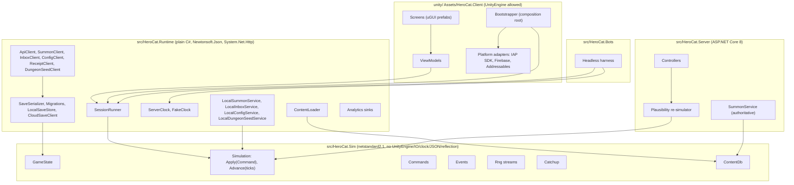
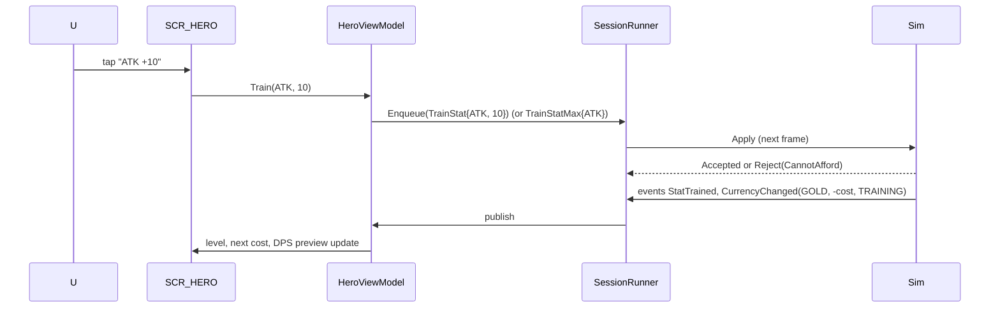
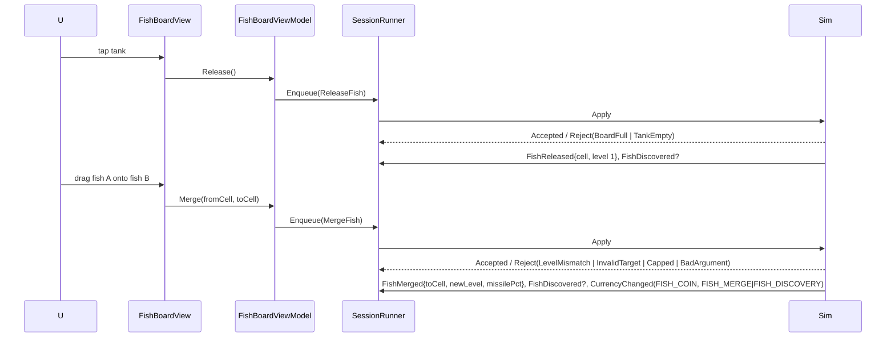

## 01 - Architecture and Data Flow

Fixes how the four assemblies (`HeroCat.Sim`, `HeroCat.Runtime`, Unity client, `HeroCat.Server`) depend on each other, the `Command -> Simulation -> Event` pipeline every feature goes through, the `SessionRunner` that drives ticks under mobile lifecycle, the threading and network rules, and a sequence diagram plus step list for every end-to-end flow in the game. Other specs describe what a feature does; this one describes which assembly does it, in what order, and what happens when the network or the OS interrupts it.

Tiers covered: M0, MVP, P1 (where a P1 flow changes a seam, it is marked).

Depends on: 00 (sections 3, 4, 8), 02 (save, clock, cloud save), 04 (summon result shape), 06 (offline catch-up, day key), 08 (API contracts).

## 1. Assemblies and dependency rules

### 1.1 Layer diagram



### 1.2 Dependency rules

| Rule | Enforced by |
|---|---|
| `HeroCat.Sim` references nothing but `netstandard2.1`. No `UnityEngine`, `System.IO`, `System.Net`, `Newtonsoft`, `System.Reflection`, `System.DateTime`/`DateTimeOffset.Now`, `Stopwatch`, `Math.Pow/Exp/Log`. | `HeroCat.Sim.csproj` has no package references; a CI source grep (10) fails the build on any of the banned identifiers. |
| `HeroCat.Runtime` references `HeroCat.Sim` and `Newtonsoft.Json`. No `UnityEngine`. | asmdef in Unity marks it `noEngineReferences: true`; the .NET csproj has no Unity reference. |
| `HeroCat.Client` references `HeroCat.Sim` and `HeroCat.Runtime` as local UPM packages (`com.herocat.sim`, `com.herocat.runtime` in `unity/HeroCatClient/Packages/manifest.json`, both `file:` references to `src/`). | Unity asmdef `references`. |
| Screens never reference `GameState` or `Simulation`. They reference a `ViewModel`. | asmdef split: `HeroCat.Client.Screens` references `HeroCat.Client.ViewModels` only; `ViewModels` references Runtime + Sim. |
| `HeroCat.Server` references `HeroCat.Sim` for `ContentDb`, rate tables and re-simulation. It never references `HeroCat.Runtime` (the server has its own persistence). | csproj. |
| `HeroCat.Bots` references `HeroCat.Sim` and `HeroCat.Runtime` (for `SessionRunner`, `FakeClock`, `LocalSummonService`). | csproj. |
| Server-sensitive operations go through the seven interfaces of 00 section 8.11 (`IClock`, `ISummonService`, `ISaveStore`, `IInboxService`, `IReceiptValidator`, `IConfigService`, `IDungeonSeedService`; issue #25). Interfaces live in `HeroCat.Runtime.Services`. Local and remote implementations live beside them. The sim never sees any of them. | Code review; `HeroCat.Sim` cannot reference `Runtime`, so the sim cannot see them by construction. |

The composition root (`Bootstrapper`, Unity `MonoBehaviour` on `SCR_BOOT`) picks implementations from a build-time `BackendMode`:

```csharp
public enum BackendMode { Local, Remote }   // Local = M0 and any build with no server configured

public static Services Build(BackendMode mode, string dataDir, ContentDb db, Simulation sim)
{
    if (mode == BackendMode.Local)
        return new Services
        {
            Clock    = new ServerClock(timeApi: null),               // serves device clock floored at last save; IsAuthoritative = false
            Summon   = new LocalSummonService(sim, db),              // same algorithm as the server (04, 08); reads state, never writes it
            Saves    = new LocalSaveStore(Path.Combine(dataDir, "saves")),
            Inbox    = new LocalInboxService(),                      // empty inbox, grants from tutorial only
            Receipts = new DisabledReceiptValidator(),
            Config   = new LocalConfigService(),                     // bundled content only
            Dungeons = new LocalDungeonSeedService(sim),             // peeks the next `dungeon` draw; StartDungeon consumes it (8.8)
        };
    var api = new ApiClient(opts.BaseUrl, tokenStore);
    return new Services
    {
        Clock    = new ServerClock(api),
        Summon   = new SummonClient(api, sim, db),
        Saves    = new CloudSaveClient(new LocalSaveStore(...), api, clock),
        Inbox    = new InboxClient(api),
        Receipts = new ReceiptClient(api),
        Config   = new ConfigClient(api, cacheDir),
        Dungeons = new DungeonSeedClient(api),                       // POST /v1/dungeon/seed
    };
}
```

## 2. The Command -> Simulation -> Event pipeline

### 2.1 Base types

```csharp
namespace HeroCat.Sim;

public abstract record Command
{
    public long IssuedAtTick { get; init; }      // Simulation.Tick at the moment of Apply; set by Simulation, not the caller
}

public abstract record Event
{
    public long Tick { get; init; }              // sim tick at emission
}

public enum RejectCode                           // category: picks the UI presentation (section 7)
{
    None, CannotAfford, InvalidTarget, Locked, Cooldown, Capped, AlreadyClaimed, NotOwned,
    SlotOccupied, BoardFull, TankEmpty, LevelMismatch, NotAvailable, RateLimited, BadArgument, StaleRequest
}

public readonly record struct ApplyResult(bool Ok, RejectCode Code, string? Reason)
{
    public static readonly ApplyResult Accepted = new(true, RejectCode.None, null);
    public static ApplyResult Reject(RejectCode c, string? reason = null) => new(false, c, reason);
}
```

A reject is two-level (issue #11): `Code` is the category from this enum, and `Reason` is a stable key from the owning spec's closed reason list (for example 06's `DUNGEON_FLOOR_NOT_UNLOCKED` under `Locked`, 03's `STAT_AT_CAP` under `Capped`), localized as `reject.<reason>`. 01 owns the type; each owning spec owns its reason list, and its tests assert both values.

Concrete commands (`VerbNoun`, 00 section 5.1) and the events they emit. Full field lists are in the owning spec; this table fixes the inventory and the owning assembly path.

| Command | Fields | Owner | Emits on success |
|---|---|---|---|
| `TrainStat` | `Stat stat, int count` (1/10/100) | 03 | `StatTrained`, `CurrencyChanged(GOLD, TRAINING)` |
| `TrainStatMax` | `Stat stat` | 03 | `StatTrained`, `CurrencyChanged(GOLD, TRAINING)` |
| `EquipWeapon` | `string weaponId` | 04 | `ItemEquipped` |
| `EquipSkill` | `string skillId, int slot` | 04 | `ItemEquipped` |
| `UnequipSkill` | `int slot` | 04 | `ItemEquipped` (slot cleared) |
| `EquipCompanion` | `string companionId, int slot` | 04 | `ItemEquipped` |
| `ApplySummonResult` | `SummonResultPayload payload` (the service output, 2.5) | 04 | `ItemAcquired` x N, `CurrencyChanged(..., SUMMON)`, `BannerLeveledUp?` |
| `ReleaseFish` | none | 05 | `FishReleased`, `FishDiscovered?` |
| `ReleaseMax` | none | 05 | one `FishReleased` per fish |
| `MergeFish` | `int fromCell, int toCell` | 05 | `FishMerged` (carries the missile size), `FishDiscovered?`, `CurrencyChanged(FISH_COIN)` |
| `MergeAll` | none | 05 | one `FishMerged` per merge |
| `TapZap` | `int count` | 03 | `TapZapped`; taps above `TAP_ZAP_MAX_PER_SEC` are dropped |
| `AttemptBoss` | none | 03 | `EnemySpawned` (the boss) |
| `SelectStage` | `int? stage` (<= highest cleared; null returns to the frontier) | 03 | `StageChanged` |
| `ClaimOfflineReward` | none | 06 | `OfflineRewardClaimed`, `CurrencyChanged(GOLD, OFFLINE)`, `CurrencyChanged(HERO_EXP, OFFLINE)` |
| `StartDungeon` | `Dungeon kind, int floor, ulong seed, bool localSeed` | 06 | `DungeonStarted` |
| `SweepDungeon` | `Dungeon kind` | 06 | `DungeonSwept`, `CurrencyChanged(..., DUNGEON)` |
| `ClaimQuest` | `string questId` | 06 | `QuestClaimed`, `CurrencyChanged(..., QUEST)` |
| `ClaimAllQuests` | `QuestKind kind` | 06 | one `QuestClaimed` per quest |
| `Awaken` | none | 03 | `Awakened`, `CurrencyChanged(ROCK_CANDY, AWAKENING)` |
| `Research` | `string nodeId` | 03 | `ResearchLeveled`, `CurrencyChanged(FISH_COIN, RESEARCH)` |
| `ApplyInboxGrant` | `InboxGrantPayload grant` | 06/08 | `CurrencyChanged(..., IAP or MAIL)`, `ItemAcquired?` |
| `ApplyServerTime` | `long serverSeconds` | 02/06 | `DayRolledOver?`, `WeekRolledOver?` (re-anchors the sim's virtual server clock, 3.1) |
| `ComputeOfflineCatchup` | `long nowServerSeconds` | 06 | `OfflineRewardComputed?` (stores or sums into `Offline.Pending`, stamps `LastTickServerTime`; 8.7) |
| `SetTutorialStep` | `int step` | 07 | `TutorialStepChanged` |

The other commands in 00 section 5.1 (`MoveFish`, `DiscardFish`, `LimitBreak`, `AutoEquipBest*`, `ClaimDailyGift`, `ExchangeItem`) follow the same rules; their rows live in the owning spec. `RetreatFromBoss` is not in MVP (issue #11): a boss attempt ends by kill or timer.

System commands (`ApplySummonResult`, `ApplyInboxGrant`, `ApplyServerTime`, `ComputeOfflineCatchup`) are issued by `HeroCat.Runtime`, never by a screen. They exist so that a server result, a clock re-anchor or an offline catch-up enters the sim through the same validated door as a tap, which is what lets the re-simulator replay a command log that includes them. No Runtime code writes `GameState` directly (issue #6).

### 2.2 `Simulation` surface

```csharp
public sealed class Simulation
{
    public GameState State { get; }               // read by Runtime for saving; screens never see it
    public ContentDb Db { get; }
    public long Tick => State.Time.Tick;

    public Simulation(GameState state, ContentDb db);

    public ApplyResult Apply(Command cmd);        // validate -> mutate -> emit. Never throws for player input.
    public void Advance(int ticks);               // runs Tick() `ticks` times. 03 owns the body.
    public IReadOnlyList<Event> DrainEvents();    // moves the buffer out; caller owns the list
    public Snapshot GetSnapshot();                // 2.4; allocation-free after warm-up
}
```

Rules:

1. `Apply` is the only mutation entry point besides `Advance`, including for offline catch-up and the summon debit (issue #6). Every branch of `Apply` either returns a reject with no state change, or mutates and emits. A reject never emits an `Event`; the caller reports it through the UI (section 7).
2. Validation is total: `Apply` on a command with an unknown id, a negative slot, or a stage past `STAGE_CAP` returns `BadArgument`, it never throws. Throwing is reserved for programmer errors (null command, `ContentDb` missing a table), which are bugs and should crash in development.
3. `Apply` is synchronous and completes within one tick. An intent that needs the server (00's `Summon(banner, count, payment, requestId)`) is never passed to `Apply`; it is a `Runtime` flow (`SummonFlow`, 8.5) that ends with a system command.
4. Commands, system commands included, are recorded in the command log (2.6) before they are applied so the log can be replayed.

### 2.3 Event buffering

`Simulation` appends to a `List<Event>` with capacity `EVENT_BUFFER_MAX = 4096`. If a single `Advance` exceeds it (a 10 s catch-up at `MAX_TICKS_PER_FRAME` on a high-DPS hero can kill a few hundred mobs), the sim coalesces per tick: repeated `EnemyKilled` and `CurrencyChanged(KILL)` in the same `Advance` call are summed into `EnemyKilledBatch(count, goldTotal, expTotal, fromStage, toStage)` once the buffer passes `EVENT_COALESCE_AT = 1024`. Coalescing is deterministic (it depends only on counts) and the bot harness turns it on permanently to keep memory flat.

`SessionRunner` drains the buffer once per frame after ticking and dispatches to the `EventBus`:

```csharp
public sealed class EventBus
{
    readonly Dictionary<Type, List<Delegate>> subs = new();
    public IDisposable Subscribe<T>(Action<T> handler) where T : Event;
    public void Publish(IReadOnlyList<Event> events);   // main thread only; handlers must not call Apply re-entrantly (they queue a command instead)
}
```

Handlers run in subscription order on the main thread. A handler that wants to issue a command calls `runner.Enqueue(cmd)`, which is applied at the start of the next frame, so event handling never nests a mutation inside a drain.

### 2.4 Snapshot for HUD polling

00 section 8.8 allows the combat viewport and HUD counters to poll. They poll a struct the sim refreshes once per tick, not `GameState`:

```csharp
public readonly struct Snapshot
{
    public long   Tick;
    public int    Stage, KillsInStage, Chapter;
    public BossPhase BossPhase; public int BossTicksLeft;   // 02 `Combat.BossPhase` (None/Pending/Walled), issue #7
    public double EnemyHp, EnemyHpMax;
    public double HeroDps;                      // the 00 section 7 formula evaluated this tick
    public double Gold, Diamonds, FishCoin, RockCandy, HeroExp, HeroExpToNext;
    public int    HeroLevel, AwakenRank;
    public double Mp, MpMax;
    public int    TankFish, TankCap; public int TankRefillTicksLeft;
    public int    PendingInboxCount;             // set by Runtime, not sim; see 2.7
    public ReadOnlySpan<DamageNumber> DamageNumbersThisTick => ...;   // up to DMG_NUMBERS_PER_TICK_MAX = 16
}
```

The snapshot is a value copy taken at the end of each `Advance`; between ticks it does not change, so a 60 fps HUD reads the same struct six times per tick and that is fine. Nothing in the snapshot is a reference into `GameState`.

### 2.5 Result payloads from services

Services (summon, inbox, dungeon seed) return payloads that become system commands. The shapes are fixed here so 04, 06 and 08 agree:

```csharp
public sealed record SummonResultPayload(
    string RequestId,                 // client-generated GUID "N" format, 32 hex chars
    Banner Banner,
    int    Count,                     // 1 or 10
    SummonPull[] Pulls,               // length == Count
    int    PityAfter,                 // pulls since last L+ after this batch
    int    BannerLevelAfter, int BannerExpAfter,
    CurrencyDelta[] Debits,           // what the pull costs: DIAMOND or a ticket; ApplySummonResult performs the debit
    CurrencyDelta[]? BalancesAfter,   // Remote: the server's balances for the debited currencies; null in Local
    long?  StreamCounterAfter,        // Local: summon_<banner>.Counter after the pull; null in Remote
    long   ServerTimeSec);

public sealed record SummonPull(string ItemId, Rarity Rarity, bool IsNew, int LevelBefore, int LevelAfter,
    int CopiesAfter,                  // capped at 160 (04 section 5.3)
    long OverflowRockCandy,           // Rock Candy from a copy past the cap, else 0
    bool GuaranteeApplied);

public sealed record InboxGrantPayload(string InboxItemId, GrantLine[] Lines, CurrencyReason Reason);   // Reason in {IAP, MAIL, REFUND, ADMIN}
public sealed record GrantLine(string Kind, string Id, long Amount);   // Kind: "currency" | "item"
```

This payload is the only summon contract (issue #13); 04 and 08 use it. `ApplySummonResult` is the only summon mutator in both modes (issue #6): it adds items and Rock Candy overflow, sets pity and banner level/EXP, and performs the debit. In Local mode it rejects `CannotAfford` if `Debits` are not covered, subtracts them, and sets `summon_<banner>.Counter = StreamCounterAfter` (so 00 contract 2's `Counter == 3 * TotalPulls` holds and a replay of the logged command is exact). In Remote mode it applies `Debits`, then replaces those balances with `BalancesAfter`, because the server ledger wins (00 section 4); if the local result disagreed it emits the `summon_reconciled` analytics event.

### 2.6 Command log

`HeroCat.Runtime.CommandLog` appends every applied command, system commands included, as one JSONL line `{tick, type, fields...}` to `saves/cmdlog.jsonl`, rotating at `CMDLOG_MAX_BYTES = 1 MiB` (oldest dropped). It is uploaded with the save in MVP (02 section 7) only when the server asks for it (08 anti-cheat spot check), never routinely. The bot harness keeps it in memory and uses it for the golden-file determinism test (10); the golden command log uses the same JSONL format, so one parser serves runtime upload, server re-simulation and golden replay (issue #28).

### 2.7 What is not in the sim

`PendingInboxCount`, network state, download progress, and the tutorial's "has seen screen X" flags are Runtime or client state. They are injected into the snapshot or view-models by Runtime after the sim produced its snapshot. The rule: if the server or the OS is the source of truth for a value, it is not in `GameState`.

## 3. `SessionRunner`

### 3.1 Responsibilities

Lives in `HeroCat.Runtime`. Owns one `Simulation`, drives ticks from a monotonic clock, applies lifecycle transitions, schedules autosaves, and drains events. The Unity side forwards four callbacks and nothing else. Every command, player or system, goes through `Issue`, so the command log holds exactly what was applied.

Server time reaches the sim only through logged `ApplyServerTime` commands at sync points: boot, resume, gap recovery and every `WALL_CLOCK_SYNC_SEC = 60` of foreground time (issue #5). Between them the sim advances a virtual server clock with its ticks (`anchor + (Tick - anchorTick) / TICK_HZ`), so a day rollover happens on a tick and is a pure function of the logged inputs (06).

```csharp
public sealed class SessionRunner
{
    readonly Simulation sim; readonly Services svc; readonly EventBus bus; readonly CommandLog log;
    readonly double tickDt;                   // 1.0 / TICK_HZ
    double acc; long lastMono; long lastSaveMono; long lastClockSyncMono; bool dirty; int saveFailures;
    readonly Queue<Command> pending = new();

    public SessionRunner(Simulation sim, Services svc, EventBus bus, CommandLog log);

    public void Enqueue(Command c) => pending.Enqueue(c);

    public void OnFrame()
    {
        long mono = MonoClock.Ticks();  double dt = (mono - lastMono) / (double)MonoClock.Frequency;  lastMono = mono;

        if (dt > IN_APP_GAP_SEC) { ResumeFromGap(); acc = 0; return; }    // frozen without a pause callback (debugger, OS freeze)

        while (pending.Count > 0) Issue(pending.Dequeue());

        acc = Math.Min(acc + dt, IN_APP_GAP_SEC);
        int n = 0;
        while (acc >= tickDt && n < MAX_TICKS_PER_FRAME) { sim.Advance(1); acc -= tickDt; n++; }
        if (n > 0) dirty = true;

        if ((mono - lastClockSyncMono) / (double)MonoClock.Frequency >= WALL_CLOCK_SYNC_SEC)
        {   // re-anchor the sim's virtual server clock; between syncs the sim derives server time from ticks (issue #5)
            Issue(new ApplyServerTime(svc.Clock.NowServerSeconds)); lastClockSyncMono = mono;
        }
        bus.Publish(sim.DrainEvents());

        if (dirty && (mono - lastSaveMono) / (double)MonoClock.Frequency >= AUTOSAVE_INTERVAL_SEC) SaveNow(SaveTrigger.Periodic);
    }

    public void OnPause()  { SaveNow(SaveTrigger.Pause); svc.Analytics.Flush(); }
    public void OnResume() { ResumeFromGap(); }
    public void OnQuit()   { SaveNow(SaveTrigger.Quit);  svc.Analytics.Flush(); }

    void Issue(Command c)                                              // the one path into the sim: log, then apply
    {
        log.Append(c); var r = sim.Apply(c); if (!r.Ok) bus.PublishReject(c, r);
    }

    void ResumeFromGap()
    {
        _ = svc.Clock.SyncAsync();                                     // fire and forget; the result lands on a later frame
        long now = svc.Clock.NowServerSeconds;
        Issue(new ApplyServerTime(now));                               // re-anchor; day/week rollover first
        Issue(new ComputeOfflineCatchup(now));                         // 06 algorithm inside Apply; stores or sums into Offline.Pending
                                                                       // and stamps LastTickServerTime; does NOT credit yet (8.7)
        bus.Publish(sim.DrainEvents());
        SaveNow(SaveTrigger.Resume);
        lastMono = MonoClock.Ticks(); lastClockSyncMono = lastMono;
    }

    void SaveNow(SaveTrigger t)
    {
        try { svc.Saves.Save(sim.State, t); dirty = false; saveFailures = 0; lastSaveMono = MonoClock.Ticks(); }
        catch (SaveWriteException) { if (++saveFailures == SAVE_FAIL_WARN_COUNT) bus.PublishSystem(new SaveWriteFailed(saveFailures)); }
    }
}
```

### 3.2 Tick budget

| Constant | Value | Meaning |
|---|---|---|
| `MAX_TICKS_PER_FRAME` | 100 | At most 10 s of sim per frame. A 25 s hitch is caught up over 3 frames. |
| `IN_APP_GAP_SEC` | 30 | A frame gap above this is treated as an offline interval and goes through `Catchup`, not ticks. |
| `AUTOSAVE_INTERVAL_SEC` | 30 | Periodic save while dirty. |
| `WALL_CLOCK_SYNC_SEC` | 60 | Foreground cadence of the logged `ApplyServerTime` re-anchor (3.1). |
| `TICK_BUDGET_MS` | 8 | Soft budget: if the tick loop has already used this much wall time this frame, stop at the current `n` even below `MAX_TICKS_PER_FRAME`. Keeps 30 fps on 2 GB devices during catch-up bursts. The remainder stays in `acc`. |

Tick cost target: one `Advance(1)` under 0.1 ms on a 2019 mid-range Android (Snapdragon 665 class) with zero GC allocation (10 perf budget). The fish board, skills and companions all run inside the same tick.

### 3.3 Lifecycle mapping

| Platform event | iOS | Android | Runner call |
|---|---|---|---|
| App goes to background | `applicationDidEnterBackground` -> Unity `OnApplicationPause(true)` | `onPause`/`onStop` -> `OnApplicationPause(true)` | `OnPause()` |
| App returns | `applicationWillEnterForeground` -> `OnApplicationPause(false)` | `onResume` -> `OnApplicationPause(false)` | `OnResume()` |
| App killed by user or OS | No callback guaranteed | No callback guaranteed | None. Last save stands (at most `AUTOSAVE_INTERVAL_SEC` lost, 02 section 5). |
| App quit via back button (Android) | n/a | `OnApplicationQuit` | `OnQuit()` |
| Low memory | `didReceiveMemoryWarning` -> `Application.lowMemory` | `onTrimMemory` -> `Application.lowMemory` | `SaveNow(Pause)` then client unloads Addressables for non-visible screens. |
| Focus lost but visible (split screen, notification shade, incoming call) | `OnApplicationFocus(false)` | `OnApplicationFocus(false)` | Nothing. Ticks continue. The sim keeps running while visible. |
| Screen locked | `OnApplicationPause(true)` | `OnApplicationPause(true)` | `OnPause()` |

Unity's `OnApplicationPause(true)` runs before the process is suspended; the save must complete synchronously inside it (02 section 5). Budget: under 50 ms for serialize + write of a 20-40 KB save.

The client requests `Screen.sleepTimeout = NeverSleep` while on `SCR_MAIN` (idle-on-desk mode, 00 pillar 1) and `SystemSetting` elsewhere.

## 4. Threading model

| Work | Thread | Why |
|---|---|---|
| `Simulation.Apply`, `Advance`, `DrainEvents`, `GetSnapshot` | Unity main thread only | The sim is not thread-safe and does not need to be; a tick is well under a millisecond. |
| `EventBus.Publish`, view-model updates, uGUI | Main thread | Unity requirement. |
| Save serialize (`SaveSerializer.Encode`) | Main thread | It is the snapshot; must see a consistent state. ~2 ms for 40 KB. |
| Save file write (`LocalSaveStore`) | Main thread on `Pause`/`Quit` (must finish before suspension); otherwise main thread too in MVP | Measured under 10 ms on flash; not worth a worker until profiling says so. |
| HTTP (`ApiClient`) | `async`/`await` on the thread pool via `HttpClient`; continuations marshalled back to main thread by Unity's `SynchronizationContext` | IO never blocks a frame. |
| Cloud save upload | Thread pool; reads an already-encoded `byte[]`, never `GameState` | No shared mutable state crosses threads. |
| Content bundle download and hash check | Thread pool, then an atomic swap on main thread at a safe point (section 8.12) | |
| Analytics sink | Main thread enqueue, thread-pool flush | |
| Bot harness | One thread per bot, each with its own `Simulation` and `FakeClock` | Sim instances share nothing but the immutable `ContentDb`. |

Rule: nothing off the main thread holds a reference to `GameState` or `Simulation`. Background work receives copies (`byte[]`, records) and returns results that are turned into commands on the main thread.

`ContentDb` is immutable after construction and may be read from any thread.

## 5. Network layer

### 5.1 `ApiClient`

```csharp
public sealed class ApiClient
{
    readonly HttpClient http;             // one instance per process; base address https://api.<env>.whiskerhero.example
    readonly ITokenStore tokens;          // access + refresh JWT in platform secure storage (Keychain / EncryptedSharedPreferences)
    readonly string clientVersion;        // "1.4.2+318" semver + build number
    readonly string contentVersion;       // active ContentDb version

    public Task<ApiResponse<T>> SendAsync<T>(ApiRequest req, CancellationToken ct);
}

public sealed record ApiRequest(HttpMethod Method, string Path, object? Body, bool Idempotent, string? RequestId = null, bool RequiresAuth = true);

public sealed record ApiResponse<T>(bool Ok, int Status, T? Body, ApiError? Error, long ServerTimeSec);
public sealed record ApiError(string Code, string Message, string? RetryAfter);
```

Headers on every request:

| Header | Value |
|---|---|
| `Authorization` | `Bearer <accessJwt>` when `RequiresAuth` |
| `X-Request-Id` | the client-generated `requestId` for mutating requests (00 section 8.13); a fresh GUID for reads (tracing only) |
| `X-Client-Version` | `1.4.2+318` |
| `X-Content-Version` | `2026.11.03` |
| `X-Device-Id` | install GUID (02) |
| `Accept-Language` | device locale |

Every response carries `X-Server-Time` (unix seconds). `ApiClient` forwards it to `ServerClock.Observe(serverTime, rttMs)` so the clock resyncs on every call for free.

### 5.2 Retry and backoff

| Condition | Action |
|---|---|
| No connectivity (DNS failure, `HttpRequestException`) | `Offline`. Retry only if `Idempotent`. |
| Timeout (`HTTP_TIMEOUT_S = 10`) | `Timeout`. Retry only if `Idempotent`. |
| 401 | Refresh token once (`POST /v1/auth/refresh`), replay the request once. A second 401 -> `AuthExpired`, go to `SCR_TITLE`. |
| 408, 425, 429, 502, 503, 504 | Retryable. Honour `Retry-After` if present, else backoff schedule. |
| 500 | Retryable once, then `ServerError`. |
| Other 4xx | `Rejected` with the body's `code`. Never retried. |
| 409 on cloud save | `Conflict` (02 section 7). |

Backoff: `HTTP_RETRY_BASE_MS = 1000`, doubling, full jitter (`delay = random(0, min(HTTP_RETRY_CAP_MS = 8000, base * 2^attempt))`), `HTTP_RETRY_MAX = 4` attempts. Total worst case about 15 s, which is also the summon "pending" threshold (section 8.5).

A mutating request is retried **only with the same `requestId`**. The server replays the stored result (00 section 8.13), so a retry after a timeout can never double-charge. The client treats a replayed 200 identically to a first 200.

### 5.3 Connectivity state

`NetworkMonitor` (client, wraps `Application.internetReachability` plus the last `ApiClient` outcome) publishes `ConnectivityChanged(online: bool)`. Screens use it to grey out server-only buttons (summon in Remote mode, shop, inbox refresh) with the `NET_OFFLINE` message. It is advisory: the real test is the request.

## 6. Offline-mode rules (what works without network)

| Area | Local mode (M0) | Remote mode, offline (MVP) | Rule |
|---|---|---|---|
| Combat, stages, training, hero level, awakening, research, fish board, tap zap | Works | Works | Client-authoritative (00 section 4). |
| Offline catch-up, day rollover | Works on device clock floored at last save | Works on `ServerClock` extrapolated from last sync; `IsAuthoritative = false` | Bounded loss, reconciled by cloud save. |
| Save | Local | Local; upload queued | A save never fails because the network did. |
| Load | Local | Local after `CLOUD_FETCH_TIMEOUT_S = 5`; conflict check deferred | Bounded boot time. |
| Summon | Works (local service) | **Blocked.** Button shows `SUMMON_NEEDS_NET`. A pending request resolves on reconnect. | Server holds the roll. No pre-issued results. |
| Quest progress | Works | Works | Local counters. |
| Quest claim (diamonds) | Works | Works; diamonds credited locally, reconciled on next save upload | Diamonds from quests are bounded per day (`DIAMONDS_PER_DAY_F2P`); the server re-derives the cap. |
| Dungeon run | Works (local seed from the `dungeon` stream) | **Blocked** for a new run (needs server seed). Sweep works if the floor was already cleared. | 00 section 4: server-issued seed in MVP. |
| Shop, IAP, inbox claim | Not available | **Blocked** with `NET_OFFLINE` | Server ledger. |
| Remote config / content | Bundled | Last cached, else bundled | Content is always available. |
| Login | Guest auto-created locally | Cached JWT; if expired, play offline as the cached account, re-auth on reconnect | Never lock a player out of their own device's save. |

## 7. Error taxonomy shown to the user

Every user-visible failure maps to one of these classes. The class picks the presentation; the `code` picks the localization key.

| Class | Presentation | Examples (`code`) | Retry |
|---|---|---|---|
| `Reject` (sim) | Inline: button shake + short toast under the button | `CannotAfford`, `BoardFull`, `TankEmpty`, `Cooldown`, `Locked`, `AlreadyClaimed` | Not applicable; the player changes something. |
| `Offline` | Non-blocking banner at the top of the screen, auto-hides on reconnect | `NET_OFFLINE` | Automatic. |
| `Timeout` / `ServerError` | Toast "Could not reach the server. Retrying..." then modal after retries exhausted with Retry / Later | `NET_TIMEOUT`, `SRV_5XX` | Button. |
| `Rejected` (server 4xx) | Modal with a specific message | `SUMMON_INSUFFICIENT_FUNDS`, `IAP_RECEIPT_INVALID`, `AUTH_ACCOUNT_LINKED_ELSEWHERE`, `CLIENT_TOO_OLD` | Depends; `CLIENT_TOO_OLD` has only "Update". |
| `Conflict` | Dedicated conflict modal (02 section 7.4) | `SAVE_CONFLICT` | Player chooses. |
| `Maintenance` | Full-screen block on `SCR_BOOT`/`SCR_TITLE` with the message from config and an ETA | `MAINTENANCE` | Automatic poll every `MAINT_POLL_S = 60`. |
| `Fatal` | Full-screen with support id; app cannot continue | `SAVE_TOO_NEW`, `CONTENT_CORRUPT`, `SAVE_CORRUPT_ALL` | Reinstall / contact support. |

Rules: never two modals at once (07); a `Reject` never produces a modal; a reject code is never shown raw, always through its key (`reject.<reason>`, 2.1); every modal has a support id (`sessionId` prefix + minute) in small print so a screenshot is actionable.

## 8. End-to-end flows

Each flow: a mermaid sequence diagram, then the numbered steps with assembly and failure handling. Participants: `U` player, `S` screen, `VM` view-model, `R` SessionRunner, `Sim`, `RT` other Runtime pieces (saves, clock, clients), `API` server.

### 8.1 Cold boot

```mermaid
sequenceDiagram
    participant U
    participant Boot as SCR_BOOT
    participant RT as Runtime
    participant API
    participant Sim
    participant Main as SCR_MAIN
    Boot->>RT: ContentLoader.LoadBundled()
    RT->>API: GET /v1/config (3 s timeout)
    API-->>RT: config {minClientVersion, contentVersion, maintenance, killSwitches}
    RT->>RT: compare content version; schedule download if newer
    RT->>API: POST /v1/auth/guest or /v1/auth/refresh
    API-->>RT: {accessJwt, refreshJwt, playerId, serverTime}
    RT->>RT: ServerClock.Observe
    RT->>RT: LocalSaveStore.Load + CloudSaveClient.Fetch (5 s)
    RT->>RT: pick save (02 conflict rules) / migrate / validate
    RT->>Sim: new Simulation(state, db)
    RT->>Sim: Apply ApplyServerTime(now), ComputeOfflineCatchup(now)
    RT->>Boot: ready(pendingOffline?)
    Boot->>Main: show SCR_MAIN
    Main->>Main: if Offline.Pending -> open SCR_OFFLINE_REWARD
```

Steps:

1. **Content load** (Runtime `ContentLoader`): read `StreamingAssets/content/manifest.json`, verify each table's hash, parse into DTOs, hand DTOs to `ContentDb.Build(dtos)` (sim). If a cached newer bundle exists in `persistentDataPath/content/<version>/` and its manifest hash verifies, use it instead. Failure of both -> `Fatal CONTENT_CORRUPT`. Target under 300 ms.
2. **Config fetch** (`ConfigClient`): `GET /v1/config` with `CONFIG_FETCH_TIMEOUT_S = 3`. On success: if `minClientVersion > clientVersion` -> `CLIENT_TOO_OLD` block with store link; if `maintenance.active` -> `Maintenance` block; store kill switches; if `contentVersion` newer than loaded -> start background download (8.12). On timeout/offline: use cached config if under `CONFIG_CACHE_MAX_AGE_S = 86400`, else defaults (everything enabled, no gate). Local mode skips this step.
3. **Auth** (`AuthClient`): if a refresh token exists, `POST /v1/auth/refresh`; else if no account at all, `POST /v1/auth/guest` with the device id. Store tokens in secure storage. On offline: continue with cached `playerId` if any; else create a local guest profile with `playerId = null` and link it on first successful connection (08 section 3). First `X-Server-Time` observation makes `ServerClock.IsAuthoritative = true`.
4. **Save load** (`CloudSaveClient.LoadAsync`): local load per 02 section 6 in parallel with `GET /v1/save/meta` (5 s). Resolve per 02 section 7.3; a `Conflict` result shows the conflict modal before `SCR_MAIN`. No save anywhere -> `GameState.NewProfile(playerId, now)` with `TUTORIAL_DIAMONDS` granted via `Wallet.Apply(+1500 DIAMOND, TUTORIAL)`, tutorial step 0.
5. **Offline catch-up**: issue the logged system commands `ApplyServerTime(now)` (day/week rollover first, so a new day's quests exist before anything is credited), then `ComputeOfflineCatchup(now)`, which runs `Catchup.Compute` inside `Apply`, stores or sums the result into `state.Offline.Pending` and stamps `LastTickServerTime = now` (8.7; issue #6). Save immediately.
6. **Main screen**: `SCR_BOOT` hands over to `SCR_MAIN`; `SCR_MAIN` opens `SCR_OFFLINE_REWARD` if `Offline.Pending != null`, then the tutorial overlay if `Tutorial.Step < TUTORIAL_DONE`. Ticks start on the first `OnFrame` after `SCR_MAIN` is shown (not during the modal, so the modal's numbers are exactly what gets credited).

Boot target: under 4 s to `SCR_MAIN` on the reference low device with warm cache (10). Failures in steps 2-4 degrade per section 6; only step 1 is fatal.

### 8.2 Warm resume from background

```mermaid
sequenceDiagram
    participant OS
    participant R as SessionRunner
    participant RT as Runtime
    participant Sim
    participant Main as SCR_MAIN
    OS->>R: OnApplicationPause(false)
    R->>RT: Clock.SyncAsync() (async)
    R->>Sim: ApplyServerTime(clock.Now)
    R->>Sim: ComputeOfflineCatchup(clock.Now) -> Offline.Pending if >= OFFLINE_MIN_S
    R->>RT: Saves.Save(Resume)
    R->>Main: publish events (DayRolledOver?, OfflinePending)
    Main->>Main: open SCR_OFFLINE_REWARD if pending
    RT-->>R: clock sync lands (later frame); ServerClock adjusts offset
```

1. `ResumeFromGap` runs synchronously inside the callback using the extrapolated server time (monotonic offset from the last sync, 02 section 8). The sync request is fired but not awaited.
2. If the sync later reports a server time that differs from the extrapolation by more than `CLOCK_JUMP_WARN_SEC = 300`, emit `clock_anomaly` and, if the real elapsed time was *longer*, credit the difference as a second catch-up window (`ApplyServerTime` then `ComputeOfflineCatchup` with the corrected now; it sums into the pending record and the effective cap applies to the sum, 8.7). If shorter, nothing is taken back (the discrepancy is bounded by the cap and logged).
3. Pending summon or IAP intents in `state.Pending` are resolved (8.5, 8.9) after the offline modal closes.
4. Cloud save: `CloudSaveClient` fetches `GET /v1/save/meta`; if the server's `saveSeq` is ahead of local and from another device -> conflict modal (02 section 7.4), otherwise nothing. This is the only time a conflict is detected mid-session.

### 8.3 Tick loop (kill -> loot -> wallet -> events -> view-model)

```mermaid
sequenceDiagram
    participant R as SessionRunner
    participant Sim
    participant Bus as EventBus
    participant VM as ViewModels
    participant HUD
    R->>Sim: Advance(1) x n (n <= MAX_TICKS_PER_FRAME)
    Note over Sim: hero attack, skills, companions, fish missiles, tap zap -> enemy HP
    Note over Sim: enemy HP <= 0: Loot.Roll(loot stream, boss only) -> Wallet.Apply(GOLD, KILL), Wallet.Apply(HERO_EXP, KILL)
    Note over Sim: KillsInStage++ ; == KILLS_PER_STAGE -> StageCleared, Stage++
    Note over Sim: emit EnemyKilled, CurrencyChanged, StageCleared, LevelUp
    R->>Sim: DrainEvents()
    R->>Bus: Publish(events)
    Bus->>VM: handlers update bound fields
    HUD->>Sim: GetSnapshot() (per frame, read-only)
```

Per tick, in this order (03 owns the bodies):

1. `Time.Tick++`; the virtual server clock advances with it and `EnsureDay` runs on the tick that crosses a day key (8.11). Boss timer decrement while a boss fight is on.
2. Spawn: if no enemy and `SpawnDelayLeft == 0`, spawn for `Stage` (`HP0 * HP_G^Stage` by table lookup, x `BOSS_HP_MULT` for a boss).
3. Damage sources, fixed order: hero auto-attack (every `ATTACK_INTERVAL_TICKS` scaled by `ATK_SPD`), skill auto-casts, companion abilities (MP check), queued fish missiles, queued tap zaps (capped). Draws follow 03's fixed order so stream counters advance deterministically regardless of frame rate: one `crit` draw per hero hit (`crit.Counter == Stats.HeroHits`); `combat` is reserved and takes no draws in MVP (issue #8).
4. Death: on a boss kill only, one `loot` draw (boss Rock Candy chance; `loot.Counter == Stats.BossKills`, issue #8); then `Wallet.Apply(GOLD, KILL)`, `Wallet.Apply(HERO_EXP, KILL)`, quest counters (`defeat monsters`), `KillsInStage++`.
5. Stage advance / boss resolution; `StageCleared` carries `firstClear` and the diamond grant (reason `FIRST_CLEAR`) when `Stage % BOSS_EVERY == 0`.
6. Magic Tank refill tick (05); passive `FISH_BOARD_DPS_PCT` is recomputed only when the board changes, not per tick.
7. Snapshot refresh.

Events coalesce above `EVENT_COALESCE_AT` (2.3). View-models update bound fields; screens re-render through their binding layer (07). The HUD reads the snapshot directly.

### 8.4 Training purchase



1. The button label shows the bulk cost: `sum_{i=n}^{n+k-1} TRAIN_COST0 * TRAIN_COST_G^i`, computed by the view-model from `ContentDb` curves (repeated multiplication, 00 section 8.1), and greys out when `Gold < cost` for 1 step. "Max" shows the largest `k` affordable, computed by the same walk.
2. `TrainStat` validation: stat exists; `count >= 1`; current level + count <= `TRAIN_CAP[stat]` (03) else `Capped`; affordable else `CannotAfford` (03's reasons in `Reason`). `TrainStatMax` buys the largest affordable count, clamped at the cap. Partial purchase is never applied: "x100" with gold for 37 is a reject, "Max" buys 37.
3. Mutation: `Wallet.Apply(-cost, TRAINING)`, `Training.Level[stat] += count`, DPS cache invalidated. Emits `StatTrained(stat, from, to, cost)` and the `CurrencyChanged`.
4. Analytics: `currency_changed` (06/02 schema) with `reason = TRAINING`; one `training` event per command, not per level.
5. Failure UX: `CannotAfford` is an inline shake; it should be rare because the button was grey. A race (gold spent on another screen in the same frame) is the only path.

Worked number: ATK level 120 -> 130: `50 * 1.07^120 * (1.07^10 - 1) / 0.07 = 50 * 3339.4 * 13.816 = 2,307,000` gold (2.31M).

### 8.5 Summon

#### 8.5.1 M0 local path

```mermaid
sequenceDiagram
    participant U
    participant S as SCR_SUMMON
    participant F as SummonFlow (Runtime)
    participant L as LocalSummonService
    participant Sim
    participant RS as SCR_SUMMON_RESULT
    U->>S: tap "10x Weapon"
    S->>F: Summon(WEAPON, 10)
    F->>F: requestId = Guid; state.Pending.Summon = {requestId, WEAPON, 10}; Save
    F->>L: PullAsync(req)
    L->>Sim: read wallet/pity/bannerLevel/stream; roll on a clone (04); no write
    L-->>F: SummonResultPayload (Debits, StreamCounterAfter)
    F->>Sim: Apply(ApplySummonResult(payload)): debit, items, pity, stream counter
    F->>F: state.Pending.Summon = null; Save
    F->>RS: show reveal
```

1. `SCR_SUMMON` shows cost (`PULL_COST[banner] * count` diamonds, or a ticket if `TICKET_SUMMON_<banner> >= count`; tickets are spent first, 06), pity progress (`pity / PITY_HARD`), banner level and the rate table for the current level. The button is disabled when neither tickets nor diamonds cover the cost.
2. `SummonFlow.Summon` (Runtime): refuse if `state.Pending.Summon != null` (one in flight). Generate `requestId`, persist the intent in `state.Pending.Summon`, save synchronously. The intent is on disk before any roll.
3. `LocalSummonService.PullAsync`: checks affordability before drawing, then runs the 04 pull algorithm on cloned banner, collection and `summon_<banner>` stream state (M0 only; 00 section 8.2) and returns the payload with `Debits` and `StreamCounterAfter`. It reads `GameState` but never writes it (issues #6, #13). Completes synchronously inside a finished `Task`.
4. `Apply(ApplySummonResult)` (logged like any command): debits `Wallet.Apply(-cost, SUMMON)`, adds items (dupe -> level per `DUPE_LVL_CUM`, copies past the cap -> Rock Candy), sets pity, banner level/EXP and the stream counter (2.5), emits `ItemAcquired` x N and `CurrencyChanged`, bumps quest counters (`summon weapon`). Clears pending, saves. Reveal opens.
5. Kill mid-flow: either the save with the pending intent exists and nothing was charged (step 4 not reached; the local service is pure, so it re-runs on resume from the same state and stream counter), or the post-apply save exists. The local service keeps a one-deep replay cache keyed by `requestId` for the in-process case.

#### 8.5.2 MVP server path

```mermaid
sequenceDiagram
    participant U
    participant S as SCR_SUMMON
    participant F as SummonFlow
    participant C as SummonClient
    participant API as POST /v1/summon/pull
    participant Sim
    participant RS as SCR_SUMMON_RESULT
    U->>S: tap "10x Weapon"
    S->>F: Summon(WEAPON, 10)
    F->>F: Pending.Summon = {requestId,...}; Save
    F->>RS: open pre-roll (SUMMON_PREROLL_MS)
    F->>C: PullAsync(req)
    C->>API: {requestId, banner, count, payment, clientContentVersion}
    alt 200
        API-->>C: payload + balances + serverTime
        C->>Sim: Apply(ApplySummonResult)
        F->>F: Pending = null; Save
        F->>RS: reveal
    else retryable (timeout/5xx/offline)
        C->>API: retry same requestId (backoff, up to HTTP_RETRY_MAX)
        API-->>C: replayed or fresh 200
    else 4xx Rejected
        API-->>C: {code}
        C->>F: Pending = null (nothing charged); Save
        F->>RS: close; show modal(code)
    end
```

1. Steps 1-2 as M0. Payment quote: the client sends `payment: "DIAMOND" | "TICKET"` per the 06 priority rule; the server rejects a mismatch with `409 PAYMENT_MISMATCH` (client refreshes balances and re-quotes, no charge).
2. `SummonClient.PullAsync` -> `POST /v1/summon/pull` (08 section 4). The reveal overlay opens immediately with the pre-roll loop (`SUMMON_PREROLL_MS = 800`). A result inside that window feels instant.
3. On 200: `Apply(ApplySummonResult)` with the server's items, pity, banner level and **balances** (`BalancesAfter` replace the local values, 2.5). Clear pending, save, reveal.
4. On retryable failure: retry with the same `requestId` per 5.2. After `SUMMON_SLOW_MS = 3000` the overlay adds "Taking longer than usual". After retries are exhausted (about 15 s): close the overlay, show toast `SUMMON_PENDING_SAVED` ("Your summon is saved and will be revealed when you are back online"), the button becomes "Pending..." and calls `Resolve()`.
5. `Resolve()`: at boot/resume or on the pending button, re-send with the saved `requestId`. The server either replays the stored result (it completed) or executes it (it never arrived). Both are a 200 and are applied identically.
6. On 4xx: `INSUFFICIENT_FUNDS` (balances drifted) -> refresh balances, clear pending, modal; `BANNER_CLOSED` -> clear pending, modal; `CLIENT_TOO_OLD` -> update block. Nothing was charged, so nothing to undo.
7. Rules for the UI: never offer a second summon while one is pending; never show "Failed" without having asked the server by replay; balances display `diamonds - cost` provisionally while pending and snap to the server value on 200.
8. Analytics `summon` event emitted on apply (04 schema), `summon_pending` when the pending path is entered, `summon_resolved` with `latencySec` when it closes.

Why a random `requestId` rather than `(playerId, totalPulls)`: a cloud-save conflict can rewind `totalPulls` on one device, and a derived key would then collide with a different intent (sibling 08 section 4.4). A random key cannot.

### 8.6 Fish release and merge



1. `ReleaseFish`: reject `TankEmpty` if `Fish.TankCount == 0`, `BoardFull` if no empty cell. Else pick the cell with one `fish_spawn` draw by 05's rule (`k = (int)(u * empties)`, `u = NextDouble()`), decrement tank, place level 1. Emits `FishReleased`. Level 1 is never a discovery after the first fish ever.
2. `MergeFish(from, to)`: reject `BadArgument` if `from == to` or a cell is out of range (never a throw, issue #11); `InvalidTarget` (reason `EmptyCell`) if either cell is empty; `LevelMismatch` if levels differ; `Capped` (reason `FishAtLevelCap`) if `level == FISH_MAX_LVL` (current cap incl. Research). 05 owns the reason list. Else `to.level++`, `from` empties, `FishMerged`. If `to.level` not in `Fish.DiscoveredLevels`: add, `Wallet.Apply(FISH_DISCOVERY_COINS[n], FISH_DISCOVERY)`, `FishDiscovered`. Else `Wallet.Apply(FISH_DISCOVERY_COINS[n] * FISH_MERGE_COINS_PCT, FISH_MERGE)`. Queue a missile of `FISH_MISSILE_PCT[n]` for the next tick (no separate event: the client animates from `FishMerged`, damage lands as 03's `FishMissileHit`), recompute board passive DPS. `ReleaseMax` and `MergeAll` are sim commands with 05's deterministic order, one log entry each.
3. The drag is client-side only until drop; the sim sees one command. An invalid drop snaps back with a haptic (07). A drop that arrives after the source cell changed (merge-all raced) is rejected with `InvalidTarget` and the board re-renders from the next snapshot.
4. Quest counters: `release fish`, `merge fish`. Analytics: 05 section 13's set (`fish_release`, `fish_merge` batched per bulk command, `fish_discovered`, `fish_discard`, `fish_board_snapshot`).
5. Determinism: the only RNG is `fish_spawn`; merges are pure. The bot's fish policy (05) issues the same commands.

### 8.7 Offline reward claim

```mermaid
sequenceDiagram
    participant R as SessionRunner
    participant Sim
    participant M as SCR_OFFLINE_REWARD
    participant U
    R->>Sim: Apply ComputeOfflineCatchup(now) -> Offline.Pending{elapsed, credited, capped, gold, exp, tankFill}
    R->>M: open (gold, EXP, duration, "capped at 24 h")
    U->>M: tap Claim
    M->>R: Enqueue(ClaimOfflineReward)
    R->>Sim: Apply: Wallet.Apply(GOLD, OFFLINE), Wallet.Apply(HERO_EXP, OFFLINE), TankCount = min(TankCap, TankCount + TankFill); Pending = null
    Sim->>R: OfflineRewardClaimed, CurrencyChanged x2, LevelUp?
    R->>R: Save
    M->>M: close; ticks begin
```

1. `ComputeOfflineCatchup(now)` runs `Catchup.Compute` (sim, 06 section 7) inside `Apply`: `credited = clamp(now - LastTickServerTime, 0, effectiveCap)` with `effectiveCap = OFFLINE_CAP_H * 3600` plus the Research `RES_OFFLINE_CAP` extension (00 decision 12); gold and EXP at `OFFLINE_RATE` of the current stage's kill rate; `TankFill` from 05's `CatchUpTank(credited * TICK_HZ)`, which carries the refill progress. No stage, drop, quest or stream change (issues #6, #21).
2. The result is stored in `state.Offline.Pending` **and** `LastTickServerTime` is stamped immediately, so the window cannot be computed twice. A second gap while a reward is pending sums into the same record (amounts and seconds summed, the effective cap applied to the summed credited time, `Stage` and `KillTimeSec` from the latest gap for display; issue #21). If the app dies before the claim, the pending reward is still in the save and the modal reopens at next boot. The modal is the only way to claim; there is no auto-claim in MVP (the P1 2x option needs the modal open).
3. `ClaimOfflineReward`: reject `NotAvailable` (reason `NO_PENDING_OFFLINE_REWARD`) if `Pending == null`. Else credit, add the tank fill (`TankCount = min(TankCap, TankCount + TankFill)`; the live tank kept ticking since compute) and clear. Emits `OfflineRewardClaimed(elapsedSec, creditedSec, capped, gold, exp)`.
4. Gaps under `OFFLINE_MIN_S` produce no pending and no modal; `ComputeOfflineCatchup` credits only the tank refill for the gap (`CatchUpTank`) and stamps `LastTickServerTime` (issue #21).
5. Ticks do not run while the modal is open (`SCR_MAIN` pauses the runner's tick loop via `runner.TicksEnabled = false`, saves and events continue), so the numbers on the modal are exactly what is credited (confirmed by issue #21).

### 8.8 Dungeon run (server-issued seed, MVP)

```mermaid
sequenceDiagram
    participant U
    participant S as SCR_DUNGEONS
    participant F as DungeonFlow
    participant API as POST /v1/dungeon/seed
    participant Sim
    participant Run as SCR_DUNGEON_RUN
    U->>S: tap "Enter Fish Coin Dungeon floor 7"
    S->>F: Start(FISH_COIN, 7)
    F->>F: requestId; Pending.Dungeon = {requestId, kind, floor}; Save
    F->>API: {requestId, kind, floor, clientContentVersion}
    API-->>F: {seed, grantId, expiresAt}
    F->>Sim: Apply(StartDungeon{kind, floor, seed})
    Sim->>Run: DungeonStarted; ticks run the fixed fight on the `dungeon` stream
    Sim->>F: DungeonCleared{kind, floor, rewards} or DungeonFailed
    F->>F: Pending = null; Save (ticket already spent at StartDungeon)
    F->>API: (next save upload carries grantId + result for plausibility, 08)
```

1. Precondition in the view-model: ticket available (`Wallet.DungeonTicket[kind] >= 1`), floor unlocked (`floor <= Dungeons.BestFloor[kind] + 1`), no boss attempt active (the sim rejects `StartDungeon` with `NotAvailable` during a boss and the screen asks the player to finish the fight first; there is no `RetreatFromBoss` in MVP, issue #11).
2. Seeds come from the `IDungeonSeedService` seam (issue #25). MVP (`DungeonSeedClient`): `POST /v1/dungeon/seed` returns a server seed bound to `(playerId, kind, floor, dayKey)` with `expiresAt = now + DUNGEON_SEED_TTL_S = 600`. The server records the issue in `dungeon_seeds` so the save upload can be checked (08). M0: `LocalDungeonSeedService` reads the next `dungeon` stream draw without advancing it and returns it with `localSeed = true`; `Apply(StartDungeon)` then consumes that one draw, so the service never writes state (as for summons, issue #6) and bots and M0 work without a server.
3. `StartDungeon` (sim): reject `CannotAfford` without a ticket, `Locked` for a floor not yet unlocked, `NotAvailable` if a run is already active (06's reasons `NO_TICKETS`, `DUNGEON_FLOOR_NOT_UNLOCKED`, `DUNGEON_RUN_IN_PROGRESS`). Else spend the ticket (`Wallet.Apply(-1, DUNGEON)`), swap the combat context to the dungeon fight (`Combat.Mode = Dungeon`), reseed a *temporary* `dungeon_run` stream with the server seed (the persistent `dungeon` stream is untouched in MVP). `SCR_DUNGEON_RUN` replaces the combat viewport.
4. The fight is a fixed enemy sequence from `dungeon_floors` (09) run by the normal tick loop with the dungeon's time limit. Outcome `DungeonCleared` grants the floor's reward table through `Wallet.Apply(..., DUNGEON)` and updates `Dungeons.BestFloor[kind]`; `DungeonFailed` grants nothing (ticket is consumed, matching the reference game; 06 may soften this). Either way `Combat.Mode = Stage` resumes at the same stage and kills.
5. Sweep: `SweepDungeon(kind)` reruns the best cleared floor with no fight: rewards of `BestFloor` instantly, one ticket, no seed needed (deterministic by content). Works offline.
6. Failure: seed request offline -> `NET_OFFLINE` banner, nothing spent. Seed request times out -> retry same `requestId`; the server replays the same seed. App dies mid-run -> on load `Combat.Mode == Dungeon` with a run in progress is abandoned: ticket refunded (`Wallet.Apply(+1, REFUND)`), mode reset. The server sees a seed issued with no result and ignores it (expiry).

### 8.9 IAP purchase -> receipt validation -> inbox -> claim

```mermaid
sequenceDiagram
    participant U
    participant S as SCR_SHOP
    participant F as PurchaseFlow
    participant Store as StoreKit2 / Play Billing
    participant RC as ReceiptClient
    participant API as POST /v1/iap/validate
    participant IB as InboxClient
    participant Sim
    U->>S: tap "Diamond pack 3 ($9.99)"
    S->>F: Buy(sku)
    F->>Store: purchase(sku)
    Store-->>F: transaction {transactionId, signedPayload}
    F->>F: Pending.Receipts += {requestId, platform, sku, transactionId, payload}; Save
    F->>RC: Validate(requestId, receipt)
    RC->>API: {requestId, platform, sku, transactionId, payload}
    API->>API: verify with Apple/Google; grant to inbox_items (idempotent on transactionId)
    API-->>RC: {status: GRANTED, inboxItemId}
    F->>Store: finishTransaction / acknowledge
    F->>F: Pending.Receipts -= it; Save
    F->>IB: GET /v1/inbox
    IB-->>F: items
    U->>S: SCR_INBOX "Claim"
    F->>API: POST /v1/inbox/claim {requestId, inboxItemId}
    API-->>F: {grant lines, balances}
    F->>Sim: Apply(ApplyInboxGrant)
```

1. Purchase through Unity IAP (StoreKit 2 on iOS, Play Billing 6 on Android). The store transaction is **not** finished/acknowledged until the server has confirmed the grant; an unacknowledged Play purchase is auto-refunded after 3 days, so step 4 must happen before then and the pending receipt list guarantees retries.
2. Persist the receipt intent (`Pending.Receipts`, a list, not a single slot: a player can complete a second purchase while the first validation is in flight) and save before calling the server.
3. `POST /v1/iap/validate` (08 section 6). Server verifies the signed payload with the store API, checks the `transactionId` has not been granted before, writes `purchases` and `inbox_items` in one transaction, returns `GRANTED` (or `ALREADY_GRANTED` with the same `inboxItemId`, which the client treats identically).
4. On 200: finish/acknowledge the store transaction, remove the pending receipt, save. On retryable failure: keep the pending receipt, retry with the same `requestId` on resume and every `RECEIPT_RETRY_S = 60` while in the foreground. On `RECEIPT_INVALID` (4xx): remove pending, do **not** finish the transaction (let the store's own refund path handle it), show `IAP_RECEIPT_INVALID` with a support id, analytics `iap_invalid`.
5. The grant lands in the Inbox, never directly in the wallet. `SCR_SHOP` shows a toast "Sent to your Inbox" and the inbox badge increments. First-purchase doubling is applied server-side when writing the inbox item (06).
6. Claim: `POST /v1/inbox/claim {requestId, inboxItemId}` -> `Apply(ApplyInboxGrant(payload))` -> `Wallet.Apply(+diamonds, IAP)`; `Inbox.ClaimedIds += id`. Replay-safe by `requestId`; a double claim returns `ALREADY_CLAIMED` which the client treats as success if the id is already in `ClaimedIds`.
7. Restore purchases (`SCR_SETTINGS`): query the store for owned non-consumed transactions, run step 3 for each. Server deduplicates on `transactionId`.
8. Refund/chargeback (08): server marks the purchase `REFUNDED`, writes a negative inbox item or applies a negative balance adjustment on next save upload with reason `REFUND`. The client shows "A purchase was refunded; N diamonds were removed" once.

### 8.10 Cloud save upload, download and conflict

```mermaid
sequenceDiagram
    participant R as SessionRunner
    participant CS as CloudSaveClient
    participant LS as LocalSaveStore
    participant API as /v1/save
    participant U
    R->>CS: Save(state, trigger)
    CS->>LS: write (atomic, 02)
    CS->>CS: enqueue upload (coalesce CLOUD_UPLOAD_MIN_SEC; immediate on Pause/Quit/Summon/IAP)
    CS->>API: PUT /v1/save {If-Match: etag, meta, hmac} + blob
    alt 200
        API-->>CS: {etag, saveSeq, serverTime, flags[]}
    else 409 Conflict
        API-->>CS: {serverMeta}
        CS->>API: GET /v1/save (blob)
        CS->>CS: resolve per 02 section 7.3
        alt auto-resolvable
            CS->>LS: write winner; PUT again with new etag
        else needs player
            CS->>U: conflict modal (two SaveSummary cards)
            U->>CS: pick
            CS->>LS: write chosen; keep rejected as slot0.conflict-*.sav
            CS->>API: PUT chosen (If-Match: serverEtag)
        end
    end
```

1. Every `Save` writes locally first (02 section 6). Upload is coalesced to at most one per `CLOUD_UPLOAD_MIN_SEC = 60` except on `Pause`, `Quit`, after a summon apply and after an inbox claim, which upload immediately (the player saw something they must not lose).
2. `PUT /v1/save` carries `If-Match: <etag>` of the last server version this device saw, the metadata (`saveSeq`, `lastSavedServerTime`, `deviceId`, `schemaVersion`, `contentVersion`, `progressScore`, `sha256`) and the HMAC envelope (02 section 8). The blob goes to S3 via the API (08). Response returns the new `etag` and any plausibility `flags`.
3. 409 means another device wrote since. Download the server blob and resolve per 02 section 7.3: same device lineage -> higher `saveSeq` wins silently; different devices -> higher `lastSavedServerTime` wins unless the loser's `progressScore` is higher by more than `CONFLICT_PROGRESS_MARGIN` (02), in which case the conflict modal shows both. The modal never appears during a boss or a reveal; it waits for `SCR_MAIN` idle.
4. Download at boot (8.1 step 4) uses the same resolution with `L` = local and `R` = server.
5. Offline: the queue holds the latest blob only; a failed upload is retried at the next trigger. A device that stays offline for days uploads once on reconnect and may hit 409 then; the resolution is identical.

### 8.11 Daily rollover while the app is open

```mermaid
sequenceDiagram
    participant R as SessionRunner
    participant Clock as ServerClock
    participant Sim
    participant VM as QuestsViewModel
    R->>Clock: NowServerSeconds (every WALL_CLOCK_SYNC_SEC, and at boot/resume/gap)
    R->>Sim: ApplyServerTime(now) (logged; re-anchors the virtual clock)
    Note over Sim: each tick: virtual now = anchor + ticks / TICK_HZ; dayKey(now) > Time.DayKey ?
    Sim->>Sim: EnsureDay: Quests.ResetDaily(newDayKey); Dungeon tickets reset; login grant if LoginDayKey < newDayKey; Time.DayKey = newDayKey
    Sim->>Sim: weekKey(now) > Time.WeekKey ? Quests.ResetWeekly
    Sim->>R: DayRolledOver{oldKey, newKey}, CurrencyChanged(DIAMOND, +LOGIN_DIAMONDS, LOGIN)
    R->>VM: publish; red dots update; SCR_QUESTS re-renders if open
```

1. Rollover is tick-driven (06): the tick whose virtual server time crosses a day key runs `EnsureDay`. `ApplyServerTime` is issued and logged only at sync points (3.1; issue #5); it re-anchors the virtual clock and runs the same key check, which handles a jump. Between syncs the check is a two-integer comparison per tick. `dayKey = floor(now / DAY_SECONDS)`, `weekKey = floor((now - WEEK_EPOCH_OFFSET) / (7 * DAY_SECONDS))` (06 fixes the week start; default Monday 00:00 UTC, `WEEK_EPOCH_OFFSET = 4 * DAY_SECONDS` because 1970-01-01 was a Thursday).
2. Rollover is forward-only: `if newKey <= Time.DayKey return`. A backwards clock never resets the day (02 section 8.3).
3. What resets: daily quest progress and claimed flags, dungeon tickets to the daily grant, daily free gift, login diamonds granted once per day key (`LOGIN_DIAMONDS` auto-granted with reason `LOGIN`, guarded by `Time.LoginDayKey`; `d_login` is a counting row that pays nothing, issue #20). What persists: everything else. A boss attempt or dungeon run in progress is not interrupted; the quest it would complete counts toward the new day.
4. A rollover during `SCR_QUESTS` re-renders the list in place with a toast `NEW_DAY`. A `ClaimQuest` for a stale quest id returns `StaleRequest` and the UI refreshes.
5. Skipped days: a 3-day absence rolls once (the day key jumps); daily quests are not retroactively granted. Login diamonds are once per *key change*, not per day skipped.

### 8.12 Remote config and content hot update

```mermaid
sequenceDiagram
    participant Boot as SCR_BOOT
    participant CC as ConfigClient
    participant API as GET /v1/config, CDN
    participant CL as ContentLoader
    participant Sim
    Boot->>CC: Fetch()
    CC->>API: GET /v1/config
    API-->>CC: {contentVersion: "2026.11.10", contentUrl, sha256, minClientVersion, rolloutPct, killSwitches}
    CC->>CC: in rollout bucket? (hash(playerId) % 100 < rolloutPct)
    CC->>CL: DownloadAsync(contentUrl, sha256) (thread pool)
    CL-->>CC: bundle verified into content/2026.11.10/
    CC->>CC: mark "pending content"; apply at next cold boot
```

1. Config is fetched at boot (8.1 step 2) and re-fetched every `CONFIG_REFRESH_S = 1800` in the foreground and on every resume. Kill switches (`shopEnabled`, `summonEnabled[banner]`, `dungeonsEnabled`, `cloudSaveEnabled`, `adsEnabled`) apply **immediately**: a view-model reads `IConfigService.Flags` and disables the button with `FEATURE_DISABLED`. A kill switch never touches `GameState`.
2. Content bundles apply **only at the next cold boot**, never mid-session (sibling 08 section 7 rule 1): kill times, catch-up arithmetic and the wall condition would change under a running sim. The downloaded bundle is validated (manifest hash, per-table hash, 09 validator) on the thread pool and marked ready; `SCR_SETTINGS` shows "Update ready, restarts on next launch". Exception: a bundle whose manifest sets `hotApply: true` and changes only `localization` or `shop_products` is swapped at a safe point (no modal open, not in a boss) because neither table affects the sim.
3. `minClientVersion` above the running client -> `CLIENT_TOO_OLD` full block with store link, checked at boot and at every config refresh (a mid-session block waits for `SCR_MAIN` idle and saves first).
4. `rolloutPct` buckets by `hash(playerId) % 100`; a player in the bucket stays in it for that version. `maintenance: {active, message, until}` blocks at boot and shows a banner mid-session with a countdown; at `until` the client re-fetches config.
5. Server-side minimum content version per client version (09) means an old client is never handed a bundle it cannot parse.

### 8.13 Logout and account switch

```mermaid
sequenceDiagram
    participant U
    participant S as SCR_SETTINGS
    participant F as AccountFlow
    participant CS as CloudSaveClient
    participant API
    participant Boot as SCR_BOOT
    U->>S: tap "Switch account" / "Log out"
    S->>F: Logout()
    F->>CS: Save(Quit) + upload now (await, 10 s)
    alt upload ok or user confirms "log out anyway"
        F->>API: POST /v1/auth/logout {refreshToken}
        F->>F: clear tokens; move saves/ to saves.<playerId>.archived/ (kept ARCHIVE_KEEP_DAYS)
        F->>Boot: restart to SCR_TITLE
    else upload failed and user cancels
        F->>S: stay
    end
    Boot->>U: SCR_TITLE: Sign in with Apple / Google / continue as guest
```

1. Logout requires the current save to be uploaded (await up to `LOGOUT_UPLOAD_TIMEOUT_S = 10`). If it fails, the modal `LOGOUT_UNSYNCED` warns that unsynced progress on this device will be unavailable on other devices and offers "Log out anyway" / "Cancel".
2. Tokens are cleared from secure storage; the local save directory is archived under the old `playerId` (not deleted) for `ARCHIVE_KEEP_DAYS = 30` so a mistaken logout is recoverable from `SCR_TITLE` ("Found a local save for another account").
3. `SCR_TITLE` sign-in: Apple / Google Play Games -> `POST /v1/auth/link-login`; the server returns the `playerId` for that platform account. Boot continues at 8.1 step 4 with no local save, so the cloud copy is downloaded.
4. Linking a guest to a platform account that already owns a different `playerId` is the `AUTH_ACCOUNT_LINKED_ELSEWHERE` case: the modal shows both `SaveSummary` cards (this device's guest vs the account's cloud save) and the player picks which to keep. The loser is archived server-side (08).
5. Delete account (`SCR_SETTINGS`): `POST /v1/account/delete` -> server starts the GDPR flow (02 section 11); the client wipes local saves and tokens and restarts.

## Open questions

1. **Ticks paused behind modals.** 8.7 pauses the tick loop while `SCR_OFFLINE_REWARD` is open. Should the tutorial overlay also pause ticks? Owner: 07. Default: yes for steps that point at the combat viewport, no otherwise.
2. **Second catch-up window after clock correction** (8.2 step 2). Credits extra time when the real gap was longer than the extrapolation. Owner: 06. Default: credit it into the same pending record, capped by the effective cap on the sum (8.7, issue #21), because the alternative punishes a player whose device clock drifted.
3. **Command log upload policy.** 2.6 uploads only on server request. Should MVP upload the last 1 MiB with every save so plausibility checks can replay without a round trip? Owner: 08. Default: no; bandwidth at 100k DAU is not worth it until flags exceed 1%.
4. **Hot-apply allowlist for content tables** (8.12 step 2). Owner: 09. Default: `localization`, `shop_products`, `shop_packages`, `inbox_templates` only.
5. **`TICK_BUDGET_MS` on high-end devices.** A fixed 8 ms is conservative on flagships. Owner: 10. Default: fixed; revisit if catch-up after a hitch is visibly slow.
6. **Dungeon fail consumes the ticket** (8.8 step 4). Owner: 06. Default: consumed, as the reference game does; soften to "refund on first fail of a new floor" if closed beta complains.
7. **Local guest with `playerId = null`** (8.1 step 3). Playing with no account until first connection complicates save upload lineage. Owner: 08. Default: allowed; the first successful guest auth adopts the local save as that player's first upload.

## Acceptance criteria

1. `HeroCat.Sim.dll` built in Release references only `netstandard`; the CI identifier grep for `UnityEngine`, `System.IO`, `Newtonsoft`, `DateTime.Now`, `DateTime.UtcNow`, `Stopwatch`, `Math.Pow`, `Math.Exp`, `Math.Log`, `System.Reflection` finds zero hits in `src/HeroCat.Sim/`.
2. Every `Command` in table 2.1 has an `Apply` branch that returns a `RejectCode` (and the owning spec's `Reason`) for each listed invalid input without mutating state (unit test per command: state hash before == after on reject, no events emitted).
3. `Simulation.Apply` never throws for any command constructed from fuzzed field values (property-based test, 10,000 cases per command type).
4. A frame gap of 25 s produces `25 * TICK_HZ` ticks over at most 3 frames with `TICK_BUDGET_MS` disabled; a gap of 31 s produces 0 ticks and one logged `ComputeOfflineCatchup` covering 31 s.
5. `SessionRunner.OnPause` completes a save synchronously in under 50 ms on the reference low device with a 40 KB state (perf test, 10).
6. Golden determinism: the same seed and command log (including the `ApplySummonResult`, `ApplyServerTime` and `ComputeOfflineCatchup` system commands; replaying a Local-mode summon reproduces the debit and the `summon_<banner>` counter) produce byte-identical `GameState` hashes on x64 .NET, ARM64 IL2CPP and the bot harness (10).
7. Summon idempotency: a `POST /v1/summon/pull` that times out after the server committed, then is retried with the same `requestId`, yields exactly one debit, one audit row and the identical payload (server test, 08; client test with a fault-injecting `ApiClient`).
8. Killing the process at any point of the summon flow (before save, after intent save, after server 200, after apply) and relaunching results in exactly one of: no charge and no items, or one charge and the items. Never partial (fault-injection test over the five points).
9. Offline reward: `Catchup.Compute` then kill before claim, relaunch: the modal shows the same numbers and the window is not credited twice (`LastTickServerTime` is stamped at compute time).
10. Day rollover with the app open resets daily quests exactly once at the key boundary, and a clock that goes back one day resets nothing (FakeClock test).
11. Kill switch `summonEnabled[WEAPON] = false` disables the summon button within one config refresh without a restart; a new content bundle never changes `ContentDb` mid-session (assert the `ContentDb` instance identity is stable across a config refresh).
12. `EventBus` handlers calling `runner.Enqueue` never cause a nested `Apply` (assert `Apply` re-entrancy guard is never hit in the PlayMode smoke test).
13. Logout with a failed upload shows `LOGOUT_UNSYNCED` and does not clear tokens unless confirmed; the archived save directory exists after logout.
14. Every error code in section 7 has a localization key in `localization` (09 validator rule).
15. Boot to `SCR_MAIN` under 4 s with warm content cache on the reference low device, under 6 s with a 3 s config timeout and offline (10 perf test).

## Constants introduced

Engineering constants, code-resident in `HeroCat.Runtime.RuntimeConfig` (not balance; not in `ContentDb`). `I` = carried from the sibling project where it had the same role; `S` = new here. Tuning tool: none of these are balance constants; 10's perf and fault tests are the check.

| Name | Value | Tag | Where |
|---|---|---|---|
| `MAX_TICKS_PER_FRAME` | 100 | I | 3.2 |
| `IN_APP_GAP_SEC` | 30 | I | 3.2 |
| `AUTOSAVE_INTERVAL_SEC` | 30 | I | 3.2 |
| `WALL_CLOCK_SYNC_SEC` | 60 | I | 3.1, 3.2, 8.11 |
| `TICK_BUDGET_MS` | 8 | S | 3.2 |
| `SAVE_FAIL_WARN_COUNT` | 3 | I | 3.1 |
| `EVENT_BUFFER_MAX` | 4096 | S | 2.3 |
| `EVENT_COALESCE_AT` | 1024 | S | 2.3 |
| `DMG_NUMBERS_PER_TICK_MAX` | 16 | S | 2.4 |
| `CMDLOG_MAX_BYTES` | 1 MiB | S | 2.6 |
| `HTTP_TIMEOUT_S` | 10 | S | 5.2 |
| `HTTP_RETRY_BASE_MS` | 1000 | I | 5.2 |
| `HTTP_RETRY_CAP_MS` | 8000 | I | 5.2 |
| `HTTP_RETRY_MAX` | 4 | I | 5.2 |
| `CONFIG_FETCH_TIMEOUT_S` | 3 | S | 8.1 |
| `CONFIG_CACHE_MAX_AGE_S` | 86400 | S | 8.1 |
| `CONFIG_REFRESH_S` | 1800 | S | 8.12 |
| `CLOUD_FETCH_TIMEOUT_S` | 5 | I | 6, 8.1 |
| `CLOUD_UPLOAD_MIN_SEC` | 60 | I | 8.10 |
| `CLOCK_JUMP_WARN_SEC` | 300 | I | 8.2 |
| `SUMMON_PREROLL_MS` | 800 | I | 8.5 |
| `SUMMON_SLOW_MS` | 3000 | I | 8.5 |
| `DUNGEON_SEED_TTL_S` | 600 | S | 8.8 |
| `RECEIPT_RETRY_S` | 60 | S | 8.9 |
| `MAINT_POLL_S` | 60 | S | 7 |
| `LOGOUT_UPLOAD_TIMEOUT_S` | 10 | S | 8.13 |
| `ARCHIVE_KEEP_DAYS` | 30 | S | 8.13 |
| `WEEK_EPOCH_OFFSET` | `4 * DAY_SECONDS` | S | 8.11 (06 owns the week-start decision) |

Used from 00 by name: `TICK_HZ`, `ATTACK_INTERVAL_TICKS`, `KILLS_PER_STAGE`, `BOSS_EVERY`, `BOSS_HP_MULT`, `HP0`, `HP_G`, `STAGE_CAP`, `TAP_ZAP_MAX_PER_SEC`, `TRAIN_COST0`, `TRAIN_COST_G`, `PULL_COST[*]`, `PITY_HARD`, `DUPE_LVL_CUM`, `DAY_SECONDS`, `OFFLINE_RATE`, `OFFLINE_CAP_H`, `RES_OFFLINE_CAP`, `OFFLINE_MIN_S`, `TUTORIAL_DIAMONDS`, `LOGIN_DIAMONDS`, `DIAMONDS_PER_DAY_F2P`, `FISH_MAX_LVL0`, `FISH_DISCOVERY_COINS`, `FISH_MERGE_COINS_PCT`, `FISH_MISSILE_PCT`, `FISH_BOARD_DPS_PCT`.
