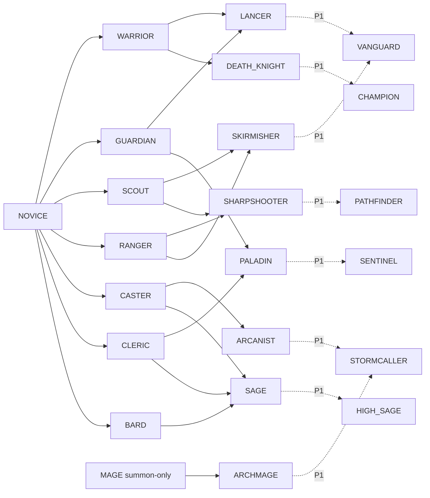

# 03 - Heroes and Growth

This spec defines what a hero is and how one grows: the hero sheet and its stats, classes and roles (section 1); former lives, traits, hidden talents and memories (section 2); statuses in battle (section 3); inner life, meaning morale, stress, loyalty and bonds (section 4); how all of these combine into one stat pipeline (section 5); and how a hero grows: levels, promotion, synthesis and conversion, skills and class change (section 6). Where this spec and `00-overview.md` disagree, 00 wins. HeroCat's spec 03 is archived at `specs/archive/03-combat-and-progression-herocat.md`, and HeroCat citations such as "03 section 8.6" in code, tools and older specs resolve there.

Tiers covered: M0 (grades, the four stats, the sheet, automatic growth, classes as data and roles, the former life and its life trait, the status engine with Fear, levels and EXP, promotion to 3★, starting skills), MVP (redistribution, summon-only classes, the full trait model, seal slots, hidden talents, memories, the other statuses, morale, stress, breakdown and stress death, bonds, promotion to 7★ and stone crafting, synthesis, conversion, skills, class change to class tier 2), P1 (loyalty, gifts, refusals and strikes, the inner-life side of duels, Surge, dual mind, claimed former lives, crafting trades, drills, class tier 3), P2 (gift requests, moving traits between heroes).

Mechanics come from the in-story game catalogued in `docs/research/pick-me-up-infinite-gacha.md` (cited as "research §N"): mechanics only, never names, characters, story, art or text (decision 121, contract 15). Every deliberate difference is a `specs/11` row, cited here by id. Issues: #342 (parent) with #357 (section 1), #360 (section 2), #358 (section 3) and #359 (section 4); #344 (parent) with #363 (6.1), #365 (6.2), #364 (6.3), #366 (6.4) and #367 (6.5).

Depends on: 00 (names, constants, contracts), 02 (the `Hero` save fields, #384), 04 (gear and consumables, #368; summons, #361), 05 (the battle loop, formation, death and revival: #370, #371, #373), 06 (facilities, the manager, research, parties and the offline report: #375-#379), 07 (screens, #385) and 09 (content tables, #387).

## 1. Hero sheet, stats, growth rate and classes

What a hero *is* in numbers: its star grade, its four stats and how they grow, its class and the formation role that class gives it, and the stat window (`SCR_HERO`) that shows all of it. Source: research §3 and §9.1. Issue #357, parent #342.

Tiers: grades, stats, the sheet, automatic growth, classes as data and roles are **M0**. Summon-only classes and the hero-awareness flag are **MVP**. Stat redistribution is **MVP**. Class *change* is section 6.5 (MVP), levels and EXP are 6.1, promotion is 6.2, synthesis is 6.3, skills are 6.4, statuses are section 3, inner life is section 4, former lives and traits are section 2. Battle formulas are 05's (#371).

Calls made here as agent defaults (`CLAUDE.md` rule 1, vetoable in review): four stats with AGI covering the source's "AGI or DEX"; the stamina stat is called `VIT` so it can't be confused with battle HP; growth points are allocated automatically and monotonically; no per-instance random stats; growth rate shown after the first level-up.

### 1.1 Star grades (M0)

`Grade` is an integer `GRADE_MIN..GRADE_MAX` (1★-7★), stored on the `Hero` (section 5.1 of 00).

| Grade | Can be pulled | Arrives with | Notes |
|---|---|---|---|
| 1★, 2★ | Yes | `NOVICE` class | Lowest stats. Up to `NOVICE_MAX_GRADE` a `HeroDef` must arrive as `NOVICE` (research §3: "low grades start as Novice"). |
| 3★-5★ | Yes | A non-Novice class | `SUMMON_GRADE_MAX = 5` (research §3). Which banner gives which grades is #361's. |
| 6★, 7★ | **No** | - | Reached only by promotion (6.2), at most `PROMOTE_GRADE_SPAN` grades above the base grade (6.2.7). No `HeroDef` has `base_grade > SUMMON_GRADE_MAX`; the content validator rejects it. |

- A `HeroDef` has exactly one `base_grade`: the grade every copy of it is summoned at. A `Hero`'s `grade` starts there and only `Promotion` raises it (6.2), up to `base_grade + PROMOTE_GRADE_SPAN` (decision 150). Nothing lowers it.
- Per-grade numbers live in one table, `grades` (section 1.7). This section adds `growth_bonus`; 6.1 adds `level_cap` and `exp_curve_pct`, 6.2 `promotion_gain_bp`, 6.3 the `synth_*` columns, 6.4 `skill_level_cap` and `skill_slots`.
- Seed for #391 (decision 127): the reused cast's five rarity bands map onto the five pullable grades, Common 1★, Rare 2★, Epic 3★, Legendary 4★, Mythic 5★. It keeps "the most glamorous designs at the top" and gives the 1★ band the most heroes. #391 owns the final mapping.

### 1.2 Stats (M0)

Four stats. The set is a fixed `StatId` enum in this order; the `stats` table has exactly one row per value. Adding or removing a stat is a save-schema change (02, #384), not a content change.

```csharp
public enum StatId : byte { STR = 0, INT = 1, VIT = 2, AGI = 3 }   // order is part of the save schema
```

| Stat | Display | What it feeds in battle (05 owns the formulas, #371) |
|---|---|---|
| `STR` | Strength | Physical attack power (swords, spears, bows), the physical part of skills that scale on it. |
| `INT` | Intelligence | Magic attack and healing power, mana pool and cast speed for classes whose `attack_stat` is `INT`. |
| `VIT` | Stamina | Max battle HP (`MaxHp = HP_BASE + VIT * HP_PER_VIT` in 05) and physical toughness. Called `VIT` in code so the stat is never mistaken for the HP pool. |
| `AGI` | Agility | Action speed (attack and cast interval), evasion and accuracy. Covers the source's "Agility or Dexterity" (research §3). |

Rules for 05 (contracts, not formulas):

- **A stat is not a damage number.** Damage is a stat times a skill coefficient (research §9.1: "technique scales it"). Skills (6.4.10) carry the coefficients; a class's basic attack uses its `attack_stat`.
- Each class names its `attack_stat` (`STR` or `INT`). 05 reads it; no class logic is hard-coded.
- Statuses, traits and inner-life bonuses act on stats, never on damage directly, unless their own spec says otherwise (section 3, section 4, section 2).

**Numbers.** Stat values are counted integers (contract 10). Percent modifiers are integers with 100 = no change. All arithmetic uses `long` intermediates and truncating division on non-negative values, clamped at 0. Derived battle values (HP, damage) become `double` in 05.

#### 1.2.1 Layers, current/max and total stat points

Each stat is built in three layers. The sheet shows **current/max** (research §3).

| Layer | Made of | Where it lives |
|---|---|---|
| **Core** (permanent) | `HeroDef` base + promotion gains (6.2.3) + growth points allocated (1.3) + permanent flat bonuses (synthesis 6.3, events) | Base and promotion gains derived from content; allocation and bonuses saved on the `Hero` |
| **Max** (the hero as equipped) | Core + gear flat (#368) + trait flat (section 2), times class % plus trait % | Derived, never saved |
| **Current** (right now, in battle) | Max times the inner-life multiplier (section 4), then the status multiplier (section 3) | Derived, never saved |

The full formula, with number formats and clamps, is section 5. The functions below are the lobby view.

```csharp
int Core(Hero h, StatId s, ContentDb db) {
    var def = db.HeroDefs[h.HeroDefId];
    return def.Base[s]
         + db.PromotionStatGain(def, h.Grade, s)   // 6.2.3; 0 at the base grade
         + h.GrowthAlloc[s]                         // 1.3
         + h.StatBonus[s];                          // synthesis (6.3) and other permanent grants
}

int Max(Hero h, StatId s, ContentDb db) {
    var t = Traits.Aggregate(h, db);                                          // section 2.3.4
    long flat  = Core(h, s, db) + GearFlat(h, s, db) + t.Flat[s];             // #368, section 2
    long pctBp = db.Classes[h.ClassId].Pct[s] * (BASIS_POINTS / STAT_PCT_BASE) + t.PctBp[s];
    return (int)Math.Max(0, flat * Math.Max(0, pctBp) / BASIS_POINTS);
}

// Out of battle there is no inner-life or status layer, so current == max on the lobby sheet.
// In battle, current is section 5's CurrentInBattle.

int TotalStatPoints(Hero h, ContentDb db) => Sum over s of Core(h, s, db);
```

- Out of battle, current equals max: every status ends with its battle (section 3.8) and the lobby heals at once (research §8). In battle, buffs (Berserk, Surge) can push current **above** max; the battle view shows it highlighted (07).
- Inner-life bonuses, pair bonuses included (section 4.6), apply only inside a battle's party context, so they appear in current during a fight, not on the lobby sheet.
- **Total stat points** = the sum of the four core stats (research §9.1). Gear, class %, traits and statuses are excluded, so it measures the hero, not the loadout. Synthesis (6.3.3.2) and 08's plausibility checks read it.

#### 1.2.2 Hero power (M0)

00 section 7 asks 03 for a rated power value. This section defines the stat term; 6.4.11 and #368 add skill and gear terms to the same sum, and 05 may retune the weights.

```csharp
long HeroPower(Hero h, ContentDb db) =>
    Sum over s of (long)Max(h, s, db) * db.Stats[s].PowerWeight     // seed weight 1 each
    + SkillPowerTerm(h, db)                                           // 6.4.11
    ;                                                                 // gear is already inside Max
```

Statuses are not in power: it is the planning value shown in the party builder, not a live reading.

### 1.3 Growth rate (M0; redistribution MVP)

Each level-up gives a hero a fixed number of growth points (research §3: about 4 for an ordinary 1★, 5 for a normal 4★).

```csharp
int GrowthPerLevel(Hero h, ContentDb db) =>
    db.HeroDefs[h.HeroDefId].GrowthRate + db.Grades[h.Grade].GrowthBonus;   // read at the moment of the level-up
```

- `HeroDef.growth_rate` is per hero concept. The seed default by base grade is in `grades.growth_default` (1★ 4, 2★ 4, 3★ 5, 4★ 5, 5★ 6); #391 starts from it, and a hero with hidden potential gets a higher value (research §3, section 2).
- `grades.growth_bonus` lets promotion raise growth. Seed 0 at every grade; a tuning lever for #348.
- The level-up itself (EXP, caps) is 6.1.4's. On each level gained it calls `GrantGrowthPoints`, which adds to `Hero.GrowthEarned` and allocates the new points.

#### 1.3.1 Automatic allocation (M0)

The player does not place points by hand. New points go to stats by the hero's **focus**, a row of four integer weights in `stat_focus`. A hero's focus is `HeroDef.focus_id` if set, else its class's `default_focus`.

Allocation is incremental, one point at a time, to the stat furthest below its weighted share. It is deterministic, uses no RNG, and never lowers a stat (it is house-monotone, so it avoids the quota paradox where a stat drops as the total rises).

```csharp
void AllocatePoints(int[] alloc, int points, StatFocus f) {          // f.W[s] >= 0, Sum(f.W) > 0 (validator)
    long wSum = Sum(f.W);
    for (int p = 0; p < points; p++) {
        long total = Sum(alloc) + 1;
        StatId best = STR; long bestGap = long.MinValue;
        foreach (StatId s in StatOrder) {                           // STR, INT, VIT, AGI: ties go to the earlier stat
            if (f.W[s] == 0) continue;
            long gap = f.W[s] * total - (long)alloc[s] * wSum;      // how far s is below its share
            if (gap > bestGap) { bestGap = gap; best = s; }
        }
        alloc[best]++;
    }
}
```

On a class change (6.5) the hero's focus becomes the new class's default; points already allocated stay where they are and only future points follow the new focus, unless the change carries a `respecFocusId`, which re-places the growth points for free (6.5.4).

#### 1.3.2 Redistribution (MVP)

The source lets points be redistributed, so a stat can fall (research §3). We keep redistribution but make it a lobby decision instead of something that happens on its own at level-up (DIV-09).

- `RedistributeStats(HeroUid, FocusId)` clears `GrowthAlloc` and re-runs `AllocatePoints(alloc, GrowthEarned, focus)` from zero. Only growth points move. Base, promotion gains and `StatBonus` never do. A stat can fall.
- The chosen focus must be in the class's `allowed_focus` list. The hero keeps it as `Hero.FocusId` for future level-ups until the next redistribution or class change.
- Cost: `STAT_REDISTRIBUTE_GOLD_PER_LEVEL * level` gold, reason `STAT_REDISTRIBUTE` (contract 6; see the notes).
- Rejects (closed list): `HERO_NOT_FOUND`, `HERO_DEAD`, `HERO_ON_ASSIGNMENT` (its party is on an assignment, 6.4.14), `HERO_PROMOTING`, `FOCUS_NOT_ALLOWED`, `NO_CHANGE` (same focus and the same resulting allocation), `NOT_ENOUGH_GOLD`.
- Emits `StatsRedistributed { HeroUid, FocusId, Before[4], After[4] }`.

#### 1.3.3 Growth rate visibility (M0)

The sheet shows the growth rate ("+N per level") once the hero has gained at least one level (`GrowthEarned > 0`) and "?" before that. The number is fixed per `HeroDef` and visible in the first level-up anyway, so this is a deterministic reveal by use (research §3: try a 1★ before synthesizing it; DIV-10). Other hidden talents follow section 2's reveal rules.

### 1.4 Classes (M0 as data; class change MVP in 6.5)

A hero always has exactly one class (`Hero.ClassId`). The class sets the hero's formation **role** (1.5), its `attack_stat`, a percent modifier per stat and its default growth focus. Class tiers, the tree and the change itself are 6.5's.

**How a class is obtained** (`classes.obtain`):

| Value | Meaning |
|---|---|
| `DEFAULT` | `NOVICE` only. Every `HeroDef` with `base_grade <= NOVICE_MAX_GRADE` arrives with it. |
| `ANY` | Can arrive with a summon (on a `HeroDef` at 3★+) or be reached by class change. |
| `SUMMON_ONLY` | Only a `HeroDef` can carry it; class change can never reach it (research §3: the source's mage is pull-only). MVP. |
| `CHANGE_ONLY` | Reached only by class change (advanced classes); no `HeroDef` may start with it. |

Validator rules, on `HeroDef` rows only: `base_grade <= NOVICE_MAX_GRADE` requires `class_id = NOVICE`; `base_grade > NOVICE_MAX_GRADE` forbids `NOVICE`; a `HeroDef` may not start in a `CHANGE_ONLY` class; 6.5.1 adds the class-tier starting rules. An owned hero promoted to 3★ stays `NOVICE` until it changes class, so no owned-hero check applies. `ChangeClass` rejects a change into `SUMMON_ONLY` (6.5.7).

**Seed class list**, class tiers 0 and 1 plus `LANCER` (our names; 6.5.1 has the full tree with the tier-2 and tier-3 rows, #391 assigns heroes). Percents are seeds for #348.

| `id` | `role` | `attack_stat` | `obtain` | `default_focus` | STR / INT / VIT / AGI % |
|---|---|---|---|---|---|
| `NOVICE` | `SHORT` | `STR` | `DEFAULT` | `BALANCED` | 100 / 100 / 100 / 100 |
| `WARRIOR` | `SHORT` | `STR` | `ANY` | `POWER` | 110 / 100 / 105 / 100 |
| `GUARDIAN` | `SHORT` | `STR` | `ANY` | `STAMINA` | 100 / 100 / 115 / 95 |
| `SCOUT` | `SHORT` | `STR` | `ANY` | `SPEED` | 100 / 100 / 95 / 115 |
| `LANCER` (class tier 2) | `MID` | `STR` | `CHANGE_ONLY` | `POWER` | 115 / 100 / 105 / 110 |
| `RANGER` | `LONG` | `STR` | `ANY` | `SPEED` | 105 / 100 / 95 / 110 |
| `CASTER` | `LONG` | `INT` | `ANY` | `MIND` | 95 / 110 / 95 / 100 |
| `MAGE` | `LONG` | `INT` | `SUMMON_ONLY` | `MIND` | 90 / 125 / 90 / 100 |
| `CLERIC` | `SUPPORT` | `INT` | `ANY` | `MIND` | 95 / 110 / 105 / 95 |
| `BARD` | `SUPPORT` | `INT` | `ANY` | `BALANCED` | 100 / 105 / 100 / 105 |

The cast's concept roles (`art/concepts/companions.md`) map onto these as follows: Warrior to `WARRIOR`, Tank to `GUARDIAN`, Mage to `MAGE` or `CASTER`, Caster to `CASTER`, Cleric to `CLERIC`, Bard to `BARD`. Paladin, Death Knight and Sage are `ANY` class-tier-2 rows that a 4★-5★ concept may start in (6.5.1); Merchant becomes a former life (section 2) rather than a class. For 1★ and 2★ heroes the concept role is a *calling* (`hero_defs.calling_class_id`, 6.5.5), not the starting class, because they arrive as `NOVICE`.

### 1.5 Roles and ranges (M0)

The formation axis 05 uses (research §9.5: short, mid and long range plus support; a swordsman can't fill a spear slot). Role comes only from the class, so a class change can change it.

| `Role` | Meaning | Typical classes |
|---|---|---|
| `SHORT` | Front line, melee reach | `NOVICE`, `WARRIOR`, `GUARDIAN`, `SCOUT`, `PALADIN`, `DEATH_KNIGHT` |
| `MID` | Second line, reach weapons and short casts | `LANCER`, `SKIRMISHER` |
| `LONG` | Back line, bows and spells | `RANGER`, `CASTER`, `MAGE`, `SHARPSHOOTER`, `ARCANIST`, `ARCHMAGE` |
| `SUPPORT` | Back line, heals and buffs first, attacks second | `CLERIC`, `BARD`, `SAGE` |

05 owns the slot layout, the range distances (`roles.range`, set in #371), whether a slot accepts only its own role, and the cost of a mismatch. This section only guarantees that every hero has exactly one role, readable as `Role RoleOf(Hero h) => db.Classes[h.ClassId].Role`.

### 1.6 The stat window (`SCR_HERO`, M0)

The player, the summoner, always sees the whole sheet. Nothing on it is gated by research; the source's research gate applies to the heroes' own view (section 1.6.1). Layout and states are 07's (#385).

| Field | Shown as | Source of the value | Tier |
|---|---|---|---|
| Portrait, name, stars | Name key, `grade` stars | `HeroDef`, `Hero.Grade` | M0 |
| Top grade | "Can reach N★" | 6.2.7 | M0 |
| Level, EXP | `Lv n`, `exp / expToNext`; at the cap the bank and "promote to continue"; `MAX` at 7★ Lv120 | 6.1.5 | M0 |
| Class and role | Class name and role icon | 1.4, 1.5 | M0 |
| Stats | `current / max` for each of STR, INT, VIT, AGI | 1.2.1 | M0 |
| Total stat points | One number | 1.2.1 | M0 |
| Growth rate | `+N per level` or `?` | 1.3.3 | M0 |
| Power | One number | 1.2.2 | M0 |
| Former life | Name and aptitude line | section 2 | M0 |
| Skills | Each with its level and tier; pending skills, clashes, evolution paths and awakening progress | 6.4 | MVP (M0 shows starting skills only) |
| Synthesized stats | `x / cap` | 6.3.3.2 | MVP |
| Calling and class history | The calling class and the classes held | 6.5.5, 6.5.7 | MVP |
| Traits and seal slots | Graded traits, `used / slots` | section 2 | MVP |
| Statuses | Active statuses with time left | section 3 | Fear M0 |
| Inner life | Morale, stress and (P1) loyalty as 0-100 with bands, bonds, any breakdown countdown (DIV-19) | Section 4.10 | MVP |
| Gear | Equipped items | #368 | MVP |
| Life state, favourite | `DEAD` greyed out; favourite toggle | 05 #373; `ToggleFavourite` | M0 |

#### 1.6.1 Heroes' own view (MVP)

In the source, heroes can't see their own windows or the mission objective until research unlocks it, and a party died for not knowing its objective (research §3). We keep that as a **hero** rule, not a player rule:

- `HeroAwareness` is an account-wide integer level held by the research state (#377), `0..HERO_AWARENESS_MAX`. Level 0 means heroes don't know the objective or their own numbers. Level 1, the first research step, means they see the objective and part of their own windows.
- 05 and #372 define what the level changes in hero AI (for example, whether heroes play to the objective, use potions at a low-HP threshold, or know a timer). In M0 the level is 0 and has no battle effect until 05 gives it one.
- It never hides anything from the player.

### 1.7 Content tables

All names below are 09's to register (#387). They replace HeroCat's `companions`, `rarities` and `stats` tables. Presentation columns (`name_key`, `desc_key`, `icon`, art ids) follow 09's conventions and are listed only where new.

**`hero_defs`**: one row per hero concept (decision 127).

| Column | Type | Notes |
|---|---|---|
| `id` | string | `HeroDefId`, stable. |
| `base_grade` | int | `1..SUMMON_GRADE_MAX`. |
| `class_id` | enum | 1.4 validator rules. |
| `focus_id` | enum, optional | Blank means the class's `default_focus`. |
| `base_str`, `base_int`, `base_vit`, `base_agi` | int >= 0 | Core stats at `base_grade` and Lv1. |
| `growth_rate` | int >= 1 | Points per level before `growth_bonus`. |
| `summonable` | bool | False keeps a row out of every banner pool (reward and story heroes). Pools themselves are #361's. |
| `former_life_id`, trait and talent columns | | section 2. |
| `start_skills` | list of `skill_id:level` | 6.4.4. |
| `calling_class_id` | enum, optional | 6.5.5. |
| `tier`, `name_key`, `desc_key`, `icon`, `portrait`, `sprite`, `splash` | | Art per #349. |

**`grades`**: one row per grade `1..7`. Columns: `grade`, `growth_default` (validator and authoring hint only, never read by the sim), `growth_bonus`, `tier`; section 6 adds `level_cap`, `exp_curve_pct` (6.1.3), `promotion_gain_bp` (6.2.3), `synth_base_exp`, `synth_exp_bp`, `synth_stat_bp`, `synth_technique_bp`, `synth_gold`, `synth_stat_cap` (6.3.7), `skill_level_cap` and `skill_slots` (6.4).

**`stats`**: one row per `StatId`. Columns: `id`, `power_weight` (int), `power_tag` (bool; true for `STR` and `INT`, the stats Berserk raises, section 3.1), `tier`, `name_key`, `desc_key`, `icon`.

**`classes`**: columns `id`, `role`, `attack_stat`, `obtain`, `default_focus`, `allowed_focus` (list), `pct_str`, `pct_int`, `pct_vit`, `pct_agi` (int, 100 = none), `tier`, `name_key`, `desc_key`, `icon`; section 6 adds `class_tier`, `skill_tags`, `skill_tier_max`, `min_start_grade` (6.5) and `skill_slot_bonus` (6.4.4).

**`roles`**: columns `id` (`SHORT`, `MID`, `LONG`, `SUPPORT`), `range` (set in #371), `tier`, `name_key`, `icon`.

**`stat_focus`**: columns `id`, `w_str`, `w_int`, `w_vit`, `w_agi` (int >= 0, sum > 0), `tier`, `name_key`. Seed rows:

| `id` | STR / INT / VIT / AGI |
|---|---|
| `BALANCED` | 1 / 1 / 1 / 1 |
| `POWER` | 3 / 0 / 2 / 1 |
| `STAMINA` | 2 / 0 / 3 / 1 |
| `SPEED` | 2 / 0 / 1 / 3 |
| `MIND` | 0 / 3 / 1 / 2 |

**Seed stat lines** for #391, from the source's sample sheets (research §3). Our archetype names; cells marked `*` are not given by the source and are seeds.

| Archetype | Grade | Class | STR | INT | VIT | AGI | Total | Growth |
|---|---|---|---|---|---|---|---|---|
| Fresh recruit | 1★ | `NOVICE` | 14 | 10 | 12 | 10* | 46 | 4 |
| Nimble striker | 3★ | `SCOUT` | 13 | 10 | 12* | 18* | 53 | 5 |
| Born caster | 3★ | `MAGE` | 7 | 36 | 9* | 11* | 63 | 5 |
| Shield veteran | 4★ | `GUARDIAN` | 19 | 10 | 18 | 22 | 69 | 5 |

**Constants**: rows in the `constants` table (section "Constants introduced").

### 1.8 `Hero` save fields (shape only; 02 owns the schema, #384)

| Field | Type | Owner | Notes |
|---|---|---|---|
| `Uid` | `HeroUid` | 00 | Never reused. |
| `HeroDefId` | string | 00 | |
| `Grade` | byte | this section, 6.2 | |
| `Level`, `Exp` | int, double | 6.1.1 | `Exp` is EXP into the current level, always a whole number. |
| `ClassId` | enum | this section, 6.5 | |
| `ClassHistory` | list of class ids | 6.5.7 | MVP. The classes held, in order, from the arrival class. |
| `FocusId` | enum, nullable | this section | Null means the derived default (`HeroDef.focus_id`, else the class's). Set by `RedistributeStats`, cleared by class change. |
| `GrowthEarned` | int | this section | All growth points ever granted. Kept so content retunes never rewrite history. |
| `GrowthAlloc` | int[4] | this section | Indexed by `StatId`. `Sum(GrowthAlloc) == GrowthEarned` always. |
| `StatBonus` | int[4] | 6.3 and others | Permanent flat grants. Never touched by redistribution. |
| `SynthStatGained` | int[4] | 6.3.7 | MVP. The synthesized part of `StatBonus`, per stat, against `synth_stat_cap`. |
| `Skills`, `PendingSkills`, `Training`, `SkillCounters`, `SkillFires` | | 6.4.14 | |
| `Traits`, `Statuses`, inner-life block, `Gear`, `Favourite`, `LifeState` | | section 2, section 3, section 4, #368, 06, #373 | |

Current, max, total stat points, power and role are derived, never saved. Base stats and promotion gains are read from content, so a balance patch to a `HeroDef` reaches existing heroes. Growth already earned does not change.

Duplicates: every copy of a `HeroDef` is created with the same stats. There is no per-instance stat roll at summon time, so a pull is worth what the banner shows. Duplicates are full, separate heroes (decision 148, 6.3.6).

### 1.9 Commands and events

| Command | Tier | Effect | Event |
|---|---|---|---|
| `RedistributeStats(heroUid, focusId)` | MVP | 1.3.2 | `StatsRedistributed` |
| (internal, called by 6.1.4's `GrantExp`, once per level) `GrantGrowthPoints(hero, n)` | M0 | Adds `n` to `GrowthEarned` and allocates them | Folded into `HeroLeveledUp`, which carries `PointsGained[4]` |

## 2. Former lives, traits, hidden talents and memories

What makes two heroes of the same grade different. Every hero was called from a former ordinary life (decision 124, DIV-08). That life gives them starting aptitudes and trades. They can carry graded **traits** in **seal slots**. Low grades can hide **talents** that only show up through use. Each promotion can **restore a memory** that changes their traits or behaviour. Mechanics come from research §3 (former lives, hidden talents), §5 (promotion restores memories), §9.1 (seal slots and graded traits) and §11 (#354 evidence). The names, occupations and fiction here are our own (decision 121).

Tiers:

| Feature | Tier |
|---|---|
| `former_life_id` on every `HeroDef`, shown on `SCR_HERO` and in the summon reveal; the life trait's `STAT_FLAT` and `STAT_PCT` effects apply | **M0** |
| The full `Trait` model (every effect kind in 2.3), seal slots, hidden talents, memory restoration | **MVP** |
| `TRAINING_RATE` effects (read by Skills, 6.4.3) and `LOBBY_WORK` effects (read by Facilities, #375) | **MVP** |
| `CRAFT_TRADE` effects (read by Crafting, #369) | **P1** |
| A claimed former life that differs from the true one and is exposed by a memory (2.6.3) | **P1** |
| Moving traits between heroes (synthesis or seal items) | **P2**, not designed |

**This section rolls no dice.** Former lives, talents, seal traits and memories are all authored per `HeroDef` and applied by fixed rules. No RNG stream is drawn, so a hero's sheet is fully determined by its `HeroDefId`, its grade and its recorded history. That is the honesty rule (pillar 5): a banner's published odds pick the hero, and nothing hidden is rolled on the copy the player receives.

Readers outside sections 1-5: promotion (6.2), skills and training (6.4), battle and hero AI (05, #371), facilities (06, #375), crafting (04, #369) and the roster content (#391).

### 2.1 Data model overview

```
HeroDef ──former_life_id──> FormerLife ──life_trait_id──> TraitDef ──> trait_effects (per level)
   │                                                           ^
   ├──> hero_talents[0..TALENTS_MAX_PER_HERO)  ── reward ──────┘ (or a SkillDef, 6.4)
   ├──> hero_seal_traits[slot] ── trait_id ────────────────────┘
   └──> memory_scenes[to_grade] ──> memory_effects

Hero (owned) ── traits: List<HeroTrait>, talentProgress[], talentRevealedMask,
                memoryRestoredMask, behaviourFlags
```

Each source of advantage is a trait with a `Source` tag, so one aggregation path (2.3.4) turns all of them into stat modifiers. Only the rules for *how a hero gets* a trait differ by source.

| `TraitSource` | Comes from | Slot | Tier |
|---|---|---|---|
| `LIFE` | The hero's former life. Exactly one, always held from acquisition. | None (not in a seal slot) | M0 |
| `SEAL` | `hero_seal_traits`, opened by grade | One seal slot each | MVP |
| `TALENT` | A revealed hidden talent | None | MVP |
| `MEMORY` | A `GRANT_TRAIT` memory effect | None | MVP |

### 2.2 Former lives (M0)

Every `HeroDef` names exactly one former life. A former life is a content row, not a code enum, so #391 can add occupations without a code change. A former life sets three things, all through its **life trait**:

1. **Starting aptitudes:** a fixed budget of flat stat points (`STAT_FLAT`), the same total for every former life (`FORMER_LIFE_START_POINTS`), spread differently. A farmer leans to VIT and a scribe to INT, but neither gets more in total. This keeps former life a matter of flavour and fit, not a ranking. Applies from M0.
2. **Skill aptitudes:** `TRAINING_RATE` per skill tag. The source's hunter is good with a bow (research §3, §11). Here that means bow skills train faster and the hero can start with a bow skill (the `HeroDef`'s skills, section 1/#366). MVP.
3. **Trades and lobby work:** `CRAFT_TRADE` (P1, #369) and `LOBBY_WORK` (MVP, #375). A smith can work the forge, and a cook raises the canteen's output. The research catalog's artisans (research §6) use these.

The former life shows on `SCR_HERO` (icon, name and one line of description) and on the summon reveal card. It is never hidden. A *claimed* former life is P1 (2.6.3).

#### 2.2.1 `former_lives` table

| Column | Type | Notes |
|---|---|---|
| `former_life_id` | string, UPPER_SNAKE | Primary key, e.g. `FARMER` |
| `name_key`, `desc_key` | loc key | Contract 11 |
| `icon_id` | string | Client asset id (#349) |
| `life_trait_id` | `traits.trait_id` | Must have `source = LIFE`. Its level-1 `STAT_FLAT` rows must sum to `FORMER_LIFE_START_POINTS`. |
| `sort_order` | int | Roster filter order |
| `bond_tags` | list | Tags for section 4.5's `bond_affinity` (two heroes from the same trade start warm) |

#### 2.2.2 Seed former lives (our own, generic)

The stats are section 1's: STR, INT, VIT, AGI. `hero_defs.base_*` exclude these points (section 5). Points are level-1 `STAT_FLAT` on the life trait (`FORMER_LIFE_START_POINTS = 4`). Skill tags are #366's and trades are #369's. The names below are proposals for those specs.

| `former_life_id` | STR | INT | VIT | AGI | `TRAINING_RATE` tags (+bp) | `CRAFT_TRADE` (P1) | `LOBBY_WORK` (MVP) |
|---|---|---|---|---|---|---|---|
| `FARMER` | 1 | 0 | 3 | 0 | `POLEARM` +2000 | — | `CANTEEN` +1000 |
| `HUNTER` | 0 | 0 | 1 | 3 | `BOW` +3000, `SCOUTING` +1500 | `LEATHER` 1 | — |
| `SMITH` | 3 | 0 | 1 | 0 | `HAMMER` +2000 | `SMITHING` 2 | `FORGE` +1500 |
| `CARPENTER` | 2 | 1 | 1 | 0 | `HAMMER` +1000 | `WOODWORK` 2 | `WORKSHOP` +1500 |
| `COOK` | 0 | 1 | 2 | 1 | `BLADE` +1000 | `COOKING` 2 | `CANTEEN` +2000 |
| `MERCHANT` | 0 | 3 | 0 | 1 | — | — | `SHOP` +2000 |
| `TOWN_GUARD` | 2 | 0 | 2 | 0 | `SHIELD` +2500, `POLEARM` +1000 | — | `GATE` +1000 |
| `SOLDIER` | 2 | 0 | 1 | 1 | `BLADE` +2000, `SHIELD` +1000 | — | `TRAINING_HALL` +1000 |
| `FISHER` | 1 | 0 | 2 | 1 | `POLEARM` +1500 | `COOKING` 1 | `CANTEEN` +1000 |
| `MINER` | 3 | 0 | 1 | 0 | `HAMMER` +1500 | `SMITHING` 1 | `STOREROOM` +1000 |
| `HERBALIST` | 0 | 2 | 1 | 1 | `HEALING` +2500 | `ALCHEMY` 2 | `INFIRMARY` +1500 |
| `SCRIBE` | 0 | 4 | 0 | 0 | `CASTING` +1500 | — | `RESEARCH_LAB` +2000 |
| `COURIER` | 0 | 1 | 0 | 3 | `SCOUTING` +2500 | — | — |
| `NURSE` | 0 | 2 | 2 | 0 | `HEALING` +3000 | — | `INFIRMARY` +2000 |
| `STREET_PERFORMER` | 0 | 1 | 0 | 3 | `BLADE` +1000 | — | `LODGING` +1000 (morale, section 4) |

Fifteen rows give every lobby facility (#375) at least one fitting occupation. #391 assigns them to the reused cast (decision 127) and may add more.

### 2.3 The `Trait` model (life-trait stats M0, the rest MVP)

A trait is a passive with a **grade** (how rare and strong it is, shown as a letter), a **level** (`1..maxLevel`) and a list of **effects** per level. In the source, a trait shows as "B+, Lv3" (research §9.1), and ours displays the same way.

#### 2.3.1 Trait grades

Grades are an ordered content table, so the letter scale can change without code. A trait's grade is a label, a sort key and a level cap. It does not compute effects: each level's effects are authored (2.3.3). The cap is the grade's `max_level`.

| `trait_grade_id` | `rank` | `label_key` | `max_level` |
|---|---|---|---|
| `D` | 0 | `trait_grade.d` | 2 |
| `C` | 1 | `trait_grade.c` | 3 |
| `C_PLUS` | 2 | `trait_grade.c_plus` | 3 |
| `B` | 3 | `trait_grade.b` | 4 |
| `B_PLUS` | 4 | `trait_grade.b_plus` | 4 |
| `A` | 5 | `trait_grade.a` | 5 |
| `A_PLUS` | 6 | `trait_grade.a_plus` | 5 |
| `S` | 7 | `trait_grade.s` | 5 |

`TRAIT_LEVEL_MAX` (5) is the largest `max_level` the validator accepts. Life traits are always grade `D` and level 1 at M0. Whether they can level is an open question (default no).

#### 2.3.2 `traits` table

| Column | Type | Notes |
|---|---|---|
| `trait_id` | string | Primary key |
| `name_key`, `desc_key` | loc key | |
| `icon_id` | string | |
| `trait_grade_id` | `trait_grades` | |
| `source` | `LIFE` / `SEAL` / `TALENT` / `MEMORY` | Where this trait may appear (validator) |
| `max_level` | int | `<= trait_grades.max_level` |
| `tags` | list | Tags other sections read: section 3's triggers (`TEMPER_BERSERK`, `TEMPER_COMPOSED`, `DUAL_MIND`, `HIDDEN_POWER`) and section 4.5's `bond_affinity` |

#### 2.3.3 `trait_effects` table and effect kinds

There is one row per effect per level. Each level lists its **full** effect set, not a delta from the level below, so a level is read on its own. The validator requires rows for every level `1..max_level`.

| Column | Type | Notes |
|---|---|---|
| `trait_id`, `level` | key | |
| `effect_kind` | enum below | |
| `target` | string | Meaning depends on the kind |
| `value` | int | Points, or basis points (bp, 10000 = 100%) |
| `condition_kind`, `condition_value` | enum, int | Only for `COND_STAT_PCT` |
| `duration_s` | int | Only for `COND_STAT_PCT`. Converted to ticks with `TICK_HZ`. |

Effect kinds form a closed enum. Each kind names the spec that reads it, and a kind with no reader yet is still loaded and shown, but has no effect.

| `effect_kind` | `target` | `value` | Read by | Tier |
|---|---|---|---|---|
| `STAT_FLAT` | stat id (section 1) | points | Stat pipeline, section 1 | M0 |
| `STAT_PCT` | stat id, or `ALL` | bp | Stat pipeline, section 1 | M0 |
| `GROWTH_POINTS` | stat id | extra points per level-up, applied from the level the trait is gained | Levels, 6.1.4 | MVP |
| `STATUS_RESIST` | status id or status group (section 3.1, e.g. `DREAD` holding `FEAR`, `PANIC`, `DESPAIR`) | bp; how it applies is section 5 | Statuses, section 3 | MVP |
| `COND_STAT_PCT` | stat id, or `ALL` | bp | Battle, #371 | MVP |
| `TRAINING_RATE` | skill tag (6.4.10.2) | bp on skill EXP from training (not combat EXP) | Skills, 6.4.3 | MVP |
| `LOBBY_WORK` | facility role (#375) | bp on that facility's output while the hero works there | Facilities, #375 | MVP |
| `INNER_LIFE` | `MORALE_GAIN`, `STRESS_GAIN`, … (section 4) | bp | Inner life, section 4 | MVP |
| `CRAFT_TRADE` | trade id (#369) | trade level | Crafting, #369 | P1 |

`COND_STAT_PCT` conditions, all evaluated by 05 at the end of a battle tick, after damage:

| `condition_kind` | `condition_value` | Fires |
|---|---|---|
| `HP_BELOW_BP` | HP threshold in bp of max HP | When current HP is `> 0` and `<= threshold`. Once per battle. A hit that kills outright does not fire it. |
| `BATTLE_START` | — | On the battle's first tick |
| `ALLY_DIED` | — | The first time an ally in the same party dies, once per battle |

The source's example graded trait (research §9.1) maps onto these kinds: one `STATUS_RESIST` on the mental group, one `STATUS_RESIST` on `FEAR`, and a `COND_STAT_PCT ALL +2000` with `HP_BELOW_BP` and `duration_s = 60`. #391 writes our own traits with our own names. This is only a check that the model can express the source's.

#### 2.3.4 How traits apply to stats

Traits add one layer to the stat pipeline, whose order is section 5's. This section supplies the layer:

```csharp
// HeroCat.Sim. Integer maths only; BP = 10000 (content: BASIS_POINTS).
public readonly struct TraitModifiers {
    public readonly int[] Flat;      // per StatId, points
    public readonly int[] PctBp;     // per StatId, basis points, ALL already spread
    public readonly int[] GrowthPts; // per StatId, extra points per level
}

public static TraitModifiers Aggregate(Hero h, ContentDb db) {
    var m = TraitModifiers.Empty(db.StatCount);
    foreach (var t in h.Traits)                       // stored order: by Source, then TraitId (ordinal)
        foreach (var e in db.TraitEffects(t.TraitId, t.Level))
            switch (e.Kind) {
                case STAT_FLAT:     m.Flat[e.Stat]      += e.Value; break;
                case STAT_PCT:      AddPct(m, e.Target, e.Value, db); break; // ALL -> every stat
                case GROWTH_POINTS: m.GrowthPts[e.Stat] += e.Value; break;
                default: break;                       // other kinds are read by their own spec
            }
    for (int s = 0; s < db.StatCount; s++)
        m.PctBp[s] = Clamp(m.PctBp[s], -db.Const.TRAIT_STAT_PCT_CAP_BP, db.Const.TRAIT_STAT_PCT_CAP_BP);
    return m;
}

// Read by section 1.2.1's Max and section 5: Flat[s] is added to the flat sum, PctBp[s] to the
// class percentage (in bp). Integer division, rounding toward zero. GrowthPts[s] are added to
// StatBonus[s] at each level-up (section 5).
```

Stacking rules:

- A hero holds each `trait_id` at most once. A second grant of a trait the hero already holds keeps the higher level and emits `TraitLeveled` if the level rose.
- Effects of the same kind on the same target add up across traits. The sum of `STAT_PCT` is capped per stat at `±TRAIT_STAT_PCT_CAP_BP`. section 3 caps the sum of `STATUS_RESIST`, because tolerance is not immunity (research §5).
- A trait's `COND_STAT_PCT` buffs are a status-like timed modifier held by the battle (05). They stack with section 3's status multipliers the way 05 and section 3 define, not inside `Aggregate`.
- Traits stay with a hero through death and revival (#373). A hero consumed by synthesis, conversion or a promotion feeder takes its traits with it (6.3.1); a transfer is P2 (Open questions).

### 2.4 Seal slots (MVP)

A hero has seal slots, shown as `open/capacity` (the source shows "1/1", research §9.1). Capacity is set by grade. Each slot's content is authored per `HeroDef`. A slot holds a `SEAL` trait from the hero's former life: something they were born with, trained into or carried away from that life. Examples include a lineage, a craft drilled since childhood or an old soldier's nerve. In our fiction these come from the hero's own ordinary life, never another world (DIV-08, DIV-12).

- **Capacity:** `SEAL_SLOTS[grade]`. Slot `i` is **open** when `i < SEAL_SLOTS[grade]` and the hero's `HeroDef` has a `hero_seal_traits` row for slot `i`. Opening a slot grants its trait at the row's `start_level` and emits `SealSlotOpened` and `TraitGained`.
- **Sealed:** a slot with a row but `i >= SEAL_SLOTS[grade]` shows as sealed, with the grade that opens it. Its trait is not shown (it reads "???") until the slot opens. A slot index with no row is not drawn at all, so the displayed capacity is `min(SEAL_SLOTS[grade], rows authored)`.
- **When slots open:** at acquisition, for every slot the starting grade already allows, and after each `Promote` that raises capacity. The open happens before memory effects, so a memory can level a trait that just opened (2.5).
- **No swapping in MVP.** The player cannot move, remove or replace seal traits. Their levels rise only through memory effects (2.5).

| Column of `hero_seal_traits` | Type | Notes |
|---|---|---|
| `hero_def_id`, `slot_index` | key | `slot_index < SEAL_SLOTS[GRADE_MAX]` |
| `trait_id` | `traits` | `source = SEAL` |
| `start_level` | int | `1..max_level` |

Seed `SEAL_SLOTS[g]`, for 1★ to 7★: `0, 1, 1, 1, 2, 2, 3`. A 1★ has none, so its first slot is a reason to promote it. Many heroes will have fewer rows than the 7★ capacity, and #391 decides per hero.

### 2.5 Hidden talents (MVP)

A hero can have up to `TALENTS_MAX_PER_HERO` talents, authored per `HeroDef` in `hero_talents`. On a hero whose `HeroDef` base grade is `<= TALENT_HIDDEN_MAX_GRADE`, talents start **hidden** and are revealed by use (research §3: "try a 1★ before synthesizing it"). On higher base grades, every talent is revealed at acquisition, because the source's higher grades arrive with their skills.

**Decision: talents are fixed per `HeroDef`, not rolled per copy.** Two heroes of the same `HeroDef` have the same talents with the same reveal conditions. This keeps the published odds the whole story: what a banner gives is the published hero, with nothing hidden rolled on top. The owner confirmed this (decision 137).

**Disclosure rule.** `SCR_HERO` shows the talent count and, for each hidden talent, its reveal condition with progress. It does not show the reward until the talent is revealed. For example:

```
Talents  1 / 3 revealed
  [Shield Instinct]  B  Lv1
  ???   Fight 5 battles          3 / 5
  ???   Reach 2★                 —
```

The banner's hero list and the summon reveal show only the count ("2 hidden talents"). No reward is shown in either place before it is revealed.

**A hidden talent has no effect.** Its reward applies only from the tick it is revealed. Revealing is the unlock. This makes it worth using a low grade before feeding it away, and the player sees exactly what still has to be done.

#### 2.5.1 `hero_talents` table

| Column | Type | Notes |
|---|---|---|
| `hero_def_id`, `ordinal` | key | `ordinal < TALENTS_MAX_PER_HERO`. Display order. |
| `reveal_kind` | enum below | |
| `reveal_target` | string | Optional. Depends on `reveal_kind`. |
| `reveal_count` | int | `>= 1` |
| `reward_kind` | `TRAIT` / `SKILL` | |
| `reward_id` | `traits.trait_id` (`source = TALENT`) or a skill id (6.4) | |
| `reward_level` | int | Trait level or skill level |

| `reveal_kind` | Counter rises by 1 when… | `reveal_target` |
|---|---|---|
| `BATTLES_FOUGHT` | The hero is alive at the end of a battle it started in (05) | — |
| `FLOORS_CLEARED` | The hero's party clears a floor with the hero alive | — |
| `STATUS_ENDURED` | The hero is alive at the end of a battle in which it had the status | status id (section 3) |
| `TRAINING_SESSIONS` | The hero completes a training session: `SKILL_TRAIN_SESSION_PULSES` training pulses (6.4.3) | Optional skill tag |
| `LEVEL_REACHED` | Set to the hero's level (not incremented) | — |
| `GRADE_REACHED` | Set to the hero's grade | — |

#### 2.5.2 Reveal logic

```csharp
// Runs inside Apply/Advance at the event points above. Pure, no RNG.
void OnTalentCounter(Hero h, RevealKind kind, string target, int newValueOrDelta, bool isSet) {
    var defs = db.HeroTalents(h.HeroDefId);
    for (int i = 0; i < defs.Length; i++) {               // ordinal order
        var d = defs[i];
        if (h.TalentRevealed(i) || d.RevealKind != kind) continue;
        if (d.RevealTarget != null && d.RevealTarget != target) continue;
        h.TalentProgress[i] = isSet ? Max(h.TalentProgress[i], newValueOrDelta)
                                    : SatAdd(h.TalentProgress[i], newValueOrDelta, d.RevealCount);
        if (h.TalentProgress[i] >= d.RevealCount) Reveal(h, i, d);
    }
}

void Reveal(Hero h, int i, TalentDef d) {
    h.SetTalentRevealed(i);
    if (d.RewardKind == TRAIT) GrantTrait(h, d.RewardId, d.RewardLevel, TraitSource.TALENT);
    else                       Skills.Grant(h, d.RewardId, d.RewardLevel, TALENT);   // 6.4.12
    Emit(new TalentRevealed(h.Uid, i, d.RewardKind, d.RewardId));
}
```

- Counters run while the player is away, under the same rules (contract 8). The offline report lists talents revealed while away.
- A talent revealed mid-battle applies its stat effects from the next battle. A battle reads `TraitModifiers` once, when it starts (05). Revealing never changes a fight in progress.
- A dead hero's counters freeze. They resume after revival.

### 2.6 Memory restoration (MVP)

Each successful promotion can restore a memory of the hero's former life (research §5). In our design this is a mechanic hook: an authored row per `HeroDef` per target grade, holding a scene id for the client and a list of effects for the sim. The scene text and art are #391's and #349's content, written in our own fiction. This spec writes none of it.

#### 2.6.1 Tables

| `memory_scenes` column | Type | Notes |
|---|---|---|
| `hero_def_id`, `to_grade` | key | `to_grade` in `2..GRADE_MAX`. At most one row per pair. |
| `cutscene_id` | string | Client presentation id (07, #349). Its loc keys hang off it. |
| `title_key` | loc key | The memory's name on the hero's history tab |

| `memory_effects` column | Type | Notes |
|---|---|---|
| `hero_def_id`, `to_grade`, `ordinal` | key | Applied in `ordinal` order |
| `effect_kind` | `TRAIT_LEVEL` / `GRANT_TRAIT` / `SET_BEHAVIOUR` / `CLEAR_BEHAVIOUR` / `INNER_LIFE` / `REVEAL_TRUE_LIFE` (P1) | |
| `target` | string | trait id, behaviour id or inner-life value (section 4) |
| `value` | int | Levels added, trait level, or an inner-life delta |

`behaviours` is a content table (`behaviour_id`, `desc_key`, `read_by`). A behaviour is a flag on the hero that another spec reads. Examples: a hero-AI tendency (05, #371), such as guarding casters or keeping to the back line, or an inner-life modifier (section 4), such as making a refusal less likely. This spec only stores the flags and sets or clears them. It defines no behaviours.

#### 2.6.2 Rules

```csharp
// Called by 6.2.3's CompletePromotion when a promotion to grade g completes, and at acquisition.
void RestoreMemories(Hero h, int fromGradeExclusive, int toGradeInclusive, bool atAcquisition) {
    OpenSealSlots(h);                                    // 2.4, for the new grade
    for (int g = fromGradeExclusive + 1; g <= toGradeInclusive; g++) {
        if (h.MemoryRestored(g)) continue;              // once per hero per grade
        var scene = db.MemoryScene(h.HeroDefId, g);
        if (scene == null) continue;
        foreach (var e in db.MemoryEffects(h.HeroDefId, g)) ApplyMemoryEffect(h, e);
        h.SetMemoryRestored(g);
        Emit(new MemoryRestored(h.Uid, g, scene.CutsceneId, atAcquisition));
    }
    OnTalentCounter(h, GRADE_REACHED, null, h.Grade, isSet: true);
}
```

- **Once per hero per grade.** `memoryRestoredMask` has one bit per grade, so a memory never applies twice. No mechanic lowers a grade.
- **At acquisition**, memories for grades up to the hero's starting grade apply silently (`atAcquisition = true`). The client adds them to the history tab without playing them. A pulled 4★ arrives already holding its 2★-4★ memories.
- **On promotion**, the client plays `cutscene_id` after `SCR_PROMOTION`'s result. It can be skipped and replayed from the history tab. Whether a scene has been seen is presentation state in `ClientPrefs`, not sim state.
- **Disclosure.** `SCR_PROMOTION` says "restores a memory" when a scene row exists for the target grade. The sheet shows the effects once they apply. Memory effects never lower a stat. `INNER_LIFE` and behaviour effects may be negative (decision 143).
- A promotion still in the Promotion Chamber (6.2.5) restores nothing until it completes. A paid promotion never fails (DIV-27).

#### 2.6.3 Claimed former lives (P1)

In the source, heroes sometimes lie about their past (research §11). P1 adds an optional `claimed_former_life_id` on `HeroDef`. While it is set, the sheet shows and applies the claimed life's trait. A `REVEAL_TRUE_LIFE` memory effect swaps in the true life and its trait. The sheet marks the swap ("former life revealed"). MVP content leaves the column empty.

### 2.7 State, commands and events

The hero fields below are listed for 02's `GameState` (#384), which owns names and shapes.

| Field on `Hero` | Type | Notes |
|---|---|---|
| `traits` | `List<HeroTrait { TraitId, Level, Source, SlotIndex? }>` | Stored order: `Source`, then `TraitId` ordinal. The life trait is always present. |
| `talentProgress` | `int[TALENTS_MAX_PER_HERO]` | Saturates at `reveal_count` |
| `talentRevealedMask` | byte | |
| `memoryRestoredMask` | byte | Bit `g` set when grade `g`'s memory has applied |
| `behaviourFlags` | `SortedSet<string>` | Behaviour ids |

Seal slot open state is not stored. It is derived from `grade` and `hero_seal_traits` (2.4).

There are **no new commands**: reveals, slot openings and memories all follow from other commands (`Promote`, training, battles) and from acquisition. New events, to add to 00 section 5.1:

| Event | Payload |
|---|---|
| `TraitGained` | `HeroUid`, `TraitId`, `Level`, `Source` |
| `TraitLeveled` | `HeroUid`, `TraitId`, `FromLevel`, `ToLevel` |
| `SealSlotOpened` | `HeroUid`, `SlotIndex`, `TraitId` |
| `TalentRevealed` | `HeroUid`, `Ordinal`, `RewardKind`, `RewardId` |
| `MemoryRestored` | `HeroUid`, `Grade`, `CutsceneId`, `AtAcquisition` |

### 2.8 Content validation (09)

- Every `HeroDef` has a valid `former_life_id`. Every life trait has `source = LIFE`, grade `D` and `max_level = 1` in MVP. The sum of its level-1 `STAT_FLAT` rows equals `FORMER_LIFE_START_POINTS`, and it has no negative `STAT_FLAT`.
- Every `traits.max_level <= trait_grades[grade].max_level <= TRAIT_LEVEL_MAX`. `trait_effects` has at least one row for each level `1..max_level`.
- `hero_talents`: ordinals are `0..n-1` with no gaps, and `n <= TALENTS_MAX_PER_HERO`. `reveal_count >= 1`. A `TRAIT` reward points at a `source = TALENT` trait. `GRADE_REACHED` and `LEVEL_REACHED` counts are reachable (`<= GRADE_MAX`, `<= LEVEL_CAP[GRADE_MAX]`).
- `hero_seal_traits`: `slot_index < SEAL_SLOTS[GRADE_MAX]`. Slots are contiguous from 0. Each slot points at a `source = SEAL` trait.
- `memory_scenes` and `memory_effects`: `to_grade` in `2..GRADE_MAX`. Every `memory_effects` key has a scene row. `TRAIT_LEVEL` never lifts a trait past its `max_level`. A trait referenced by `TRAIT_LEVEL` is held by then (life, a seal slot open at that grade, or an earlier grant).
- `SEAL_SLOTS[g]` is non-decreasing in `g`.
- Contract 15 is a manual review item for #391's rows: no source names, occupations used as character names, story or text.

## 3. Statuses

A `Status` is a timed or conditional combat state on one combatant (section 5.1 of 00). Statuses are content rows; the sim owns one generic engine that applies, stacks, ticks, ends and reports them. Every trigger is a deterministic threshold on values the player can see, and **the status engine draws no RNG**. The battle loop that calls the engine is 05's (#371); death and revival are #373's.

Tiers: the engine, the pressure model and `FEAR` are **M0**. `PANIC`, `DESPAIR`, `BERSERK`, `EXHAUSTION`, `COMPOSURE`, `POISON`, `BLEEDING`, `FRENZY`, `NEAR_DEATH`, contagion and the offline summary are **MVP**. `SURGE` (hidden-power awakening), dual-mind heroes and leader-side alert hooks are **P1**.

Sources: research §3 (Fear, Panic, Despair, Frenzy, Poison, Bleeding, near death, Berserk vs Composure, status alerts), §9.1 (Exhaustion, hidden power, Composure + Berserk, the near-death trait), §9.5 (the death cascade, a boss that berserks at low health), §10 (the numbers).

### 3.1 The status set

| Id | Group | Rank | Effect | Ends | Tier |
|---|---|---|---|---|---|
| `FEAR` | `DREAD` | 1 | All stats `STATUS_FEAR_PCT` (-30) | Pressure falls below its band (3.3) | M0 |
| `PANIC` | `DREAD` | 2 | All stats `STATUS_PANIC_PCT` (-50) | Same | MVP |
| `DESPAIR` | `DREAD` | 3 | All stats `STATUS_DESPAIR_PCT` (-80) | Same | MVP |
| `BERSERK` | `MIND` | 1 | Power stats `STATUS_BERSERK_PCT`, skill effect `STATUS_BERSERK_SKILL_PCT`, AI flag `RECKLESS`; suppresses `DREAD` | `STATUS_BERSERK_TICKS`; then `EXHAUSTION` | MVP |
| `COMPOSURE` | `MIND` | 1 | Nerve `+STATUS_COMPOSURE_NERVE`; blocks `BERSERK` and `FRENZY` | Its source's duration (0 = whole battle) | MVP |
| `EXHAUSTION` | `FATIGUE` | 1 | All stats `STATUS_EXHAUSTION_PCT` (-90); blocks `BERSERK` | `STATUS_EXHAUSTION_TICKS` | MVP |
| `FRENZY` | `RAGE` | 1 | AI flag `TARGET_HOSTILE_PARTNER` (3.4) | `STATUS_FRENZY_TICKS`, or the partner dies | MVP |
| `POISON` | `TOXIN` | 1 | Lose `STATUS_POISON_PERMILLE` of max HP every `STATUS_DOT_INTERVAL_TICKS` | `STATUS_POISON_TICKS`, or an antidote (cure tag `ANTIDOTE`) | MVP |
| `BLEEDING` | `WOUND` | 1 | Lose `STATUS_BLEED_PERMILLE` of max HP per stack every `STATUS_DOT_INTERVAL_TICKS`; up to `STATUS_BLEED_MAX_STACKS` | `STATUS_BLEED_TICKS`, or any healing potion (cure tag `HEAL`) | MVP |
| `NEAR_DEATH` | `VITAL` | 1 | Marker, no stat change; read by traits (section 2) and alerts | HP back above `STATUS_NEAR_DEATH_EXIT_PCT` | MVP |
| `SURGE` | `SURGE` | 1 | All stats `STATUS_SURGE_PCT` (+1000) | `STATUS_SURGE_TICKS`; once per battle | P1 |

"All stats" means every combat stat in section 1's set **except the HP pool**: current and max HP are never scaled by a status, so a -80% status can't kill by itself (DIV-16). Power stats are those with `stats.power_tag` (section 1.7): `STR` and `INT`.

Statuses apply to any combatant. Heroes run the pressure model (3.3); enemies get statuses only from explicit triggers on their own rows, such as a boss that takes `BERSERK` at low health (research §9.5). Enemies have no pressure.

### 3.2 Content tables

Three tables (09, #387). Ids and ranks are content; adding a status is a content change plus, only for a new *kind* of effect, code.

**`statuses`**: one row per status.

| Column | Type | Meaning |
|---|---|---|
| `id` | string | UPPER_SNAKE id, as in 3.1 |
| `group` | string | Exclusion group. One active status per group per combatant (3.5) |
| `rank` | int | Precedence inside the group; higher wins |
| `stat_pct` | int | Added to every combat stat's percentage (3.6); 0 for none |
| `stat_scope` | enum | `ALL` or `POWER` |
| `skill_pct` | int | Added to skill effect percentage (6.4.10.1) |
| `nerve_bonus` | int | Added to the hero's nerve (3.3) |
| `ai_flags` | flags | Read by 05's AI: `RECKLESS`, `TARGET_HOSTILE_PARTNER` |
| `duration_ticks` | int | 0 = lasts until its end condition |
| `min_ticks` | int | The status can't end by condition before this many ticks (anti-flicker) |
| `stack_rule` | enum | `REFRESH` (reset the timer), `STACK` (add a stack and reset the timer), `IGNORE` |
| `max_stacks` | int | 1 unless `STACK` |
| `dot_permille` | int | Max-HP permille lost per stack per DoT interval; 0 for none |
| `dot_cause` | enum | Death cause given to #373 if the DoT kills (`POISON`, `BLEEDING`) |
| `cure_tags` | list | Consumable tags that remove it (#368) |
| `blocks` | list | Status ids that can't be applied while this one is active |
| `suppresses_groups` | list | Groups whose active status ends (`SUPPRESSED`) while this one is active |
| `on_end_status` | string | Applied when this ends by `EXPIRED` (Berserk -> Exhaustion) |
| `max_per_battle` | int | 0 = unlimited |
| `contagion_shock` | int | Shock added to each living party ally when this is applied (3.7) |
| `alert` | enum | `NONE`, `FEED`, `ALERT` (3.9) |
| `stress_on_apply` | int | Stress added to the hero when this is applied (section 4.3); seed Fear 100, Panic 200, Despair 400, others 0 |
| `name_key`, `desc_key`, `icon` | string | Localization keys and icon id (contract 11) |
| `tier` | enum | `M0`, `MVP`, `P1` |

**`status_triggers`**: the non-pressure ways a status starts.

| Column | Type | Meaning |
|---|---|---|
| `id` | string | Trigger id |
| `status_id` | string | What it applies |
| `on` | enum | `BATTLE_START`, `PRESSURE_BAND`, `HP_AT_OR_BELOW_PCT`, `STATUS_APPLIED`, `PAIR_HOSTILE` |
| `param` | int | Threshold for the `on` kind (band rank, HP percent) |
| `requires_tag` | string | Tag the combatant must carry (trait section 2, skill 6.4, class 6.5, enemy row 05); empty = anyone |
| `replaces_status` | string | For `PRESSURE_BAND`: the dread status this one takes the place of |
| `priority` | int | Order when several triggers fire on one tick |

Seed rows:

| `id` | `status_id` | `on` | `param` | `requires_tag` | `replaces_status` | Tier |
|---|---|---|---|---|---|---|
| `T_COMPOSED_START` | `COMPOSURE` | `BATTLE_START` | 0 | `TEMPER_COMPOSED` | | MVP |
| `T_BERSERK_PANIC` | `BERSERK` | `PRESSURE_BAND` | 2 | `TEMPER_BERSERK` | `PANIC` | MVP |
| `T_BERSERK_LOW_HP` | `BERSERK` | `HP_AT_OR_BELOW_PCT` | `STATUS_BERSERK_HP_PCT` | `TEMPER_BERSERK` | | MVP |
| `T_BOSS_ENRAGE` | `BERSERK` | `HP_AT_OR_BELOW_PCT` | `STATUS_BERSERK_HP_PCT` | `ENEMY_ENRAGES` | | MVP |
| `T_FRENZY` | `FRENZY` | `PAIR_HOSTILE` | 2 | | | MVP |
| `T_SURGE` | `SURGE` | `STATUS_APPLIED` | 0 (`NEAR_DEATH`) | `HIDDEN_POWER` | | P1 |

Attack-applied statuses (poison, bleeding) are not triggers here: an attack row in 05 carries `applies_status` and `apply_every_n_hits`, and a skill carries a `skill_effects` row of kind `APPLY_STATUS` with `apply_every_n_hits` (6.4.10.3). The attacker keeps a hit counter per attack, so the Nth, 2Nth... hit applies the status. No roll.

**`constants`**: every scalar in "Constants introduced" is a row in the existing key/value `constants` table.

### 3.3 Pressure: Fear, Panic and Despair (M0 Fear, MVP the rest)

The dread statuses are not timed. They are bands of one integer per hero, **pressure**, computed every tick from visible inputs:

```csharp
int Pressure(Hero h, BattleCtx b) =>
    Threat(h, b) - Nerve(h, b) + h.Battle.Shock;

int Threat(Hero h, BattleCtx b) =>
    b.Floor.Threat                                            // floor row column, 05 (#370)
  + Max(0, b.Floor.EnemyLevel - h.Level) * C.STATUS_THREAT_PER_LEVEL_GAP;

int Nerve(Hero h, BattleCtx b) =>
    C.STATUS_NERVE_BY_GRADE[h.Grade]
  + Min(h.BattlesSurvived, C.STATUS_NERVE_BATTLES_CAP) * C.STATUS_NERVE_PER_BATTLE
  + InnerLife.NerveModifier(h)            // morale and stress bands: section 5; 0 in M0
  + Traits.NerveModifier(h)               // STATUS_RESIST on DREAD: section 5
  + ActiveStatuses(h).Sum(s => s.Def.NerveBonus);   // COMPOSURE

DreadRank Band(int p, DreadRank current) {
    // Enter at the threshold; leave only below threshold - hysteresis.
    int R(DreadRank r) => r == current ? C.STATUS_BAND_HYSTERESIS : 0;
    if (p >= C.STATUS_DESPAIR_AT - R(Despair)) return Despair;
    if (p >= C.STATUS_PANIC_AT   - R(Panic))   return Panic;
    if (p >= C.STATUS_FEAR_AT    - R(Fear))    return Fear;
    return None;
}
```

- **Battle start (M0).** Shock starts at 0, so the opening band depends only on the floor, the hero's level and grade, battles survived, inner life and traits. "Unprepared heroes start afraid" (research §3) becomes: under-levelled, low-grade or green heroes start in `FEAR` or worse.
- **Shock (M0).** Battle events add to `Shock` (3.7), clamped to `0..STATUS_SHOCK_MAX`. Shock decays by 1 every `STATUS_SHOCK_DECAY_TICKS`, and each enemy the hero's party kills subtracts `STATUS_SHOCK_RELIEF_KILL`. This is how Fear wears off mid-fight (research §3).
- **Band changes.** A higher band replaces the lower status at once (`StatusEnded` reason `REPLACED`, then `StatusApplied`). A lower band only takes over after the current status has lasted `min_ticks`. With M0 content, only the `FEAR` row exists, so any band at or above Fear maps to `FEAR`.
- **Forecast (M0).** Because the opening band is a pure function of state, the sim exposes `ForecastOpeningStatus(heroUid, floor)`. `SCR_PARTY` and `SCR_TOWER` show it per hero ("will start afraid"), before the player commits a party (DIV-15).
- `BattlesSurvived` is a counter on `Hero`, +1 for each battle the hero ends alive. 02 owns its field (#384).

### 3.4 Berserk, Composure, Exhaustion, Frenzy and Surge

- **Berserk (MVP).** A hero tagged `TEMPER_BERSERK` (from a former life or trait, section 2, or a skill, 6.4) who reaches the Panic band takes `BERSERK` in place of `PANIC`, or takes it at `STATUS_BERSERK_HP_PCT` HP. Berserk ends any active `DREAD` status (`SUPPRESSED`) and keeps it from applying; pressure is still tracked. Its `RECKLESS` flag tells 05's AI to ignore its role and formation and attack the nearest enemy. `max_per_battle` is 1.
- **Exhaustion (MVP).** When Berserk expires, `EXHAUSTION` follows for `STATUS_EXHAUSTION_TICKS` (research §9.1). It does not follow if Berserk ended by death, cure or battle end. Exhaustion and dread sum (3.6), clamped.
- **Composure (MVP).** Granted at battle start by `TEMPER_COMPOSED`, or by a skill for the skill's duration. It adds nerve and blocks `BERSERK` and `FRENZY`. Berserk and Composure share the `MIND` group, so normally only one holds (research §3).
- **Dual mind (P1).** A hero tagged `DUAL_MIND` (rare trait, section 2) is exempt from the `MIND` exclusion: it can hold both, and its Berserk drops `RECKLESS` (power without the control loss, research §9.1).
- **Frenzy (MVP).** Two heroes in the same battle whose bond is in tier `HOSTILE` (section 4.5) both take `FRENZY` when either reaches the band given by `param` (2 = Panic). A frenzied hero's AI targets its hostile partner, and only that partner, while the partner lives; it attacks enemies otherwise. Frenzy ends when its timer ends or the partner dies. The wipe risk comes from the deaths and the shock that follow (DIV-17). Pair hostility is shown on the party screen by section 4, so the risk is visible before assignment.
- **Surge (P1).** A hero tagged `HIDDEN_POWER` (a hidden talent, section 2) takes `SURGE` the first time `NEAR_DEATH` is applied in a battle. The trait is hidden until first used (research §3 hidden talents); the trigger rule itself is public in the hero help text. The source does not say what triggers it (research §12); this fills that gap.

### 3.5 Stacking and precedence

1. **One status per group.** Applying status *S* in group *G* where *A* is active:
   - `S.rank > A.rank`: *A* ends `REPLACED`, *S* applies.
   - `S.rank < A.rank`: ignored, no event.
   - `S == A`: by `stack_rule`. `REFRESH` resets the timer; `STACK` adds a stack (up to `max_stacks`) and resets the timer; `IGNORE` does nothing. A refresh or stack emits `StatusApplied` with the new stack count.
   - Same rank, different id (Berserk vs Composure in `MIND`): the first one holds; the second is ignored, unless the combatant is `DUAL_MIND`.
2. **Blocks** are checked before group rules: a status in an active status's `blocks` list is not applied (no event).
3. **Suppression:** applying a status with `suppresses_groups` ends the active status of each listed group (`SUPPRESSED`) and blocks that group until it ends.
4. **Across groups** effects combine (3.6). Fear and Panic can never both be active: they share `DREAD`.

### 3.6 Effect on stats

Status modifiers are applied **last**, after section 1's pipeline (grade, level, growth, class, skills, traits, gear):

```csharp
int Effective(int stat, StatTag tag, Combatant c) {
    int pct = 0;
    foreach (var s in c.Statuses)            // canonical order: status id
        if (s.Def.StatScope == ALL || (s.Def.StatScope == POWER && tag == POWER))
            pct += s.Def.StatPct;
    pct = Clamp(pct, C.STATUS_STAT_PCT_MIN, C.STATUS_STAT_PCT_MAX);
    return (int)((long)stat * (100 + pct) / 100);   // integer, truncates toward zero
}
```

Percentages add across groups and are clamped, so Despair plus Exhaustion (-170) holds at `STATUS_STAT_PCT_MIN` (-95) (DIV-16). `skill_pct` sums and clamps the same way into 6.4.10.1's skill-effect value. Effective stats are recomputed only on the tick a status is applied or ends.

DoT damage is `maxHp * dot_permille * stacks / 1000`, taken through 05's damage path with source `STATUS`, so armour and shields follow 05's rules and a DoT death reaches #373 with `dot_cause`. HP arithmetic follows contract 10 and 05; the status engine's own numbers (ticks, pressure, percentages, permille, stacks) are all integers.

### 3.7 Spread through a party (the death cascade)

Research §9.5 shows fear and panic spreading before a wipe. Spread works only through shock, inside one party, and is bounded:

| Event | Shock to each living hero in the same party | Tier |
|---|---|---|
| An ally dies | `STATUS_SHOCK_ALLY_DEATH` | M0 |
| The party leader dies | `STATUS_SHOCK_LEADER_DEATH` extra | MVP |
| An ally takes `PANIC` or `DESPAIR` | That row's `contagion_shock` | MVP |
| Another party in the same battle is wiped | `STATUS_SHOCK_PARTY_WIPED` (to every party still fighting) | MVP |
| The party kills an enemy | `-STATUS_SHOCK_RELIEF_KILL` | M0 |

Contagion fires on **entry** to a band, at most once per hero per status per battle, so a cascade always terminates. `COMPOSURE` gives nerve, not immunity: a composed hero feels shock but needs more of it.

### 3.8 Tick order

05 owns the battle tick (#371). The status engine exposes two hooks that 05 calls on every battle tick, in this place:

```csharp
// 05's battle tick, status parts only
void BattleTick(BattleCtx b) {
    Statuses.PreAction(b);   // 1. timers, DoT, expiry chains, shock decay, bands, HP markers
    Ai.Act(b);               // 2. 05: moves and attacks; they may queue status applications
    Damage.Resolve(b);       // 3. 05: hits, deaths (deaths queue shock)
    Statuses.PostAction(b);  // 4. queued applications, shock, bands, spread, effective stats
}

void PreAction(BattleCtx b) {
    foreach (var c in b.CanonicalOrder) {        // parties by entry order, slot 0..4; then enemies by spawn index
        foreach (var s in c.Statuses.OrderBy(id)) {
            s.ElapsedTicks++;
            if (s.Def.DotPermille > 0 && s.ElapsedTicks % C.STATUS_DOT_INTERVAL_TICKS == 0)
                Damage.Queue(c, DotAmount(c, s), source: STATUS, cause: s.Def.DotCause);
            if (s.Def.DurationTicks > 0 && s.ElapsedTicks >= s.Def.DurationTicks)
                End(c, s, EXPIRED);              // applies on_end_status (Berserk -> Exhaustion)
        }
        if (c is Hero h) { DecayShock(h); ApplyBand(h, b); }
        CheckHpMarkers(c);                       // NEAR_DEATH enter/exit, HP_AT_OR_BELOW_PCT triggers
    }
}

void PostAction(BattleCtx b) {
    // Deterministic order: target canonical index, then trigger priority, then status id, then queue order.
    foreach (var app in b.StatusQueue.OrderBy(a => (a.Target.Index, a.Priority, a.StatusId, a.Seq)))
        TryApply(app);                           // 3.5 rules; may emit StatusApplied / StatusEnded
    ApplyShockFromDeaths(b);                     // 3.7
    foreach (var h in b.HeroesInCanonicalOrder) ApplyBand(h, b);   // may chain contagion; bounded by 3.7
    RecomputeDirtyStats(b);
}
```

- `BATTLE_START` triggers and the opening bands are applied once, before the first `PreAction`, in canonical order.
- A hero who dies ends every status with `DIED`. When the battle ends, every remaining status ends with `BATTLE_ENDED` and no `on_end_status` applies. Statuses never leave a battle: the lobby heals everything (research §9.1), and the next battle starts clean.
- **No RNG.** `StatusSystem` takes no RNG stream and draws nothing, so statuses never shift 05's battle stream (contract 2). Any future chance-based status must draw from 05's battle stream and show its chance in the UI; that needs a change to this section.
- **Away is the same game** (contract 8). Offline catch-up runs these same hooks. If 05 or 06 define a faster catch-up, it must reproduce the same status events or be proven equivalent by the bots.

### 3.9 Events and alerts

Both events are in 00's vocabulary (section 5.1).

```csharp
record StatusApplied(BattleId Battle, long Tick, CombatantRef Target,   // HeroUid or enemy spawn index
                     PartyId? Party, StatusId Status, int Stacks, int RemainingTicks,
                     StatusCause Cause, CombatantRef? Source);         // PRESSURE, TRIGGER, ATTACK, SKILL, CHAIN, CONTAGION
record StatusEnded  (BattleId Battle, long Tick, CombatantRef Target, PartyId? Party,
                     StatusId Status, StatusEndReason Reason);
enum StatusEndReason { EXPIRED, CONDITION_CLEARED, REPLACED, SUPPRESSED, CURED, DIED, BATTLE_ENDED }
```

A refresh or a new stack emits `StatusApplied` again; going from one dread band to another emits `StatusEnded(REPLACED)` then `StatusApplied`.

The source sends status alerts to the master and the party leader, even across split parties (research §3). Ours surface by the row's `alert` column:

| Where | `FEED` | `ALERT` | Tier |
|---|---|---|---|
| `SCR_BATTLE`, while watching | Icon on the hero and a line in the battle log | Same, plus a banner toast naming hero and party | M0 (Fear is `FEED`) |
| `SCR_LOBBY`, a fight running elsewhere | Nothing | An alert chip on that party until the player looks at it | MVP |
| `SCR_OFFLINE_REWARD` and `SCR_MISSION_RESULT` | Counted | Listed per hero | MVP |
| Push notification | Never | Never | — |

Seed alerts: `FEAR`, `POISON`, `BLEEDING`, `COMPOSURE`, `EXHAUSTION` are `FEED`; `PANIC`, `DESPAIR`, `BERSERK`, `FRENZY`, `NEAR_DEATH`, `SURGE` are `ALERT`. Push notifications are 06's and 07's; statuses never push on their own (DIV-18). Death notices are #373's.

**Offline summary (MVP).** For each assignment that ran while away, the sim keeps a `StatusSummary`: per hero, the worst dread status reached, how many times `NEAR_DEATH` applied, and any `BERSERK`, `FRENZY` or `SURGE`. 06 (#379) lays it out in the report next to the deaths.

**Leader hook (P1).** The party leader's AI can read the party's active alerts (for example, guard a hero in `NEAR_DEATH`). 05 decides whether to use it.

### 3.10 Cures and consumables

Each status lists `cure_tags`. When a hero uses a consumable with a matching tag, the status ends with `CURED`. Healing potions restore HP but do not end `POISON` (research §3: potions slow poison, they don't cure it); they do end `BLEEDING`. Antidotes end `POISON`. When the AI uses a carried consumable is #368's auto-use rule; this section provides `bool CanCure(ItemDef, Status)`.

## 4. Inner life

A hero's inner life is four values and a web of pair bonds that the lobby shapes and the climb wears down: **morale**, **stress**, **loyalty** and **bonds** between heroes (research §3, §8, §9.6). They turn into small stat bonuses or penalties in battle, they decide whether a hero breaks down, and from P1 they decide whether a hero refuses a floor. Every value is shown to the player as a number and a band. Nothing about a hero's mind is hidden (owner, #359 comment; DIV-19). Stress can kill (decision 128), but only after a warning the player has seen and a countdown a single tap can stop (section 4.4).

Design budget for an idle game: the player never has to feed, pet or check in on heroes to keep them alive. Recovery is automatic while a hero is off duty. The player's decisions are the same ones the lobby already asks for: who fights, who rests, who is fed to synthesis, who goes in a party with whom. The only active care is one command, `OrderRest`, and the optional P1 gifts.

| Feature | Tier |
|---|---|
| Morale, its bands and stat effect | MVP |
| Stress, its bands and stat effect, breakdown and stress death | MVP |
| Bonds: intimacy, pair synergy and anti-synergy, hostility on summon | MVP |
| `OrderRest` | MVP |
| Loyalty | P1 |
| Gifts, tastes, jealousy | P1 (matches section 2.1's Gifts row) |
| Refusals and strikes | P1 |
| Duels, inner-life side only (slot duels and stakes are 06's, #378) | P1 |
| Hero gift requests ("asks for a specific gift", research §8) | P2 |

M0 has no inner life: M0 heroes carry no inner-life fields and battles apply no inner-life modifier. The fields arrive in MVP (02, #384 decides whether v1 reserves them).

### 4.1 Scale, storage and timing

All inner-life values are integers. Morale, stress and loyalty run `0..INNER_MAX` (10,000 points); a bond runs `-INNER_MAX..INNER_MAX`. The UI shows `floor(value / 100)` as 0-100 (bonds as -100..100), plus the band. Percentages in rules are integer percents; every product is computed as `a * b / 100` in `long`, truncating toward zero, clamped after each change.

```csharp
// On Hero (02 owns the final names, #384)
struct InnerLife {
    int Morale;            // 0..INNER_MAX
    int Stress;            // 0..INNER_MAX
    int Loyalty;           // 0..INNER_MAX, P1 (held at LOYALTY_START until then)
    bool RestOrdered;      // set by OrderRest
    long BreakdownTick;    // -1 = not in breakdown
    long GraceStartTick;   // -1 = grace not started (breakdown not yet seen)
    int GiftsToday;        // P1, reset on DayRolledOver
}
// On GameState: bonds, sparse, sorted by (A, B) with A < B. A missing pair is 0.
struct Bond { HeroUid A; HeroUid B; int Value; bool SharedPartyToday; }
```

When values change:

| Trigger | When | What it changes |
|---|---|---|
| **Pulse** | Every `INNER_PULSE_S` of sim time (`tick % (INNER_PULSE_S * TICK_HZ) == 0`), online and in offline catch-up alike | Battle stress, rest recovery, bond growth (4.3, 4.5) |
| Battle events | When 05 emits them: `StatusApplied`, `HeroDied` | Stress and morale spikes (4.2, 4.3) |
| Lobby events | When the owning command applies: `HeroesSynthesized`, `HeroConverted`, `HeroPromoted` (feeder route), `HeroExecuted`, `FacilityUpgraded`, `FloorFirstCleared`, `HeroAcquired`, `HeroRevived` | Spikes, bond creation |
| `DayRolledOver` | Day rollover (decision 8) | Morale drift, food relief, bond drift, jealousy (P1) |
| Battle boundary | When a battle ends and before the party's next battle starts | Benching for breakdown or rest orders; refusal check (P1) |

The pulse is the only per-time update, so catch-up stays cheap and exact: catch-up must apply the same pulses in the same order as online ticks (contract 8). If 05 or 06 defines a faster analytic catch-up (#371, #379), it must reproduce pulse results exactly, since every rule here is integer arithmetic on counts of pulses.

Per-hero modifiers come from data, never from code: traits and former lives (section 2) may carry `stress_gain_pct`, `stress_rest_pct`, `morale_loss_pct` and `bond_tags` columns. A modifier of `+20` means 120% of the base amount.

### 4.2 Morale (MVP)

Morale is how much hope a hero has. The lobby moves it mostly as a whole; parties and gifts move it per hero (research §3: synthesis lowers it, gifts and facility upgrades raise it; a lobby run on fear loses hope).

| Trigger | Who | Change |
|---|---|---|
| `HeroAcquired` | The new hero | Set to `MORALE_START` |
| `HeroesSynthesized`, `HeroPromoted` with a feeder | Every living hero after the command, the target included (6.3.5) | `-MORALE_SYNTH_WITNESS` per hero consumed, at most `-MORALE_SYNTH_CAP` per command |
| `HeroConverted` | Every living hero after the command | `-MORALE_CONVERT_WITNESS` per hero consumed (dead ones included), at most `-MORALE_CONVERT_CAP` per command |
| `HeroExecuted` (P1, #376) | Every other living hero | `-MORALE_EXECUTION_WITNESS` |
| `HeroDied` | Its party-mates / everyone else living | `-MORALE_ALLY_DEATH` / `-MORALE_LOBBY_DEATH` |
| `FacilityUpgraded` | Every living hero | `+MORALE_FACILITY_UPGRADE` |
| `FloorFirstCleared` | Living heroes of the clearing party | `+MORALE_FIRST_CLEAR` |
| Gift (P1) | The receiver | 4.7 |
| `DayRolledOver` | Every living hero | Moves `MORALE_DRIFT_PER_DAY` toward `MORALE_BASELINE`, never past it |

Bands (`inner_bands` table, stat `MORALE`):

| Band | Range | Stat % | Notes |
|---|---|---|---|
| `INSPIRED` | 8000-10000 | +5 | |
| `STEADY` | 4000-7999 | 0 | |
| `LOW` | 2000-3999 | -5 | |
| `DESPONDENT` | 0-1999 | -10 | Refusal condition R2 from P1 |

The witness penalties are what makes synthesis a choice with a cost (research §5: typical masters synthesize 3-4 times a day). The seed values let a player synthesize a few heroes a day and recover by the next day's drift plus an occasional facility upgrade; running the lobby on mass culls sinks it to `LOW`. #348 tunes this.

### 4.3 Stress (MVP)

Stress is wear from fighting. It rises while a hero fights, fastest against human-shaped enemies (research §7: from floor 12), and spikes on frightening events. It falls on its own while the hero is off duty, faster with good lodging and varied food (research §3, §8).

```csharp
// Each pulse, for each living hero h:
if (h.BreakdownTick < 0 && Fighting(h)) {               // its party has an active Battle (05)
    int pct = 100 + STRESS_HUMAN_BONUS_PCT * battle.HumanSharePct / 100;   // HumanSharePct from 05, 0..100
    pct = pct * (100 + h.Mods.StressGainPct) / 100;
    h.Stress += STRESS_BATTLE_PER_PULSE * pct / 100;
} else if (!Fighting(h)) {                                // unassigned, or assigned between battles
    int pct = 100 + lobby.RestBonusPct + h.Mods.StressRestPct;  // RestBonusPct from 06's lodging, #375
    if (h.Training != null) pct = pct * SKILL_TRAIN_REST_PCT / 100;   // 6.4.3; resistance training adds train_stress_per_pulse instead
    if (h.RestOrdered) pct = pct * STRESS_REST_ORDER_PCT / 100;
    if (h.BreakdownTick >= 0 && !h.RestOrdered) pct = 0;      // a broken-down hero can't calm down alone
    h.Stress -= STRESS_REST_PER_PULSE * pct / 100;
}
h.Stress = Clamp(h.Stress, 0, INNER_MAX);
```

| Spike | Who | Change |
|---|---|---|
| `HeroAcquired` | The new hero | Set to `STRESS_START` |
| `StatusApplied` | The hero | `+statuses.stress_on_apply` for that status (a column on section 3's table; seed Fear 100, Panic 200, Despair 400, others 0) |
| `HeroDied` | Party-mates | `+STRESS_ALLY_DEATH`, or `+STRESS_ALLY_DEATH_BONDED` if their bond with the dead hero is `CLOSE` or better |
| `HeroesSynthesized`, `HeroPromoted` with a feeder | The target / every other living hero | `+STRESS_SYNTH_TARGET` / `+STRESS_SYNTH_WITNESS`, per hero consumed |
| `HeroConverted` | Every living hero after the command | `+STRESS_CONVERT_WITNESS` per hero consumed |
| `HeroExecuted` (P1) | Every other living hero | `+STRESS_EXECUTION_WITNESS` |
| `DayRolledOver` | Every living hero | `-STRESS_FOOD_PER_DISH * min(lobby.FoodVariety, STRESS_FOOD_DISH_CAP)`; `FoodVariety` is the count of distinct dishes the restaurant served that day (06, #375) |
| `HeroRevived` | The revived hero | Set to `STRESS_REVIVE`; breakdown and rest order cleared |

Bands (`inner_bands`, stat `STRESS`):

| Band | Range | Stat % | Notes |
|---|---|---|---|
| `CALM` | 0-3999 | 0 | |
| `STRAINED` | 4000-7999 | -5 | |
| `CRITICAL` | 8000-9999 | -10 | Warning W1 (4.4); refusal condition R1 from P1 |
| `BREAKDOWN` | 10000 | n/a | The hero is benched and the death countdown runs (4.4) |

Seed budget, for #348 to check: a hero fighting all day (24 h, the offline cap) on floors with no human enemies gains about 2,900 points; on fully human floors about 8,600. A day of passive rest removes about 8,600; a full-variety restaurant removes 750 a day. So a party on human floors needs about a day off for each day on, and a party below floor 12 can fight for several days before it is `CRITICAL`. Rotating rested heroes into the climb is the intended lobby skill, not a chore: it happens through the party screen the player already uses.

### 4.4 Breakdown, stress death and the warning rule (MVP)

Stress death is real (decision 128) and never a surprise. A hero dies of stress only after **two** signals the player has seen and a countdown they ignored.

**W1, critical warning.** When a hero enters `CRITICAL`, the sim emits `StressBandChanged(band = CRITICAL)`. The lobby shows a standing alert until the hero leaves the band, the hero's roster card turns red, and the offline report lists it. `SCR_PARTY` shows, for each assigned hero, a projection: `pulses = ceil((INNER_MAX - stress) / gainPerPulse(floor))`, shown as "breaks down in about N h on this floor".

**W2, breakdown.** When stress reaches `INNER_MAX`:

1. The sim sets `BreakdownTick` and emits `HeroBrokeDown`. Stress stays at `INNER_MAX`; battle stress stops accruing.
2. The hero finishes the battle in progress (no mid-fight removal; 05's battle loop is untouched) and is removed from its party at the battle boundary, leaving the slot empty. The party keeps its assignment if any hero remains (06, #378). The hero can't be put in a party until it recovers (`SetParty` rejects with `HERO_BROKEN_DOWN`).
3. **The grace countdown starts only when the player has seen the breakdown.** If the breakdown happened in online ticks, `GraceStartTick = BreakdownTick`. If it happened during offline catch-up, `GraceStartTick` is set on `ClaimOfflineReward`, so the offline report always shows it with the full countdown left.
4. The hero dies when `tick - GraceStartTick >= STRESS_GRACE_H * 3600 * TICK_HZ` and it has not recovered. The sim emits `HeroDied(cause = STRESS)` and the hero becomes `DEAD` (05, #373). A revive item brings it back (DIV-04), at `STRESS_REVIVE`.
5. **The fix always works.** While in breakdown, passive rest does nothing, so neglect has a cost, but one `OrderRest` is always enough: the seeds satisfy `STRESS_REST_PER_PULSE * STRESS_REST_ORDER_PCT / 100 * pulsesIn(STRESS_GRACE_H / 2) >= INNER_MAX - STRESS_RECOVER` with no lodging bonus (about 3.7 h needed against a 24 h countdown). A content-validator rule (09) rejects tables that break this inequality.
6. When stress falls below `STRESS_RECOVER`, the breakdown ends: `HeroRecovered` is emitted and the countdown is cleared.

Since `STRESS_GRACE_H` is at least `OFFLINE_CAP_H`, a player who opens the game once a day never loses a hero to stress without having had a full countdown in front of them. Because sim time is capped by `OFFLINE_CAP_H` per absence, a long absence pauses the countdown rather than running it out.

**`OrderRest(heroUid)` (MVP).** Sets `RestOrdered`. The hero leaves its party at the next battle boundary (at once if not fighting) and rests at `STRESS_REST_ORDER_PCT`. The order clears itself when stress falls below `STRESS_REST_DONE` (`HeroRested`) or on `CancelRest(heroUid)`. A resting hero can't join a party (`HERO_RESTING`). Rejects: `HERO_NOT_FOUND`, `HERO_DEAD`, `ALREADY_RESTING`. Free, no cooldown. The manager's tips (#376) point at it on every W1 and W2 alert.

### 4.5 Bonds: intimacy, pair synergy and hostility (MVP)

A bond is how two heroes feel about each other (research §3: goodwill gives a pair stat bonuses in one party, some pairs lower each other's stats, hostility can form the moment a hero is summoned). Positive values are intimacy; negative values are hostility. Bonds are symmetric in MVP.

**Forming on summon.** On `HeroAcquired`, for each other living hero `o` in the roster:

```csharp
int v = AffinityFromTags(newHero, o);                  // bond_affinity table: tag pair -> value, summed
if (Rng("inner_life").NextPct() < BOND_SUMMON_HOSTILE_PCT)
    v += BOND_SUMMON_HOSTILE_VALUE;                     // hostility at first sight
if (sameAffinityPull) v += BOND_AFFINITY_PULL_VALUE;    // heroes pulled together who know each other (#361)
if (v != 0) { SetBond(newHero, o, v); Emit(BondFormed(a, b, v)); }
```

Tags come from former lives and traits (section 2), e.g. two heroes from the same trade start warm, and content may list pairs of trades that start cold. The draw uses a new named stream, `inner_life` (contract 2), one draw per existing living hero in ascending `HeroUid` order, so the result replays exactly. The summon reveal (`SCR_SUMMON_RESULT`) shows every bond formed.

**Growth.** Each pulse, for each pair of living heroes fighting in the same active battle: a bond `>= 0` gains `BOND_TOGETHER_PER_PULSE`; a bond `< 0` loses it (hostility festers side by side). On `DayRolledOver`, a negative bond whose pair did not share a party that day moves `BOND_HOSTILE_DRIFT_PER_DAY` toward 0. Positive bonds don't decay. When a hero leaves the roster (synthesis, conversion), its bonds are deleted; a `DEAD` hero keeps its bonds for revival.

**Tiers and party effect** (`bond_tiers` table):

| Tier | Range | Stat % per party-mate in this tier |
|---|---|---|
| `SWORN` | 7000 and up | +6 |
| `CLOSE` | 3000-6999 | +3 |
| `NEUTRAL` | -2999-2999 | 0 |
| `TENSE` | -6999 to -3000 | -3 |
| `HOSTILE` | -7000 and below | -6 |

A hero's pair % is the sum over its living party-mates, clamped to `±BOND_PARTY_PCT_CAP`. A `HOSTILE` pair in one party is the trigger for Frenzy (research §3); the status and its rules are section 3's. `BondTierChanged` is emitted when a pair crosses a tier boundary. `SCR_PARTY` shows the party's pair grid and each hero's total before the player assigns it.

### 4.6 How inner life reaches stats (MVP)

```csharp
int InnerLifePct(Hero h, Party p) =>
    Clamp(Band(MORALE, h.Morale).StatPct + Band(STRESS, h.Stress).StatPct + PairPct(h, p),
          INNER_STAT_PCT_MIN, INNER_STAT_PCT_MAX);   // -20..+15
```

The result is one all-stats percentage that the stat pipeline applies as a single multiplier, after max and before statuses (section 5). It never scales the HP pool. It is read at battle start and at each pulse, so a mid-fight band change takes effect at the next pulse. Outside a party, `PairPct` is 0.

### 4.7 Loyalty and gifts (P1)

Loyalty is how the hero sees the summoner. It merges the source's loyalty and favourability into one value (research §3, §8; DIV-22). It does nothing in MVP and is held at `LOYALTY_START`. In P1 it gates refusals (4.8).

| Trigger | Change |
|---|---|
| `HeroAcquired` | Set to `LOYALTY_START` |
| `FloorFirstCleared` | `+LOYALTY_FIRST_CLEAR` to the clearing party |
| Being party leader for a `FloorFirstCleared` | `+LOYALTY_LEADER_CLEAR` extra |
| `HeroExecuted`, `HeroesSynthesized`, `HeroConverted`, `HeroPromoted` with a feeder | `-LOYALTY_CULL_WITNESS` to every other living hero, once per command (6.3.5) |
| Gift | Below |

**`GiveGift(heroUid, itemId)`.** Consumes one gift `Item` (an item kind with `gift_tags`; sources are #368 and #379, and gifts must be obtainable without gems, pillar 5). Taste is looked up in the `gift_tastes` table by `HeroDef` and tag: liked `GIFT_LIKED_PCT`, neutral 100, disliked `GIFT_DISLIKED_PCT` (negative). The hero gains `GIFT_MORALE * taste / 100` morale and `GIFT_LOYALTY * taste / 100` loyalty. Only the first `GIFT_DAILY_CAP` gifts per hero per day have an effect; later ones are rejected (`GIFT_CAP_REACHED`). Tastes are shown on `SCR_HERO` from the start. Event: `GiftGiven`.

**Jealousy.** On `DayRolledOver`, for each party in which at least one hero received a gift that day, every party-mate who received none loses `JEALOUSY_MORALE` per gifted party-mate, at most `JEALOUSY_MORALE_CAP`. Jealousy is scoped to parties, so the rule the player has to learn is "gift the whole party or none" (DIV-21).

### 4.8 Refusals and strikes (P1)

A refusal is deterministic and visible in advance (DIV-20). A hero refuses an assignment while any of these hold:

| Id | Condition | Shown as |
|---|---|---|
| R1 | Stress `CRITICAL`, the floor has `HumanSharePct > 0`, and loyalty `< LOYALTY_HOLD` | "Too stressed to fight people" |
| R2 | Morale `DESPONDENT` and loyalty `< LOYALTY_REFUSE_BELOW` | "Has given up" |
| R3 | A `HOSTILE` bond with a party-mate, and loyalty `< LOYALTY_HOLD` | "Won't fight beside *name*" |

**Strikes.** A refusal spreads one hop: any living hero with a `CLOSE` or better bond to a refuser, and loyalty `< LOYALTY_HOLD`, also refuses, in any party. The refuser whose own condition holds is the ringleader; heroes refusing by contagion name their ringleader. If a ringleader stops refusing or leaves the roster, its followers re-check at once.

Refusals never block `Synthesize`, `Convert` or a feeder `Promote` (research §5; 6.3.1).

**Effect.** The check runs when a party is assigned (`AssignFloor`, `AssignReplay` reject with `HERO_REFUSES` and list the refusers) and at every battle boundary. A party with a refuser is inoperable: it finishes the current battle, then stops, and the sim emits `HeroRefused` per refuser and `PartyInoperable(partyId)`. The party screen shows refusers before assignment, so a refusal is never a surprise.

**Ways out**, as in the source (research §8: meet their wishes or punish the instigator): fix the condition (rest, gifts, split a hostile pair), drop the refuser from the party, or punish the ringleader with the manager's execution (#376, decision 128) or synthesis (#364). Both punishments carry the witness penalties of 4.2 and 4.7 lobby-wide.

### 4.9 Duels, inner-life side (P1)

Duels and their stakes are #378's (research §8, §9.6). Inner life only reacts: when a duel between two heroes ends, their bond is set to 0 (the conflict is settled), the winner gains `DUEL_WIN_MORALE` and the loser loses `DUEL_LOSE_MORALE`. A duel is the one way to clear a `HOSTILE` bond quickly.

### 4.10 Visibility (MVP)

| Where | What |
|---|---|
| `SCR_HERO` | Morale, stress and (P1) loyalty as 0-100 with bands; bonds list; breakdown countdown; (P1) gift tastes and refusal reasons |
| `SCR_ROSTER` | Band icons; sort and filter by stress and morale |
| `SCR_PARTY` | Pair grid, each hero's inner-life %, breakdown projection on the chosen floor, (P1) refusers |
| `SCR_LOBBY` | Standing alerts for `CRITICAL` and `BREAKDOWN` heroes with the countdown |
| `SCR_OFFLINE_REWARD` | Band changes into `CRITICAL`, breakdowns, recoveries and stress deaths while away |
| `SCR_SUMMON_RESULT` | Bonds formed by the new hero |

### 4.11 Commands, events and content tables

| Command | Tier | Rejects |
|---|---|---|
| `OrderRest(heroUid)` | MVP | `HERO_NOT_FOUND`, `HERO_DEAD`, `ALREADY_RESTING` |
| `CancelRest(heroUid)` | MVP | `HERO_NOT_FOUND`, `NOT_RESTING` |
| `GiveGift(heroUid, itemId)` | P1 | `HERO_NOT_FOUND`, `HERO_DEAD`, `NOT_A_GIFT`, `NOT_ENOUGH_ITEM`, `GIFT_CAP_REACHED` |

New reject reasons on other specs' commands: `HERO_BROKEN_DOWN`, `HERO_RESTING` (on `SetParty`, 06); `HERO_REFUSES` (on `AssignFloor`, `AssignReplay`, 05, P1).

| Event | Tier | Payload |
|---|---|---|
| `MoraleBandChanged` | MVP | `HeroUid`, from, to |
| `StressBandChanged` | MVP | `HeroUid`, from, to |
| `HeroBrokeDown` | MVP | `HeroUid`, `PartyId` |
| `HeroRecovered` | MVP | `HeroUid` |
| `HeroRestOrdered`, `HeroRested` | MVP | `HeroUid` |
| `BondFormed` | MVP | two `HeroUid`s, value |
| `BondTierChanged` | MVP | two `HeroUid`s, from, to |
| `HeroDied` (existing) | MVP | adds `cause = STRESS` |
| `GiftGiven` | P1 | `HeroUid`, item, taste |
| `HeroRefused` (existing) | P1 | `HeroUid`, `PartyId`, reason `R1`/`R2`/`R3`/`STRIKE`, ringleader `HeroUid` |
| `PartyInoperable` | P1 | `PartyId`, refuser list |

Raw value changes emit no event (they happen every pulse); view-models read them from snapshots and react to band events (contract 9).

| Table | Key | Columns |
|---|---|---|
| `constants` | key | every inner-life scalar in "Constants introduced" (section 5) |
| `inner_bands` | `stat`, `band` | `min`, `max`, `stat_pct`, `nerve` (section 5), `name` (loc key) |
| `bond_tiers` | `tier` | `min`, `max`, `stat_pct`, `name` |
| `bond_affinity` | `tag_a`, `tag_b` | `value` |
| `gift_tastes` (P1) | `hero_def_id`, `tag` | `taste` (`LIKED`, `DISLIKED`) |
| Columns on others | | `statuses.stress_on_apply` (section 3); trait and former-life modifier columns and `bond_tags` (section 2); `HumanSharePct` from enemy rows (#370, #371); `RestBonusPct`, `FoodVariety` (#375) |

## 5. The stat pipeline, end to end

Sections 1-4 each own one layer. This section fixes their order, their number formats and the hand-offs between them.

```csharp
// Out of battle (the lobby sheet, power, the party builder): layers 1-2 only.
// In battle: all four layers. Integer maths throughout, long intermediates, clamped at 0.
int CurrentInBattle(Hero h, StatId s, BattleCtx b, ContentDb db) {
    long flat  = Core(h, s, db)                       // 1. section 1.2.1: base + promotion + growth + StatBonus
               + GearFlat(h, s, db)                   //    gear, #368
               + Traits.Flat[s];                      //    section 2.3.4
    long pctBp = db.Classes[h.ClassId].Pct[s] * (BASIS_POINTS / STAT_PCT_BASE)
               + Traits.PctBp[s];                     //    trait sum already clamped to ±TRAIT_STAT_PCT_CAP_BP
    long max   = Math.Max(0, flat * Math.Max(0, pctBp) / BASIS_POINTS);   // 2. Max: shown on the sheet

    int inner  = InnerLifePct(h, b.Party);            // 3. section 4.6, clamped INNER_STAT_PCT_MIN..MAX; 0 in M0
    int status = StatusSum(h, s, b);                  // 4. section 3.6, clamped STATUS_STAT_PCT_MIN..MAX
    long cur   = max * (STAT_PCT_BASE + inner) / STAT_PCT_BASE;
    return (int)Math.Max(0, cur * (STAT_PCT_BASE + status) / STAT_PCT_BASE);
}
```

- **Order:** core, then gear, traits and class (max), then inner life, then statuses. A trait's timed `COND_STAT_PCT` buff (section 2.3.3) is held by the battle as a status-like modifier and adds to the status sum, under the same clamp.
- **The HP pool is never scaled by layers 3 and 4.** Battle max HP reads **max** `VIT`, not current `VIT` (05, #371), so neither inner life nor a status can kill by itself (DIV-16). Current `VIT` still feeds 05's toughness terms.
- **Power** (section 1.2.2) reads max, never current: it is a planning value.
- **Numbers.** Stats, percentages, basis points, ticks, pressure and inner-life values are integers (contract 10 counts them as counted values). Battle HP and damage are curve values and stay `double` in 05 per contract 10; the status engine's damage-over-time amount is handed to 05 as a permille of max HP.
- **Former life and base stats.** `hero_defs.base_*` exclude the life trait. The seed stat lines in section 1.7 are what the sheet shows at Lv1, so a hero's base is the line minus its former life's spread (section 2.2.2).
- **Hidden potential.** A high growth rate on some low grades (research §3) is either the `HeroDef`'s visible `growth_rate` (DIV-10) or a hidden `GROWTH_POINTS` talent (section 2.5). `GROWTH_POINTS` go into `StatBonus` at each level-up, so redistribution never moves them.

**Hand-offs between sections.**

| From | To | What |
|---|---|---|
| Section 2 traits (`traits.tags`) and behaviours (section 2.6) | Section 3 triggers | Tags `TEMPER_BERSERK`, `TEMPER_COMPOSED`, `DUAL_MIND`, `HIDDEN_POWER`. `status_triggers.requires_tag` matches a held trait's tag, a behaviour flag, a class, skill or enemy tag. |
| Section 2 `STATUS_RESIST` effects | Section 3 | On the `DREAD` group or one of its members, the summed resistance becomes nerve: `nerve += sumBp / STATUS_RESIST_BP_PER_NERVE`. On any other status, it shortens that status's duration by `sumBp`, with the sum capped at `STATUS_RESIST_CAP_BP` (tolerance, not immunity; research §5). Resistance never rolls a chance. |
| Section 4 bands (`inner_bands.nerve`) | Section 3 nerve | `InnerLife.NerveModifier(h)` = the morale band's `nerve` + the stress band's `nerve` (seeds: `INSPIRED` +5, `LOW` -3, `DESPONDENT` -6; `STRAINED` -3, `CRITICAL` -6; others 0). 0 in M0. |
| Section 3 `StatusApplied` | Section 4 stress | `statuses.stress_on_apply` (seed Fear 100, Panic 200, Despair 400, others 0). |
| Section 4 bonds | Section 3 Frenzy | "Hostile" means bond tier `HOSTILE`. |
| Section 6.4 skill `STATUS_RESIST` effects | Section 3 | Summed with trait resistance into the same per-status total, under the same `STATUS_RESIST_CAP_BP` (6.4.9). |
| Section 2 `INNER_LIFE` effects | Section 4 modifiers | Targets `STRESS_GAIN`, `STRESS_REST`, `MORALE_LOSS`, in basis points; section 4 reads them as `StressGainPct = sumBp / 100` and so on. |
| Section 2 `former_lives.bond_tags` and `traits.tags` | Section 4.5 `bond_affinity` | Tag pairs that start warm or cold. |

**RNG.** Only two rules in this spec draw a random number: stone crafting (6.2.4), from the named stream `promotion`, at a published rate with pity; and hostility at first sight on summon (section 4.5), from the named stream `inner_life` (contract 2), at the published chance `BOND_SUMMON_HOSTILE_PCT`, shown in the hero help text and on the summon reveal. Stats, growth, traits, talents, memories and statuses draw nothing.

**Scalars.** Every scalar constant in this spec is a row in the `constants` table (09). Bands and tiers have their own tables (`inner_bands`, `bond_tiers`, `trait_grades`).

## 6. Growth: levels, promotion, synthesis, skills and class change

How a hero grows after it arrives: levels and EXP (6.1, #363), promotion (6.2, #365), synthesis, conversion and duplicates (6.3, #364), skills (6.4, #366) and class change (6.5, #367). Parent #344. They fill the hooks sections 1-5 left: `GrantGrowthPoints` and `HeroLeveledUp.PointsGained` (6.1), `PromotionStatGain` and `RestoreMemories` (6.2), `StatBonus` as the synthesis ledger (6.3), `Skills.Grant`, skill tags and `SkillPowerTerm` (6.4), and section 1.4's class rules (6.5).

Rules shared by all five:

- **One roll.** Only `CraftStone` (6.2.4) draws a random number, from the `promotion` stream (contract 2), at a published rate with pity. Levels, promotion itself, synthesis, conversion, skills and class change draw nothing.
- **One way out of the roster.** Synthesis, conversion and promotion's feeder route consume heroes through `ConsumeHero` and guard them with `Consumption.Ineligible` (6.3.1, 6.3.2). Consumed heroes are not `DEAD` and can't be revived (decision 128).
- **One rule while away fighting.** Growth commands reject a hero whose party is on an assignment, or who is in the Promotion Chamber (6.4.14). EXP and skill EXP still arrive at battle end.
- **Previewed, then binding.** Promotion, synthesis, conversion, merges, evolutions and class change show their exact result before the player confirms; synthesis and conversion carry a preview hash (6.3.3.3), and class change needs `acceptLosses` for any skill it divides or loses (6.5.3).
- **Every number is content.** Each table and constant is listed in "Constants introduced".

### 6.1 Levels, EXP and level caps

How a hero gains EXP, turns it into levels and growth points, and stops at its grade's level cap until it is promoted. Source: research §5 ("Levels and EXP", "Level cap per grade", "Slower levelling for high starters"), §9.3, §9.6 ("Level cap") and §10. Issue #363, parent #344.

Tiers: the EXP curve, level caps, the base-grade curve multiplier, battle EXP (kills and clears), automatic level-up, the cap bank and the "promote to continue" prompt, and offline EXP are **M0**. Replay, weekday-dungeon and exploration EXP are **MVP** (their content is MVP, #374). EXP bonuses from facilities and research are a **P1** hook (#375, #377). EXP items are not planned (6.1.10).

The 7★ cap is Lv120 (`LEVEL_MAX`), the end of the curve: an owner decision on #344 (00 decision 155, DIV-24). Calls made here as agent defaults (`CLAUDE.md` rule 1, vetoable in review):

- **Levelling is automatic.** EXP is applied the moment it is granted and every level it pays for is taken at once. There is no `LevelUpHero` command. An idle game gains most of its levels while the player is away, and the source shows level-ups on the clear screen with no player action (research §7 "Rewards").
- **EXP is per hero, not split.** Every hero who fought gets the full award. A capped or weak hero never costs a party-mate EXP.
- **Kills pay even on a failed floor**; the clear bonus pays only on a clear (DIV-23).
- **At the cap, EXP banks up to one level's worth, then is wasted** and the waste is shown (6.1.5). Promotion releases the bank at once.
- **Level is never reset.** Promotion raises the cap and the hero carries on from its current level (6.1.7, 6.2.6).
- **No RNG anywhere in this section.** EXP, levels and growth draw nothing (contract 2).

#### 6.1.1 Data model

Two fields on the `Hero` (section 1.8; 02 owns the schema, #384):

| Field | Type | Notes |
|---|---|---|
| `Level` | int | `LEVEL_START..LEVEL_MAX`. Set to `LEVEL_START` when the hero enters the roster, at any grade. Never decreases. |
| `Exp` | double | EXP **into the current level**, not lifetime EXP. Always a whole number (every grant is computed in `long` and floored, 6.1.4), so it is exact in a double up to 2^53 and contract 10's "EXP is a curve value" holds without any rounding drift. `0 <= Exp`; below the cap `Exp < ExpToNext`; at the cap `Exp <= BankLimit` (6.1.5). |

Everything else (EXP to next level, the cap, "capped", the bank limit) is derived from content and never saved.

#### 6.1.2 The EXP curve (M0)

**`hero_levels`**: one row per level `1..LEVEL_MAX - 1` (09 registers it, #387).

| Column | Type | Notes |
|---|---|---|
| `level` | int | Contiguous from 1. |
| `exp_to_next` | int >= 1 | Base EXP from this level to the next, before the grade multiplier. Non-decreasing in `level` (validator). |
| `tier` | enum | M0 for every row (M0 heroes reach Lv20 and above). |

The table is the curve: the sim reads it, never a formula (contract 1). It is authored as a committed CSV; the seed values below are anchored on the source and filled by fixed increments between anchors, so #348 can retune segments without touching the anchors.

| Levels | `exp_to_next` | Rule |
|---|---|---|
| 1-9 | 10, 20, 30, 40, 50, 50, 60, 65, 70 | Source anchors at Lv1 10, Lv2 20, Lv5-6 50, Lv9 70 (research §5, §10); Lv3, 4, 7, 8 filled. |
| 10-15 | 78, 87, 95, 103, 112, 120 | Linear to the Lv15 anchor, 120 (research §5, §10), rounded half up. |
| 16-19 | 128, 135, 143, 150 | Linear to the Lv19 anchor, 150 (research §10). |
| 20-39 | 160 + 10 per level (Lv39 350) | Seed. |
| 40-59 | 370 + 20 per level (Lv59 750) | Seed. |
| 60-79 | 790 + 40 per level (Lv79 1,550) | Seed. |
| 80-98 | 1,630 + 80 per level (Lv98 3,070) | Seed. |
| 99-119 | 3,230 + 160 per level (Lv119 6,430) | Seed: past 99 is the 7★-only "transcendent" band (research §9.6), so it costs twice the slope. |

Cumulative base EXP from Lv1 (multiplier 100%), for #348's model:

| To reach | Lv10 | Lv20 | Lv40 | Lv60 | Lv80 | Lv99 | Lv120 |
|---|---|---|---|---|---|---|---|
| Base EXP | 395 | 1,546 | 6,646 | 17,846 | 41,246 | 85,896 | 187,326 |

#### 6.1.3 Level caps and the base-grade multiplier (M0)

Two columns added to `grades` (section 1.7):

| Column | Type | Read by | Seed 1★ / 2★ / 3★ / 4★ / 5★ / 6★ / 7★ |
|---|---|---|---|
| `level_cap` | int | The hero's **current** grade | 10 / 20 / 40 / 60 / 80 / 99 / 120 |
| `exp_curve_pct` | int, 100 = base curve | The hero's `HeroDef.base_grade`, **never** its current grade | 100 / 110 / 125 / 150 / 200 / - / - |

- `level_cap` is `LEVEL_CAP[g]` (00 section 6.2). 1★ Lv10 is the source's clear rule; 2★-6★ are the wiki values; "99, except for 7-stars" (research §5, §9.6). The 7★ cap is `LEVEL_MAX = 120` (owner, decision 155, DIV-24).
- `exp_curve_pct` is how "heroes that start at a high grade level more slowly" (research §5) becomes data. It follows the hero for life: a 1★ promoted to its top grade, 4★ (6.2.7), keeps the 100% curve, a 5★ keeps 200%. That is the low-grade hero's compensation for its lower base stats and its extra promotions, and the reason a 1★ is worth raising rather than only feeding to synthesis. The values are seeds for #348 (a 5★ to Lv80 costs 82,492 EXP against a 1★'s 41,246).
- The 6★ and 7★ rows of `exp_curve_pct` are blank: no `HeroDef` has those base grades (section 1.1).
- The source's anchors come from heroes of unstated base grade; we read them as the 100% curve.

```csharp
int LevelCap(Hero h, ContentDb db) => db.Grades[h.Grade].LevelCap;

long ExpToNext(Hero h, ContentDb db) => ExpToNextAt(h, h.Level, db);

long ExpToNextAt(Hero h, int level, ContentDb db) {           // only called with level < LEVEL_MAX
    long baseExp = db.HeroLevels[level].ExpToNext;
    int  pct     = db.Grades[db.HeroDefs[h.HeroDefId].BaseGrade].ExpCurvePct;
    return Math.Max(1, baseExp * pct / STAT_PCT_BASE);         // floor, at least 1
}

bool IsCapped(Hero h, ContentDb db) => h.Level >= LevelCap(h, db);
```

Validator (09): `level_cap` strictly increasing with grade, `level_cap[1] >= LEVEL_START + 1`, `level_cap[GRADE_MAX] == LEVEL_MAX`, `hero_levels` has exactly the rows `1..LEVEL_MAX - 1` with non-decreasing `exp_to_next`, and `exp_curve_pct >= 1` on every grade `1..SUMMON_GRADE_MAX`. `CLASS_CHANGE_LEVEL` must be `<= level_cap[CLASS_CHANGE_GRADE]` (20 <= 40).

#### 6.1.4 Granting EXP and levelling up (M0)

Every EXP source goes through one function. It is internal (not a command): callers are the battle-end award (6.1.6), exploration return (6.1.6), synthesis (section 6.3) and promotion (section 6.2, via `Settle`).

```csharp
public enum ExpSource : byte { BATTLE, EXPLORATION, SYNTHESIS, ADMIN }   // closed; analytics and the reports read it

void GrantExp(Hero h, long amount, ExpSource src, ContentDb db, IEventSink ev) {
    if (h.LifeState != LifeState.ALIVE || amount < 0) return;            // dead or consumed heroes gain nothing
    int from = h.Level;
    long exp = (long)h.Exp + amount;
    var points = new int[STAT_COUNT];
    int cap = LevelCap(h, db);

    while (h.Level < cap) {
        long need = ExpToNext(h, db);
        if (exp < need) break;
        exp -= need;
        h.Level++;
        GrantGrowthPoints(h, GrowthPerLevel(h, db), points);              // section 1.3: once per level, grade read now
    }

    long wasted = 0;
    if (h.Level >= cap) {
        long bank = BankLimit(h, db);                                     // 6.1.5
        if (exp > bank) { wasted = exp - bank; exp = bank; }
    }
    h.Exp = exp;

    if (amount > 0) ev.Emit(new HeroExpGained(h.Uid, src, amount, amount - wasted, wasted));
    if (h.Level > from) ev.Emit(new HeroLeveledUp(h.Uid, from, h.Level, points));
    if (h.Level >= cap && from < cap) ev.Emit(new HeroLevelCapReached(h.Uid, h.Grade, h.Level));
}

void Settle(Hero h, ContentDb db, IEventSink ev) => GrantExp(h, 0, ExpSource.ADMIN, db, ev);   // re-applies held EXP after a cap rises
```

- **Several levels in one grant** are taken in order. `GrantGrowthPoints` runs once per level, so section 1.3's allocator sees exactly the same sequence as one level at a time. One `HeroLeveledUp` per grant carries `FromLevel`, `ToLevel` and the summed `PointsGained[4]` (section 1.9).
- **Grants compose.** For a hero whose grade doesn't change in between, `GrantExp(a)` then `GrantExp(b)` leaves the same `Level`, `Exp`, growth and total waste as `GrantExp(a + b)` (the bank clamp is `min(x, bank)`, which composes). Offline catch-up and any batched catch-up 05 or 06 define rely on this (6.1.8).
- **Never throws, never draws RNG.** Out-of-range input is ignored, as contract 5's `Apply` rule.
- **Content retunes.** A level never falls on a content change. If a patch lowers `exp_to_next` or raises a cap, the hero's held `Exp` settles on its next grant, or at once when 02's load reconcile (decision 88) calls `Settle` on every living hero. A hero left above a lowered cap keeps its level and is treated as capped.

#### 6.1.5 At the cap: bank, then waste (M0)

The source says only that a capped 1★ "must be promoted" (research §5). We decide the overflow rule:

- A capped hero keeps gaining EXP until `Exp` reaches `BankLimit`, then further EXP is **wasted**. The waste is reported, never silent.
- `BankLimit` is `LEVEL_CAP_BANK_LEVELS` levels' worth past the cap (seed 1). At `GRADE_MAX` it is 0: a 7★ at Lv120 is at the top of the game and shows `MAX`.
- When promotion raises the cap, section 6.2 calls `Settle`, so a full bank becomes an immediate level-up: the player sees the promotion pay off on the spot.

```csharp
long BankLimit(Hero h, ContentDb db) {
    if (h.Grade >= GRADE_MAX) return 0;
    long sum = 0;
    for (int lv = h.Level; lv < h.Level + db.Const.LevelCapBankLevels && lv < LEVEL_MAX; lv++)
        sum += ExpToNextAt(h, lv, db);             // the next levels' costs, at the hero's base-grade multiplier
    return sum;
}
```

Why one level: a 0 bank punishes a player who didn't notice the cap during a long absence; an unlimited bank makes each promotion an instant multi-level jump and moves the real level gate from the cap to the promotion queue. One level keeps "promote to continue" honest and rewarding. `LEVEL_CAP_BANK_LEVELS = 0` gives "lose", and a large value gives "bank all", so the rule is a content switch (agent default, decision 156).

**The "promote to continue" prompt (M0).** Presentation is 07's (#385); the sim provides the facts.

| Where | What | From |
|---|---|---|
| `SCR_HERO` level line | `Lv n` and `exp / expToNext`; at the cap a full bar, `BANK exp / bankLimit` and "Promote to continue" with a link to `SCR_PROMOTION`; at 7★ Lv120 `MAX` | `IsCapped`, `BankLimit` |
| `SCR_HERO` growth block | "Levels at ×1.5 EXP (started at 4★)" for any `exp_curve_pct != 100` | `exp_curve_pct` |
| `SCR_ROSTER` | A "ready to promote" badge on capped heroes below `GRADE_MAX`; a sort and filter for it | `IsCapped` |
| `SCR_PARTY` | A "capped" chip on a capped hero whose bank is full: "EXP from this assignment will be wasted". Never a block: a capped hero still fights for the party | `IsCapped`, `Exp == BankLimit` |
| `SCR_MISSION_RESULT`, `SCR_OFFLINE_REWARD` | Per hero: EXP gained, levels gained, EXP wasted, "reached its level cap" | `HeroExpGained`, `HeroLeveledUp`, `HeroLevelCapReached` |
| Lobby | One manager notice per `HeroLevelCapReached` (#376), batched in the offline report | `HeroLevelCapReached` |

#### 6.1.6 EXP sources (M0 battles, MVP the rest)

The source's rule is kept: **only heroes who fought gain EXP** (research §5). A hero *fought* in a battle when it was in a party assigned to that battle at `BattleStarted` and is `ALIVE` when the battle ends. A hero that died in the battle gets nothing, even if revived later (05, #373). A hero that refused (P1, section 4.8) did not fight.

| Source | Tier | EXP to each hero who fought | Owner of the numbers |
|---|---|---|---|
| **Kills**, any battle | M0 | `KillPool`: the sum of `KillExp(e)` over every enemy killed in the battle, by anyone on the player's side. Paid at battle end on a clear **and** on a failure (DIV-23). | Constants here; `enemies.level`, `enemies.exp_pct` (#370, #390) |
| **Floor clear** | M0 | `floors.clear_exp`, on a clear only. | #370 |
| **First clear** | M0 | `clear_exp * EXP_FIRST_CLEAR_BP / BASIS_POINTS` in place of the plain clear amount. | Constant here |
| **Replays** of a cleared floor | MVP | The same kills plus `clear_exp`. (The source's regenerative-stone boss replay gives no EXP, research §7; if #374 adds that variant it sets its clear EXP to 0.) | #374 |
| **Weekday dungeon** | MVP | Kills as any battle, plus its tier row's `clear_exp`. | #374 |
| **Exploration** (48 h) | MVP | On `ExplorationReturned`, each member back alive gets `exploration_exp` from #374's table, source `EXPLORATION`. Bots check that exploration's EXP per hour stays below a replay of the party's highest floor, so exploration is a materials run, not the best EXP. | #374 |
| **Synthesis** | MVP | The target's gain from consumed heroes. Section 6.3 sets the amount and passes it through `GrantExp` (source `SYNTHESIS`), so caps and the bank apply. | section 6.3 |
| **Training** (training hall) | MVP | **None.** Training gives skill EXP only (research §5 "Training"; section 6.4, #375). | - |
| **Idle in the lobby**, resting, unassigned | M0 | **None** (research §5). | - |
| **Promotion** | M0 | None of its own; it only releases the bank via `Settle` (6.1.7). | section 6.2 |

```csharp
long KillExp(EnemyDef e, ContentDb db) =>
    (db.Const.KillExpBase + (long)db.Const.KillExpPerLevel * e.Level) * e.ExpPctBp / BASIS_POINTS;   // ExpPctBp default 10000

void AwardBattleExp(Battle b, ContentDb db, IEventSink ev) {           // called by 05 once, after the outcome is fixed, before FloorCleared
    long pool = Sum over killed enemies of KillExp(e, db);
    if (b.Cleared) {
        long clear = b.Floor.ClearExp;
        if (b.IsFirstClear) clear = clear * db.Const.ExpFirstClearBp / BASIS_POINTS;
        pool += clear;
    }
    foreach (var party in b.Parties.OrderBy(p => p.PartyId))           // fixed order: party id, then slot
        foreach (var h in party.SlotOrder.Where(Fought))
            GrantExp(h, pool * (BASIS_POINTS + ExpBonusBp(h, db)) / BASIS_POINTS, ExpSource.BATTLE, db, ev);
}

int ExpBonusBp(Hero h, ContentDb db) => 0;   // P1 hook: facility (#375) and research (#377) bonuses, summed, clamped to 0..EXP_BONUS_CAP_BP
```

- Kill EXP is paid at battle end, not per kill, so a hero's stats never change mid-battle.
- Kills are not credited to the killer. Supports and tanks level with the strikers (the source gives the clear's EXP to the party; its MVP is display only, 05's).
- On a multi-party floor every party in the battle shares one pool (every survivor gets the full amount).
- Seed scale: floor 1 with about twenty Lv1-3 enemies pays ~80 kill EXP plus `clear_exp`; with #370's suggested `clear_exp` of `50 * floor`, a 1★ caps (395 EXP) in about four floor-1 clears, inside M0's first 20-minute session. #348 owns the real numbers.

#### 6.1.7 Promotion and level

How levels and promotion (section 6.2) fit together:

1. Promotion does **not** reset the level. A 1★ at Lv10 promoted to 2★ stays Lv10 with a cap of 20, then `Settle` spends its bank (a full bank gives Lv11 at once).
2. Promotion needs the hero at its level cap (`promotion_steps.min_level`, seed `LEVEL_CAP[g]`, 6.2.1): the cap is when you promote (research §5: "must be promoted").
3. The base-grade curve multiplier does not change on promotion (6.1.3).
4. Growth points for levels gained after a promotion use the new grade's `growth_bonus` (section 1.3 reads the grade at each level-up).
5. A "hero of the same grade at a set level" as promotion material (research §5) reads `Hero.Level` against `feeder_min_level` (6.2.1).

Other hand-offs: class change needs `CLASS_CHANGE_LEVEL` (Lv20) at `CLASS_CHANGE_GRADE` (3★), which a 2★ promoted at its Lv20 cap meets at once (section 6.5). Revival keeps level and EXP unless #373 decides on a penalty (asked on #373).

#### 6.1.8 Away is the same game (M0)

Contract 8 applies unchanged: assigned parties fight while the player is away, battles end, and `AwardBattleExp` runs exactly as online, in the same order. Offline level-ups, cap-reaches and waste are emitted during catch-up and summarised per hero in `SCR_OFFLINE_REWARD` (06, #379). No EXP is held back for `ClaimOfflineReward`: EXP is not a wallet credit, and levels earned while away are already part of the battles that followed (a hero who levelled at hour 3 fought hours 4-24 at the new level). If 05 or 06 define a batched catch-up, they may sum one hero's grants between promotions into one `GrantExp` call (6.1.4 composition) and must keep the per-battle order of growth points; the bots prove equivalence (contract 8).

#### 6.1.9 Commands and events

No command: levelling is automatic (6.1.4), so 00 section 5.1 has no `LevelUpHero`.

| Event | Tier | Fields | Emitted by |
|---|---|---|---|
| `HeroExpGained` | M0 | `HeroUid`, `ExpSource`, `Amount`, `Applied`, `Wasted` | Every `GrantExp` with `amount > 0` |
| `HeroLeveledUp` | M0 | `HeroUid`, `FromLevel`, `ToLevel`, `PointsGained[4]` | `GrantExp` and `Settle` when the level rose |
| `HeroLevelCapReached` | M0 | `HeroUid`, `Grade`, `Level` | The grant that brings a hero to its cap; not repeated while it stays there |

Rejects: none here. Callers' commands (`Synthesize`, `Promote`) carry their own.

#### 6.1.10 Content tables and constants

- `hero_levels` (new, 6.1.2). `grades.level_cap`, `grades.exp_curve_pct` (6.1.3).
- Requested from 05 (#370, #390): `floors.clear_exp` (int >= 0) and `enemies.exp_pct` (bp, default 10000; seed 30000 for a step-floor boss). `enemies.level` already exists for the threat rule (section 3, `STATUS_THREAT_PER_LEVEL_GAP`).
- Requested from #374: `exploration_exp` per exploration row; `clear_exp` per weekday-dungeon tier.
- **No EXP items.** The source has none (research §5, §9.3). Adding EXP potions or books would be *Added*, need a `specs/11` row, and per DIV-05 could cost only gold or materials (agent default: none in MVP; Open questions).

### 6.2 Promotion

Promotion raises a hero one star, from grade `g` to `g + 1`, up to `GRADE_MAX` (7★). It is the only thing that raises a `Grade` (00 section 5.1, section 1.1), and the only way to reach 6★ and 7★ (`SUMMON_GRADE_MAX = 5`). A hero can climb at most `PROMOTE_GRADE_SPAN` (3) grades above its base grade (6.2.7). Source: research §5 (Promotion, Promotion Chamber, Promotion Stone recipe, memories), §9.3 (Intermediate stone, "four more times" to 7★, Chamber Lv2), §10 (87% and 91%). Issue #365, parent #344.

Tiers:

| Feature | Tier |
|---|---|
| `Promote` by the stone route and the feeder route for the steps 1★→2★ and 2★→3★; instant; Basic and Intermediate stones granted directly by floor rewards and the tutorial (#370, #376) | **M0** |
| Every step to 7★, the 6★→7★ tome, the Promotion Chamber's levels, chamber timers, `CraftStone` and its published success rates | **MVP** |
| Per-grade portrait art on promotion (research §9.3 "a new illustration") | Open: #349's call (Open questions); MVP changes the sheet's star frame only |

Owner decisions on #344: a failed stone craft returns the lower stone, loses the other inputs, and after two failures in a row the next attempt succeeds (decision 149, DIV-25); a hero can be promoted at most `PROMOTE_GRADE_SPAN` grades above its base grade (decision 150, DIV-28).

Calls made here as agent defaults (`CLAUDE.md` rule 1, vetoable in review): promotion itself never fails, so the only roll is on crafting a stone (6.2.4, DIV-27); the target must be at its level cap; level and EXP carry over (6.2.6); feeder heroes follow the shared consumption rules of 6.3.2; promotion gains are a percentage of the `HeroDef`'s base stats, read from content; chamber timers can't be cancelled; gems may skip a chamber timer and nothing else (DIV-05).

#### 6.2.1 The promotion step (M0)

One `promotion_steps` row per `from_grade` `1..GRADE_MAX-1`. Each step can be paid by either of two **routes**; the player picks one on `SCR_PROMOTION`.

| Route | Pays with | Source |
|---|---|---|
| `STONE` | `stone_item_id` x `stone_count`, plus any `extra_items` and `gold_cost` | Research §5: "needs a Promotion Stone" |
| `FEEDER` | One living hero of exactly the target's grade at level `>= feeder_min_level`, plus any `extra_items` and `gold_cost`. The feeder is **consumed** (decision 128): it leaves the roster, is not `DEAD` and can't be revived. | Research §5: "or a hero of the same grade at a set level as material" |

`extra_items` apply to both routes. The 6★→7★ step's extra item is the **star tome** (`PROMO_TOME`), the rare dungeon book of research §5; neither route skips it.

**`promotion_steps` table**

| Column | Type | Notes |
|---|---|---|
| `from_grade` | int, key | `1..GRADE_MAX-1`. The step goes to `from_grade + 1`. |
| `min_level` | int | The target's level must be at least this. Seed `LEVEL_CAP[from_grade]`; validator: `<= LEVEL_CAP[from_grade]`. |
| `stone_item_id`, `stone_count` | item id, int | Stone route. Blank `stone_item_id` disables the route. |
| `feeder_allowed` | bool | Feeder route on or off for this step. |
| `feeder_min_level` | int | Seed `LEVEL_CAP[from_grade]` ("a set level"). |
| `extra_items` | list of `item_id:count` | Both routes. |
| `gold_cost` | int >= 0 | `GOLD`, reason `PROMOTION`. |
| `chamber_level` | int >= 1 | Promotion Chamber level that unlocks this step (6.2.5). |
| `duration_s` | int >= 0 | Chamber time (6.2.5). 0 = instant. M0 rows must be 0. |
| `tier` | enum | M0 / MVP |

**Seed rows** (S unless marked):

| `from_grade` | `min_level` | Stone route | Feeder | `extra_items` | `gold_cost` | `chamber_level` | `duration_s` | Tier |
|---|---|---|---|---|---|---|---|---|
| 1 | 10 | `STONE_BASIC` x1 (Src) | 1★, Lv10 | — | 1,000 | 1 | 0 | M0 |
| 2 | 20 | `STONE_INTERMEDIATE` x1 (Src, §9.3) | 2★, Lv20 | — | 5,000 | 1 | 0 | M0 |
| 3 | 40 | `STONE_ADVANCED` x1 | 3★, Lv40 | — | 20,000 | 2 | 1,800 (30 min) | MVP |
| 4 | 60 | `STONE_SUPERIOR` x1 | 4★, Lv60 | — | 60,000 | 3 | 7,200 (2 h) | MVP |
| 5 | 80 | `STONE_GRAND` x1 | 5★, Lv80 | — | 150,000 | 4 | 28,800 (8 h) | MVP |
| 6 | 99 | `STONE_GRAND` x2 | 6★, Lv99 | `PROMO_TOME` x1 (Src, §5) | 400,000 | 5 | 86,400 (24 h) | MVP |

With `min_level = LEVEL_CAP`, a 1★ promoted twice reaches 3★ at Lv20, exactly `CLASS_CHANGE_LEVEL`, so class change (section 6.5) follows promotion without a gap.

#### 6.2.2 Validation and the `Promote` command (M0)

`Promote(heroUid, route, feederUid?)`. Rejects use 01's `RejectCode` plus this closed list (decision 43); a rejected command changes nothing.

```csharp
PromoteResult Promote(GameState s, HeroUid uid, PromoteRoute route, HeroUid? feederUid, ContentDb db) {
    var h = s.Roster.Find(uid);
    if (h == null)                                   return Reject(HERO_NOT_FOUND);
    if (!Features.Unlocked(s, PROMOTION))            return Reject(FEATURE_LOCKED);            // feature_unlocks, 00 section 5.3
    if (h.LifeState == DEAD)                         return Reject(HERO_DEAD);
    if (s.Promotion.InChamber(uid))                  return Reject(HERO_PROMOTING);
    if (Assignments.IsFighting(s, uid))              return Reject(HERO_ON_ASSIGNMENT);
    if (h.Grade >= GRADE_MAX)                        return Reject(GRADE_MAX_REACHED);
    if (h.Grade >= MaxPromoteGrade(h, db))           return Reject(PROMOTION_CAP_REACHED);     // 6.2.7, decision 150
    var step = db.PromotionSteps[h.Grade];
    if (!step.InTier(s.Tier))                        return Reject(FEATURE_LOCKED);
    if (h.Level < step.MinLevel)                     return Reject(LEVEL_TOO_LOW);
    if (ChamberLevel(s) < step.ChamberLevel)         return Reject(CHAMBER_LEVEL_TOO_LOW);
    if (step.DurationS > 0 && s.Promotion.Jobs.Count >= ChamberSlots(s, db)) return Reject(CHAMBER_FULL);

    var items = new ItemBag(step.ExtraItems);
    if (route == STONE) {
        if (step.StoneItemId == null)                return Reject(ROUTE_NOT_ALLOWED);
        if (feederUid != null)                       return Reject(ROUTE_NOT_ALLOWED);
        items.Add(step.StoneItemId, step.StoneCount);
    } else {                                         // FEEDER
        if (!step.FeederAllowed)                     return Reject(ROUTE_NOT_ALLOWED);
        var f = s.Roster.Find(feederUid);
        if (f == null)                               return Reject(FEEDER_NOT_FOUND);
        if (f.Uid == h.Uid)                          return Reject(FEEDER_IS_TARGET);
        if (f.Grade != h.Grade)                      return Reject(FEEDER_GRADE_MISMATCH);
        if (f.Level < step.FeederMinLevel)           return Reject(FEEDER_LEVEL_TOO_LOW);
        var why = Consumption.Ineligible(s, f, ConsumeCause.PROMOTION);   // 6.3.2, shared with synthesis and conversion
        if (why != null)                             return Reject(why);                       // HERO_DEAD, HERO_FAVOURITE, HERO_IN_PARTY, HERO_ON_POST, HERO_PROMOTING
    }
    if (!s.Items.Has(items))                         return Reject(NOT_ENOUGH_ITEMS);
    if (s.Wallet.Gold < step.GoldCost)               return Reject(NOT_ENOUGH_GOLD);

    // Commit: everything is paid now. Promotion itself cannot fail (6.2.4).
    s.Items.Apply(-items, PROMOTION);
    s.Wallet.Apply(-step.GoldCost * GOLD, PROMOTION);
    if (route == FEEDER) ConsumeHero(s, s.Roster.Find(feederUid), ConsumeCause.PROMOTION);   // decision 128; 6.3.1, the one removal path
    if (step.DurationS == 0) { CompletePromotion(s, h, route, feederUid, db); return Ok(); }
    s.Promotion.Jobs.Add(new PromotionJob(uid, h.Grade + 1, route, feederUid, doneAt: s.Now + ChamberDuration(s, step, db)));
    Emit(new PromotionStarted(uid, h.Grade, h.Grade + 1, route, feederUid, doneAt));
    return Ok();
}
```

- The favourite flag protects a hero from being fed (research §8: favourites are protected from culling). Unfavouriting is one tap, so this is a guard, not a lock.
- A feeder must be out of every party and post, as a synthesis offering (6.3.2). Consuming a party member is always two deliberate steps.
- `NOT_ENOUGH_ITEMS` covers stones, tomes and every other `Item`. `NOT_ENOUGH_<CURRENCY>` stays for currencies (decision 95).
- The feeder's gear returns to storage (#368), through `ConsumeHero` (6.3.1).

#### 6.2.3 What a promotion does (M0)

`CompletePromotion` runs at once for a `duration_s = 0` step, or when the chamber job finishes (6.2.5). In order:

```csharp
void CompletePromotion(GameState s, Hero h, PromoteRoute route, HeroUid? feeder, ContentDb db) {
    int from = h.Grade, to = from + 1;
    var before = Sheet.Snapshot(h, db);                 // core stats, caps, seal capacity
    h.Grade = (byte)to;                                 // 1. grade
    // 2. Core stats rise by PromotionStatGain (below): derived, nothing to write.
    // 3. Level cap, skill cap, growth bonus: read from grades[to] by section 6.1, section 6.4 and section 1.3. Nothing to write.
    //    Level and EXP are kept (6.2.6).
    RestoreMemories(h, from, to, atAcquisition: false); // 4. section 2.6.2: opens seal slots (2.4), applies the memory, ticks GRADE_REACHED talents
    Emit(new HeroPromoted(h.Uid, from, to, route, feeder, before, Sheet.Snapshot(h, db)));
    Levels.Settle(h, db, ev);                           // 5. 6.1.4: banked EXP applies under the new cap (HeroLeveledUp after HeroPromoted)
    // 6. Class change: section 6.5 reads h.Grade (CLASS_CHANGE_GRADE). Promotion emits nothing extra.
}
```

**Stat gains.** Promotion raises core stats by a percentage of the `HeroDef`'s base stats, one `grades.promotion_gain_bp` per step taken above the hero's base grade. It fills section 1.2.1's `PromotionStatGain`:

```csharp
int PromotionStatGain(HeroDef def, int grade, StatId s) {
    long bp = 0;
    for (int g = def.BaseGrade + 1; g <= grade; g++) bp += db.Grades[g].PromotionGainBp;   // sum first, then one division
    return (int)(def.Base[s] * bp / BASIS_POINTS);
}
```

- A hero pulled at a grade has no promotion gain for it: its base stats are already that grade's. Only steps taken add gain.
- Gains are derived from content, never saved, so a retune reaches existing heroes (section 1.8). Redistribution never moves them (section 1.3.2).
- Seeds: 2★ 1500, 3★ 1500, 4★ 2000, 5★ 2000, 6★ 2500, 7★ 3000 bp. They are chosen so a 1★ promoted to 4★ matches a born 4★'s base total: the seed 1★ line's 46 points times 1.5 is 69, the seed 4★ line (section 1.7). #348 checks the higher steps.

**Caps and the rest.** Promotion changes nothing else itself. Everything grade-keyed reads the new grade:

| What | Read from | Owner |
|---|---|---|
| Level cap | `grades.level_cap` (`LEVEL_CAP[g]`) | section 6.1 |
| Skill level cap | `grades.skill_level_cap` | section 6.4 |
| Growth per level | `grades.growth_bonus` (seed 0, section 1.3) | Section 1.3, #348 |
| Seal slots | `SEAL_SLOTS[g]`, opened inside `RestoreMemories` | Section 2.4 |
| Memories and `GRADE_REACHED` talents | `memory_scenes`, `hero_talents` | Section 2.5, 2.6 |
| Class change eligibility | `CLASS_CHANGE_GRADE`, `CLASS_CHANGE_LEVEL` | section 6.5 |
| Status nerve | `STATUS_NERVE_BY_GRADE[g]` | Section 3.3 |

**Inner life.** The feeder route kills a hero, so its witness penalties are synthesis's with `k = 1` (6.3.5): every living hero, the target included, takes `-MORALE_SYNTH_WITNESS` morale; the others take `+STRESS_SYNTH_WITNESS` stress and the target `+STRESS_SYNTH_TARGET` (section 4.2, 4.3); and loyalty `-LOYALTY_CULL_WITNESS` (P1, section 4.7). The stone route has no inner-life effect. Inner life is MVP, so M0's feeder route has none.

#### 6.2.4 Promotion stones and `CraftStone` (MVP)

Stones are `Item`s (00 section 5.1). Higher stones are crafted from lower ones in the Promotion Chamber. In the source the 87% and 91% rates attach to the stone recipes, "automatic synthesis", and the ingredients are lost on failure (research §5, §9.3). We keep the roll there and only there: **a promotion with a stone in hand never fails** (DIV-27). What a failed craft costs is the owner's rule (decision 149, DIV-25): the lower stone comes back, the other inputs are lost, and after `pity_fails` failures in a row the next attempt succeeds.

**`stone_recipes` table**

| Column | Type | Notes |
|---|---|---|
| `recipe_id` | string, key | |
| `output_item_id`, `output_count` | item id, int | |
| `inputs` | list of `item_id:count:kept_on_fail` | `kept_on_fail` = this input comes back on a failed attempt |
| `gold_cost` | int >= 0 | `GOLD`, reason `PROMOTION`; spent on every attempt |
| `success_bp` | int `1..10000` | Published base rate. 10000 = no roll. |
| `pity_fails` | int >= 0 | After this many failures in a row on this recipe, the next attempt succeeds. 0 = no pity. |
| `chamber_level` | int >= 1 | Chamber level that unlocks the recipe |
| `tier` | enum | |

**Seed recipes** (elemental stones and spirit stones are #368's item rows, dropped by the weekday dungeon (#374) and by conversion (6.3.4)):

| `recipe_id` | Output | Inputs (`*` = kept on fail) | `gold_cost` | `success_bp` | `pity_fails` | `chamber_level` |
|---|---|---|---|---|---|---|
| `R_STONE_BASIC` | `STONE_BASIC` | `ELEM_FIRE` 1, `ELEM_WATER` 1, `ELEM_WIND` 1 | 0 | 8700 (Src) | 2 | 1 |
| `R_STONE_INTERMEDIATE` | `STONE_INTERMEDIATE` | `STONE_BASIC` 1*, `SPIRIT_STONE` 1 | 500 | 9100 (Src) | 2 | 1 |
| `R_STONE_ADVANCED` | `STONE_ADVANCED` | `STONE_INTERMEDIATE` 1*, `SPIRIT_STONE` 2, `ELEM_FIRE` 2, `ELEM_WATER` 2, `ELEM_WIND` 2 | 2,000 | 9300 | 2 | 2 |
| `R_STONE_SUPERIOR` | `STONE_SUPERIOR` | `STONE_ADVANCED` 1*, `SPIRIT_STONE` 3 | 5,000 | 9500 | 2 | 3 |
| `R_STONE_GRAND` | `STONE_GRAND` | `STONE_SUPERIOR` 1*, `SPIRIT_STONE` 4 | 12,000 | 9700 | 2 | 4 |

`PROMO_TOME` has no recipe: it drops in dungeons (research §5), at a rate #374 publishes. It must be earnable without gems (DIV-03), because 7★ exists only through promotion.

**`CraftStone(recipeId, count)`**, `count` in `1..STONE_CRAFT_BATCH_MAX`. The player sees, before committing: the effective rate, the pity counter ("guaranteed within N more attempts"), which inputs are lost and which come back on failure.

```csharp
void CraftStone(GameState s, string recipeId, int count, ContentDb db) {
    var r = db.StoneRecipes[recipeId];
    // Rejects: RECIPE_NOT_FOUND, FEATURE_LOCKED, CHAMBER_LEVEL_TOO_LOW, BAD_COUNT, NOT_ENOUGH_ITEMS, NOT_ENOUGH_GOLD.
    // The check is for the worst case: count * inputs and count * gold_cost.
    int effBp = Math.Min(BASIS_POINTS, r.SuccessBp + Chamber(s).CraftBonusBp);
    int ok = 0, fail = 0;
    for (int i = 0; i < count; i++) {
        s.Items.Apply(-r.Inputs, PROMOTION);
        s.Wallet.Apply(-r.GoldCost * GOLD, PROMOTION);
        ref int pity = ref s.Promotion.StonePity[recipeId];
        bool certain = effBp >= BASIS_POINTS || (r.PityFails > 0 && pity >= r.PityFails);
        bool success = certain || s.Rng.Promotion.NextInt(BASIS_POINTS) < effBp;   // contract 2: stream "promotion"; no draw when certain
        if (success) { s.Items.Apply(+(r.OutputItemId, r.OutputCount), PROMOTION); pity = 0; ok++; }
        else         { s.Items.Apply(+r.Inputs.KeptOnFail, PROMOTION);              pity++;    fail++; }
    }
    Emit(new StonesCrafted(recipeId, count, ok, fail, s.Promotion.StonePity[recipeId], effBp));
}
```

- One draw per uncertain attempt, in attempt order, so the command log replays exactly (contract 2). The rate is the same for every account (DIV-01).
- The pity counter is per recipe, saved in `GameState.Promotion.StonePity`, shown on the screen and never reset by anything but a success.
- The failure rule is content on the same code: every `kept_on_fail` false with `pity_fails = 0` would be the source's harsher rule, and `success_bp = 10000` everywhere would remove the roll. Changing it is an owner call (decision 149).

#### 6.2.5 The Promotion Chamber (MVP; fixed at level 1 in M0)

The source's chamber is a building attached to the synthesis chamber: a black box the hero goes into with the materials, coming out promoted later (research §5). Ours shows everything before commit: cost, time, gains and what opens (DIV-26). 06 owns facilities in general (levels, upgrade costs, `UpgradeFacility`, `FacilityUpgraded`, #375). This section defines what chamber levels do for promotion. In M0 there is no facility system; the sim treats the chamber as level 1, so every M0 step and its instant timing work.

**`promotion_chamber_levels` table** (one row per level `1..PROMOTION_CHAMBER_LEVEL_MAX`):

| Column | Type | Notes |
|---|---|---|
| `level` | int, key | |
| `slots` | int >= 1 | Heroes in the chamber at once (timed steps only; instant steps take no slot) |
| `duration_pct` | int `1..100` | Multiplies `promotion_steps.duration_s`, rounded up to a whole second |
| `craft_bonus_bp` | int >= 0 | Added to every recipe's `success_bp`, capped at 10000 |
| `synthesis_bonus_bp` | int >= 0 | Read by section 6.3 as synthesis efficiency (research §9.3, Chamber Lv2) |
| `tier` | enum | |

Which steps and recipes a level unlocks is the `chamber_level` column on `promotion_steps` and `stone_recipes`, not this table.

Seeds (S): 

| Level | Unlocks | `slots` | `duration_pct` | `craft_bonus_bp` | `synthesis_bonus_bp` |
|---|---|---|---|---|---|
| 1 | Steps to 3★; Basic, Intermediate | 1 | 100 | 0 | 0 |
| 2 | Step to 4★; Advanced | 1 | 90 | 100 | 500 |
| 3 | Step to 5★; Superior | 2 | 80 | 200 | 1000 |
| 4 | Step to 6★; Grand | 2 | 70 | 300 | 1500 |
| 5 | Step to 7★ | 3 | 60 | 400 | 2000 |

**Chamber jobs (MVP).** A timed promotion is a `PromotionJob { HeroUid, ToGrade, Route, FeederUid?, DoneAt }` in `GameState.Promotion.Jobs`. Everything is paid at `Promote`, so nothing can fail later.

- While in the chamber the hero can't be assigned, fed, synthesized, converted, levelled, trained or class-changed: those commands reject with `HERO_PROMOTING`. Its inner life runs as for any hero in the lobby (section 4).
- The job completes in `Simulation.Advance` on the first tick with `Now >= DoneAt`, and offline catch-up completes it the same way (contract 8). The offline report lists completed promotions.
- No cancel: the confirm dialog says so. Gems may skip the remaining time through 06's generic skip-wait flow (#379), which is the one gem use here (DIV-05).
- `DoneAt` is fixed at start; a later chamber upgrade doesn't shorten a running job.

#### 6.2.6 Level and EXP on promotion

The hero keeps its level and EXP; only the cap rises, from `LEVEL_CAP[g]` to `LEVEL_CAP[g+1]` (research §9.3: promotion "raises level caps"). `CompletePromotion` then calls 6.1.4's `Settle`, so EXP banked at the cap (6.1.5) applies at once through the normal level-up path, emitting `HeroLeveledUp`.

#### 6.2.7 How far a hero can climb (owner decision 150)

A hero can be promoted at most `PROMOTE_GRADE_SPAN` grades above its base grade:

```csharp
int MaxPromoteGrade(Hero h, ContentDb db) =>
    Math.Min(GRADE_MAX, db.HeroDefs[h.HeroDefId].BaseGrade + db.Const.PromoteGradeSpan);   // seed span 3
```

| Base grade | 1★ | 2★ | 3★ | 4★ | 5★ |
|---|---|---|---|---|---|
| Top grade | 4★ | 5★ | 6★ | 7★ | 7★ |

The source lets a born 1★ reach the top (research §11); we don't (DIV-28). Base grade sets a hero's ceiling, and promotion is how a hero reaches it. Consequences, checked against the other sections:

- **No grade is paid-only (DIV-03).** 4★ and 5★ heroes can be pulled free, so every player can reach 7★, through a 4★ or 5★ hero. The free route is stones from the weekday dungeon and conversion, a feeder or stone at every step, and a tome from dungeon drops.
- **Class change.** A 1★ or 2★ reaches 3★ (tier 1, 6.5.1) and 4★ (tier 2); tier 3 (6★) needs base 3★ or higher.
- **Seed stats.** A 1★ promoted to its top grade, 4★, matches a born 4★'s base total (6.2.3).
- **Seal slots, memories, level caps** are only reached up to the hero's top grade; content for higher grades on a low-base `HeroDef` is dead, and the validator warns about it.
- A single constant rather than a per-grade column: one owner rule, one number. The `Promote` reject is `PROMOTION_CAP_REACHED`, and `SCR_HERO` shows the hero's top grade from acquisition ("can reach 4★").

#### 6.2.8 `SCR_PROMOTION` disclosure (M0; 07 owns layout, #385)

Before the player commits, the screen shows:

- The route choice and every cost: stones, tomes, gold, or the chosen feeder.
- For the feeder route, a `SCR_CONFIRM` step: the feeder is consumed and can't be revived (decision 128).
- The result: new grade, the new level and skill caps, stat gains per stat (before/after), seal slots that open, "restores a memory" when a scene exists (section 2.6.2), "class change available" when the new grade reaches `CLASS_CHANGE_GRADE` (section 6.5), and the hero's top grade (6.2.7).
- Chamber time, or "instant", and that the job can't be cancelled.
- A disabled button gives the first reject reason as text (decision 102 keys).

The stone tab shows each recipe's effective rate, pity counter and failure loss (6.2.4).

#### 6.2.9 State, commands, events

**State** (02 owns names and shapes, #384): `Hero.Grade` (section 1.8). `GameState.Promotion { List<PromotionJob> Jobs; Dictionary<string,int> StonePity; }`. Chamber level is 06's facility state.

| Command | Tier | Effect | Event |
|---|---|---|---|
| `Promote(heroUid, route, feederUid?)` | M0 (steps 1-2), MVP (all) | 6.2.2, 6.2.3 | `HeroPromoted`, or `PromotionStarted` then `HeroPromoted` |
| `CraftStone(recipeId, count)` | MVP | 6.2.4 | `StonesCrafted` |

| Event | Payload |
|---|---|
| `HeroPromoted` | `HeroUid`, `FromGrade`, `ToGrade`, `Route`, `FeederUid?`, `Before`, `After` (core stats, level cap, skill cap, seal capacity) |
| `PromotionStarted` | `HeroUid`, `FromGrade`, `ToGrade`, `Route`, `FeederUid?`, `DoneAt` |
| `StonesCrafted` | `RecipeId`, `Attempts`, `Successes`, `Failures`, `PityAfter`, `EffectiveBp` |

`MemoryRestored`, `SealSlotOpened`, `TraitGained`, `TalentRevealed` follow from `RestoreMemories` (section 2.7). The feeder's removal is carried by `HeroPromoted.FeederUid`; there is no separate consumption event. Items and gold change with reason `PROMOTION` (contract 6), with `ItemChanged` and `CurrencyChanged`.

**Reject reasons (closed list).** `Promote`: `HERO_NOT_FOUND`, `FEATURE_LOCKED`, `HERO_DEAD`, `HERO_PROMOTING`, `HERO_ON_ASSIGNMENT`, `GRADE_MAX_REACHED`, `PROMOTION_CAP_REACHED`, `LEVEL_TOO_LOW`, `CHAMBER_LEVEL_TOO_LOW`, `CHAMBER_FULL`, `ROUTE_NOT_ALLOWED`, `FEEDER_NOT_FOUND`, `FEEDER_IS_TARGET`, `FEEDER_GRADE_MISMATCH`, `FEEDER_LEVEL_TOO_LOW`, the feeder's 6.3.2 reasons (`HERO_DEAD`, `HERO_FAVOURITE`, `HERO_IN_PARTY`, `HERO_ON_POST`, `HERO_PROMOTING`, with the feeder's uid in the reject detail), `NOT_ENOUGH_ITEMS`, `NOT_ENOUGH_GOLD`. `CraftStone`: `RECIPE_NOT_FOUND`, `FEATURE_LOCKED`, `CHAMBER_LEVEL_TOO_LOW`, `BAD_COUNT`, `NOT_ENOUGH_ITEMS`, `NOT_ENOUGH_GOLD`.

**Analytics** (decision 96): `hero_promoted` (def, from, to, route, gold, items), `stones_crafted` (recipe, attempts, successes, pity triggered).

**Content validation (09).** One `promotion_steps` row per `from_grade` `1..GRADE_MAX-1`, each with at least one route on. `min_level`, `feeder_min_level <= LEVEL_CAP[from_grade]`. M0-tier rows have `duration_s = 0` and `chamber_level = 1`. `chamber_level <= PROMOTION_CHAMBER_LEVEL_MAX`. Every item id exists. `stone_recipes`: `success_bp` in `1..10000`, no recipe consumes its own output, and the recipe graph is acyclic. `promotion_chamber_levels` has contiguous levels, non-decreasing `slots` and bonuses, non-increasing `duration_pct`. `promotion_gain_bp >= 0`, and 0 at grade 1. `PROMOTE_GRADE_SPAN >= 1`. Warning (not failure): a `memory_scenes`, seal-slot or talent row for a grade above the `HeroDef`'s top grade.

### 6.3 Synthesis, conversion and duplicates

The two ways a summoner gets rid of a hero on purpose. **Synthesis** feeds one or more living heroes (the **offerings**) to a living **target**, which gains EXP, permanent stats and, from higher-grade offerings, technique. **Conversion** turns a hero into promotion materials. Both **consume** the heroes fed in (decision 128): a consumed hero leaves the roster for good. It is not `DEAD`, it can't be revived, and its `HeroUid` is never reused (00 section 5.1). This is also the duplicate sink, so this section settles how duplicate pulls work (6.3.6). Source: research §5 (Synthesis), §9.3 (Synthesis loss, Conversion Chamber, Promotion Chamber Lv2), §9.5 (PvP-killed heroes offered to synthesis or conversion), §11 (#339 permadeath), §12 (no duplicate rules shown). Issue #364, parent #344.

Tiers:

| Feature | Tier |
|---|---|
| `Synthesize`: EXP and stat transfer, level gap, synthesis stat cap, preview and confirm | **MVP** |
| Technique transfer from 3★+ offerings, auto-picked (needs section 6.4) | **MVP** |
| Same-`HeroDef` offerings: stat bonus and talent-progress merge (6.3.6) | **MVP** |
| `Convert`, batch of up to `CONVERT_BATCH_MAX`, including `DEAD` heroes at reduced yield | **MVP** |
| Facility bonus to retention (read from #375) | **MVP** (0 until #375 sets it) |
| Choosing which technique an offering passes on | **P1** |
| Moving traits through synthesis (Open questions) | **P2**, not designed; consumed heroes take their traits with them |

**Only `ConsumeHero` is M0**, for promotion's feeder route (6.2.1). Synthesis and conversion are MVP, so M0's promotion stones come from floor drops and the tutorial (6.2.1), not from conversion.

**This section rolls no dice.** The source's "sometimes a skill" becomes a fixed rule (DIV-30). Synthesis and conversion draw no RNG stream, so 00 contract 2 has no `synthesis` stream.

Owner decisions on #344: a duplicate pull is a full, separate hero, and feeding it to its twin doubles the stat transfer and merges talent progress (decision 148, 6.3.6, DIV-33); a `DEAD` hero can be converted at half yield, which ends any chance of revival, and is never a synthesis offering (decision 154, DIV-32).

Calls made here as agent defaults (`CLAUDE.md` rule 1, vetoable in review): two transfer channels with different retention (DIV-29); the level gap only penalizes an offering *below* the target; a per-grade cap on synthesized stats (DIV-31); a small gold cost per offering (DIV-34); offerings must be out of every party and post; the preview is binding through a hash.

#### 6.3.1 What a consumed hero takes and leaves

One internal routine, `ConsumeHero`, is the only way a hero leaves the roster other than by its own story (03 has none). Synthesis, conversion and promotion's feeder route (6.2.1) call it, and so must any later spec that consumes a hero. One eligibility function, `Consumption.Ineligible` (6.3.2), guards all three.

```csharp
// HeroCat.Sim. Called once per consumed hero, in ascending HeroUid order, inside Apply.
void ConsumeHero(GameState s, Hero h, ConsumeCause cause) {        // SYNTHESIS, CONVERSION, PROMOTION (closed; later specs add values)
    Gear.ReturnAllToStorage(s, h);          // #368: equipped gear goes to storage; carried consumables to the item stock
    Bonds.DeleteAllFor(s, h.Uid);           // section 4.5
    s.Roster.Remove(h.Uid);                 // traits, skills, talents, memories, inner life and statuses leave with it
    // No record stays in GameState. Events carry what 07, analytics and a P1 memorial (#373) need.
}
```

- **Taken:** traits, revealed talents, skills, memories, behaviours, inner life, `StatBonus`. Only what 6.3.3 transfers reaches the target.
- **Left behind:** gear (to storage, even past its cap; #368 owns the overflow rule) and carried consumables. Never destroyed.
- **Refusals don't apply.** Heroes can refuse floors (P1, section 4.8) but not synthesis or conversion (research §5).

#### 6.3.2 Who can be fed in (protections)

`Consumption.Ineligible(state, hero, cause)` returns the first failing row's reason, or null. The promotion feeder (6.2.2) uses the offering column.

| Rule | Synthesis offering, promotion feeder | Synthesis target | Conversion | Reject reason (`RejectCode`) |
|---|---|---|---|---|
| Must exist in the roster | yes | yes | yes | `HERO_NOT_FOUND` (`NotOwned`) |
| `DEAD` | blocked | blocked | **allowed**, at `CONVERT_DEAD_YIELD_PCT` (decision 154) | `HERO_DEAD` (`InvalidTarget`) |
| Favourite | blocked | allowed | blocked | `HERO_FAVOURITE` (`InvalidTarget`) |
| In any party, assigned or not | blocked | allowed if the party is not on an assignment | blocked | `HERO_IN_PARTY` (`InvalidTarget`) |
| Its party is on an assignment (fighting, replay, dungeon, exploration) | n/a | blocked | n/a | `HERO_ON_ASSIGNMENT` (`InvalidTarget`) |
| Holding a facility or research post (06, #375, #377) | blocked | allowed | blocked | `HERO_ON_POST` (`InvalidTarget`) |
| In the Promotion Chamber (6.2.5) | blocked | blocked | blocked | `HERO_PROMOTING` (`InvalidTarget`) |
| Breakdown, rest order, stress countdown | allowed | allowed | allowed | |
| Would leave fewer than `ROSTER_MIN_LIVING` living heroes | n/a (the target lives) | n/a | blocked | `LAST_LIVING_HERO` (`InvalidTarget`) |

- Protections are rejects, not silent filters: the screen greys the hero out with the reason, and the command fails whole if any listed hero fails. Nothing is consumed by a rejected command.
- The player removes a hero from a party or post with the commands that already exist (`SetParty`, 06). There is no "remove and consume" shortcut, so consuming a party member is always two deliberate steps (research §9.6: heroes at risk of synthesis get no party).
- Favourite is the explicit lock (`ToggleFavourite`, section 1.6). Unlocking a favourite and then consuming it is two commands.

#### 6.3.3 Synthesis

##### 6.3.3.1 The command

`Synthesize(targetUid, offeringUids[], expectedPreviewHash)`, MVP. `offeringUids` holds `1..SYNTH_OFFERINGS_MAX` distinct heroes (research §5: six in one go). Additional rejects: `NO_OFFERINGS`, `TOO_MANY_OFFERINGS`, `DUPLICATE_HERO`, `TARGET_IN_OFFERINGS` (all `BadArgument`), `NO_GAIN` (`Capped`), `PREVIEW_STALE` (`StaleRequest`), `NOT_ENOUGH_GOLD` (`CannotAfford`), `SYNTHESIS_LOCKED` (`Locked`, the facility is not built, #375).

Gold cost: `Sum over offerings of grades[offering.Grade].synth_gold`, reason `SYNTHESIS` (contract 6). Gold only (DIV-05).

##### 6.3.3.2 What the target gains

Every gain is computed from a **snapshot** of the target and offerings taken before anything changes, so the result doesn't depend on offering order and the preview is exact. Each offering contributes on three channels:

| Channel | Offering's value | Kept | Applied as |
|---|---|---|---|
| **EXP** | `CumulativeExp(level) + Exp + grades[g].synth_base_exp` | `synth_exp_bp` of the offering's grade (seed 50-60%) | EXP to the target through section 6.1's `GrantExp(target, exp, SYNTHESIS)`, which levels it and grants growth points (section 1.3) |
| **Stats** | `TotalStatPoints(offering)` (section 1.2.1, core only) | `synth_stat_bp` (seed 10-20%) | Permanent points in `StatBonus`, split like the offering's own core |
| **Technique** | The offering's best skill (MVP auto-pick) | `synth_technique_bp`, 0 below 3★ | Skill EXP, or a newly learned skill, through section 6.4 |

Most of the value is lost, as in the source. The source gives two loss figures, "over 40%" and a 100 STR offering that gave +10 (research §9.3, §12). We use both: EXP keeps about half and stats keep about a tenth (DIV-29).

Multipliers, all in basis points, applied in this order with truncating `long` division:

1. **Retention** by the offering's grade (`grades.synth_*_bp`).
2. **Level gap**: `gap = max(0, target.Level - offering.Level)`, looked up in `synth_level_gap` (the row with the largest `min_gap <= gap`). An offering at or above the target's level is not penalized. Its EXP is still limited by the target's level cap (section 6.1). Feeding fresh Lv1 heroes to a Lv50 main mostly wastes them.
3. **Same `HeroDef`** (stats channel only): `+SYNTH_SAME_DEF_STAT_BONUS_BP` when the offering's `HeroDefId` equals the target's (6.3.6).
4. **Facility**: `+Facilities.SynthRetentionBonusBp(state)`, the Promotion Chamber level's `synthesis_bonus_bp` (6.2.5; research §9.3: the chamber's Lv2 raises synthesis efficiency). Applies to the EXP and stats channels; 0 at chamber level 1.

```csharp
// HeroCat.Sim. Pure: Apply calls it, and so does the screen's view-model. BP = BASIS_POINTS (10000).
SynthesisPreview Preview(GameState s, Hero t, IReadOnlyList<Hero> offs, ContentDb db) {
    var p = new SynthesisPreview(t);
    long facBp = Facilities.SynthRetentionBonusBp(s, db);                 // 6.2.5 synthesis_bonus_bp
    int  room  = db.Grades[t.Grade].SynthStatCap - Sum(t.SynthStatGained);
    var  rawStats = new long[STAT_COUNT];  long rawStatTotal = 0;

    foreach (var o in offs.OrderBy(h => h.Uid)) {                          // canonical order
        var g   = db.Grades[o.Grade];
        long gapBp = db.SynthLevelGap(Math.Max(0, t.Level - o.Level));     // 10000 at gap < 10

        // EXP channel (EXP is a curve value, double, contract 10)
        long expBp = g.SynthExpBp * gapBp / BP * (BP + facBp) / BP;
        double exp = Math.Floor((Levels.CumulativeExp(o.Level, db) + o.Exp + g.SynthBaseExp) * expBp / BP);
        p.AddExp(o.Uid, exp);

        // Stats channel
        long statBp = g.SynthStatBp * gapBp / BP;
        if (o.HeroDefId == t.HeroDefId) statBp = statBp * (BP + db.Const.SYNTH_SAME_DEF_STAT_BONUS_BP) / BP;
        statBp = statBp * (BP + facBp) / BP;
        long pts = (long)TotalStatPoints(o, db) * statBp / BP;
        rawStatTotal += pts;
        int tot = TotalStatPoints(o, db);
        if (tot > 0) foreach (StatId st in StatOrder)                       // split weights: o's share of pts by its core mix
            rawStats[st] += (long)Core(o, st, db) * pts * db.Const.SYNTH_SPLIT_SCALE / tot;
        p.AddStatShare(o.Uid, pts);

        // Technique channel (section 6.4)
        if (g.SynthTechniqueBp > 0 && Skills.BestTechnique(o, db) is SkillRef sk)
            p.AddTechnique(o.Uid, Skills.PreviewTransfer(t, sk, g.SynthTechniqueBp * gapBp / BP, db));

        // Same HeroDef: talent progress (6.3.6)
        if (o.HeroDefId == t.HeroDefId) p.MergeTalents(o);
    }

    int grant = (int)Math.Min(rawStatTotal, Math.Max(0, room));           // synthesis stat cap
    p.StatGain = new int[STAT_COUNT];
    if (grant > 0) AllocatePoints(p.StatGain, grant, StatFocus.FromWeights(rawStats));  // section 1.3.1
    p.StatCapped = rawStatTotal > grant;

    p.ExpResult = Levels.PreviewGrantExp(t, p.TotalExp, db);               // section 6.1: levels, points, EXP lost at the cap
    p.Gold      = offs.Sum(o => db.Grades[o.Grade].SynthGold);
    p.Witness   = InnerLife.PreviewWitness(s, t, offs.Count, SYNTHESIS, db); // 03 sections 4.2, 4.3, 4.7
    p.Hash      = p.CanonicalHash();                                        // 64-bit, 01's canonical encoding
    return p;
}
```

- **The stat split** reuses section 1.3.1's house-monotone `AllocatePoints` with the offerings' summed core stats (weighted by each offering's share) as the focus. So a STR-heavy offering passes mostly STR, and the total is exact. With all-zero weights the split falls back to `BALANCED`.
- **Synthesis stat cap.** A target holds at most `grades[target.Grade].synth_stat_cap` synthesized points in total, tracked in `Hero.SynthStatGained[4]` (a sub-ledger of `StatBonus`). Promotion raises the cap, so a capped hero has a reason to promote (DIV-31). Stat points above the cap are lost, and the preview says so.
- **Technique** (MVP, needs 6.4). For an offering at a grade with `synth_technique_bp > 0` (seed: 3★ and up; research §9.3: higher-grade offerings pass on traces of technique), `Skills.BestTechnique` picks the offering's highest-level skill that the target could hold, ties by section 6.4's skill sort order. If the target holds it, the target gains `floor(skillCumExp * bp / BP)` skill EXP. If the target can learn it (section 6.4's class, tag and slot rules), it learns it at `max(1, floor(skillLevel * bp / BP))`. Otherwise nothing passes, and the preview says why. The source's "transfer so strong it confuses the target's skills" (7★ offerings) gets no special rule: section 6.4's clash rules apply and the preview shows any weakening (DIV-30). The target's class must `Allows` the skill (6.5.2), checked here because `Skills.Grant` skips that check for `SYNTHESIS` (6.4.12). P1 lets the player pick the skill.
- **Traits don't transfer** (P2; Open questions).
- **`NO_GAIN`**: the command is rejected if the preview's EXP gained, stat gain, techniques and talent merges are all zero. That happens when the target is at its level cap with full EXP and its synthesis stat cap is full. A synthesis that kills heroes for nothing is never allowed. A *partial* waste is allowed, and the preview flags it in red.

##### 6.3.3.3 Apply order

```csharp
ApplyResult Synthesize(Cmd c) {
    // 1. Validate (6.3.2, 6.3.3.1). Reject changes nothing.
    var p = Preview(state, t, offs, db);
    if (p.Hash != c.ExpectedPreviewHash) return Reject(StaleRequest, "PREVIEW_STALE");
    if (p.IsEmpty)                        return Reject(Capped, "NO_GAIN");
    // 2. Pay.
    Wallet.Apply(-p.Gold, GOLD, SYNTHESIS);                  // NOT_ENOUGH_GOLD checked in 1
    // 3. Consume, ascending HeroUid.
    foreach (var o in offs.OrderBy(h => h.Uid)) ConsumeHero(state, o, SYNTHESIS);
    // 4. Gains, in this order: talent merge, stats, EXP, techniques.
    Talents.ApplyMerge(t, p);                                 // may emit TalentRevealed (section 2.5)
    for (s) { t.StatBonus[s] += p.StatGain[s]; t.SynthStatGained[s] += p.StatGain[s]; }
    Levels.GrantExp(t, p.TotalExp, SYNTHESIS);                // section 6.1; emits HeroLeveledUp per level
    Skills.ApplyTransfers(t, p.Techniques);                   // section 6.4; emits SkillLeveled / its learn event
    // 5. Fact, then the lobby's reaction.
    Emit(new HeroesSynthesized(...));
    InnerLife.OnHeroesSynthesized(state, t, offs.Count);      // sections 4.2, 4.3, 4.7; 6.3.5
    return Accepted;
}
```

The preview hash makes the screen binding: if anything that feeds the preview changes between the moment the player saw it and the tick the command applies (a facility level finishing, a talent counter, content hot-apply), the command is rejected with `PREVIEW_STALE` and the screen re-previews. Bots and tests compute the hash with the same `Preview` call.

##### 6.3.3.4 Preview and confirm (`SCR_SYNTHESIS`, MVP)

07 (#385) owns the layout. The view-model exposes, from `SynthesisPreview` only:

- Per offering: grade, level, EXP contributed, stat points contributed, the level-gap multiplier as a percent, the technique it passes (or why not), "same hero: +N% stats, talent progress shared".
- Totals: `Lv a → b`, EXP lost at the level cap, each stat `before → after`, `synthesized x / cap`, stats lost at the cap, techniques learned or levelled, talents that will be revealed (by condition, the reward stays hidden until it is revealed, section 2.5), gold.
- Lobby impact: "Every hero: morale -N, stress +M" and the target's stress, from `InnerLife.PreviewWitness`, plus a list of any heroes it would push into a new band.
- Gear and items returning to storage.
- A confirm step (`SCR_CONFIRM`) that names every offering and says plainly that they will be gone for good. It shows a 6★ or 7★ offering, or one above the target's grade, in a stronger warning.

#### 6.3.4 Conversion

`Convert(heroUids[], expectedPreviewHash)`, MVP. Turns `1..CONVERT_BATCH_MAX` distinct heroes into spirit stones, the promotion material of 6.2.4 (research §9.3: one conversion gave 3 stones, enough for 3 promotions; heroes fear it more than synthesis, which section 4 already reflects with larger witness penalties). Rejects: 6.3.2's, plus `NO_HEROES`, `TOO_MANY_HEROES`, `DUPLICATE_HERO` (`BadArgument`), `PREVIEW_STALE` (`StaleRequest`), `CONVERSION_LOCKED` (`Locked`, the annex is not built, #375). Free: no gold cost.

**Yield.** Each hero yields the `conversion_yields` rows for its **current grade**: one or more `(item_id, count)` pairs, credited with reason `CONVERSION` (contract 6). Level, skills and investment don't change the yield. Synthesis is the way to recycle investment, and conversion is the way to get promotion materials. A `DEAD` hero yields `max(1, count * CONVERT_DEAD_YIELD_PCT / 100)` of each row.

Seed table. `SPIRIT_STONE` is 6.2.4's material (our name; #368 registers the item row, decision 121: none of the source's item names).

| Grade | Yield (seed) | Notes |
|---|---|---|
| 1★ | 3 × `SPIRIT_STONE` | Src: 3 per conversion (research §9.3, §10) |
| 2★ | 5 × `SPIRIT_STONE` | |
| 3★ | 8 × `SPIRIT_STONE` | |
| 4★ | 12 × `SPIRIT_STONE` | |
| 5★ | 18 × `SPIRIT_STONE` | |
| 6★ | 27 × `SPIRIT_STONE` | |
| 7★ | 40 × `SPIRIT_STONE` | |

`conversion_yields` columns: `grade`, `item_id` (an `items` row of kind material, #368), `count` (int ≥ 1), `tier`. Validator: every grade `1..GRADE_MAX` has at least one row, and each item's count doesn't fall as the grade rises.

**Dead heroes (owner decision 154).** A `DEAD` hero can be converted. It is the only way to clear a dead hero out of the roster, which counts against the lodging cap (00 section 5.1), and it gives the dead some use. It yields half, so reviving a good hero (DIV-04) stays the better choice for anyone worth keeping. A dead hero can't be a synthesis offering or target (research §5: synthesis takes the living). Converting a dead hero still carries the conversion witness penalties: the lobby sees what happens to its dead (decision 128). The confirm step says "can no longer be revived" (DIV-32).

**Apply order.** Validate → preview hash → for each hero in ascending `HeroUid`: credit its yield (`ItemChanged`), `ConsumeHero(…, CONVERSION)`, emit `HeroConverted` → then `InnerLife.OnHeroesConverted(state, k)` once for the command, with `k` the number consumed, so section 4.2's per-command caps apply.

The preview (`SCR_SYNTHESIS`'s conversion tab) shows each hero's yield, the total, the lobby impact and the gear returning, under the same confirm rules as 6.3.3.4.

#### 6.3.5 Lobby reaction (owned by section 4; restated)

Section 4 already defines the numbers. This section only fixes who counts:

- **Witnesses** are every living hero left in the roster after the command, the synthesis target included. The target takes `STRESS_SYNTH_TARGET` instead of `STRESS_SYNTH_WITNESS`, plus the morale witness penalty like everyone else.
- `k` = heroes consumed by the command (dead conversions included). Morale: `-min(k * MORALE_*_WITNESS, MORALE_*_CAP)`. Stress: `+k * STRESS_*_WITNESS`, as section 4 says (no cap).
- Consumed heroes' bonds are deleted before the reaction runs (6.3.1), so a bonded witness gets no extra penalty in MVP (Open questions).
- A promotion by the feeder route counts as a synthesis with `k = 1`, the promoted hero as the target (6.2.3).
- P1 loyalty: `-LOYALTY_CULL_WITNESS` once per `Synthesize`, `Convert` or feeder `Promote` command (section 4.7).

#### 6.3.6 Duplicates

The source shows no duplicate rules (research §12). Owner decision on #344 (decision 148, DIV-33): **duplicates are full, separate heroes.** A pull of a `HeroDef` you already own gives a new `Hero` with its own `HeroUid`, at the def's base grade, with the same stats, talents and seal traits as every other copy (sections 1.8 and 2.5). The summon reveal (#361) marks it "you have N of this hero" with their grades. Feeding a duplicate to its twin is the best use of a spare copy:

- **Stat bonus:** the offering's stat transfer is multiplied by `(BP + SYNTH_SAME_DEF_STAT_BONUS_BP) / BP` (seed ×2), still under the synthesis stat cap.
- **Talent progress merges:** for each talent ordinal `i`, `target.TalentProgress[i] = max(target, offering)`. A talent the offering had revealed is revealed on the target (`TalentRevealed`, reward applied). This is deterministic because talents are fixed per `HeroDef` (decision 137). It makes "try a low grade before you synthesize it" (research §3) pay off: the copy you tried passes on what it found.
- Nothing else merges: grade, level, skills, traits, memories and inner life stay the target's own.

Why: heroes are individuals (decision 133) who can each die, break down and bond on their own. The 1★ band is the largest and pulls are frequent, so with any rule that allows only one copy, synthesis fodder would run out. It needs no new item or currency. The cost is fiction: two people of the same concept in one lobby. Copies need something to tell them apart, such as a per-copy given name derived from the `HeroUid`, deterministic and with no stat effect; that is #391's and #354's to settle (issue #396).

#### 6.3.7 Content tables

**Columns added to `grades`** (section 1.7):

| Column | Type | Seed 1★ / 2★ / 3★ / 4★ / 5★ / 6★ / 7★ |
|---|---|---|
| `synth_base_exp` | double ≥ 0 | 30 / 80 / 250 / 700 / 2000 / 5000 / 12000 (scaled to section 6.1's curve) |
| `synth_exp_bp` | int 0..10000 | 5000 / 5000 / 5500 / 6000 / 6000 / 6000 / 6000 |
| `synth_stat_bp` | int 0..10000 | 1000 / 1000 / 1200 / 1400 / 1600 / 1800 / 2000 |
| `synth_technique_bp` | int 0..10000 | 0 / 0 / 3000 / 4000 / 5000 / 6000 / 7000 |
| `synth_gold` | int ≥ 0 | 100 / 200 / 500 / 1000 / 2000 / 4000 / 8000 |
| `synth_stat_cap` | int ≥ 0 | 8 / 16 / 30 / 50 / 75 / 100 / 140 |

Read as "the offering's grade" for the first five columns and "the target's grade" for `synth_stat_cap`. Validator: every column is non-decreasing in grade.

**`synth_level_gap`**: columns `min_gap` (int ≥ 0, the first row 0), `mult_bp` (int 0..10000, non-increasing). Seed rows: `0` 10000, `10` 8000, `20` 6000, `40` 4000, `60` 2500.

**`conversion_yields`**: 6.3.4.

**Constants**: "Constants introduced" at the end of this spec.

**Save fields** (02 owns the schema, #384): `Hero.SynthStatGained` `int[4]`, indexed by `StatId`, ≤ `StatBonus` per stat always. No other state. Consumed heroes leave no record.

#### 6.3.8 Commands and events

| Command | Tier | Effect | Events |
|---|---|---|---|
| `Synthesize(targetUid, offeringUids[], expectedPreviewHash)` | MVP | 6.3.3 | `CurrencyChanged`, `HeroesSynthesized`, then `TalentRevealed`, `HeroLeveledUp`, skill events and the section 4 band events it causes |
| `Convert(heroUids[], expectedPreviewHash)` | MVP | 6.3.4 | Per hero `ItemChanged` and `HeroConverted`, then band events |

| Event | Payload |
|---|---|
| `HeroesSynthesized` | `TargetUid`; `Offerings[]` of `{ HeroUid, HeroDefId, Grade, Level }`; `ExpGained`, `ExpLostAtCap` (double); `LevelFrom`, `LevelTo`; `StatGain[4]`; `StatLostAtCap`; `Techniques[]` of `{ FromUid, SkillId, Kind (LEARNED/LEVELED), LevelAfter }`; `TalentsRevealed[]`; `GoldSpent` |
| `HeroConverted` | `HeroUid`, `HeroDefId`, `Grade`, `Level`, `WasDead`, `Yields[]` of `{ ItemId, Count }` |

Analytics (08) logs both with the same payload. The offline report doesn't need them: both are online-only player commands.

### 6.4 Skills

A `Skill` is something a hero knows how to do, with a **level** and a **tier** (00 section 5.1). This section covers how a hero gets skills, how they level (training and combat), the plateau, merging, clashes between skills, evolution, awakening, achievement and drill skills, skill books, resistance training and skill slots. What a skill *does* in a fight is 05's (#371). This section fixes only the effect rows the battle reads (6.4.10). Source: research §5 (training, skill levels and plateau, tiers, merging, awakening, resistance training, mid-battle skill books) and §9.3 (skill max and evolution, achievement skills, drill-created skills, the class-change split). Issue #366, parent #344.

| Feature | Tier |
|---|---|
| `skill_defs`, `skill_effects`, starting skills (`hero_defs.start_skills`), skill slots, the skill term of hero power, showing skills on `SCR_HERO` | **M0** (whether the M0 battle reads the effect rows is 05's call, #371) |
| Skill EXP from training and combat, levels, the grade cap, the plateau and sparring, tiers, merging, clashes, evolution, awakening, achievement skills, skill books, resistance skills, `ForgetSkill` | **MVP** |
| Team drills that create a skill (6.4.8.3), counter-skills learned by sparring, a hero asking for a book (6.4.9) | **P1** |
| Moving skills between heroes outside synthesis | **P2**, not designed |

Calls made here as agent defaults (`CLAUDE.md` rule 1, vetoable in review): every way to gain or change a skill is either a player command with a preview or a counted condition the sheet shows with its progress. **The skills system draws no RNG.** Known skills are capped by slots, and every known skill is active. Like every growth command, skill commands reject a hero whose party is on an assignment (6.4.14, agent default). Awakening and achievement rewards are shown before they fire, unlike talent rewards (section 2.5).

Owner decision on #344: gems never skip skill-training time (decision 153). The training hall's level and sparring partners are the only speed-ups.

Naming: in this spec, **awakening** means *skill* awakening (6.4.8.1). The hidden-power status of section 3.4 is `SURGE`, and the two are separate.

#### 6.4.1 Data model overview

```
SkillTier (BASIC < INTERMEDIATE < MASTERY < DIVINE)
SkillDef ──tier, tags, kind, max_level──> skill_effects (rows per level range, read by 05)
   ├── skill_merges   (a + b -> c at a set level)       player command, previewed
   ├── skill_clashes  (tag x tag -> penalty)            static, previewed
   ├── skill_evolutions (from -> to, conditions)        player command, conditions shown
   └── skill_unlocks  (TRAINING / AWAKENING / ACHIEVEMENT / DRILL rules: condition -> reward)

Hero ── Skills: List<HeroSkill>, PendingSkills, Training?, SkillCounters
```

One counter engine (6.4.8) runs all conditioned rules: learn-by-training, awakening, achievements, drills and evolution conditions. It is the same shape as section 2.5's talent counters, and it fires at the same points: battle end, floor clear, training pulse and grade change.

#### 6.4.2 Tiers, levels and caps (MVP)

**Tiers** are an ordered content table. A skill's tier is fixed by its `SkillDef`. Only evolution (6.4.6), merging (6.4.5) and class change (section 6.5) turn one skill into another of a different tier.

| `skill_tier_id` | `rank` | `max_level` | `exp_mult_pct` | `power_per_level` | Seed meaning |
|---|---|---|---|---|---|
| `BASIC` | 0 | 10 | 100 | 2 | A first technique: "basic sword". |
| `INTERMEDIATE` | 1 | 12 | 150 | 4 | A style: "sword and shield". |
| `MASTERY` | 2 | 15 | 220 | 7 | A master's art. |
| `DIVINE` | 3 | 20 | 350 | 12 | The top. No MVP content (Open questions). |

`skill_defs.max_level` defaults to its tier's `max_level` and may be lower, never higher (validator).

**Level cap.** A skill can never be above

```csharp
int SkillCap(Hero h, SkillDef d, ContentDb db) =>
    Math.Min(d.MaxLevel, db.Grades[h.Grade].SkillLevelCap);   // grades.skill_level_cap
```

Seed `SKILL_LEVEL_CAP[g]` for 1★-7★: `10, 10, 12, 14, 16, 18, 20`. A 1★ can max a basic skill at Lv10 (research §10) and evolve it, but its intermediate skills stop at Lv10 until promotion raises the cap (research §9.3: promotion raises skill caps). A merge, grant or book that would set a level above the cap sets it to the cap.

**Skill EXP.** Skill EXP is an integer per skill. `ExpToNext(d, L) = skill_exp[L].exp * tier.exp_mult_pct / 100`, from one shared `skill_exp` table (seed levels 1→2 ... 19→20: `10, 15, 20, 30, 40, 60, 80, 110, 150, 200, 260, 330, 410, 500, 600, 720, 850, 1000, 1200`). Gaining EXP:

```csharp
// Pure, no RNG. The one place a skill level rises from EXP.
void GainSkillExp(Hero h, HeroSkill s, int amount, SkillExpSource src) {
    var d = db.Skills[s.SkillId];
    int cap = SkillCap(h, d, db);
    if (s.Level >= cap) { s.Exp = 0; return; }             // EXP at the cap is discarded, never banked
    s.Exp = SatAdd(s.Exp, amount);
    int from = s.Level;
    while (s.Level < cap && s.Exp >= ExpToNext(d, s.Level)) {
        s.Exp -= ExpToNext(d, s.Level);
        s.Level++;
    }
    if (s.Level >= cap) s.Exp = 0;
    if (s.Level > from) {
        Emit(new SkillLeveled(h.Uid, s.SkillId, from, s.Level, src));
        SkillCounters.OnSet(h, SKILL_LEVEL, s.SkillId, s.Level);    // 6.4.8
    }
}
```

`SkillExpSource` is `TRAINING`, `COMBAT`, `AWAKENING` or `GRANT`. Discarding EXP at the cap keeps the rule "promote or evolve to continue" readable, and the sheet says which one applies ("at cap: promote to 3★" or "at max: ready to evolve").

#### 6.4.3 Training (MVP)

Training raises no stats or levels. It gives skill EXP and can teach a new skill (research §5). It happens in the training hall (#375), which owns the hall's slots and its speed bonus by level.

**`TrainSkill(heroUid, skillId)`** puts a hero in a training-hall slot on one target:

- If the hero **knows** `skillId`, training adds skill EXP to it (`Mode = LEVEL`).
- If not, `skillId` must have a `skill_unlocks` row with `source = TRAINING` that the hero is eligible for (6.4.8). Training then advances that row's counter (`Mode = LEARN`), and the skill is learned when the counter completes ("train until they learn a named skill", research §5).
- Calling `TrainSkill` on a hero who is already training switches the target. Progress made so far is kept: EXP stays on the old skill, and the learn counter stays where it was.

A training hero is off duty: it can't be on an assignment, and it recovers stress at `SKILL_TRAIN_REST_PCT` of the passive rate (section 4.3). A skill whose `train_stress_per_pulse > 0` (resistance skills, 6.4.9.2) adds that much stress per pulse instead. `OrderRest` ends training (`TrainingStopped` reason `RESTING`). If the hero's party is assigned, training ends at the assignment (`ASSIGNED`).

**Pulse.** Training ticks on section 4.1's inner-life pulse (`INNER_PULSE_S`), online and in offline catch-up alike (contract 8):

```csharp
void TrainingPulse(Lobby lobby) {
    foreach (var h in lobby.TrainingHeroes)                 // canonical order: HeroUid ascending
    {
        var t = h.Training;
        long rateBp = BASIS_POINTS
                    + Traits.TrainingRateBp(h, db.Skills[t.SkillId].Tags)  // section 2 TRAINING_RATE, summed over matching tags
                    + lobby.TrainingHallRateBp;                            // #375
        rateBp = rateBp * PlateauBp(h, t, lobby) / BASIS_POINTS;          // 6.4.3.1
        long gainBp = C.SKILL_TRAIN_EXP_PER_PULSE * rateBp + t.CarryBp;
        int gain = (int)(gainBp / BASIS_POINTS);
        t.CarryBp = (int)(gainBp % BASIS_POINTS);                        // fractions carry over, never lost
        if (t.Mode == LEVEL) GainSkillExp(h, h.Skill(t.SkillId), gain, TRAINING);
        else                 SkillCounters.OnAdd(h, TRAINING_PULSES, t.SkillId, 1);   // 6.4.8
        if (++t.PulsesThisSession >= C.SKILL_TRAIN_SESSION_PULSES) {
            t.PulsesThisSession = 0;
            OnTalentCounter(h, TRAINING_SESSIONS, TagsOf(t.SkillId), 1, isSet: false);  // section 2.5.1
        }
        if (t.Mode == LEVEL && h.Skill(t.SkillId).Level >= SkillCap(h, db.Skills[t.SkillId], db))
            StopTraining(h, AT_CAP);
    }
}
```

A **session**, for section 2.5.1's `TRAINING_SESSIONS` counter, is `SKILL_TRAIN_SESSION_PULSES` training pulses on a skill carrying the counter's tag (seed 60 pulses, one hour). The training panel shows each hero's rate in bp, its parts (former life, hall, plateau), the EXP bar and an ETA to the next level.

##### 6.4.3.1 The plateau and sparring partners (MVP)

From skill Lv`SKILL_PLATEAU_LEVEL` (6) on, training needs an equal sparring partner (research §5):

```csharp
int PlateauBp(Hero h, Training t, Lobby lobby) {
    if (t.Mode == LEARN) return BASIS_POINTS;               // learning a new skill has no plateau
    var s = h.Skill(t.SkillId);
    if (s.Level < C.SKILL_PLATEAU_LEVEL) return BASIS_POINTS;
    bool partner = lobby.TrainingHeroes.Any(p => p.Uid != h.Uid
        && p.Skills.Any(ps => SharesPrimaryTag(ps.SkillId, s.SkillId) && ps.Level >= s.Level));
    return partner ? BASIS_POINTS : C.SKILL_PLATEAU_SOLO_BP;   // solo drills: 25%
}
```

- A partner is any other hero in the training hall on the same pulse who **knows** a skill with the same primary tag (`skill_defs.tags[0]`) at an equal or higher level. The partner can be training something else. One partner can serve any number of heroes. The check reads state only, so it's deterministic.
- Solo training past the plateau runs at `SKILL_PLATEAU_SOLO_BP` (the source's "self-imposed handicaps", DIV-39).
- **Combat EXP ignores the plateau.** Real fights are their own sparring.
- The panel shows the rule on the hero's row: "Plateau: needs a BLADE partner at Lv7+, training at 25%", and lists who in the roster could partner.
- P1: sparring with a partner on `SPAR_PULSES` counters can teach counter-skills (research §5), through `skill_unlocks` rows with source `TRAINING` and condition `SPAR_PULSES` (6.4.8). MVP content has none.

##### 6.4.3.2 Combat EXP (MVP)

At the end of a battle, every skill of a hero who is alive gains `Min(uses, SKILL_COMBAT_USES_CAP) * SKILL_COMBAT_EXP_PER_USE`, where `uses` is how many times 05 recorded that skill firing for the hero in that battle (passive and resistance skills count one use for each battle in which their effect applied). Skills gain EXP in slot order, then the counters of 6.4.8 run. The battle report and the offline report (#379) list the skill levels gained.

#### 6.4.4 Skill slots and known skills (M0 data, MVP rules)

A hero knows at most `SkillSlots(h)` skills, and **every known skill is active** in battle. 05's hero AI chooses which active skill to use when (research §8: heroes pick their own skills).

```csharp
int SkillSlots(Hero h, ContentDb db) =>
    db.Grades[h.Grade].SkillSlots + db.Classes[h.ClassId].SkillSlotBonus;
```

Seed `SKILL_SLOTS[g]` for 1★-7★: `4, 5, 6, 6, 7, 8, 8`. Seed `classes.skill_slot_bonus` is 0 for every class. The validator requires it to be non-decreasing along every class-change edge (6.5.8), so a class change never leaves a hero with more known skills than slots.

- **More skills is not more strength** (research §5). That comes from clashes (6.4.5.2), not from a tight slot cap.
- **Full slots.** A command that would add a skill (`LearnSkill`) is rejected with `SKILL_SLOTS_FULL`. A rule that grants a skill on its own (awakening, achievement, talent, synthesis from section 6.3) puts it in `PendingSkills` (at most `SKILL_PENDING_MAX`, oldest first; the sheet shows "new skill waiting: free a slot"). A pending skill has no effect. It fills the first slot that frees. If `PendingSkills` is full, the newest grant is dropped and `SkillGrantDropped` tells the player, so nothing vanishes silently.
- **`ForgetSkill(heroUid, skillId)`** removes a known skill and its EXP. It is free, cannot be undone and needs a `SCR_CONFIRM`. Starting skills can be forgotten like any other.
- Whether a skill needs a class (`skill_defs.class_req`) is checked when it is learned. What a class change does to skills the new class can't use is section 6.5's ("dividing" skills, research §9.3), through `Skills.Replace`/`Skills.Remove` (6.4.12).
- **Starting skills (M0).** `hero_defs.start_skills` is a list of `skill_id:level`. They are granted at acquisition in list order, with source `START`. Their count must fit `SkillSlots` at the base grade (validator). A higher-grade pull arrives with its skills (research §3).

#### 6.4.5 Merging and clashes (MVP)

##### 6.4.5.1 Merging

Two compatible skills fuse into a new one that starts above Lv1 (research §5: basic sword plus basic shield gives a sword-and-shield skill at Lv3).

`skill_merges`: one row per unordered pair (stored with `skill_a < skill_b` by ordinal):

| Column | Type | Notes |
|---|---|---|
| `skill_a`, `skill_b` | `skill_defs.id` | Key. Unordered pair. |
| `min_level_a`, `min_level_b` | int | Both must be at least this level. |
| `result_skill` | `skill_defs.id` | Tier must be `>=` both inputs' tiers. |
| `result_level` | int | Fixed level of the result, before the cap (seed 3 for a basic pair). |
| `gold` | int | Cost, reason `SKILL`. 0 allowed. |
| `tier` | enum | `MVP`, `P1`. |

**`MergeSkills(heroUid, skillA, skillB)`** removes both skills and their EXP and adds `result_skill` at `Min(result_level, SkillCap)`, in skillA's slot. It frees one slot, so a pending skill may move in. Emits `SkillsMerged { HeroUid, SkillA, LevelA, SkillB, LevelB, Result, Level }`.

**Preview.** `SCR_HERO`'s skills tab draws a link between every pair the hero holds that has a merge row, with the result and level ("Sword + Shield → Sword and Shield Lv3, 2,000 gold"), and greys out a link whose minimum level isn't met yet, showing what's missing. The encyclopedia (07) lists every merge row, so a pair can be planned before either skill is learned. A merge is never a surprise and never fails.

##### 6.4.5.2 Clashes

Incompatible skills weaken each other (research §5). Compatibility is a visible tag-pair table, not a hidden per-skill value:

`skill_clashes`: `tag_a`, `tag_b` (unordered, key), `penalty_bp`, `tier`. Seed rows (our tags):

| `tag_a` | `tag_b` | `penalty_bp` | Reads as |
|---|---|---|---|
| `CALM` | `RAGE` | 2000 | A calm-mind art and a rage art pull against each other (research §3: Berserk vs Composure) |
| `STEALTH` | `HEAVY` | 1500 | Moving unseen in heavy armour |
| `BOW` | `SHIELD` | 1000 | Both hands wanted |
| `HOLY` | `SHADOW` | 2000 | |

```csharp
// The clash penalty on one active skill, from every other active skill the hero knows.
int ClashBp(Hero h, HeroSkill s) {
    long bp = 0;
    foreach (var o in h.Skills) if (o.SkillId != s.SkillId)
        foreach (var ta in db.Skills[s.SkillId].Tags) foreach (var tb in db.Skills[o.SkillId].Tags)
            bp += db.ClashPenaltyBp(ta, tb);                   // 0 when no row
    return (int)Math.Min(bp, C.SKILL_CLASH_CAP_BP);
}
```

- The penalty lowers the skill's **effect value** (6.4.10.1) and its share of hero power (6.4.11). It never touches stats.
- A skill tagged `DUAL_MIND` ignores clashes, the skill-side twin of section 3.4's dual-mind heroes (research §9.1: a hero with both arts is rare and prized). P1.
- **Preview.** The sheet draws clashing pairs in red with the penalty ("−20% to both"). `LearnSkill`'s confirm, the merge preview and the evolution preview show any clash the result would create or end. Forgetting or merging away one side of a clash is the fix, and the sheet says so.

#### 6.4.6 Evolution (MVP)

A skill at its max level may evolve into a more advanced skill once conditions are met (research §9.3: basic, then intermediate, then mastery; a calm-mind skill evolving into a higher one).

`skill_evolutions`: one row per path. A skill can have several paths (branches).

| Column | Type | Notes |
|---|---|---|
| `id` | string | Key. Also the key for its condition counters (6.4.8). |
| `from_skill`, `to_skill` | `skill_defs.id` | `to_skill` tier must be exactly one rank above `from_skill`. |
| `min_grade` | int | The hero's grade. |
| `class_req` | list, optional | Classes that may take this path (section 6.5). |
| `cond1_kind`, `cond1_target`, `cond1_count`, `cond2_kind`, `cond2_target`, `cond2_count` | 6.4.8 kinds | 0-2 conditions besides max level. |
| `result_level` | int | Seed 1. |
| `gold` | int | Reason `SKILL`. |
| `tier` | enum | |

**Ready** means: the skill is at `skill_defs.max_level` (not just the grade cap), the hero meets `min_grade` and `class_req`, and every condition counter is complete. Max level alone is never enough when the row has conditions.

**`EvolveSkill(heroUid, skillId, evolutionId)`** replaces the skill in its slot with `to_skill` at `result_level` and emits `SkillEvolved { HeroUid, From, To, EvolutionId }`. Evolving is the player's choice, because branches differ and a lower-tier skill at max can be worth keeping (fewer clashes, a merge partner). The sheet marks a ready skill ("ready to evolve") and the manager tips point at it (#376).

**Disclosure.** From the moment a hero learns a skill, the sheet lists every evolution path of it with `to_skill`, `min_grade`, each condition and its progress. Example:

```
Basic Sword  Lv10 / 10                         ready to evolve ▸
  → Sword Style      (2★+)   ✓ Lv10   ✓ Fight 20 battles   20 / 20
  → Duelist's Edge   (3★+)   ✓ Lv10   ✗ Decisive blows on HUMAN   4 / 10
```

The condition counters of a path run from the moment the hero knows `from_skill`, so a path is often ready the moment the skill maxes out.

#### 6.4.7 Skill books (MVP)

A skill book is an `Item` (kind `SKILL_BOOK`, 04 #368) that teaches one **basic** skill (research §5: only basic skills).

- **Source and price.** Sold in the shop for gold (#379) and dropped by floors and the weekday dungeon (05, #370, #374). Never sold for gems (DIV-05, decision 126). Seed shop price `SKILL_BOOK_GOLD` (10,000), set per book in the shop row.
- **`LearnSkill(heroUid, itemId)`** consumes one book (item reason `SKILL`) and adds its skill at Lv1, source `BOOK`. It is a lobby command on a hero whose party is not on an assignment (DIV-35): there is no mid-battle shop (DIV-06).
- The confirm shows the result slot, any clash the skill would create (6.4.5.2) and any merge it would enable.

#### 6.4.8 Conditioned skills: one counter engine (MVP; drills P1)

Learning by training, awakening, achievement skills, drills and evolution conditions all run on per-hero counters with shown targets and progress. No rule fires on chance.

##### 6.4.8.1 `skill_unlocks`

| Column | Type | Notes |
|---|---|---|
| `id` | string | Key; also the counter key. |
| `source` | `TRAINING` / `AWAKENING` / `ACHIEVEMENT` / `DRILL` (P1) | How the UI groups it. |
| `cond_kind`, `cond_target`, `cond_count` | 6.4.8.2 | |
| `req_tag` | string, optional | The hero must know a skill with this tag, or hold a trait with it (section 2.3.2), or have a former life with it in `bond_tags`. |
| `req_class`, `req_min_grade` | optional | |
| `reward_kind` | `LEARN` / `LEVELS` | Learn a skill, or add levels to a known skill. |
| `reward_skill` | `skill_defs.id` | For `LEARN`. |
| `reward_tag` | string | For `LEVELS`: which known skill (6.4.8.3). |
| `reward_value` | int | Skill level for `LEARN`; levels added for `LEVELS` (1 or 2). |
| `max_fires` | int | How often per hero; 1 for every `LEARN` row. |
| `tier` | enum | |

**Awakening** (research §5: being pushed to the limit awakens a skill such as pain tolerance, composure or berserk, sometimes two levels at once; hunting awakened a hunter skill) is a set of `AWAKENING` rows. Seed examples, our names:

| `id` | Condition | Reward | `max_fires` |
|---|---|---|---|
| `AW_PANIC_EDGE` | `STATUS_ENDURED PANIC` 1 | `LEVELS` +1 on the most-used skill | 3 |
| `AW_DESPAIR_EDGE` | `STATUS_ENDURED DESPAIR` 1 | `LEVELS` +2 on the most-used skill ("two levels at once") | 2 |
| `AW_GRIT` | `STATUS_ENDURED NEAR_DEATH` 2 | `LEARN` Grit (pain tolerance, a resistance skill) Lv1 | 1 |
| `AW_STEADY` | `STATUS_ENDURED FEAR` 5, `req_tag` `CALM` | `LEARN` Steady Breath (tag `TEMPER_COMPOSED`, section 3.4) Lv1 | 1 |
| `AW_RED_MIST` | `STATUS_ENDURED PANIC` 3, `req_tag` `RAGE` | `LEARN` Red Mist (tag `TEMPER_BERSERK`) Lv1 | 1 |
| `AW_TRACKER` | `DECISIVE_BLOW BEAST` 10, `req_tag` `BOW` | `LEARN` Tracker's Eye Lv1 | 1 |

**Achievement skills** (research §9.3: skills that come only from deeds, such as one that slows bleeding and poison, or a slayer skill against one kind of enemy) are `ACHIEVEMENT` rows on deed counters, for example `DECISIVE_BLOW DRAGON` 1 → `LEARN` a dragon-slayer skill, or `STATUS_ENDURED POISON` 10 → `LEARN` a skill whose `STATUS_RESIST` shortens `TOXIN` and `WOUND` statuses. A deed that needs two counters is written as an evolution path with two conditions (6.4.6).

**Training-to-learn** rows (`source = TRAINING`, `cond_kind = TRAINING_PULSES`, target the skill) are what `TrainSkill` on an unknown skill advances (6.4.3).

##### 6.4.8.2 Condition kinds

| `cond_kind` | Counter rises when… | `cond_target` | Set or add |
|---|---|---|---|
| `BATTLES_FOUGHT` | The hero is alive at the end of a battle | — | add 1 |
| `FLOORS_CLEARED` | The hero's party clears a floor with the hero alive | — | add 1 |
| `STATUS_ENDURED` | The hero is alive at the end of a battle in which it had the status (same rule as section 2.5.1) | status id | add 1 |
| `DECISIVE_BLOW` | An enemy carrying the tag dies and this hero holds its decisive blow (below) | enemy tag (05) | add 1 |
| `OUTMATCHED_WIN` | The hero's party clears a floor whose enemy level is at least the hero's level + `SKILL_OUTMATCHED_GAP`, with the hero alive | — | add 1 |
| `TRAINING_PULSES` | A training pulse on this target | skill id | add 1 |
| `SPAR_PULSES` (P1) | A training pulse with a partner (6.4.3.1) whose skill has the tag | skill tag | add 1 |
| `DRILL_COMPLETED` (P1) | The hero completes the drill (6.4.8.4) | drill id | add 1 |
| `SKILL_LEVEL` | Set to the hero's level in the skill | skill id | set |
| `GRADE_REACHED` | Set to the hero's grade | — | set |

**The decisive blow** is the source's "credit goes to the hero who landed the critical blow, not the last hit" (research §9.3), made exact. For each enemy, 05 records the single hit that dealt it the most damage, ties to the earliest hit, and the hero who landed it is credited when the enemy dies. It needs no RNG and is shown in the battle log ("decisive blow: …"). 05 (#371) owns the bookkeeping. This section only reads `EnemyDied { DecisiveHeroUid, EnemyTags }` (DIV-38).

##### 6.4.8.3 The engine

```csharp
// Runs at battle end (after combat EXP), at floor clear, on training pulses and on grade change.
// Pure, no RNG. Rules are visited in table order (id ordinal), so results replay exactly.
void OnCounter(Hero h, CondKind kind, string target, int valueOrDelta, bool isSet) {
    foreach (var r in db.SkillCounterRules(kind))              // skill_unlocks rows and evolution conditions
    {
        if (r.Target != null && r.Target != target) continue;
        if (!Eligible(h, r)) continue;                         // req_tag / class / grade; evolution: knows from_skill
        if (r is Unlock u && h.Fires(u.Id) >= u.MaxFires) continue;
        int v = isSet ? Math.Max(h.Counter(r.Key), valueOrDelta)
                      : SatAdd(h.Counter(r.Key), valueOrDelta, r.Count);
        h.SetCounter(r.Key, v);
        if (r is Unlock un && v >= un.Count) Fire(h, un);      // evolution rows never fire: they gate EvolveSkill
    }
}

void Fire(Hero h, Unlock u) {
    h.IncFires(u.Id); h.SetCounter(u.Id, 0);                   // a repeatable rule counts again from 0
    if (u.RewardKind == LEARN) Skills.Grant(h, u.RewardSkill, u.RewardValue, SourceOf(u));   // 6.4.12; may go pending
    else {
        var s = MostUsedSkill(h, u.RewardTag);                 // most uses this battle; ties: slot order; tag "" = any
        if (s != null) GainLevels(h, s, u.RewardValue, AWAKENING);   // up to the cap; EXP kept
    }
    Emit(new SkillAwakened(h.Uid, u.Id, u.Source, u.RewardKind, u.RewardSkill, u.RewardValue));
}
```

- **Fires at battle end, never mid-fight.** A skill or level gained in a battle applies from the next battle, as with talents (section 2.5.2). The battle reads a hero's skills once, at its start (05).
- **Counters run while away** under the same rules (contract 8). The offline report lists skills awakened, learned and levelled.
- **A dead hero's counters freeze** and resume after revival. Skills stay with a hero through death and revival (#373), like traits.
- `LEVELS` with no matching known skill used that battle does nothing, and the fire still counts. The sheet's progress line says "needs a skill used in the battle".

##### 6.4.8.4 Drills (P1)

A drill is a training-hall program (#375) that `DRILL_PARTY_MAX` heroes run together for `duration_h`. When it completes, each participant who meets the drill's requirements gains the counter `DRILL_COMPLETED`, and a `DRILL` unlock row teaches the drill's skill ("Skill created!", research §9.3). Example: a fire-endurance drill that creates a fire-tolerance skill. Content table `drills` (`id`, `duration_h`, `party_min`, `party_max`, `req_tag`, `facility_level`, `gold`, `tier`). MVP content has no drills, and fire tolerance is learned by solo training instead (6.4.9.2).

#### 6.4.9 Resistance skills (MVP)

Resistances (fire, pain) are trained on purpose and give tolerance, not immunity (research §5).

##### 6.4.9.1 What a resistance skill does

A skill of `kind = RESIST` carries effect rows of two kinds:

- `STATUS_RESIST` on a status or group (section 3.1). It sums with trait `STATUS_RESIST` (section 2.3.3) into the **same** per-status total, under the same cap, `STATUS_RESIST_CAP_BP` (section 5's hand-off). On `DREAD` it becomes nerve; on any other status it shortens the duration. Pain tolerance is `STATUS_RESIST` on `WOUND` plus `VITAL` nerve.
- `DAMAGE_TAKEN_PCT` on a damage element (`FIRE`, `COLD`, `POISON`… 05 owns the element list, #371). Negative bp, summed across skills and traits and capped at `SKILL_ELEMENT_RESIST_CAP_BP` (5000): at most half the damage is ignored. Tolerance, not immunity.

##### 6.4.9.2 How resistance is trained

A resistance skill is learned and levelled through the ordinary training path (6.4.3): a `TRAINING` unlock row to learn it, then `TrainSkill` to level it. Its `train_stress_per_pulse` is positive (seed 8 a pulse for fire and pain), so a hero in resistance training gains stress instead of recovering it. The panel shows it ("+8 stress a minute"), and section 4's warnings still apply, so the dark cost is visible and stoppable (decision 136). Awakening (`AW_GRIT`) and achievements are the other ways in.

#### 6.4.10 Effect rows the battle reads (M0 shape; semantics are 05's)

##### 6.4.10.1 Skill-effect value

```csharp
// The percentage a skill's effect values are multiplied by in battle. Integer, 100 = no change.
int SkillEffectPct(Hero h, HeroSkill s, Combatant c) {
    int status = Clamp(c.Statuses.Sum(x => x.Def.SkillPct), C.STATUS_STAT_PCT_MIN, C.STATUS_STAT_PCT_MAX);  // section 3.6
    long pct = (long)(STAT_PCT_BASE + status) * (BASIS_POINTS - ClashBp(h, s)) / BASIS_POINTS;
    return (int)Math.Max(0, pct);
}
```

Clash is read once at battle start (skills are fixed for the battle). Status `skill_pct` changes when statuses change (section 3.6).

##### 6.4.10.2 `skill_defs`

| Column | Type | Notes |
|---|---|---|
| `id` | string | `SkillId`, stable. |
| `tier` | `skill_tiers` | |
| `kind` | `ACTIVE` / `PASSIVE` / `RESIST` | 05's AI uses only `ACTIVE` skills as choices; the others apply on their own. |
| `tags` | list | `tags[0]` is the **primary tag** (plateau partners, 6.4.3.1). Tags are matched by former-life `TRAINING_RATE` (section 2.2.2: `BLADE`, `BOW`, `POLEARM`, `HAMMER`, `SHIELD`, `HEALING`, `CASTING`, `SCOUTING`), by clashes, by unlock `req_tag`, by section 3's `requires_tag` (`TEMPER_BERSERK`, `TEMPER_COMPOSED`) and by talent counters. |
| `max_level` | int | `<= skill_tiers.max_level`. |
| `class_req` | list, optional | Classes that can learn it. Empty = any. |
| `learn_via` | flags | `START`, `TRAINING`, `BOOK`, `MERGE`, `EVOLVE`, `AWAKENING`, `ACHIEVEMENT`, `DRILL`, `TALENT`, `SYNTHESIS`, `CLASS_CHANGE`. The validator checks every content reference against it. |
| `train_stress_per_pulse` | int >= 0 | 6.4.9.2. 0 for most skills. |
| `power_weight_pct` | int | Scales the tier's `power_per_level` (seed 100). |
| `tier_tag` | enum | `M0`, `MVP`, `P1`. |
| `name_key`, `desc_key`, `icon` | | Contract 11; art per #349. |

Tags are a closed content table, `skill_tags` (`id`, `universal`, `name_key`, `icon`), so the UI can name and filter them. A `universal` tag is allowed by every class (6.5.2); seed: resistance, mind and survival tags.

##### 6.4.10.3 `skill_effects` (the row shape; 05 defines what each kind does)

Rows are **ranges of levels**, not one row per level, to keep the table small. A row applies from `min_level` up, and its value grows linearly. Several rows of the same skill can apply at once (a skill that gains a second effect at Lv5).

| Column | Type | Notes |
|---|---|---|
| `skill_id`, `ordinal` | key | Applied in ordinal order. |
| `min_level` | int | Active from this skill level. |
| `trigger` | `ACTIVE` / `PASSIVE` / `BATTLE_START` / `HP_BELOW_BP` / `EVERY_N_HITS` / `ALLY_DIED` | When it applies. `ACTIVE` means the AI casts it. |
| `trigger_value` | int | Threshold or N, per trigger. |
| `cooldown_ticks`, `cast_ticks` | int | For `ACTIVE`. Converted with `TICK_HZ`. |
| `target_rule` | enum (05) | e.g. `SELF`, `ENEMY_CURRENT`, `ENEMY_NEAREST`, `ALLY_LOWEST_HP`, `PARTY`, `ENEMIES_AREA` |
| `effect_kind` | enum (05) | `DAMAGE`, `HEAL`, `SHIELD`, `STAT_PCT`, `APPLY_STATUS`, `CURE_TAG`, `STATUS_RESIST`, `DAMAGE_TAKEN_PCT`, `DAMAGE_VS_TAG_PCT`, `NERVE`, `GRANT_TAG` |
| `scale_stat` | stat id, optional | For `DAMAGE`, `HEAL`, `SHIELD`: the stat the coefficient multiplies (section 1.2: "a stat is not a damage number"). |
| `target_key` | string | Status id, status group, element, enemy tag or granted tag, per kind. |
| `value_base`, `value_per_level` | int | bp for coefficients and percentages, points for nerve. Value at level L = `value_base + value_per_level * (L - min_level)`. |
| `duration_ticks` | int | For timed effects; 0 = the battle. |
| `apply_every_n_hits` | int | For `APPLY_STATUS` on hits: section 3.2's counter rule, no roll. |
| `tier` | enum | |

Every effect value is multiplied by `SkillEffectPct` (6.4.10.1) except `STATUS_RESIST`, `DAMAGE_TAKEN_PCT` and `NERVE`, which are tolerances and are reduced only by clashes, not by statuses. 05 may add kinds. The validator rejects a kind 05 doesn't list.

#### 6.4.11 Hero power: the skill term (M0)

Section 1.2.2's `SkillPowerTerm`:

```csharp
long SkillPowerTerm(Hero h, ContentDb db) {
    long sum = 0;
    foreach (var s in h.Skills) {                           // known (active) skills only; pending skills add nothing
        var d = db.Skills[s.SkillId];
        long p = (long)db.SkillTiers[d.Tier].PowerPerLevel * s.Level * d.PowerWeightPct / 100;
        sum += p * (BASIS_POINTS - ClashBp(h, s)) / BASIS_POINTS;
    }
    return sum;
}
```

Seeds are small next to the stat term (a 1★ with four Lv5 basic skills adds 40 to about 46 stat power), for #348 to tune.

#### 6.4.12 Hooks for other specs

| Hook | Called by | Rule |
|---|---|---|
| `Skills.Grant(h, skillId, level, source)` | Talents (section 2.5.2), synthesis (section 6.3), unlock rules (6.4.8), class change (section 6.5) | If known: keep the higher level (`SkillLeveled` if it rose). Else add to a free slot, or to `PendingSkills` (6.4.4). Emits `SkillLearned`. Checks `class_req` and the class's `Allows` (6.5.2) except for `CLASS_CHANGE` and `SYNTHESIS`, whose owners check it. |
| `Skills.Replace(h, from, to, level, reason)` | Class change "dividing" a skill (section 6.5, research §9.3) | Same slot, new skill, EXP reset. Emits `SkillReplaced`. |
| `Skills.Remove(h, skillId, reason)` | Class change penalty (section 6.5) | Emits `SkillForgotten` with the reason. |
| `TrainingStopped` on assignment | Parties and assignments (05, 06) | 6.4.3. |
| `EnemyDied.DecisiveHeroUid`, per-skill use counts per hero | Battle (05, #371) | 6.4.3.2, 6.4.8.2. |
| `TrainingHallRateBp`, hall slots | Facilities (#375) | 6.4.3. |
| `SKILL_BOOK` item kind, `skill_id` column | Gear and items (#368), shop (#379) | 6.4.7. |

#### 6.4.13 Determinism: what fires in the idle sim and how it's shown

| Way a skill changes | When it happens | Player sees beforehand | RNG |
|---|---|---|---|
| Training EXP | Every inner-life pulse, online and away | Rate in bp with its parts, EXP bar, ETA, plateau rule | None |
| Combat EXP | Battle end | Per-use rate in help text; gains in the reports | None |
| Plateau | Each pulse, from Lv6 | "Needs a partner at LvN+" and the list of possible partners | None |
| Learn by training | When the training counter completes | Target skill, counter, ETA | None |
| Merge | Player command | Result skill and level, cost, clashes | None |
| Clash | Static while the skills are known | Red links with the penalty; previewed on every learn, merge or evolve | None |
| Evolution | Player command once ready | Every path, its conditions and progress | None |
| Awakening, achievements | Battle end or floor clear, on counter completion | Rule, reward and progress on the sheet (the rules the hero is eligible for) | None |
| Skill book | Player command in the lobby | Skill, slot, clashes, merges | None |
| Drill (P1) | Drill completion | Drill, participants, result | None |

Nothing in this section draws RNG. The skills system adds no stream to contract 2.

#### 6.4.14 State, commands and events

`Hero` fields for 02 (#384), shape only:

| Field | Type | Notes |
|---|---|---|
| `Skills` | `List<HeroSkill { SkillId, Level, Exp, Source }>` | Slot order. `Count <= SkillSlots(h)` always. Grade never falls, and `skill_slot_bonus` never falls along a class change (6.4.4). |
| `PendingSkills` | `List<{ SkillId, Level, Source }>` | At most `SKILL_PENDING_MAX`. |
| `Training` | nullable `{ SkillId, Mode, CarryBp, PulsesThisSession }` | |
| `SkillCounters` | `SortedDictionary<string, int>` | Keyed by unlock id or `evolutionId#condIndex`. Only rules the hero is eligible for get a key. |
| `SkillFires` | `SortedDictionary<string, byte>` | Fires per unlock id. |

| Command | Tier | Rejects (closed list) | Event |
|---|---|---|---|
| `TrainSkill(heroUid, skillId)` | MVP | `HERO_NOT_FOUND`, `HERO_DEAD`, `HERO_ON_ASSIGNMENT`, `HERO_PROMOTING`, `HERO_RESTING`, `HERO_BROKEN_DOWN`, `TRAINING_HALL_LOCKED`, `TRAINING_HALL_FULL`, `SKILL_NOT_TRAINABLE` (unknown and no eligible `TRAINING` row), `SKILL_AT_CAP`, `NO_CHANGE` | `TrainingStarted` |
| `StopTraining(heroUid)` | MVP | `HERO_NOT_FOUND`, `NOT_TRAINING` | `TrainingStopped` (reason `ORDERED`) |
| `MergeSkills(heroUid, skillA, skillB)` | MVP | `HERO_NOT_FOUND`, `HERO_DEAD`, `HERO_ON_ASSIGNMENT`, `HERO_PROMOTING`, `SKILL_NOT_KNOWN`, `NO_MERGE`, `SKILL_LEVEL_TOO_LOW`, `NOT_ENOUGH_GOLD` | `SkillsMerged` |
| `EvolveSkill(heroUid, skillId, evolutionId)` | MVP | `HERO_NOT_FOUND`, `HERO_DEAD`, `HERO_ON_ASSIGNMENT`, `HERO_PROMOTING`, `SKILL_NOT_KNOWN`, `NO_EVOLUTION`, `SKILL_NOT_MAX`, `GRADE_TOO_LOW`, `CLASS_NOT_ALLOWED`, `CONDITIONS_NOT_MET`, `NOT_ENOUGH_GOLD` | `SkillEvolved` |
| `LearnSkill(heroUid, itemId)` | MVP | `HERO_NOT_FOUND`, `HERO_DEAD`, `HERO_ON_ASSIGNMENT`, `HERO_PROMOTING`, `NOT_A_SKILL_BOOK`, `NOT_ENOUGH_ITEMS`, `SKILL_ALREADY_KNOWN`, `CLASS_NOT_ALLOWED`, `SKILL_SLOTS_FULL` | `SkillLearned`, `ItemChanged` |
| `ForgetSkill(heroUid, skillId)` | MVP | `HERO_NOT_FOUND`, `HERO_DEAD`, `HERO_ON_ASSIGNMENT`, `HERO_PROMOTING`, `SKILL_NOT_KNOWN` | `SkillForgotten` |

**One rule for growth commands while away fighting.** Every command that changes a hero's grade, class, stats, growth or skills (`Promote`, `ChangeClass`, `RedistributeStats`, `Synthesize` on the target, `TrainSkill`, `MergeSkills`, `EvolveSkill`, `LearnSkill`, `ForgetSkill`) rejects with `HERO_ON_ASSIGNMENT` while the hero's party is on an assignment, and with `HERO_PROMOTING` while it is in the Promotion Chamber. A hero changes in the lobby, never mid-assignment, so no battle sees a hero change under it. EXP and skill EXP still arrive during assignments, at battle end (6.1.6, 6.4.3.2). Gold costs use reason `SKILL` (contract 6).

| Event | Tier | Payload |
|---|---|---|
| `SkillLeveled` (existing) | MVP | `HeroUid`, `SkillId`, `FromLevel`, `ToLevel`, `Source` (`TRAINING`, `COMBAT`, `AWAKENING`, `GRANT`) |
| `SkillLearned` | M0 | `HeroUid`, `SkillId`, `Level`, `Source` (`START`, `BOOK`, `TRAINING`, `AWAKENING`, `ACHIEVEMENT`, `DRILL`, `TALENT`, `SYNTHESIS`, `CLASS_CHANGE`), `Pending` |
| `SkillsMerged` | MVP | `HeroUid`, `SkillA`, `LevelA`, `SkillB`, `LevelB`, `Result`, `Level` |
| `SkillEvolved` | MVP | `HeroUid`, `From`, `To`, `EvolutionId` |
| `SkillReplaced` | MVP | `HeroUid`, `From`, `To`, `Level`, `Reason` |
| `SkillForgotten` | MVP | `HeroUid`, `SkillId`, `Level`, `Reason` (`ORDERED`, `CLASS_CHANGE`) |
| `SkillAwakened` | MVP | `HeroUid`, `UnlockId`, `Source`, `RewardKind`, `SkillId`, `Value` |
| `SkillGrantDropped` | MVP | `HeroUid`, `SkillId`, `Source` |
| `TrainingStarted` | MVP | `HeroUid`, `SkillId`, `Mode` |
| `TrainingStopped` | MVP | `HeroUid`, `SkillId`, `Reason` (`ORDERED`, `AT_CAP`, `LEARNED`, `RESTING`, `ASSIGNED`, `DIED`) |

##### 6.4.14.1 Content validation (09)

- `skill_defs.max_level <= skill_tiers.max_level`; every `skill_effects` row has `min_level` in `1..max_level`; every effect kind is in 05's list.
- `hero_defs.start_skills`: each skill has `START` in `learn_via`, its level `<= SkillCap` at the base grade, its `class_req` admits the hero's class, and the count is `<= SkillSlots` at the base grade.
- `skill_merges`: `skill_a < skill_b`, no duplicate pair, the result has `MERGE` in `learn_via` and a tier `>=` both inputs.
- `skill_evolutions`: `from_skill` and `to_skill` differ by exactly one tier rank; `to_skill` has `EVOLVE`; every condition kind is in 6.4.8.2; `min_grade` lets the cap reach `from_skill.max_level` (`SKILL_LEVEL_CAP[min_grade] >= from.max_level`), so no path is unreachable.
- `skill_unlocks`: every `LEARN` row has `max_fires = 1` and a skill whose `learn_via` includes its source; counts `>= 1`.
- Skill books teach only `BASIC` skills with `BOOK` in `learn_via`.
- `SKILL_LEVEL_CAP[g]` and `SKILL_SLOTS[g]` are non-decreasing in `g`. `SKILL_LEVEL_CAP[GRADE_MIN] >= SKILL_PLATEAU_LEVEL`.
- Contract 15 is a manual review item for skill names: no source skill names.

### 6.5 Class change

A hero can change its class along an authored tree once it is strong enough: the first change at `CLASS_CHANGE_GRADE` (3★) and `CLASS_CHANGE_LEVEL` (Lv20), later ones at higher gates. A change resets the hero's role, class percentages and default focus, opens the new class's skill pool and, where a held skill doesn't fit the new class, **divides** it into a lesser skill or loses it. Everything is previewed before the player commits, costs gold and tower materials (DIV-05), and draws no RNG. Source: research §9.3 (class change at 3★/Lv20, skill division, class penalty, classes unlock advanced skills), §3 (low grades start as Novice; a mage is pull-only), §11 (a born 1★ reaches the top through class change). Issue #367, parent #344.

This section extends section 1.4; it does not replace it. The `classes` table, `obtain` kinds, `NOVICE`, the summon-only `MAGE` and the `CASTER` calling (decision 146) stand.

Tiers:

| Feature | Tier |
|---|---|
| `classes.class_tier`, `skill_tags`, `skill_tier_max`, `min_start_grade` loaded and validated; M0 content has class tiers 0 and 1 only | **M0** (data only) |
| `ChangeClass`, the preview, skill division, class tiers 1 and 2, costs, callings, the class-change panel | **MVP** |
| Class tier 3 content rows (the schema and command handle them from MVP) | **P1** |

Owner decisions on #344: a class change is forward only, to a child class of the next tier, never back or sideways (decision 151); a skill the new class can't use and can't divide is lost for good, shown in the preview and confirmed first (decision 152). Agent calls made here (`CLAUDE.md` rule 1, vetoable in review): a three-tier tree with grade-and-level gates per tier; costs in gold plus a tier insignia; callings favour a class with a discount but former lives never gate one; a free focus re-placement bundled with the change; tier 3 as P1 content.

#### 6.5.1 The class tree (MVP; tier 3 P1)

Every class has a **class tier** (`classes.class_tier`, 0-3; not the scope `tier` column). Changes go from a class to one of its authored children in `class_changes`, always to a class of exactly the next class tier. A hero never skips a tier.



**Class tiers and their gates** (`class_tiers`, one row per tier; seeds for #348):

| `class_tier` | Meaning | `min_grade` | `min_level` | `gold` | `item_id` × `item_count` | Scope |
|---|---|---|---|---|---|---|
| 0 | `NOVICE` | - | - | - | - | M0 |
| 1 | Base classes | 3 (`CLASS_CHANGE_GRADE`) | 20 (`CLASS_CHANGE_LEVEL`) | 3,000 | `INSIGNIA_T1` × 1 | MVP |
| 2 | Advanced classes | 4 | 40 | 25,000 | `INSIGNIA_T2` × 3 | MVP |
| 3 | Master classes | 6 | 80 | 150,000 | `INSIGNIA_T3` × 5 | P1 |

The gate is the **target** tier's row: a change into a tier-`t` class needs the hero's grade `>= min_grade[t]` and level `>= min_level[t]`. Tier 1 is the source's 3★/Lv20 (research §9.3, §10). Tiers 2 and 3 are seeds: the source shows only the first change, and a promotion "allows a new class" (research §9.3), so later tiers ride on grades. Promotion keeps the level (6.2.6), so the level part of a gate may already be met on promotion; that's harmless. Tier 3 needs 6★, which only heroes of base grade 3★ and up reach (6.2.7).

**Seed classes.** Rows marked *existing* are section 1.4's and keep their values except where noted. Every new row's `allowed_focus` includes its `default_focus` plus `BALANCED`. Percents are seeds for #348; each tier's percents sum to roughly the same total (tier 1 about 410, tier 2 430, tier 3 455), so a change is a sidegrade in shape and an upgrade in size.

| `id` | `class_tier` | `role` | `attack_stat` | `obtain` | `min_start_grade` | `default_focus` | STR / INT / VIT / AGI % | Parents | Scope |
|---|---|---|---|---|---|---|---|---|---|
| `NOVICE` *existing* | 0 | `SHORT` | `STR` | `DEFAULT` | 1 | `BALANCED` | 100 / 100 / 100 / 100 | - | M0 |
| `WARRIOR` *existing* | 1 | `SHORT` | `STR` | `ANY` | 3 | `POWER` | 110 / 100 / 105 / 100 | `NOVICE` | M0 |
| `GUARDIAN` *existing* | 1 | `SHORT` | `STR` | `ANY` | 3 | `STAMINA` | 100 / 100 / 115 / 95 | `NOVICE` | M0 |
| `SCOUT` *existing* | 1 | `SHORT` | `STR` | `ANY` | 3 | `SPEED` | 100 / 100 / 95 / 115 | `NOVICE` | M0 |
| `RANGER` *existing* | 1 | `LONG` | `STR` | `ANY` | 3 | `SPEED` | 105 / 100 / 95 / 110 | `NOVICE` | M0 |
| `CASTER` *existing* | 1 | `LONG` | `INT` | `ANY` | 3 | `MIND` | 95 / 110 / 95 / 100 | `NOVICE` | M0 |
| `MAGE` *existing* | 1 | `LONG` | `INT` | `SUMMON_ONLY` | 3 | `MIND` | 90 / 125 / 90 / 100 | none (summon-only) | MVP |
| `CLERIC` *existing* | 1 | `SUPPORT` | `INT` | `ANY` | 3 | `MIND` | 95 / 110 / 105 / 95 | `NOVICE` | M0 |
| `BARD` *existing* | 1 | `SUPPORT` | `INT` | `ANY` | 3 | `BALANCED` | 100 / 105 / 100 / 105 | `NOVICE` | M0 |
| `LANCER` *existing, retuned* | 2 | `MID` | `STR` | `CHANGE_ONLY` | - | `POWER` | **115 / 100 / 105 / 110** (was 110/100/100/105) | `WARRIOR`, `GUARDIAN` | MVP |
| `PALADIN` | 2 | `SHORT` | `STR` | `ANY` | 4 | `STAMINA` | 110 / 105 / 115 / 100 | `GUARDIAN`, `CLERIC` | MVP |
| `DEATH_KNIGHT` | 2 | `SHORT` | `STR` | `ANY` | 4 | `POWER` | 120 / 100 / 110 / 100 | `WARRIOR` | MVP |
| `SKIRMISHER` | 2 | `MID` | `STR` | `CHANGE_ONLY` | - | `SPEED` | 110 / 100 / 100 / 120 | `SCOUT`, `RANGER` | MVP |
| `SHARPSHOOTER` | 2 | `LONG` | `STR` | `CHANGE_ONLY` | - | `SPEED` | 115 / 100 / 95 / 120 | `SCOUT`, `RANGER` | MVP |
| `ARCANIST` | 2 | `LONG` | `INT` | `CHANGE_ONLY` | - | `MIND` | 95 / 125 / 100 / 110 | `CASTER` | MVP |
| `ARCHMAGE` | 2 | `LONG` | `INT` | `CHANGE_ONLY` | - | `MIND` | 90 / 140 / 95 / 105 | `MAGE` | MVP |
| `SAGE` | 2 | `SUPPORT` | `INT` | `ANY` | 4 | `MIND` | 95 / 120 / 110 / 105 | `CASTER`, `CLERIC`, `BARD` | MVP |
| `VANGUARD` | 3 | `MID` | `STR` | `CHANGE_ONLY` | - | `POWER` | 120 / 100 / 115 / 120 | `LANCER`, `SKIRMISHER` | P1 |
| `CHAMPION` | 3 | `SHORT` | `STR` | `CHANGE_ONLY` | - | `POWER` | 130 / 100 / 115 / 110 | `DEATH_KNIGHT` | P1 |
| `SENTINEL` | 3 | `SHORT` | `STR` | `CHANGE_ONLY` | - | `STAMINA` | 110 / 110 / 130 / 105 | `PALADIN` | P1 |
| `PATHFINDER` | 3 | `LONG` | `STR` | `CHANGE_ONLY` | - | `SPEED` | 115 / 100 / 105 / 135 | `SHARPSHOOTER` | P1 |
| `STORMCALLER` | 3 | `LONG` | `INT` | `CHANGE_ONLY` | - | `MIND` | 90 / 150 / 100 / 115 | `ARCANIST`, `ARCHMAGE` | P1 |
| `HIGH_SAGE` | 3 | `SUPPORT` | `INT` | `CHANGE_ONLY` | - | `MIND` | 100 / 130 / 120 / 105 | `SAGE` | P1 |

MVP content: 17 classes (1 + 8 + 8), every role reachable at tiers 1 and 2, two `MID` classes at tier 2. P1 adds 6 tier-3 rows. The three `ANY` tier-2 rows are the cast's Paladin, Death Knight and Sage concepts (section 1.4): a 4★ or 5★ concept may arrive in them; a 1★-2★ concept arrives as `NOVICE` and gets there by calling (6.5.5).

**The summon-only line.** `MAGE` has no parent, so no change reaches it (section 1.4, research §3). `ARCHMAGE` is reachable only from `MAGE`, so the pulled mage keeps its edge at tier 2. The two magic lines meet again at tier 3 (`STORMCALLER`), where grade, not birth, decides. Players without a `MAGE` reach strong magic through `CASTER` → `ARCANIST` (decision 146).

**Obtain and starting rules** (extend section 1.4's validator):

- A `HeroDef` with `base_grade <= NOVICE_MAX_GRADE` starts in `NOVICE` (unchanged).
- Above it, the starting class must have `obtain` `ANY` or `SUMMON_ONLY`, `class_tier >= 1`, and `min_start_grade <= base_grade`. So 3★ heroes start at tier 1, and 4★-5★ heroes may start at tier 1 or in a tier-2 `ANY` class.
- `CHANGE_ONLY` and tier-3 classes are never a starting class.
- No `class_changes` row targets a `SUMMON_ONLY` or `DEFAULT` class. Every `class_changes` row goes from tier `t` to tier `t + 1`. Every non-`SUMMON_ONLY`, non-`DEFAULT` class in content has at least one parent.

#### 6.5.2 Classes and skills: tags, tier caps and pools (MVP; section 6.4 owns skills)

Section 6.4 owns skill definitions, levels, tiers, merging, evolution and training. This section owns only **which skills a class allows** and **which skills a class offers**.

**Compatibility.** Each skill carries `tags` (section 6.4; section 2's `TRAINING_RATE` tags `BLADE`, `SHIELD`, `POLEARM`, `HAMMER`, `BOW`, `SCOUTING`, `CASTING`, `HEALING` are the start of that vocabulary). 6.4.10.2's `skill_tags` table has a `universal` bool for tags that every class allows (seed: resistances, mind and survival skills). Each class lists `skill_tags` and a `skill_tier_max`, the highest `skill_tiers.rank` it can hold (6.4.2: 0 basic, 1 intermediate, 2 mastery, 3 divine).

```csharp
bool Allows(ClassDef c, SkillDef s, ContentDb db) =>
    db.SkillTiers[s.Tier].Rank <= c.SkillTierMax
    && s.Tags.All(t => db.SkillTags[t].Universal || c.SkillTags.Contains(t));
```

- section 6.4 calls `Allows` before any learn, train-to-learn, skill-book use, merge result or evolution (`Skills.Grant` included). A skill the current class doesn't allow can't be gained. This is how "a class unlocks advanced skills" (research §9.3) works: `NOVICE` holds basic skills only, tier 1 up to intermediate, tier 2 up to mastery, tier 3 divine.
- `skill_tier_max` seeds: `NOVICE` 0, tier 1 1, tier 2 2, tier 3 3. Grade-based skill level caps (`grades.skill_level_cap`) are section 6.4's and apply on top.

**Seed `skill_tags` per class** (proposal; section 6.4 may rename tags). Universal tags are allowed everywhere and not listed.

| Class | `skill_tags` |
|---|---|
| `NOVICE` | `BLADE`, `SHIELD`, `POLEARM`, `HAMMER`, `BOW`, `SCOUTING`, `STEALTH`, `CASTING`, `HEALING` (basic only) |
| `WARRIOR` | `BLADE`, `HAMMER`, `POLEARM`, `SHIELD` |
| `GUARDIAN` | `SHIELD`, `HAMMER`, `BLADE` |
| `SCOUT` | `BLADE`, `SCOUTING`, `STEALTH`, `BOW` |
| `RANGER` | `BOW`, `SCOUTING`, `BLADE` |
| `CASTER`, `MAGE` | `CASTING` (`CASTER` also `HEALING`) |
| `CLERIC` | `HEALING`, `HOLY`, `HAMMER` |
| `BARD` | `SONG`, `BLADE`, `HEALING` |
| `LANCER` | `POLEARM`, `SHIELD`, `BLADE` |
| `PALADIN` | `SHIELD`, `BLADE`, `HAMMER`, `HEALING`, `HOLY` |
| `DEATH_KNIGHT` | `BLADE`, `HAMMER`, `DARK` |
| `SKIRMISHER` | `BLADE`, `SCOUTING`, `STEALTH`, `THROWN` |
| `SHARPSHOOTER` | `BOW`, `SCOUTING`, `STEALTH` |
| `ARCANIST`, `ARCHMAGE` | `CASTING`, `ARCANE` |
| `SAGE` | `HEALING`, `CASTING`, `SONG`, `HOLY` |
| Tier 3 | Their tier-2 parents' union (P1) |

`NOVICE` is deliberately wide: a Novice tries everything, and the first change is where the player picks what to keep.

**Class skill pools** (`class_skills`): the skills a class offers.

| Column | Type | Notes |
|---|---|---|
| `class_id`, `skill_id` | key | `Allows(class, skill)` must hold (validator). |
| `grant` | `ON_CHANGE` / `LEARNABLE` | `ON_CHANGE`: granted when the hero enters the class by `ChangeClass`. `LEARNABLE`: section 6.4's training and skill books may teach it while the hero is in this class. |
| `level` | int | `ON_CHANGE` only: the level granted. `1..` the tier-1 skill level cap. |

- Seed sizing: each MVP class has 1 `ON_CHANGE` skill (its signature skill) and 2-4 `LEARNABLE` skills, so section 6.4 authors about 17 signature skills and 40-60 learnables for MVP.
- A hero that *arrives* in a class gets its skills from `hero_defs.start_skills` (section 6.4), not from `ON_CHANGE` rows; #391 normally lists the class's signature skill there.
- A pool is per class, not inherited. The validator warns (does not fail) when a parent's `LEARNABLE` skill is `Allows`-compatible with a child but missing from the child's pool.
- A skill outside every pool can still be held (start skills, talents, achievements, section 6.4), as long as the current class `Allows` it.

#### 6.5.3 Skill division (MVP)

When a hero changes class, every skill it holds is checked against the new class. Each gets exactly one outcome:

| Outcome | When | Result |
|---|---|---|
| `KEEP` | `Allows(newClass, skill)` | Unchanged: same level, same skill EXP. |
| `DIVIDE` | Not allowed, and a `skill_divisions` row for the skill applies | The skill is replaced by the row's `to_skill_id` at the row's level. Skill EXP above the new level's floor is dropped. |
| `LOSE` | Not allowed, and no division row applies | The skill is removed for good (the class penalty, research §9.3; owner decision 152). |

**`skill_divisions`** (owned here, read only by class change; section 6.4 keeps it consistent with its merge rows):

| Column | Type | Notes |
|---|---|---|
| `from_skill_id`, `ordinal` | key | Rows are tried in `ordinal` order. |
| `min_from_level` | int >= 1 | The row applies only if the held skill's level is at least this. |
| `to_skill_id` | skill id | Usually one component of a merged skill (section 6.4), possibly at a higher skill tier. |
| `to_level` | int >= 1 | The level of the result. |

The first row (by `ordinal`) whose `min_from_level <= level` and whose `to_skill_id` the new class `Allows` is used. The source's example (research §9.3) fits two rows on a merged blade-and-shield skill: from Lv10, an intermediate blade skill at Lv1; from Lv1, the basic blade skill at its current level (authored per row, not computed). We write our own skills; this only checks that the model can express the source's.

```csharp
// Pure. Shared by PreviewClassChange and ChangeClass, so the preview is the outcome.
ClassChangePlan Plan(Hero h, ClassId to, FocusId? respec, ContentDb db) {
    var c = db.Classes[to];
    var plan = new ClassChangePlan(h.Uid, h.ClassId, to);
    foreach (var hs in h.Skills.InStoredOrder()) {                 // section 6.4's stored order (SkillId ordinal)
        var s = db.Skills[hs.SkillId];
        if (Allows(c, s, db)) { plan.Keep(hs); continue; }
        var row = db.SkillDivisions(hs.SkillId)
                    .FirstOrDefault(r => r.MinFromLevel <= hs.Level && Allows(c, db.Skills[r.ToSkillId], db));
        if (row != null) plan.Divide(hs, row.ToSkillId, Min(row.ToLevel, db.SkillLevelCap(h.Grade)));
        else             plan.Lose(hs);
    }
    foreach (var g in db.ClassSkills(to).Where(x => x.Grant == ON_CHANGE))
        plan.Grant(g.SkillId, Min(g.Level, db.SkillLevelCap(h.Grade)));
    plan.ResolveCollisions();      // two results with the same SkillId (keep, divide or grant) merge into one at the highest level
    plan.Focus = respec ?? null;   // 6.5.4
    plan.Cost  = Cost(h, to, db);  // 6.5.5
    return plan;
}
```

- **Deterministic.** No RNG, fixed iteration order, authored levels. The same hero and content always give the same plan.
- **Previewed.** The plan is shown in full before the player confirms (6.5.6), and the command applies exactly that plan.
- **Explicit consent.** If the plan has any `DIVIDE` or `LOSE`, `ChangeClass` must carry `acceptLosses = true`, or it is rejected with `LOSSES_NOT_ACCEPTED`. The client sets it only after the confirm dialog that lists every loss.
- Divided and lost skills are not refunded. A skill a talent granted (section 2.5) follows the same rule; #391 gives a talent skill universal tags if it should survive every change.
- Skills gained this way count for section 6.4's skill power term (section 1.2.2) and merges like any other.

#### 6.5.4 Stats, focus and growth (MVP)

- **Kept:** grade, level, EXP, `GrowthEarned`, `StatBonus`, traits, talents and their progress, memories, inner life, bonds, gear (but see 04: gear a new class can't use is #368's call; default: it stays equipped and works), favourite, party membership.
- **Changed at once:** `ClassId`; class percentages, `attack_stat` and role, and so max stats and power (all derived, section 1.2). `Hero.FocusId` is cleared, so future level-ups follow the new class's `default_focus` (section 1.3.1).
- **Optional free re-placement.** `ChangeClass` takes an optional `respecFocusId` from the new class's `allowed_focus`. If given, the hero's growth points are re-placed from zero by that focus, exactly as `RedistributeStats` does (section 1.3.2), with no gold cost, and `FocusId` is set to it. A Novice's balanced points can follow it into its new class without paying for a separate redistribution. Without it, allocated points stay where they are (section 1.3.1).
- Section 1.3.2 still applies afterwards: the player can redistribute again at its normal price.
- If the hero is in a party (not on assignment), it stays in it. Its new role may not fit its slot; 05 and 06 decide what a mismatch does (#371, #378). The party screen flags it.

#### 6.5.5 Cost, callings and former lives (MVP)

**Cost** is the target tier's `class_tiers` row: `gold` gold (reason `CLASS_CHANGE`, contract 6) plus `item_count` of `item_id`, the tier's **insignia**, an `Item` material (reason `CLASS_CHANGE`). No gems, no waiting time and no chance of failure, so there is nothing for gems to skip (DIV-05). Insignia are dropped by tower content, which ties each tier to the climb (pillar 1). Their ids are registered by #368 (04) and their drop floors set by #370 (05); seed suggestion: `INSIGNIA_T1` from the floor-5 step onward, `INSIGNIA_T2` from floor 20, `INSIGNIA_T3` from floor 50.

**Callings.** `hero_defs.calling_class_id` (optional, MVP) names a class the hero is meant for: for a `NOVICE` the tier-1 class its concept implies (decision 146: low-grade mage concepts get `CASTER`), for others a tier-2 class (a 1★ Paladin concept: `GUARDIAN`, then `PALADIN`; store as the final target, `PALADIN`, and the preview marks the path). The rules:

- A change **into** the calling, or into the tier-1 class on the path to it, costs `CLASS_CALLING_DISCOUNT_PCT` less gold and items (items rounded up). The preview marks it "calling".
- A calling never forbids another class. Any child in `class_changes` is open to any hero who meets the gate.
- `SCR_HERO` shows the calling from acquisition (no hidden information).

**Former lives favour, never gate.** A former life doesn't restrict classes (DIV-13: a former life is fit, not a ranking). It favours them in two visible ways only: #391 aligns `calling_class_id` with the former life, and the life trait's `TRAINING_RATE` tags (section 2.2.2) make skills in matching classes train faster. The preview shows, per candidate class, how many of its `skill_tags` match the hero's `TRAINING_RATE` tags.

```csharp
Cost Cost(Hero h, ClassId to, ContentDb db) {
    var t = db.ClassTiers[db.Classes[to].ClassTier];
    bool calling = IsOnCallingPath(h, to, db);                       // to == calling, or to is calling's tier-1 ancestor
    int pct = calling ? 100 - db.Const.CLASS_CALLING_DISCOUNT_PCT : 100;
    return new Cost(gold: (long)t.Gold * pct / 100,
                    item: t.ItemId, count: CeilDiv(t.ItemCount * pct, 100));
}
```

#### 6.5.6 Preview and the class-change panel (MVP)

`PreviewClassChange(heroUid)` is a read-only query (not a command) the view-model calls. For every child of the hero's current class it returns: gate met or not (grade, level, unlock), cost and calling discount, role before and after, max stats and power before and after (with and without a chosen respec focus), the full skill plan (`KEEP` / `DIVIDE` with the result skill and level / `LOSE` / granted skills) and the number of matching `TRAINING_RATE` tags. Children whose gate isn't met are listed with what's missing ("needs 4★", "needs Lv40"). P1 tier-3 classes are hidden while their rows are off.

The panel is a tab of `SCR_HERO` (proposed id `SCR_CLASS_CHANGE`, MVP, 07 #385). Confirming a plan with any `DIVIDE` or `LOSE` opens `SCR_CONFIRM` listing each one; only that confirm sets `acceptLosses`.

The class change unlocks with a `feature_unlocks` row `CLASS_CHANGE`, seed `FLOOR_HIGHEST >= 10`.

#### 6.5.7 Command, rejects and event (MVP)

`ChangeClass(heroUid, classId, respecFocusId?, acceptLosses)`.

Checks, in this order; the first failure rejects and changes nothing:

| Reason | When |
|---|---|
| `FEATURE_LOCKED` | `CLASS_CHANGE` not unlocked |
| `HERO_NOT_FOUND` | No such living or dead hero in the roster |
| `HERO_DEAD` | `LifeState == DEAD` |
| `HERO_ON_ASSIGNMENT` | Its party is on an assignment |
| `CLASS_NOT_FOUND` | No such class, or the row is off in this content |
| `CLASS_SUMMON_ONLY` | Target `obtain` is `SUMMON_ONLY` (section 1.4) |
| `CLASS_NOT_REACHABLE` | No `class_changes` row from the current class to the target |
| `GRADE_TOO_LOW`, `LEVEL_TOO_LOW` | Below the target tier's gate |
| `FOCUS_NOT_ALLOWED` | `respecFocusId` not in the target's `allowed_focus` |
| `LOSSES_NOT_ACCEPTED` | The plan has a `DIVIDE` or `LOSE` and `acceptLosses` is false |
| `HERO_PROMOTING` | The hero is in the Promotion Chamber (6.2.5) |
| `NOT_ENOUGH_GOLD`, `NOT_ENOUGH_ITEMS` | Short on either cost (decision 95) |

On success, in one `Apply`: debit gold and items, set `ClassId`, apply the plan's skill results (through section 6.4's skill API, so its events and invariants hold), clear or set `FocusId`, re-place growth points if `respecFocusId` was given, append to `ClassHistory`, then emit:

```csharp
ClassChanged {
    HeroUid, FromClassId, ToClassId, ClassTier, Calling,      // Calling: discount applied
    Kept[]     (SkillId, Level),
    Divided[]  (FromSkillId, FromLevel, ToSkillId, ToLevel),
    Lost[]     (SkillId, Level),
    Granted[]  (SkillId, Level),
    FocusId?, AllocBefore[4], AllocAfter[4]                  // equal when no respec
}
```

plus `CurrencyChanged` and `ItemChanged` with reason `CLASS_CHANGE`. The analytics event `class_changed` carries the same fields with the cost (decision 96).

**Save fields** (02 owns the schema, #384): `ClassId` (existing); `ClassHistory: List<ClassId>`, the classes held in order, starting with the arrival class, for the sheet's history tab and analytics. No other new state: the plan is derived.

**Tables added or extended** (09 registers them, #387): `classes` gains `class_tier`, `skill_tags` (list), `skill_tier_max`, `min_start_grade`; new `class_tiers`, `class_changes` (`from_class_id`, `to_class_id`, `tier` scope), `class_skills`, `skill_divisions`; `hero_defs` gains `calling_class_id`; section 6.4's `skill_tags` gains `universal`.

#### 6.5.8 Content validation (09)

- The obtain and starting rules of 6.5.1.
- `class_changes`: from tier `t` to tier `t + 1` only; no target with `obtain` `SUMMON_ONLY` or `DEFAULT`; no row whose scope tier is lower than either class's; every changeable class has a parent.
- `class_tiers`: one row per `class_tier` `0..CLASS_TIER_MAX`; `min_grade` and `min_level` non-decreasing; tier 1 equals `CLASS_CHANGE_GRADE` and `CLASS_CHANGE_LEVEL`; `min_level[t] <= LEVEL_CAP[min_grade[t]]` (each gate is reachable).
- `classes.skill_tier_max` and `classes.skill_slot_bonus` non-decreasing along every `class_changes` edge (6.4.4); every `skill_tags` entry exists in section 6.4's `skill_tags`.
- `class_skills`: `Allows(class, skill)` holds for every row; `ON_CHANGE` levels within the cap at the tier's `min_grade`.
- `skill_divisions`: `to_skill_id` exists and differs from `from_skill_id`; ordinals contiguous; no cycle of divisions; `to_level <= skill_level_cap[GRADE_MAX]`.
- `calling_class_id`, when set, is reachable from the `HeroDef`'s starting class through `class_changes` and is not `SUMMON_ONLY`.

## Divergences from the source

Rows in `specs/11-source-divergences.md`:

| Id | Section | Summary |
|---|---|---|
| DIV-09 | 1.3.2 | Level-ups only add points; a stat falls only on a paid-in-gold redistribution |
| DIV-10 | 1.3.3 | Growth rate fixed per `HeroDef`, shown after the first level-up |
| DIV-11 | 2.5 | Talents fixed per `HeroDef`; count, condition and progress shown |
| DIV-12 | 2.4 | Seal traits come from the hero's own former life, not another world |
| DIV-13 | 2.2 | Every former life gets the same starting stat budget |
| DIV-14 | 2.6 | Memories apply once per grade and never lower a stat |
| DIV-15 | 3.3 | Fear, Panic and Despair are bands of a visible pressure value, forecast before assignment |
| DIV-16 | 3.1, 3.6, 5 | Statuses never scale the HP pool; summed status percentages clamp at -95% / +1000% |
| DIV-17 | 3.4 | Frenzy attacks only the hostile partner, for a fixed time |
| DIV-18 | 3.9 | Status alerts in the battle view, lobby chips and reports, never pushed |
| DIV-19 | 4 | Morale, stress, loyalty and bonds are visible numbers and bands |
| DIV-20 | 4.4, 4.8 | Stress death only after two seen warnings and a countdown; refusals follow fixed visible rules |
| DIV-21 | 4.7 | Jealousy only among party-mates |
| DIV-22 | 4.7 | Loyalty and favourability are one value |
| DIV-23 | 6.1.6 | Kill EXP pays on failures and goes in full to every surviving fighter |
| DIV-24 | 6.1.3 | The 7★ level cap is Lv120 |
| DIV-25 | 6.2.4 | A failed stone craft returns the lower stone; two failures in a row guarantee the next |
| DIV-26 | 6.2.5 | The Promotion Chamber shows costs, time and results before commit |
| DIV-27 | 6.2.4 | Promotion itself never fails; only stone crafting rolls |
| DIV-28 | 6.2.7 | A hero climbs at most three grades above its base grade |
| DIV-29 | 6.3.3.2 | Synthesis keeps about half the EXP and a tenth of the stats, previewed |
| DIV-30 | 6.3.3.2 | 3★+ offerings always pass their best technique; no hidden roll |
| DIV-31 | 6.3.3.2 | Synthesized stats are capped per target grade |
| DIV-32 | 6.3.4 | A dead hero can be converted at half yield, ending its revival |
| DIV-33 | 6.3.6 | Duplicates are separate heroes; a same-hero offering doubles stats and merges talent progress |
| DIV-34 | 6.3.3.1 | Each synthesis offering costs a little gold |
| DIV-35 | 6.4.7 | Skill books are lobby items for gold or drops, never bought mid-battle |
| DIV-36 | 6.4.8 | Awakening rules are shown content rows that fire at battle end |
| DIV-37 | 6.4.5.2 | Skill clashes are a visible tag-pair table |
| DIV-38 | 6.4.8.2 | The decisive blow is the largest single hit |
| DIV-39 | 6.4.3.1 | Past the plateau, a same-tag partner or 25% speed |
| DIV-40 | 6.4.6 | Evolution is a player command choosing among shown paths |
| DIV-41 | 6.5.1 | A forward-only class tree with grade-and-level gates per tier |
| DIV-42 | 6.5.3 | Skill division and loss are authored, previewed and confirmed |
| DIV-43 | 6.5.5 | A former life favours a class but never gates one |

## Decisions

Owner decisions on #342 (2026-11-07), recorded as 00 decisions 136-139:

- **Stress death (decision 136).** MVP. A hero dies of stress only after two warnings the player has seen (the `CRITICAL` alert, then the breakdown) and a `STRESS_GRACE_H` (24 h) countdown that starts only once the breakdown has been seen. One free `OrderRest` always saves the hero (section 4.4).
- **Talents (decision 137).** Fixed per `HeroDef`, not rolled per copy. The sheet shows the count, each reveal condition and its progress; the reward stays hidden until revealed (section 2.5).
- **Redistribution (decision 138).** MVP, as focus presets for gold (section 1.3.2).
- **Refusals (decision 139).** P1, by fixed visible rules shown before assignment, never by chance (section 4.8).

Agent defaults, open to the owner's veto in review (`CLAUDE.md` rule 1), recorded as 00 decisions 140-146:

- **140.** Frenzy attacks only the hostile partner, for `STATUS_FRENZY_TICKS` (DIV-17).
- **141.** The opening-status forecast is shown as a band per hero, not as the raw pressure number.
- **142.** No auto-rest party setting in MVP. Revisit with soft-launch data, possibly as a manager upgrade (#376).
- **143.** A memory never lowers a stat. Behaviour and inner-life effects may go either way (DIV-14).
- **144.** Claimed former lives are P1 and off in MVP content (section 2.6.3).
- **145.** The reused cast's rarity bands map to 1★-5★ (Common 1★ to Mythic 5★); #391 has the final say (section 1.1).
- **146.** The cast's Common and Rare mage concepts arrive as `NOVICE` with a `CASTER` calling; `MAGE` stays summon-only for 3★ and up (section 1.4).

Owner decisions on #344 (2026-11-07), recorded as 00 decisions 148-155:

- **Duplicates (decision 148).** A duplicate pull is a full, separate hero. Feeding it to its twin doubles the stat transfer and merges talent progress (6.3.6, DIV-33). Telling copies apart is #396.
- **Stone crafting (decision 149).** The rate is published; a failure returns the lower stone and loses the other inputs; after two failures in a row the next attempt succeeds (6.2.4, DIV-25).
- **Promotion reach (decision 150).** A hero can be promoted at most `PROMOTE_GRADE_SPAN` (3) grades above its base grade: 1★ to 4★, 2★ to 5★, 3★ to 6★, 4★ and 5★ to 7★ (6.2.7, DIV-28).
- **Class change is forward only (decision 151)**, to a child of the next class tier (6.5.1).
- **Lost skills (decision 152).** A skill the new class can't use and can't divide is lost for good, shown in the preview and confirmed first (6.5.3).
- **No gem skip for training (decision 153)** (6.4.3).
- **Dead heroes can be converted (decision 154)** at `CONVERT_DEAD_YIELD_PCT` (50%), ending any chance of revival; they are never synthesis offerings (6.3.4, DIV-32).
- **The 7★ cap is Lv120 (decision 155)** (6.1.3, DIV-24).

Agent defaults for section 6, open to the owner's veto in review, recorded as 00 decisions 156-163:

- **156.** At the level cap, EXP banks one level's worth and the rest is wasted and shown (6.1.5).
- **157.** Levelling is automatic, with no `LevelUpHero` command; every surviving fighter gets the full EXP award, and kills pay on failures too (6.1.4, 6.1.6, DIV-23).
- **158.** Promotion never fails once paid; the target must be at its level cap; level and EXP are kept (6.2, DIV-27).
- **159.** M0 promotion covers 1★→2★ and 2★→3★, instant, with stones from floor rewards and the tutorial. Chamber timers (3★ and up) are MVP, can't be cancelled, and gems only skip them (6.2.1, 6.2.5).
- **160.** Synthesis has two channels (EXP keeps about half, stats about a tenth), a per-grade synthesized-stat cap, a small gold cost per offering and a binding preview hash (6.3, DIV-29, DIV-31, DIV-34).
- **161.** One consumption routine and one eligibility rule for synthesis, conversion and the promotion feeder; consumed heroes must be out of every party and post (6.3.1, 6.3.2).
- **162.** Skills draw no RNG; known skills are capped by slots and all active; awakening and achievement rewards are shown before they fire (6.4, DIV-36 to DIV-40).
- **163.** Growth commands reject a hero on an assignment or in the chamber (6.4.14); a class change's tree, gates and costs as seeded, tier 3 at P1, callings that favour but never gate, and an optional free respec on change (6.5, DIV-41, DIV-43).

Other calls made in the drafts, also vetoable: four stats with `VIT` for stamina, monotone automatic allocation, the trait letter scale and `SEAL_SLOTS`, an equal former-life budget, inner-life values on a 0-10,000 scale with a 60 s pulse, symmetric bonds, `SURGE` for hidden-power awakening at P1, and every status ending at battle end.

## Open questions

Each has the default we take if nobody answers.

1. Split `AGI` into `AGI` and `DEX`? **Default: no.** A fifth stat is a save-schema change, cheaper to add later than to remove. (Section 1.)
2. Should promotion raise the growth rate (`grades.growth_bonus`)? **Default: 0 at every grade**; promotion's stat gains come from `promotion_gain_bp` (6.2.3). #348 may tune it.
3. What does `HeroAwareness` change in battle? **05 and #372 decide.** Default: no effect in M0.
4. The source's "Lv20 with stats totalling 100" (research §9.1) doesn't fit a 46-point 1★ start plus 4 a level (122 at Lv20). **Default: keep 4 a level** and let #348 fit the curve.
5. Is a talent active before it is revealed? **Default: no.** The reveal is the unlock.
6. Can traits move between heroes through synthesis, conversion or seal items? **Default: no in MVP, P2.** Consumed heroes take their traits with them (6.3.1).
7. Do life traits level? **Default: no in MVP.** P1 could tie it to crafting (#369).
8. Are revealed talents remembered across copies in a hero catalog? **Default: no**; a catalog is #379's call.
9. Surge at the source's +1000% can carry a floor. **Default: keep it at P1** and let #348 tune it.
10. Do enemies use the pressure model? **Default: no**; enemies get statuses only from explicit trigger rows.
11. Do any statuses outlast a battle? **Default: no**; revisit if #374's 48-hour exploration wants injuries.
12. Seed values for pressure, threat and nerve are guesses until #348 and 05's floor `threat` column (#370). **Default: the seeds below**, with the bots checking that 1★ heroes start afraid on floor 1 and 3★ heroes don't.
13. Synthesis witness penalty size. **Default: morale -100 per consumed hero, capped at -400 per command** (#348 tunes).
14. Push notifications for the stress warnings while the app is closed. **Default: P1 local notifications** (07, #385); fairness doesn't need them because the countdown waits for the player.
15. Asymmetric bonds. **Default: symmetric in MVP and P1.**
16. The bond table grows as `n(n-1)/2` pairs. **Default: fine up to the lodging cap** (#375); revisit storage above about 300 heroes.
17. Per-grade portrait art on promotion (research §9.3). **#349's call; default: no new portrait in MVP**, the sheet's star frame changes (6.2). Asked on #349.
18. Should kill EXP fall when the hero is far above the enemy? **Default: no**; the rising curve already slows farming low floors (6.1).
19. EXP items (potions, books)? **Default: none in MVP.** If added (P1) they cost gold or materials only (DIV-05) and need a `specs/11` *Added* row (6.1.10).
20. Does a hero who dies mid-battle keep the EXP of earlier kills? **Default: no** (6.1.6).
21. Are promotion materials (stones, spirit stones, tomes) sold in paid packages? **#379's call with the owner; default: no direct gem price**, and every material has a free source (6.2.4).
22. Does promotion lift morale? **Default: no** (6.2).
23. Does the level gap cut an offering that is *above* the target? **Default: no**; the target's level cap already limits it (6.3.3.2).
24. Can the player pick which technique an offering passes on? **Default: auto-pick in MVP, choice at P1** (6.3.3.2).
25. Do witnesses bonded to a consumed hero take an extra hit? **Default: no in MVP**; a P1 `MORALE_SYNTH_BONDED` if the lobby feels indifferent (6.3.5).
26. Should conversion yield scale with level or investment? **Default: no, grade only**; synthesis is the recycling path (6.3.4).
27. Clash penalty sizes (10-20%, capped at 50%) and resistance-training stress (+8 a pulse). **Default: the seeds**, #348 tunes (6.4).
28. `DIVINE` skill content in MVP? **Default: none**; the tier exists in data (6.4.2).
29. Do skill EXP at the cap, or merged skills' EXP, carry over? **Default: no** for both; the cap and the fixed merge level are the whole rule (6.4.2, 6.4.5).
30. Class-change gates and costs (4★/Lv40 and 6★/Lv80; 3,000 / 25,000 / 150,000 gold; 1 / 3 / 5 insignia; 50% calling discount; unlock at floor 10). **Default: the seeds**, #348 and #379 tune (6.5).
31. Gear the new class can't use. **Default: no class restriction on gear in MVP**; #368 decides (6.5.4).
32. Seventeen MVP classes need about 17 signature skills and 40-60 learnables. **Default: keep the full tier-2 set**; cut `SKIRMISHER` and `DEATH_KNIGHT` first if content runs short (6.5.1).

## Acceptance criteria

**Hero sheet (section 1)**

1. The content validator rejects a `HeroDef` with `base_grade` outside `1..SUMMON_GRADE_MAX`, a `NOVICE` class above `NOVICE_MAX_GRADE`, a non-`NOVICE` class at or below it, or a `CHANGE_ONLY` starting class.
2. The validator rejects a `stat_focus` row with a negative weight or a zero sum, a `classes` row whose `default_focus` is not in its `allowed_focus`, and a `stats` table that doesn't have exactly one row per `StatId`.
3. Unit test: `AllocatePoints` with each seed focus, from 0 to 400 points one at a time, never lowers any stat, keeps `Sum(alloc) == points`, and gives a zero-weight stat no points.
4. Unit test: allocating N points in one call gives the same array as N calls of one point. `RedistributeStats` to the hero's current focus from a clean history returns `NO_CHANGE`.
5. Unit test: for a hero with no gear, traits or statuses, `Max == Core * classPct / 100` (truncated) and `Current == Max`. With a -30% status, `Current == Max * 70 / 100`. No value is ever negative.
6. Unit test: `TotalStatPoints` changes on level-up by exactly `GrowthPerLevel` and does not change on equip, unequip, status changes or redistribution.
7. Unit test: `RedistributeStats` keeps `Sum(GrowthAlloc) == GrowthEarned`, leaves `StatBonus` and base unchanged, debits `STAT_REDISTRIBUTE_GOLD_PER_LEVEL * level` gold with reason `STAT_REDISTRIBUTE`, and rejects with each listed reason when it applies, changing nothing.
8. Determinism: two sims given the same content and commands produce identical `GrowthAlloc` arrays and the same `StateHash`. No stat code draws from any RNG stream.
9. Two heroes of the same `HeroDef` summoned in one session have identical core stats.
10. Changing `base_str` of a `HeroDef` in content changes the core STR of existing heroes of that def by the same amount after reload. `GrowthEarned` and `GrowthAlloc` don't change.
11. Every hero's role is defined, and `RoleOf` returns its class's role. Searching the sim for a `StatId` or class literal outside the enum and content reads finds nothing (code review checklist).
12. `SCR_HERO`'s view-model exposes every M0 field in 1.6. The growth rate reads `?` until `GrowthEarned > 0`. (Engine-free view-model test; the Unity screen is only type-checked.)

**Former lives and traits (section 2)**

13. **M0:** every `HeroDef` in content has a former life. `SCR_HERO`'s view-model and the summon reveal expose its name, icon and description key.
14. **M0:** a newly acquired hero holds exactly one `LIFE` trait. Its stats before any level-up equal the `HeroDef` base stats plus the life trait's `STAT_FLAT` values, after section 1's pipeline (unit test, per seed former life).
15. The content validator rejects a former life whose life-trait `STAT_FLAT` sum differs from `FORMER_LIFE_START_POINTS`, and every other 2.8 violation (one failing fixture per rule).
16. Acquiring, revealing talents, opening slots and restoring memories draw no RNG. A test runs a 30-day bot session and asserts that no stream counter moves on these paths.
17. Two heroes of the same `HeroDef` that receive the same command history end with identical `traits`, `talentProgress`, `talentRevealedMask`, `memoryRestoredMask` and `behaviourFlags`, and the same `StateHash` contribution.
18. A hidden talent contributes nothing to `TraitModifiers` before it is revealed and its full effect after (unit test). A reveal during a battle does not change that battle's stats (05 test).
19. A hidden talent's reward id and name are absent from `SCR_HERO`'s view-model until `TalentRevealed`. Its condition kind, `reveal_count` and progress are present.
20. A hero whose base grade is above `TALENT_HIDDEN_MAX_GRADE` has every talent revealed on acquisition.
21. Talent counters advance the same online and through offline catch-up for the same battles (contract 8 equivalence test). The offline report lists talents revealed while away.
22. Seal slots: after promoting to grade `g`, the hero holds a `SEAL` trait for exactly the slots `i < SEAL_SLOTS[g]` that have rows. Each new one emits `SealSlotOpened` and `TraitGained` exactly once.
23. Memories: a promotion to `g` with a `memory_scenes` row emits exactly one `MemoryRestored` and applies its effects in `ordinal` order. A second pass over the same grade does nothing. A promotion still in the chamber emits none until it completes.
24. A hero acquired at grade `g` has `memoryRestoredMask` bits set for every authored grade `<= g`, with `AtAcquisition = true`, and the client plays no cutscene for them.
25. No memory effect lowers a stat: the validator rejects any memory-granted trait with a negative `STAT_FLAT` or `STAT_PCT`.
26. `STAT_PCT` sums are clamped to `±TRAIT_STAT_PCT_CAP_BP` per stat (unit test with stacked traits).
27. `HP_BELOW_BP` fires once per battle, only while the hero's HP is above 0, and lasts `duration_s * TICK_HZ` ticks (05 battle test).
28. Every number in section 2 is read from `ContentDb`. A grep test finds no literal for section 2's constants in `HeroCat.Sim`.

**Statuses (section 3)**

29. Unit: a hero whose opening pressure is at or above `STATUS_FEAR_AT` gets `FEAR` before the first `PreAction`, and `ForecastOpeningStatus` returns the same status for the same state. (M0)
30. Unit: with `FEAR` at -30, every combat stat except max and current HP equals `stat * 70 / 100` truncated; removing the status restores the exact original values. (M0)
31. Unit: shock decays one point per `STATUS_SHOCK_DECAY_TICKS`; once pressure is below `STATUS_FEAR_AT - STATUS_BAND_HYSTERESIS` and `min_ticks` have passed, `FEAR` ends with `CONDITION_CLEARED`. (M0)
32. Unit: an ally's death adds `STATUS_SHOCK_ALLY_DEATH` to every living hero in that party and none to other parties. (M0)
33. Unit: with Fear active, entering the Panic band emits `StatusEnded(FEAR, REPLACED)` then `StatusApplied(PANIC)`; `FEAR` and `PANIC` are never both active on any tick of a 1,000-battle bot run. (MVP)
34. Unit: Despair (-80) plus Exhaustion (-90) gives an effective modifier of exactly `STATUS_STAT_PCT_MIN`. (MVP)
35. Unit: Berserk that expires is followed by `EXHAUSTION` on the same tick; Berserk ended by death or battle end is not. A `TEMPER_BERSERK` hero never holds `PANIC` or `DESPAIR` while Berserk is active. (MVP)
36. Unit: a non-`DUAL_MIND` hero never holds `BERSERK` and `COMPOSURE` together; a `DUAL_MIND` hero can, and its Berserk has no `RECKLESS` flag. (MVP, dual mind P1)
37. Unit: an attack with `apply_every_n_hits = 3` applies its status on hits 3, 6, 9 and no others. (MVP)
38. Unit: `BLEEDING` stacks up to `STATUS_BLEED_MAX_STACKS`; DoT per interval equals `maxHp * permille * stacks / 1000`; a healing potion ends Bleeding but not Poison; an antidote ends Poison. A DoT death reaches #373 with cause `POISON` or `BLEEDING`. (MVP)
39. Unit: in a party of five where every death causes contagion, the cascade ends within one `PostAction` and each hero's contagion fires at most once per status per battle. (MVP)
40. Unit: at battle end every active status emits `StatusEnded(BATTLE_ENDED)`; the next battle starts with no statuses and zero shock. (M0)
41. API/test: `StatusSystem` takes no RNG stream; the battle stream counter after a golden battle is the same as in a variant of that battle whose only difference is a status row's `stat_pct`. (M0)
42. Determinism: the same save and command log give byte-identical status event sequences on two runs, and online ticks and offline catch-up give the same sequence for the same span (contract 8). (M0)
43. Content validation (09): every `status_triggers.status_id`, `replaces_status`, `on_end_status` and `blocks` entry names an existing status; group ranks are unique per group; no status row is read with a hard-coded number in code (grep check for literals in `StatusSystem`). (M0)
44. Client checklist: `SCR_PARTY` shows each hero's forecast opening status; `SCR_BATTLE` shows an icon and log line for every `FEED` status and a toast for every `ALERT` status; `SCR_OFFLINE_REWARD` lists each hero's worst dread status and near-death count. Type-checked only in cloud sessions (Unity can't run there). (M0 battle view and forecast, MVP report)
45. Bot: on floor 1 with M0 content, every 1★ hero starts in `FEAR` and no 3★ hero at the floor's enemy level does. (M0)

**Inner life (section 4)**

46. With the same save and command log, two runs give identical inner-life values, bonds and events, including through offline catch-up (unit test plus `StateHash` golden).
47. Online ticks and offline catch-up over the same span give identical inner-life values (bot test, contract 8).
48. A hero fighting a 100% human floor gains `STRESS_BATTLE_PER_PULSE * (100 + STRESS_HUMAN_BONUS_PCT) / 100` per pulse; a hero with no assignment loses `STRESS_REST_PER_PULSE` per pulse at 0% lodging bonus (unit test).
49. No hero dies of stress unless a `StressBandChanged` to `CRITICAL` and a `HeroBrokeDown` were emitted for it, and at least `STRESS_GRACE_H` of sim time passed after `GraceStartTick` (property test over the 20-seed bot sweep).
50. A breakdown that starts during offline catch-up has `GraceStartTick` equal to the tick of the `ClaimOfflineReward` that showed it (unit test).
51. Issuing `OrderRest` at any point in a breakdown's first `STRESS_GRACE_H / 2` prevents the death, with zero lodging bonus and no food (unit test); the content validator rejects tables that break the inequality in 4.4 step 5.
52. A broken-down or resting hero is rejected by `SetParty` with `HERO_BROKEN_DOWN` or `HERO_RESTING`, and a hero that breaks down mid-battle stays in that battle until it ends (unit test).
53. Synthesizing k heroes changes every living hero's morale, the target's included, by `-min(k * MORALE_SYNTH_WITNESS, MORALE_SYNTH_CAP)` (unit test).
54. A hero's inner-life % equals the clamped sum of its morale band, stress band and bond tiers with its party-mates, and section 1's pipeline applies it once (unit test).
55. Bonds formed on summon depend only on the `inner_life` stream and roster order: the same summon on the same save forms the same bonds (unit test).
56. Changing any inner-life value in `constants`, `inner_bands` or `bond_tiers` changes behaviour with no code change; no inner-life number appears as a literal in `HeroCat.Sim` (code review checklist and a content-override test).
57. (P1) A party containing a hero that meets R1, R2 or R3 is rejected by `AssignFloor` with `HERO_REFUSES`; one that becomes so mid-assignment stops at the next battle boundary with `PartyInoperable` (unit test).
58. (P1) Removing a strike's ringleader from the roster makes its contagion followers stop refusing in the same command (unit test).
59. (P1) Gifting one hero of a five-hero party leaves the other four `JEALOUSY_MORALE` lower after the next rollover, and gifting all five leaves none jealous (unit test).
**Stat pipeline (section 5)**

60. Unit: for a hero in battle with gear, traits, an inner-life modifier and a status, current equals the section 5 formula step by step, and the layers apply in the stated order; removing each layer restores the previous value exactly.
61. Unit: no inner-life value or status changes a hero's battle max HP; only max `VIT` does.
62. Unit: a `STATUS_RESIST` of `STATUS_RESIST_BP_PER_NERVE * k` on the `DREAD` group adds exactly `k` nerve; a resistance on `POISON` shortens its duration by that many basis points, capped at `STATUS_RESIST_CAP_BP`; neither draws RNG.
63. Determinism: over a 30-day bot run, the only stream counters that this spec's code advances are `inner_life`, only on `HeroAcquired`, and `promotion`, only on uncertain `CraftStone` attempts (6.2.4).

**Levels and EXP (section 6.1)**

64. The validator rejects `hero_levels` with a gap, a row at or above `LEVEL_MAX`, `exp_to_next < 1` or a decreasing value; `grades.level_cap` not strictly increasing or `level_cap[GRADE_MAX] != LEVEL_MAX`; a missing or < 1 `exp_curve_pct` on grades `1..SUMMON_GRADE_MAX`; `CLASS_CHANGE_LEVEL > level_cap[CLASS_CHANGE_GRADE]`.
65. A new hero of any grade enters the roster at `LEVEL_START` with `Exp == 0`.
66. Unit: a 1★ (`exp_curve_pct` 100) given 10 EXP reaches Lv2 with `Exp == 0`; given 395 EXP from Lv1 it reaches Lv10 with `Exp == 0` and emits one `HeroLeveledUp(1, 10)` and one `HeroLevelCapReached`.
67. Unit: a 4★ (`exp_curve_pct` 150) at Lv1 needs exactly 15 EXP for Lv2 (floor of 10 × 150 / 100).
68. Unit: a capped 1★ at Lv10 given 1,000 EXP keeps `Level == 10`, holds `Exp == ExpToNext(Lv10)` (78), and its `HeroExpGained` reports `Wasted == 922`. A 7★ at Lv120 holds `Exp == 0` and wastes everything.
69. Unit: after a promotion from 1★ to 2★ with a full bank, `Settle` yields Lv11, `Exp == 0`, one `HeroLeveledUp(10, 11)`, and no `HeroExpGained`.
70. Property test: for random sequences of grants on a hero whose grade doesn't change, `GrantExp(a); GrantExp(b)` and `GrantExp(a + b)` give the same `Level`, `Exp`, `GrowthAlloc`, `GrowthEarned` and total waste.
71. Property test: across a grant of k levels, `GrowthEarned` rises by exactly the sum of `GrowthPerLevel` at each level, and `Sum(GrowthAlloc) == GrowthEarned` (section 1.8).
72. A `DEAD` hero, a consumed hero, and a hero not in an assigned party gain no EXP from any battle; a hero who died in the battle gains none from it.
73. A failed floor attempt pays survivors the kill pool and no clear EXP; a first clear pays `clear_exp * EXP_FIRST_CLEAR_BP / BASIS_POINTS`; a later clear pays `clear_exp`.
74. Every surviving fighter of one battle receives the same pre-bonus amount, and grants are emitted in party-id then slot order; replaying the command log reproduces the same events and `StateHash`.
75. No call in this section draws from any RNG stream (a test asserts every stream counter is unchanged across `AwardBattleExp` and `GrantExp`).
76. Bot: a 24-hour offline catch-up gives the same levels, EXP and growth as the same 24 hours ticked online, and `SCR_OFFLINE_REWARD`'s view-model lists every level gained, cap reached and EXP wasted per hero.
77. Bot (report-only until #348): in the M0 loop a bot playing floors 1-5 caps a 1★ and promotes it within the first 20 minutes of play (the M0 exit test, 00 section 11).
78. A content patch that lowers `exp_to_next` never lowers a level; after load reconcile (`Settle`) the hero holds `Exp < ExpToNext` or is capped.

**Promotion (section 6.2)**

79. `Promote` on a 1★ at `LEVEL_CAP[1]` with one `STONE_BASIC` and 1,000 gold raises it to 2★ at once, uses exactly those costs with reason `PROMOTION`, and emits one `HeroPromoted { FromGrade 1, ToGrade 2, Route STONE }` (unit test, M0).
80. Every reject in 6.2.9's list is reachable by a unit test, and a rejected `Promote` or `CraftStone` leaves `StateHash` unchanged.
81. The feeder route removes the feeder from the roster: it is not `DEAD`, `Revive` rejects it, its `HeroUid` is never reused, and its gear is in storage (unit test).
82. A feeder of a different grade, below `feeder_min_level`, favourited, `DEAD`, in a party, on a post or in the chamber is rejected with its reason.
83. After promoting a 1★ seed hero to 4★, its core total equals its base total times `(1 + 0.15 + 0.15 + 0.20)`, truncated per stat, plus growth and `StatBonus`. A 4★ pulled at 4★ has zero promotion gain (unit test).
84. A retune of `promotion_gain_bp` changes existing promoted heroes' core stats on the next load, and `GrowthAlloc` is untouched (unit test).
85. After a promotion to `g`, the level cap is `LEVEL_CAP[g]`, the skill cap is `grades[g].skill_level_cap`, seal slots `i < SEAL_SLOTS[g]` with rows are open, and the memory for `g` applies once. Level and EXP are unchanged (unit test).
86. `CraftStone` with `success_bp = 10000` or a reached pity counter draws nothing from the `promotion` stream. Otherwise it draws one number per attempt, and replaying the command log gives the same `StateHash` (unit test).
87. With `pity_fails = 2`, no sequence of attempts gives three failures in a row. The counter resets on success (property test over 10,000 seeded attempts).
88. Over 100,000 seeded attempts at `effBp = 8700`, the success share is 87% ± 0.5% (bot or unit test).
89. On a failed attempt, exactly the `kept_on_fail` inputs come back, and the rest and the gold stay spent (unit test).
90. A timed `Promote` puts the hero in the chamber; while there, `AssignFloor`, `Synthesize`, `Convert`, `ChangeClass` and `TrainSkill` on it reject with `HERO_PROMOTING`. It completes on the first tick with `Now >= DoneAt`, online or in offline catch-up, with the same resulting state either way (bot test, MVP).
91. A timed `Promote` with every chamber slot busy rejects with `CHAMBER_FULL`. An instant step never takes a slot.
92. The validator rejects a missing step row, a step with both routes off, `min_level > LEVEL_CAP[from]`, an M0 row with `duration_s > 0`, a cyclic recipe graph and `success_bp` outside `1..10000`.
93. A bot playing free (no gems) promotes at least one 1★ to 3★ by floor 10 in M0 content, using only floor and tutorial rewards (bot test, M0 exit; #348 sets the day target).
94. `SCR_PROMOTION`'s view-model exposes every disclosure item of 6.2.8 before the confirm button enables (engine-free view-model test).

**Synthesis, conversion and duplicates (section 6.3)**

95. Unit test: `Synthesize` applies exactly what `Preview` returned for the same state: `HeroesSynthesized`'s payload equals the preview's, field by field, for each seed grade pair and for 1 and `SYNTH_OFFERINGS_MAX` offerings.
96. Unit test: the result doesn't depend on the order of `offeringUids` (all permutations of 3 offerings give the same `StateHash`).
97. Unit test: a 1★ Lv1 offering with 46 total stat points, fed to a 1★ Lv1 target of another `HeroDef` with an empty cap, adds exactly `floor(46 * synth_stat_bp[1] / BP)` points to `StatBonus` and `SynthStatGained`, split by `AllocatePoints` on the offering's core. A same-`HeroDef` offering adds `floor(46 * synth_stat_bp[1] * 2 / BP)`.
98. Unit test: the level-gap multiplier picks the right `synth_level_gap` row at gaps 0, 9, 10, 19, 20, 59, 60 and 99, and an offering above the target's level gets 10000.
99. Unit test: `Sum(SynthStatGained)` never exceeds `synth_stat_cap[target.Grade]`. At the cap the preview reports `StatLostAtCap > 0`. After a promotion the cap rises and synthesis adds stats again.
100. Unit test: a target at its level cap with full EXP and a full stat cap, fed 1★ offerings, is rejected `NO_GAIN` and nothing changes (roster, wallet, `StateHash`).
101. Unit test: each 6.3.2 protection rejects with its listed reason and `RejectCode`, and nothing is consumed: a favourite, a party member (assigned and unassigned), a post holder, a dead offering or target, a target whose party is on an assignment, a duplicate uid, a target listed as an offering, 0 or `SYNTH_OFFERINGS_MAX + 1` offerings, short gold.
102. Unit test: `Convert` of the last living hero is rejected `LAST_LIVING_HERO`. Converting a dead hero while one living hero remains succeeds.
103. Unit test: changing any preview input between preview and apply (facility bonus, the target's EXP, content) gives `PREVIEW_STALE` and changes nothing.
104. Unit test: after either command, each consumed `HeroUid` is absent from the roster and from every bond. Its equipped gear is in storage and its consumables are in the item stock. A later summon never reuses its uid. `Revive` on it fails `HERO_NOT_FOUND`.
105. Unit test: converting one hero of each grade credits exactly its `conversion_yields` rows with reason `CONVERSION`. A dead hero gets `max(1, count * CONVERT_DEAD_YIELD_PCT / 100)` per row.
106. Unit test: after synthesizing `k` offerings, every living witness (the target included) has morale `-min(k * MORALE_SYNTH_WITNESS, MORALE_SYNTH_CAP)`. The target has stress `+k * STRESS_SYNTH_TARGET` and the others `+k * STRESS_SYNTH_WITNESS`. Conversion of `k` heroes, dead ones included, applies the `CONVERT` values once per command.
107. Unit test (same `HeroDef`): an offering that revealed talent `i` reveals it on the target, emitting `TalentRevealed` once. Unrevealed progress merges as the maximum of the two.
108. Unit test (needs section 6.4): a 3★+ offering passes its best technique by the stated rule. A 1★ or 2★ offering passes none. A technique the target can't hold passes nothing and the preview says why.
109. Determinism: neither command moves any RNG stream counter (30-day bot session assertion, as 03 criterion 16).
110. The content validator rejects a `grades` synthesis column that falls with grade, a `synth_level_gap` table that doesn't start at 0 or whose `mult_bp` rises, and a grade with no `conversion_yields` row.
111. `SCR_SYNTHESIS`'s view-model exposes every 6.3.3.4 field from `SynthesisPreview` alone (engine-free view-model test; the Unity screen is only type-checked).

**Skills (section 6.4)**

112. With M0 content, a summoned hero arrives with exactly its `start_skills` at their levels, in list order, and `SkillLearned` with source `START` for each (unit test).
113. The content validator rejects each rule of 6.4.14.1 when broken, one fixture per rule.
114. `GainSkillExp` never raises a skill above `min(skill_defs.max_level, SKILL_LEVEL_CAP[grade])`, discards EXP at the cap, and emits one `SkillLeveled` per call with the right from and to levels (unit test, including a gain that crosses two levels).
115. A 1★ can level a `BASIC` skill to Lv10 but not an `INTERMEDIATE` skill past Lv10; after promotion to 3★ the intermediate skill levels to 12 (unit test).
116. A hero training a skill at Lv5 gains `SKILL_TRAIN_EXP_PER_PULSE` EXP per pulse at 0 bonus; at Lv6 with no partner it gains a quarter of that over 4 pulses (carry included); adding a hero who knows a same-primary-tag skill at Lv6 restores the full rate on the next pulse (unit test).
117. Training EXP with a former-life `TRAINING_RATE` of +3000 bp on the skill's tag is 1.3x the base over 10 pulses, exactly, with the carry (unit test).
118. Training runs in offline catch-up: a 10-hour away gap produces the same skill state and events as 10 hours of online ticks (bot test, contract 8).
119. `TrainSkill` on an unknown skill with an eligible `TRAINING` row learns the skill when the counter reaches `cond_count`, emits `SkillLearned` and `TrainingStopped` reason `LEARNED`; on a skill with no row it rejects `SKILL_NOT_TRAINABLE` (unit test).
120. `MergeSkills` on a pair with a merge row and the minimum levels removes both skills, adds `result_skill` at `min(result_level, cap)` in skillA's slot, charges the gold with reason `SKILL` and emits `SkillsMerged`; on a pair with no row it rejects `NO_MERGE` and changes nothing (unit test).
121. A hero holding a `CALM` and a `RAGE` skill gets `ClashBp = 2000` on both, its `SkillEffectPct` is 80 with no statuses, and its skill power term falls by the same share; forgetting one restores both (unit test).
122. `EvolveSkill` rejects `SKILL_NOT_MAX` below `skill_defs.max_level`, `CONDITIONS_NOT_MET` while any condition counter is short, and succeeds once all are met, replacing the skill in place at `result_level` (unit test).
123. An `AWAKENING` row on `STATUS_ENDURED DESPAIR` with `LEVELS +2` raises the hero's most-used skill in that battle by exactly 2 levels at battle end, no more than `max_fires` times, and never changes the battle in progress (unit test with a scripted battle).
124. A `DECISIVE_BLOW` counter credits the hero with the largest single hit on the enemy, not the hero with the last hit (unit test with a scripted damage log from 05).
125. `LearnSkill` consumes one book, adds the skill at Lv1 and is rejected with `SKILL_SLOTS_FULL` when slots are full; an automatic grant at full slots goes to `PendingSkills` and fills the next freed slot (unit test).
126. A resistance skill's `STATUS_RESIST` and a trait's on the same status sum under `STATUS_RESIST_CAP_BP`; `DAMAGE_TAKEN_PCT` sums cap at `SKILL_ELEMENT_RESIST_CAP_BP` (unit test).
127. No code path in the skills system draws from any RNG stream: running the skill tests with every stream counter checked before and after shows no change (unit test).
128. A full bot run's command log replays to the same `StateHash` with skills content enabled (bot test, contract 13).

**Class change (section 6.5)**

129. The content validator rejects each 6.5.1 and 6.5.8 violation (one failing fixture per rule): a `NOVICE` start above `NOVICE_MAX_GRADE`, a `CHANGE_ONLY` or tier-3 start, an `ANY` tier-2 start below its `min_start_grade`, a change edge that skips a tier or targets `SUMMON_ONLY`, a gate above its grade's level cap, a `class_skills` row the class doesn't `Allows`.
130. Unit: `ChangeClass` rejects with each listed reason, in the listed order, when it applies, and the state hash is unchanged after every reject.
131. Unit: a 3★ Lv19 `NOVICE` gets `LEVEL_TOO_LOW`; at Lv20 it can change to each tier-1 child of `NOVICE` and never to `MAGE` (`CLASS_SUMMON_ONLY`) or to a tier-2 class (`CLASS_NOT_REACHABLE`).
132. Unit: for every hero and target in a fixture roster, the plan from `PreviewClassChange` equals the `ClassChanged` payload of the following `ChangeClass` field for field.
133. Unit: a plan with any `DIVIDE` or `LOSE` and `acceptLosses = false` is rejected with `LOSSES_NOT_ACCEPTED`; with no losses, `acceptLosses` is ignored.
134. Unit: a merged blade-and-shield fixture skill at Lv10 changing into a class without `SHIELD` becomes the authored division result at the authored level; at Lv5 it takes the second row; with no applicable row it is lost; a skill whose tags the new class allows keeps its level and EXP.
135. Unit: when a kept, divided and granted result share a `SkillId`, the hero holds it once, at the highest level.
136. Unit: after a change, `ClassId`, role and max stats match the new class's row; `Grade`, `Level`, `Exp`, `GrowthEarned`, `StatBonus`, traits, talents, memories and inner life are unchanged; without `respecFocusId`, `GrowthAlloc` is unchanged and `FocusId` is null; with it, `GrowthAlloc` equals `RedistributeStats` to that focus and no gold is charged for it.
137. Unit: gold and items are debited exactly per `Cost`, with reason `CLASS_CHANGE`; a change on the calling path costs `CLASS_CALLING_DISCOUNT_PCT` less, items rounded up; no gem balance is read or changed.
138. Unit: after `ChangeClass`, section 6.4's learn and skill-book paths accept a `LEARNABLE` skill of the new class and reject a skill the class doesn't `Allows`, including one above its `skill_tier_max`.
139. Determinism: class change draws no RNG; over a 30-day bot run with class changes, no stream counter moves on the class-change path, and two runs give the same `StateHash`.
140. Content override: changing a `class_tiers`, `classes` or `skill_divisions` value changes the outcome with no code change; a grep test finds no class id or class-change constant as a literal in `HeroCat.Sim`.
141. The class-change view-model lists every child of the current class with its gate state, cost, role and stat deltas and full skill plan, and the confirm lists every `DIVIDE` and `LOSE` (engine-free view-model test; the Unity screen is only type-checked).
142. Bot: in MVP content, a 1★ hero promoted to 3★ and levelled to 20 can change class, and every role (`SHORT`, `MID`, `LONG`, `SUPPORT`) is reachable at tier 2 from `NOVICE` without a summon-only class.

**Growth, across sections (section 6)**

143. Unit: `Promote` on a 1★ hero at 4★ rejects `PROMOTION_CAP_REACHED`; a 2★ stops at 5★, a 3★ at 6★, and a 4★ or 5★ reaches 7★ (decision 150).
144. Unit: each growth command of 6.4.14's rule (`Promote`, `ChangeClass`, `RedistributeStats`, `Synthesize` on the target, `TrainSkill`, `MergeSkills`, `EvolveSkill`, `LearnSkill`, `ForgetSkill`) rejects `HERO_ON_ASSIGNMENT` for a hero whose party is on an assignment and `HERO_PROMOTING` for a hero in the chamber, changing nothing.
145. Unit: a feeder `Promote` applies the synthesis witness values with `k = 1`, the promoted hero as the target; a `Convert` lowers every living hero's loyalty by `LOYALTY_CULL_WITNESS` once per command (P1).
146. The validator rejects a `class_changes` edge whose target has a lower `skill_slot_bonus` or `skill_tier_max` than its source.
147. Determinism: over a 30-day bot run with every growth system on, the only stream counters section 6 advances are `promotion`, and only on uncertain `CraftStone` attempts.

## Constants introduced

These are lifted into 00 section 6.2 as one pointer row per section; this table is the source of truth for the values.

| Name | Value | Kind | Notes |
|---|---|---|---|
| **Hero sheet (section 1)** | | | |
| `NOVICE_MAX_GRADE` | 2 | Src | `HeroDef`s at or below this grade arrive as `NOVICE`; 3★ and up arrive with a class (research §3). |
| `STAT_COUNT` | 4 | I | `STR`, `INT`, `VIT`, `AGI`. A schema constant, not tuning: changing it is a save migration (02). |
| `STAT_PCT_BASE` | 100 | I | Percent modifiers are integers with 100 = no change. |
| `GROWTH_DEFAULT[g]` | 1★ 4 / 2★ 4 / 3★ 5 / 4★ 5 / 5★ 6 | Src/S | `grades.growth_default`, an authoring default for `HeroDef.growth_rate`. 1★ and 4★ from research §3; the rest are seeds. |
| `GROWTH_BONUS[g]` | 0 at every grade | S | `grades.growth_bonus`, added per level on top of `growth_rate`. A lever for #348. |
| `CLASS_STAT_PCT` | per `classes` row (1.4) | S | 90-125. Validated by #348. |
| `STAT_POWER_WEIGHT[s]` | 1 each | S | `stats.power_weight`. 05 may retune it (#371). |
| `STAT_REDISTRIBUTE_GOLD_PER_LEVEL` | 200 | S | MVP. Gold only (DIV-05). Sized against gold income in #379 and #348. |
| `HERO_AWARENESS_MAX` | 1 | Src | The first step of the research tree that lets heroes see themselves (research §3, §8). Higher levels are P1 (#377). |
| **Former lives and traits (section 2)** | | | |
| `FORMER_LIFE_START_POINTS` | 4 | S | Flat stat points every life trait gives at acquisition. Equal for all former lives (DIV-13). |
| `TALENTS_MAX_PER_HERO` | 3 | S | Hidden or revealed talents per `HeroDef` |
| `TALENT_HIDDEN_MAX_GRADE` | 2 | Src | Talents start hidden on base grades up to this one. Higher grades arrive with theirs revealed (research §3). |
| `SEAL_SLOTS[g]` | 1★ 0 / 2★ 1 / 3★ 1 / 4★ 1 / 5★ 2 / 6★ 2 / 7★ 3 | S | The source shows "1/1" and leaves the count unexplained (research §9.1, §12) |
| `TRAIT_LEVEL_MAX` | 5 | S | Highest trait level. The source shows Lv3 (research §9.1). |
| `trait_grades` | D, C, C+, B, B+, A, A+, S, with `max_level` 2/3/3/4/4/5/5/5 | S | Letter scale for traits (the source shows B+, research §9.1). A table, not a single constant. |
| `TRAIT_STAT_PCT_CAP_BP` | 10000 | S | Cap on summed `STAT_PCT` from traits, per stat (±100%) |
| `BASIS_POINTS` | 10000 | I | 1 bp = 0.01%. Shared with any spec that uses bp. |
| **Statuses (section 3)** | | | |
| `STATUS_STAT_PCT_MIN`, `STATUS_STAT_PCT_MAX` | -95, +1000 | S | Clamp on summed status percentages (DIV-16). |
| `STATUS_FEAR_AT`, `STATUS_PANIC_AT`, `STATUS_DESPAIR_AT` | 10, 25, 45 | S | Pressure thresholds for the dread bands (3.3). M0 uses only `STATUS_FEAR_AT`. |
| `STATUS_BAND_HYSTERESIS` | 5 | S | A band is left only below its threshold minus this. |
| `STATUS_DREAD_MIN_TICKS` | 30 | S | `min_ticks` of the dread rows: 3 s before a band can drop. |
| `STATUS_THREAT_PER_LEVEL_GAP` | 2 | S | Threat per level the floor's enemies are above the hero. |
| `STATUS_NERVE_BY_GRADE[g]` | 1★ 0 / 2★ 4 / 3★ 10 / 4★ 14 / 5★ 18 / 6★ 22 / 7★ 26 | S | 1★ heroes panic, 3★ fight from day one (research §3). |
| `STATUS_NERVE_PER_BATTLE`, `STATUS_NERVE_BATTLES_CAP` | 1, 10 | S | Nerve from battles survived. |
| `STATUS_SHOCK_MAX` | 60 | S | Shock clamp. |
| `STATUS_SHOCK_DECAY_TICKS` | 10 | S | One shock point lost per second. |
| `STATUS_SHOCK_ALLY_DEATH` | 15 | S | M0. |
| `STATUS_SHOCK_LEADER_DEATH` | 10 | S | Extra, on top of the ally death. |
| `STATUS_SHOCK_PARTY_WIPED` | 10 | S | To other parties in the same battle. |
| `STATUS_SHOCK_RELIEF_KILL` | 2 | S | Shock removed per enemy the party kills. |
| `STATUS_CONTAGION_PANIC`, `STATUS_CONTAGION_DESPAIR` | 5, 10 | S | `contagion_shock` of the two rows. |
| `STATUS_BERSERK_PCT`, `STATUS_BERSERK_SKILL_PCT` | +50, -50 | S | Power stats up, skill effect down (research §3). |
| `STATUS_BERSERK_TICKS`, `STATUS_BERSERK_HP_PCT` | 300, 30 | S | 30 s; low-HP trigger. |
| `STATUS_EXHAUSTION_TICKS` | 200 | S | 20 s after Berserk. |
| `STATUS_COMPOSURE_NERVE` | 15 | S | |
| `STATUS_FRENZY_TICKS` | 200 | S | |
| `STATUS_DOT_INTERVAL_TICKS` | 10 | S | DoT once a second. |
| `STATUS_POISON_PERMILLE`, `STATUS_POISON_TICKS` | 2, 6000 | Src/S | About 10 minutes of useful movement left (research §3): 2‰ a second empties HP in ~8 min. |
| `STATUS_BLEED_PERMILLE`, `STATUS_BLEED_MAX_STACKS`, `STATUS_BLEED_TICKS` | 5, 3, 150 | S | |
| `STATUS_NEAR_DEATH_HP_PCT`, `STATUS_NEAR_DEATH_EXIT_PCT` | 20, 25 | S | |
| `STATUS_SURGE_PCT`, `STATUS_SURGE_TICKS` | +1000, 300 | Src/S | Research §9.1, §10. P1. |
| **Inner life (section 4)** | | | |
| `INNER_MAX` | 10000 | S | Scale of morale, stress, loyalty; bonds run ±. Displayed / 100. |
| `INNER_PULSE_S` | 60 | S | Inner-life update period in sim seconds. |
| `INNER_STAT_PCT_MIN`, `INNER_STAT_PCT_MAX` | -20, +15 | S | Clamp on the combined inner-life stat %. |
| `MORALE_START`, `MORALE_BASELINE`, `MORALE_DRIFT_PER_DAY` | 6000, 5000, 300 | S | |
| `MORALE_SYNTH_WITNESS`, `MORALE_SYNTH_CAP` | 100, 400 | S | Per consumed hero; cap per command. Research §3 direction. |
| `MORALE_CONVERT_WITNESS`, `MORALE_CONVERT_CAP` | 200, 600 | S | Conversion is feared more (research §9.3). |
| `MORALE_EXECUTION_WITNESS` | 800 | S | P1. |
| `MORALE_ALLY_DEATH`, `MORALE_LOBBY_DEATH` | 500, 100 | S | |
| `MORALE_FACILITY_UPGRADE`, `MORALE_FIRST_CLEAR` | 300, 200 | S | Research §3 direction. |
| Morale bands | 8000 / 4000 / 2000 at +5 / 0 / -5 / -10 % | S | `inner_bands`. |
| `STRESS_START`, `STRESS_REVIVE` | 1000, 5000 | S | |
| `STRESS_BATTLE_PER_PULSE`, `STRESS_HUMAN_BONUS_PCT` | 2, 200 | S | Human-shaped enemies raise stress faster (research §7). |
| `STRESS_REST_PER_PULSE`, `STRESS_REST_ORDER_PCT`, `STRESS_REST_DONE` | 6, 300, 4000 | S | |
| `STRESS_FOOD_PER_DISH`, `STRESS_FOOD_DISH_CAP` | 150, 5 | S | Food variety lowers stress (research §3, §8). |
| `STRESS_ALLY_DEATH`, `STRESS_ALLY_DEATH_BONDED` | 800, 1500 | S | |
| `STRESS_SYNTH_TARGET`, `STRESS_SYNTH_WITNESS`, `STRESS_CONVERT_WITNESS`, `STRESS_EXECUTION_WITNESS` | 200, 50, 100, 300 | S | Execution P1. |
| Stress bands | 4000 / 8000 / 10000 at 0 / -5 / -10 % | S | `inner_bands`. |
| `STRESS_RECOVER` | 6000 | S | Breakdown ends below this. |
| `STRESS_GRACE_H` | 24 | S | Must be ≥ `OFFLINE_CAP_H`; validator-checked with 4.4 step 5. |
| `BOND_SUMMON_HOSTILE_PCT`, `BOND_SUMMON_HOSTILE_VALUE` | 3, -5000 | S | Hostility on summon (research §3). |
| `BOND_AFFINITY_PULL_VALUE` | 5000 | S | Affinity pulls (research §4, #361). |
| `BOND_TOGETHER_PER_PULSE`, `BOND_HOSTILE_DRIFT_PER_DAY` | 1, 500 | S | |
| Bond tiers | ±3000 / ±7000 at ±3 / ±6 % | S | `bond_tiers`; intimacy bonus (research §3). |
| `BOND_PARTY_PCT_CAP` | 12 | S | |
| `LOYALTY_START`, `LOYALTY_FIRST_CLEAR`, `LOYALTY_LEADER_CLEAR`, `LOYALTY_CULL_WITNESS` | 3000, 200, 200, 100 | S | P1. |
| `LOYALTY_REFUSE_BELOW`, `LOYALTY_HOLD` | 2000, 7000 | S | P1. |
| `GIFT_MORALE`, `GIFT_LOYALTY`, `GIFT_DAILY_CAP` | 300, 300, 3 | S | P1. |
| `GIFT_LIKED_PCT`, `GIFT_DISLIKED_PCT` | 200, -50 | S | P1. |
| `JEALOUSY_MORALE`, `JEALOUSY_MORALE_CAP` | 200, 600 | S | P1. |
| `DUEL_WIN_MORALE`, `DUEL_LOSE_MORALE` | 300, 300 | S | P1. |
| **Stat pipeline (section 5)** | | | |
| `STATUS_RESIST_BP_PER_NERVE` | 100 | S | Trait resistance on the `DREAD` group becomes nerve at this rate: 1% = 1 nerve. |
| `STATUS_RESIST_CAP_BP` | 7500 | S | Cap on summed resistance to one status: at most 75% shorter. Tolerance, not immunity (research §5). |
| **Levels and EXP (section 6.1)** | | | |
| `LEVEL_START` | 1 | Src | Every hero arrives at Lv1 at any grade. |
| `LEVEL_MAX` | 120 | S | The 7★ cap and the end of `hero_levels` (DIV-24). Validator: `== LEVEL_CAP[GRADE_MAX]`. |
| `LEVEL_CAP[g]` | 1★ 10 / 2★ 20 / 3★ 40 / 4★ 60 / 5★ 80 / 6★ 99 / 7★ 120 | Src/S | `grades.level_cap`, read by current grade. 1★ clear, 2★-6★ wiki (research §5, §9.6); 7★ Lv120 by owner decision 155 (DIV-24). |
| `EXP_CURVE_PCT[g]` | 1★ 100 / 2★ 110 / 3★ 125 / 4★ 150 / 5★ 200 | Src/S | `grades.exp_curve_pct`, read by **base** grade. Direction from research §5; values are seeds for #348. |
| `hero_levels` | Lv1-19 10, 20, 30, 40, 50, 50, 60, 65, 70, 78, 87, 95, 103, 112, 120, 128, 135, 143, 150; then +10/level from 160 (Lv20-39), +20 from 370 (40-59), +40 from 790 (60-79), +80 from 1,630 (80-98), +160 from 3,230 (99-119) | Src/S | A table, not a scalar. Anchors at Lv1, 2, 5-6, 9, 15, 19 from research §5, §10; the rest seeds. |
| `LEVEL_CAP_BANK_LEVELS` | 1 | S | Levels' worth of EXP a capped hero holds for its next promotion; 0 = lose at the cap. 0 at `GRADE_MAX` regardless. |
| `KILL_EXP_BASE`, `KILL_EXP_PER_LEVEL` | 2, 1 | S | `KillExp = (base + perLevel * enemyLevel) * enemies.exp_pct / 10000`. |
| `EXP_FIRST_CLEAR_BP` | 20000 | S | First clear pays 2× `floors.clear_exp`. |
| `EXP_BONUS_CAP_BP` | 10000 | S | P1. Cap on summed facility and research EXP bonuses (+100%). |
| **Promotion (section 6.2)** | | | |
| `promotion_steps` | Per 6.2.1 seed table | Src/S | Basic stone for 1★→2★, Intermediate for 2★→3★, and the tome for the last step are from research §5 and §9.3. Costs and times are seeds. A table, not a scalar. |
| `PROMOTION_GAIN_BP[g]` | 2★ 1500 / 3★ 1500 / 4★ 2000 / 5★ 2000 / 6★ 2500 / 7★ 3000 | S | `grades.promotion_gain_bp`, a share of base stats per step above base grade. A promoted 1★ matches a born 4★ at 4★. |
| `PROMOTE_GRADE_SPAN` | 3 | S | Grades a hero can climb above its base grade: top grade = `min(GRADE_MAX, base + span)` (owner decision 150, DIV-28). |
| `stone_recipes` | Per 6.2.4 seed table | Src/S | 87% and 91% from research §10; higher stones are seeds. A table. |
| `STONE_PITY_FAILS` | 2 | S | Seed `pity_fails` for every recipe (owner decision 149, DIV-25). |
| `STONE_CRAFT_BATCH_MAX` | 10 | S | Attempts per `CraftStone` |
| `PROMOTION_CHAMBER_LEVEL_MAX` | 5 | S | 06 (#375) owns upgrade costs. |
| `promotion_chamber_levels` | Per 6.2.5 seed table | S | Slots 1-3, time 100-60%, craft +0-400 bp, synthesis +0-2000 bp for section 6.3 (research §9.3). A table. |
| **Synthesis, conversion and duplicates (section 6.3)** | | | |
| `SYNTH_OFFERINGS_MAX` | 6 | Src | Offerings per `Synthesize` (research §5: six in one go). |
| `SYNTH_BASE_EXP[g]`, `SYNTH_EXP_BP[g]`, `SYNTH_STAT_BP[g]`, `SYNTH_TECHNIQUE_BP[g]`, `SYNTH_GOLD[g]` | 6.3.7 | S/Src | Columns on `grades`, by offering grade. EXP and stat retention reconcile research §9.3's "over 40%" and 90% losses (DIV-29). `SYNTH_BASE_EXP` is rescaled with section 6.1's curve. |
| `SYNTH_STAT_CAP[g]` | 8 / 16 / 30 / 50 / 75 / 100 / 140 | S | Column on `grades`, by target grade (DIV-31). |
| `SYNTH_LEVEL_GAP` | 0:10000, 10:8000, 20:6000, 40:4000, 60:2500 | S | `synth_level_gap` table (research §9.3: level gaps cut the value). |
| `SYNTH_SAME_DEF_STAT_BONUS_BP` | 10000 | S | Same-`HeroDef` offering doubles stat transfer (owner decision 148, DIV-33). |
| `CONVERT_BATCH_MAX` | 10 | S | Heroes per `Convert`. |
| `CONVERSION_YIELD[g]` | 6.3.4 table | Src/S | `conversion_yields`. `SPIRIT_STONE` 3 / 5 / 8 / 12 / 18 / 27 / 40. 1★ = 3 from research §9.3, §10; the rest are seeds. |
| `CONVERT_DEAD_YIELD_PCT` | 50 | S | Yield for a `DEAD` hero, at least 1 per row (owner decision 154, DIV-32). |
| `ROSTER_MIN_LIVING` | 1 | S | `Convert` can't leave fewer living heroes. |
| `SYNTH_SPLIT_SCALE` | 1000 | I | Fixed-point precision of the stat-split weights in `Preview`. Not balance. |
| **Skills (section 6.4)** | | | |
| `SKILL_LEVEL_CAP[g]` | 1★ 10 / 2★ 10 / 3★ 12 / 4★ 14 / 5★ 16 / 6★ 18 / 7★ 20 | Src/S | `grades.skill_level_cap`. 1★ 10 is the source's (research §10); promotion raises it (research §9.3); the rest are seeds. |
| `skill_tiers` | `BASIC`, `INTERMEDIATE`, `MASTERY`, `DIVINE`; `max_level` 10 / 12 / 15 / 20; `exp_mult_pct` 100 / 150 / 220 / 350; `power_per_level` 2 / 4 / 7 / 12 | Src/S | Tier names are the source's levels of rank in our words (research §5, §9.3); numbers are seeds. A table, not a single constant. |
| `skill_exp` | 10, 15, 20, 30, 40, 60, 80, 110, 150, 200, 260, 330, 410, 500, 600, 720, 850, 1000, 1200 | S | EXP from level L to L+1, before the tier multiplier. |
| `SKILL_SLOTS[g]` | 1★ 4 / 2★ 5 / 3★ 6 / 4★ 6 / 5★ 7 / 6★ 8 / 7★ 8 | S | `grades.skill_slots`. The source's sample sheet shows seven skills (research §3). |
| `CLASS_SKILL_SLOT_BONUS` | 0 for every class | S | `classes.skill_slot_bonus`. Non-decreasing along class-change edges (6.4.4). |
| `SKILL_PENDING_MAX` | 3 | S | Automatic grants waiting for a free slot. |
| `SKILL_PLATEAU_LEVEL` | 6 | Src | Research §5. |
| `SKILL_PLATEAU_SOLO_BP` | 2500 | S | Training rate past the plateau without a partner (DIV-39). |
| `SKILL_TRAIN_EXP_PER_PULSE` | 1 | S | Per inner-life pulse (60 s): a basic skill goes Lv1 to Lv6 in about 2 hours. |
| `SKILL_TRAIN_SESSION_PULSES` | 60 | S | One training session for talent counters (section 2.5.1). |
| `SKILL_TRAIN_REST_PCT` | 50 | S | Stress recovery while training, as a percentage of passive rest. |
| `SKILL_COMBAT_EXP_PER_USE` | 1 | S | Skill EXP per recorded use in a battle. |
| `SKILL_COMBAT_USES_CAP` | 10 | S | Uses counted per skill per battle. |
| `SKILL_CLASH_CAP_BP` | 5000 | S | Cap on summed clash penalty on one skill. |
| `SKILL_ELEMENT_RESIST_CAP_BP` | 5000 | S | Cap on summed `DAMAGE_TAKEN_PCT` reduction per element: tolerance, not immunity (research §5). |
| `SKILL_OUTMATCHED_GAP` | 5 | S | Enemy levels above the hero's for `OUTMATCHED_WIN`. |
| `SKILL_BOOK_GOLD` | 10000 | S | Seed shop price per book; the shop row is #379's. Gold only (DIV-05). |
| `SKILL_RESIST_TRAIN_STRESS` | 8 | S | Seed `train_stress_per_pulse` for fire and pain resistance skills. |
| `DRILL_PARTY_MAX` | 5 | S | P1. |
| **Class change (section 6.5)** | | | |
| `CLASS_CHANGE_GRADE`, `CLASS_CHANGE_LEVEL` | 3, 20 | Src | Existing (00 section 6.2). Now the tier-1 row of `class_tiers`; the validator checks they match (research §9.3). |
| `CLASS_TIER_MAX` | 3 | S | Highest class tier. Tier 3 content is P1. |
| `CLASS_TIER_GATE[t]` | t1 3★/Lv20, t2 4★/Lv40, t3 6★/Lv80 | Src/S | `class_tiers.min_grade`, `min_level`. Tier 1 from research §9.3; the rest are seeds. |
| `CLASS_CHANGE_GOLD[t]` | 3,000 / 25,000 / 150,000 | S | `class_tiers.gold`. Gold only (DIV-05). #348 and #379 size it. |
| `CLASS_CHANGE_ITEMS[t]` | `INSIGNIA_T1` ×1 / `INSIGNIA_T2` ×3 / `INSIGNIA_T3` ×5 | S | `class_tiers.item_id`, `item_count`. Item ids are #368's, drops #370's. |
| `CLASS_CALLING_DISCOUNT_PCT` | 50 | S | Off gold and items for a change on the hero's calling path. |
| `CLASS_SKILL_TIER_MAX[t]` | t0 0 / t1 1 / t2 2 / t3 3 | S | `classes.skill_tier_max`, per class; seeds by tier. Values are `skill_tiers.rank` (6.4.2). |
| `CLASS_STAT_PCT` | per `classes` row (6.5.1) | S | Extends section 1.4's row: 90-150; tier totals about 400 / 410 / 430 / 455. |
| `feature_unlocks.CLASS_CHANGE` | `FLOOR_HIGHEST >= 10` | S | Decision 77's table. |
