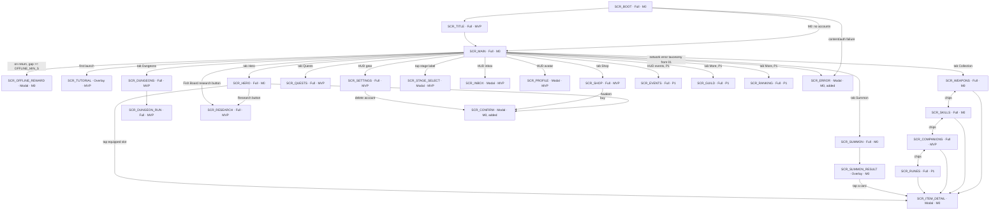

# 07 - Screens and UX

Every screen in 00 section 5.3: what it is for, how it is laid out on a portrait phone, which view-model fields each element binds to, which `Command` each action sends, which `Event`s it reacts to, and its empty, loading, error, locked and first-time states. Then the rules that hold across screens: formatting, palette, touch, haptics, sound, badges, modals, accessibility, localization, performance, the tutorial, the placeholder-art plan and the Unity implementation shape. The client is presentation only (00 section 4): nothing here computes a game number; every number is read from a view-model that was filled from a sim snapshot or an event.

Tiers covered: M0 (`SCR_BOOT`, `SCR_MAIN`, `SCR_HERO`, `SCR_WEAPONS`, `SCR_SKILLS`, `SCR_SUMMON`, `SCR_SUMMON_RESULT`, `SCR_OFFLINE_REWARD`, `SCR_ITEM_DETAIL`), MVP (the rest of 5.3 except P1 rows), P1 (`SCR_RUNES`, `SCR_GUILD`, `SCR_RANKING`, `SCR_EVENTS`) in outline.

Depends on: 00 (screen IDs, commands, events, constants), 01 (`SessionRunner`, snapshot API, error taxonomy), 02 (`GameState` fields the view-models read), 03 (combat snapshot, Training, Awakening, Research), 04 (banners, collections), 05 (Fish Board), 06 (quests, dungeons, offline, shop, inbox), 09 (localization keys and length budgets).

## 1. Navigation map

Types: **Full** replaces the content area and pushes onto the `ScreenRouter` stack; **Modal** is a card over a dimmed scrim, pushed onto the same stack, at most one visible at a time; **Overlay** draws over `SCR_MAIN` without a scrim and does not block the combat viewport.



Two screens are added beyond 5.3 and should be lifted into 00: `SCR_CONFIRM` (generic two-button confirmation with a cost line) and `SCR_ERROR` (blocking or non-blocking error card driven by 01's error taxonomy). Both are M0 because the boot path and the Awakening confirm need them.

Stack rules:

1. `SCR_MAIN` is the stack root and is never popped. Every Full screen is pushed over it; the HUD stays visible on every Full screen; the combat viewport and Fish Board are hidden under Full screens except `SCR_DUNGEON_RUN`, which replaces the combat viewport and keeps the HUD.
2. Tab bar taps replace the top Full screen rather than pushing (stack depth stays 2), so the back button from any tab returns to `SCR_MAIN`.
3. Modals push; a modal over a Full screen dims both. A second modal request while one is open is queued, not stacked (section 10).
4. Overlays (`SCR_SUMMON_RESULT`, `SCR_TUTORIAL`) are drawn in a layer above modals but never hide the HUD wallet chips.
5. Android back button: pops the top modal or overlay if dismissible; else pops the top Full screen; on `SCR_MAIN` with nothing open it shows the `SCR_CONFIRM` "Exit Whisker Hero?" once, then quits on the second press within 2 s. It never pops `SCR_OFFLINE_REWARD` (claim is mandatory, 06 section 7.3) and is ignored during a summon reveal until the reveal finishes or is skipped.

## 2. Portrait layout grammar

Reference resolution 1080 x 1920; `CanvasScaler` Scale With Screen Size, match width (0). Every size below is in reference pixels (rp); 1 rp is about 0.055 mm on a 5.5 inch 1080p phone, so 120 rp is about 9 mm.

```
+----------------------------------------------+  safe area top (status bar, notch)
| HUD bar                               120 rp |  wallet chips, avatar, inbox, settings
+----------------------------------------------+
|                                              |
| Combat viewport                       800 rp |  about 45% of the usable height
|   stage label, enemy, hero, HP bar, timer    |
|   skill icons, companion icons, DPS          |
+----------------------------------------------+
| Action strip                          100 rp |  Boss button, quick toggles, red-dot shortcuts
+----------------------------------------------+
|                                              |
| Fish Board                            640 rp |  about 35%: tank, 5x4 grid, merge/release buttons
|                                              |
+----------------------------------------------+
| Tab bar                               160 rp |  Hero | Collection | Summon | Dungeons | Quests | Shop
+----------------------------------------------+  safe area bottom (gesture bar)
```

Band budget: 120 + 800 + 100 + 640 + 160 = 1,820 rp. The remaining 100 rp of a 1920 rp screen absorbs safe-area insets; on taller phones (19.5:9 and 20:9) the combat viewport grows (`flex-grow: 1`); on 16:9 phones with insets larger than 100 rp the combat viewport shrinks first, then the Fish Board's cell size, never the tab bar or HUD.

| Element | Rule |
|---|---|
| Safe area | `SafeAreaFitter` on the root panel applies `Screen.safeArea` as padding on `Start` and on resolution change. Nothing is drawn outside it except the background. |
| HUD wallet chips | Gold, Diamonds, Fish Coins (MVP adds Rock Candy). Each chip: icon 56 rp, value in 40 rp bold, tappable (gold opens `SCR_HERO`, diamonds opens `SCR_SHOP`, Fish Coins opens `SCR_RESEARCH`, Rock Candy opens `SCR_HERO` Awakening tab). Right side: avatar (opens `SCR_PROFILE`), inbox icon with badge, settings gear. |
| Combat viewport | Full-width camera render texture or a world-space sorting layer; UI elements over it are the stage label (top-left, tappable: `SCR_STAGE_SELECT`), kill counter (top-right), enemy HP bar (under the enemy), boss timer bar (under HP bar, boss only), DPS readout (bottom-left), skill icon row and companion icon row (bottom, 6 + 4 icons, 88 rp each). Tap anywhere else = `TapZap`. |
| Action strip | Left: `[Boss]` button (visible only while walled, 06/03), `[Auto]` placeholder toggle (P1 Auto Merge). Right: shortcut pills with red dots for Quests claimable, Dungeon tickets unused, Inbox items; each opens its screen. |
| Fish Board | Left column 160 rp: Magic Tank gauge (fill, `n / cap`, next-fish countdown), `[Release]` and `[Release max]` buttons, `[Merge all]`. Right: 5 x 4 grid, cell 176 rp with 8 rp gaps (5 x 176 + 4 x 8 = 912 rp wide), fish sprite 140 rp inside. A `[Research]` button (MVP) in the tank column bottom. |
| Tab bar | Six tabs, 180 rp wide each, icon 64 rp over a 28 rp label. Red-dot badge at top-right of the icon. Active tab tinted `accent`. P1 adds a seventh "More" tab opening Guild / Ranking / Events. |
| Full screen content | Pushed over combat viewport + action strip + Fish Board (the 1,540 rp between HUD and tab bar). Has a 96 rp title row with a back chevron (left) and the screen title; content below scrolls. |
| Modal | Width 960 rp, centered; max height 1,400 rp; 32 rp corner radius; scrim `#000000` at 60%. Tap on scrim dismisses when `Dismissible`. |
| Overlay stacking | z-order: background < combat < Fish Board < HUD/tab bar < Full screens < modal scrim + modal < overlays (`SCR_SUMMON_RESULT`, `SCR_TUTORIAL`) < toasts < `SCR_ERROR` when blocking. |
| Touch targets | Minimum 112 x 112 rp (about 8.5 mm) for any tappable; 16 rp minimum gap between adjacent targets; list rows at least 128 rp tall. |

## 3. Binding conventions used by every screen section

- A screen is a uGUI prefab with a `ScreenBase` subclass. `Bind(vm)` resolves references once; `Refresh()` writes only changed values through change-only setters (`NumberLabel`, `IntLabel`, `TextKeyLabel`, `BarFill`, `BadgeDot`); `OnEvent(Event e)` handles the events listed per screen.
- View-models live in `Whisker.Client.ViewModels`, one class per screen named `<Screen>Vm` (`MainVm`, `HeroVm`, ...). They are plain C#, no `UnityEngine`. They are filled from `Simulation.Snapshot()` after any tick that ran and from events as they drain (01).
- A view-model field listed as `bind` is read-only display; `cmd` means the element sends that `Command` through `Commands.Send(cmd)`; a rejection comes back as `Rejected(code)` and renders as a toast with the localized reason (`err.<CODE>`).
- States every screen implements unless the section says otherwise: **Loading** (skeleton rows, shimmer, no spinner longer than 2 s before a retry link), **Empty** (illustration key + one-line copy + the primary action that fills it), **Error** (inline card from 01 taxonomy with Retry), **Locked** (greyed content, lock icon, unlock condition text, no interaction), **First-time** (one coach-mark overlay pointing at the primary action, shown once, stored in `Profile.SeenCoachMarks`).

## 4. Screens

### 4.1 `SCR_BOOT` (Full, M0)

Purpose: cold-boot progress and the only place a fatal startup error is shown. Runs the 01 cold-boot sequence: content load, config fetch (MVP), auth (MVP), save load, Offline Catch-up compute, then `SCR_TITLE` (MVP) or `SCR_MAIN` (M0).

```
+----------------------------------------------+
|                                              |
|              [ logo placeholder ]            |
|                                              |
|          Whisker Hero                        |
|                                              |
|   |==================          |  64%        |
|   Loading content...                         |
|                                              |
|   v0.1.0 (17)  content 12  build abc123      |
+----------------------------------------------+
```

| Element | Binding |
|---|---|
| Progress bar | `BootVm.Progress01` (steps weighted: content 40, config 10, auth 10, save 20, catch-up 10, warm-up 10) |
| Step label | `BootVm.StepKey` (`boot.step.content`, `boot.step.config`, `boot.step.auth`, `boot.step.save`, `boot.step.catchup`, `boot.step.warmup`) |
| Version caption | `BootVm.ClientVersion`, `ContentVersion`, `BuildHash` |

States: Loading is the whole screen. Error: `SCR_ERROR` blocking, with the 01 taxonomy code, `[Retry]` and, for `SAVE_CORRUPT`, `[Restore from cloud]` (MVP) / `[Reset profile]` (two-step confirm). Content newer than the client (`CLIENT_TOO_OLD`): `SCR_ERROR` with `[Update]` opening the store page. No interaction otherwise; back button ignored. Events: none from the sim; it reacts to `SessionRunner.BootProgress`.

### 4.2 `SCR_TITLE` (Full, MVP)

Purpose: account pick on first launch and after logout; skipped when a guest or linked session token is valid.

```
+----------------------------------------------+
|              [ key art placeholder ]         |
|                                              |
|   [ Continue as Guest ]                      |
|   [ Sign in with Apple ]        (iOS)        |
|   [ Sign in with Google Play ]  (Android)    |
|                                              |
|   Have a save on another device? Sign in     |
|   with the same account to restore it.       |
|                                              |
|   Terms · Privacy · Age 13+ (region)         |
+----------------------------------------------+
```

| Element | Binding / command |
|---|---|
| Guest button | `cmd` runtime `Auth.Guest()` (01, not a sim command) |
| Platform buttons | `Auth.LinkOrSignIn(provider)`; only the platform's own provider is shown |
| Legal links | open in-app browser; `TitleVm.AgeGateRequired` (08 compliance) shows a birth-year picker modal before any sign-in |

States: Loading during the auth round-trip (buttons disabled, spinner on the pressed one). Error inline under the buttons (`err.AUTH_*`). Conflict: when the cloud save and the local save differ, the 02 conflict modal is shown here before `SCR_MAIN` with both saves' stage, hero level, server time and a `[Keep this device]` / `[Use cloud]` pair.

### 4.3 `SCR_MAIN` (Full root, M0)

Purpose: the game. Combat on top, Fish Board below, HUD and tab bar framing them. It is never popped and keeps ticking under every other screen.

```
+----------------------------------------------+
| [G] 3.72M  [D] 1,240  [F] 812   (av) [in] [*]|  HUD
+----------------------------------------------+
| Stage 100  Ch.2  v        kills 9/10   WALL  |
|                                              |
|        (cat)                 (boss)          |
|        ~~~~                  ~~~~~~          |
|                        HP |==========   | 1.2M|
|                        T  |======       | 17s |
| DPS 3.72K  +12.3K  +9.8K crit!               |  damage numbers float here
| [sk1][sk2][sk3][sk4][ -- ][ -- ]  MP |===  | |  skill row, MP bar
| [c1][c2][ -- ][ -- ]                         |  companion row
+----------------------------------------------+
| [ Boss: need ~2.3x ]        (Q*) (Dg*) (In)  |  action strip
+----------------------------------------------+
| Tank    | [1][2][ ][3][ ]                    |
| 7/10    | [ ][1][1][ ][2]                    |
| 0:04    | [ ][ ][ ][ ][ ]                    |
| [Rel.]  | [ ][ ][ ][ ][ ]                    |
| [Rel.max]                                    |
| [Merge all]                       [Research] |
+----------------------------------------------+
| Hero | Collection | Summon | Dungeons | Quests | Shop |
+----------------------------------------------+
```

| Element | `MainVm` field (bind) or command | Notes |
|---|---|---|
| Gold chip | `Wallet.Gold` | suffix ladder; pulses on increase from `BOSS`/`OFFLINE` only, not per kill |
| Diamond chip | `Wallet.Diamond` | pulses on any increase |
| Fish Coin chip | `Wallet.FishCoin` | |
| Rock Candy chip (MVP) | `Wallet.RockCandy` | shown once `Stage.Highest >= AWAKEN_STAGES[0]` |
| Avatar | `Profile.AvatarId` | tap: push `SCR_PROFILE` |
| Inbox icon | `Inbox.UnclaimedCount` badge | tap: push `SCR_INBOX` |
| Settings gear | | tap: push `SCR_SETTINGS` |
| Stage label | `Combat.Stage`, `Combat.Chapter` | tap: push `SCR_STAGE_SELECT` (MVP; M0 no-op) |
| Kill counter | `Combat.KillsInStage / KILLS_PER_STAGE` | red when `IsWalled` |
| WALL badge | `Combat.IsWalled` | |
| Enemy sprite, HP bar | `Combat.EnemyId`, `EnemyIsBoss`, `EnemyHp`, `EnemyMaxHp` | HP bar text "1.2M / 1.7M" |
| Boss timer bar | `Combat.BossTimerTicks / BOSS_TIME_TICKS` | boss only; turns `bad` under 5 s |
| Hero sprite | `Hero.AwakenRank` (tint/aura), `Hero.EquippedWeaponId` (held sprite) | |
| Damage numbers | from `DamageDealt(amount, isCrit, source)` events | pooled, section 13 |
| DPS readout | `Combat.Dps` | updates at most 2 Hz |
| Skill icons x6 | `Loadout.Skills[i]`: `IconId`, `CooldownPct`, `IsEmpty` | tap: push `SCR_ITEM_DETAIL`; long-press (P1 manual cast) |
| MP bar | `Loadout.Mp / Loadout.MpMax` | |
| Companion icons x4 | `Loadout.Companions[i]`: `IconId`, `AbilityReadyPct` | |
| Tap on viewport | `cmd TapZap` | at most `TAP_ZAP_MAX_PER_SEC`; extra taps still play the tap VFX but send nothing |
| Boss button | `Combat.IsWalled`, `Combat.BossClearable`, `Combat.NeedDpsRatio` | `cmd AttemptBoss`; label "Boss: need ~2.3x" or "Boss: clearable" (green border) |
| Shortcut pills | `Badges.QuestsClaimable`, `Badges.DungeonTicketsUnused`, `Badges.InboxUnclaimed` | push the respective screen |
| Tank gauge | `Fish.TankCount / Fish.TankCap`, `Fish.NextFishSec` | |
| Release / Release max | `Fish.CanRelease` | `cmd ReleaseFish` / `cmd ReleaseFish` repeated `min(tank, emptyCells)` times in one frame |
| Merge all | `Fish.MergeAllCount` (pairs available) | `cmd MergeFish(src, dst)` for each pair, lowest level first, one frame |
| Grid cells | `Fish.Cells[20]`: `Level` (0 empty), `IsSelected`, `IsNew`, `IsDropTarget` | interaction in section 5 |
| Research button (MVP) | `Badges.ResearchAffordable` dot | push `SCR_RESEARCH` |
| Tab bar | `Badges.*` per tab | replace top Full screen |

Events `SCR_MAIN` reacts to: `EnemySpawned` (new sprite, HP full), `DamageDealt` (number), `EnemyKilled` (death VFX, gold burst toward chip), `StageCleared` (stage label pulse), `BossFailed` (WALL badge in, boss button in, toast with need ratio), `BossCleared` (green flash, first-clear diamond toast if `FirstClearGranted`), `LevelUp` (hero sprite flash, "Lv 32" float), `FishReleased` (cell pop-in), `FishMerged` (merge VFX, missile launch toward enemy), `FishDiscovered` (discovery card overlay 1.5 s with coins), `QuestCompleted` (Quests badge), `DayRolledOver` (toast, badges), `Awakened` (full-width card over the combat viewport, combat keeps running), `StageCapReached` (toast), `OfflineRewardComputed` (push `SCR_OFFLINE_REWARD`).

States: Loading never (boot covers it). First-time: `SCR_TUTORIAL` overlay. Error: non-blocking `SCR_ERROR` card in the action strip position for network errors (MVP) while the sim keeps running offline. Locked elements: Rock Candy chip, stage label tap, Research button and the Dungeons/Quests/Shop tabs before their unlock conditions show a lock glyph and a toast naming the condition.

### 4.4 `SCR_HERO` (Full, M0)

Purpose: all gold and Rock Candy sinks on the hero: Training per stat, Hero Level readout, Awakening (MVP), the equipped loadout, and the entry to Research (MVP).

```
+----------------------------------------------+
| <  Hero                        DPS 3.72K     |
| (cat)  Lv 32  |=========     | 4.2K / 9.8K   |
| Awakening I   next: stage 150  [ Awaken ]    |  MVP
| Loadout: [wpn] [s1][s2][s3][s4][s5][s6] [c1][c2][c3][c4] |
| Training              [x1] [x10] [x100] [Max]|
| ATK      Lv 64  x4.20   cost 3.80K  [ + ]    |
| HP       Lv 12  x1.60   cost 112    [ + ]    |
| DEF      Lv 10  ...                          |
| CRIT_RATE Lv 5  12.5%   cost 70     [ + ]    |
| CRIT_DMG Lv 3   +45%                         |
| ATK_SPD  Lv 8   +16%                         |
| GOLD_GAIN Lv 20 +40%                         |
| EXP_GAIN Lv 6   +12%                         |
|                              [ Research > ]  |  MVP
+----------------------------------------------+
```

| Element | `HeroVm` field or command |
|---|---|
| Level, EXP bar | `Hero.Level`, `Hero.Exp / Hero.ExpToNext` (`HERO_LVL_EXP(l)`) |
| DPS | `Combat.Dps` |
| Awakening row (MVP) | `Awaken.Rank`, `Awaken.NextStage`, `Awaken.NextCost`, `Awaken.CanAfford`, `Awaken.StageReached`; `[Awaken]` opens `SCR_CONFIRM` with cost and balance-after, then `cmd Awaken` |
| Loadout icons | `Loadout.Weapon`, `Loadout.Skills[6]`, `Loadout.Companions[4]`; tap: `SCR_ITEM_DETAIL`; empty slot tap: push the matching collection screen |
| Bulk step selector | `Training.Step` in `TRAIN_BULK_STEPS` {1, 10, 100, Max}; persisted in `Profile.Prefs.TrainStep` |
| Per-stat row x8 | `Training.Rows[stat]`: `Level`, `EffectText` (from 03 per-stat formatter), `Cost` (bulk cost for the selected step), `Count` (levels the step buys; Max computes affordable), `CanAfford`, `AtCap`; `[+]` sends `cmd TrainStat(stat, count)` all-or-nothing |
| Research button (MVP) | `Badges.ResearchAffordable`; push `SCR_RESEARCH` |

Events: `TrainingPurchased(stat, count, cost)` (row flash, "+5%" float), `LevelUp`, `Awakened` (rank glyph animates), `CurrencyChanged(GOLD)` (re-evaluate `CanAfford`).

States: a stat at its cap (03) shows "MAX" in place of the cost and a disabled button. Awakening before the stage gate: button disabled with "Reach stage 150". First-time: coach mark on ATK `[+]`. The `Max` step shows "Buy 37 levels for 3.71M" so the player knows what they are tapping.

### 4.5 `SCR_WEAPONS` (Full, M0)

Purpose: the 30-weapon collection, equip, level-up readout, and the owned-collection passive total that makes dupes and low rarities matter (00 decision 5).

```
+----------------------------------------------+
| <  Collection   [Weapons] Skills Companions  |  chips switch screens
| Equipped: [L] Tuna Blade Lv3  ATK +120%      |
| Collection passive: +86% ATK (24/30 owned)   |
| Sort: [Rarity v]  Filter: [All v]  (3 new)   |
| [M?] [L ] [L ] [E*] [E ] [E ]                |  6 per row, 5 rows
| [R ] [R ] [R ] [R ] [R?] [R ]                |
| ...                                          |
| Selected: [E] Sardine Spear  Lv2 (4/6)       |
|  ATK +48%  passive +4.8%     [ Equip ] [ i ] |
+----------------------------------------------+
```

| Element | `WeaponsVm` field or command |
|---|---|
| Chips | push sibling collection screen (replace, same stack depth) |
| Equipped summary | `Equipped`: `Rarity`, `NameKey`, `Level`, `AtkPct` |
| Passive total | `PassiveTotalPct`, `OwnedCount / PoolSize` (04 `WEAPON_PASSIVE_PCT`) |
| Sort / filter | `Sort` in {Rarity, Level, Newest, Owned first}, `Filter` in {All, Owned, Rarity r}; persisted prefs |
| Grid tile x30 | `Tiles[i]`: `Id`, `Rarity`, `IconId`, `Owned`, `Level`, `CopiesToNext`, `IsNew`, `IsEquipped`; unowned at 30% opacity with "?" |
| Selected panel | `Selected`: stats, `NextLevelCopies` ("4/6"), `AtkPct`, `PassivePct`; `[Equip]` sends `cmd EquipWeapon(id)` (disabled when equipped or unowned); `[i]` pushes `SCR_ITEM_DETAIL` |

Events: `ItemAcquired(kind=WEAPON)` (tile flips from "?" or copies tick up, `IsNew` set), `WeaponEquipped` (equipped summary swap), `ItemLeveledUp`.

States: Empty is impossible after the tutorial (the first summon is scripted). New badges clear when the tile is tapped or the screen is left (`cmd MarkSeen(ids)` is a client-side pref, not a sim command). Locked: none.

### 4.6 `SCR_SKILLS` (Full, M0)

Purpose: 40-skill collection, six auto-cast slots, slot order.

```
+----------------------------------------------+
| <  Collection   Weapons [Skills] Companions  |
| Slots (auto-cast in order)   [ Auto-equip ]  |
| [1:E Fish Rain][2:R Claw][3:R Pounce][4][5][6]|
| Sort / Filter row                            |
| 40 tiles, 6 per row                          |
| Selected: [E] Fish Rain Lv2  DPS 85% CD 8s   |
|  instant · 1/6 copies · [ Equip to slot v ]  |
+----------------------------------------------+
```

| Element | `SkillsVm` field or command |
|---|---|
| Slot x6 | `Slots[i]`: `SkillId?`, `IconId`, `Rarity`, `Level`, `CooldownSec`; tap with a selection: `cmd EquipSkill(slot, id)`; tap without: `cmd UnequipSkill(slot)`; drag slot onto slot (MVP): `cmd ReorderSkills(from, to)` |
| Auto-equip | `AutoEquipWouldChange` dot; `cmd AutoEquipSkills` (04 ordering rule) |
| Tiles x40 | as weapons plus `DpsPct`, `CooldownTicks`, `CastType` (instant / dot / buff) glyph |
| Selected panel | `[Equip to slot v]` lists the six slots with current occupant; disabled when unowned |

Events: `ItemAcquired(kind=SKILL)`, `SkillEquipped`, `SkillsReordered`, `ItemLeveledUp`.

### 4.7 `SCR_COMPANIONS` (Full, MVP)

Purpose: 50-companion collection, four slots, the shared MP pool readout.

```
+----------------------------------------------+
| <  Collection   Weapons Skills [Companions]  |
| MP 120 / 200   regen 4.0/s   (Research +)    |
| Slots [c1][c2][c3][ -- ]   total MP/s cost 3.2|
| Sort / Filter row                            |
| 50 tiles, 6 per row                          |
| Selected: [L] Captain Mittens Lv1            |
|  damage · 40 MP · every 6 s · DPS +60%       |
|  [ Equip to slot v ]                         |
+----------------------------------------------+
```

| Element | `CompanionsVm` field or command |
|---|---|
| MP line | `Mp`, `MpMax`, `MpRegenPerSec` (03 Research); `(Research +)` pushes `SCR_RESEARCH` |
| Slots x4 | `Slots[i]`; `cmd EquipCompanion(slot, id)`, `cmd UnequipCompanion(slot)` |
| MP budget | `EquippedMpPerSec` vs `MpRegenPerSec`; shown `bad` when cost exceeds regen (04 explains the trade) |
| Tiles x50 | plus `AbilityType` glyph (damage / buff / gold / MP regen), `MpCost`, `IntervalSec` |

Events: `ItemAcquired(kind=COMPANION)`, `CompanionEquipped`, `ItemLeveledUp`. Locked before the Companion banner unlock (04): whole screen shows "Unlocks at stage 20" over the greyed grid.

### 4.8 `SCR_RUNES` (Full, P1)

Same grid grammar with six slots (`RUNE_SLOTS`) and a slot-type filter. Fourth chip on the collection header, hidden until P1 content ships. `RunesVm` mirrors `WeaponsVm` with `StatMods[]` on the selected panel. Commands `EquipRune(slot, id)`, `UnequipRune(slot)`.

### 4.9 `SCR_RESEARCH` (Full, MVP)

Purpose: the Fish Coin sink (03 node list: MP pool, MP regen, tank capacity, tank refill, fish level cap, gold gain, offline cap extension).

```
+----------------------------------------------+
| <  Research              [F] 812 Fish Coins  |
| Tank capacity   Lv 2  10 -> 12    120 [ Buy ]|
| Tank refill     Lv 1  6.0s -> 5.5s 150 [Buy] |
| Fish level cap  Lv 0  10 -> 11    800 [ Buy ]|
| MP pool         Lv 3  ...                    |
| MP regen        Lv 1                         |
| Gold gain       Lv 0                         |
| Offline cap     Lv 0  24h -> 26h  2,000      |
+----------------------------------------------+
```

| Element | `ResearchVm` field or command |
|---|---|
| Row per node | `Rows[node]`: `Level`, `MaxLevel`, `CurrentText`, `NextText`, `Cost`, `CanAfford`, `AtMax`; `[Buy]` sends `cmd BuyResearch(node)` |
| Header | `Wallet.FishCoin` |

Events: `ResearchPurchased(node, level)` (row flash, tank gauge on `SCR_MAIN` updates via snapshot), `CurrencyChanged(FISH_COIN)`. Locked before stage 15 (03 unlock): greyed with the condition. First-time coach mark on Tank capacity.

### 4.10 `SCR_SUMMON` (Full, M0)

Purpose: the diamond sink. One tab per banner; 1x and 10x; rates, pity and banner level always visible (pillar 4).

```
+----------------------------------------------+
| <  Summon      [Weapon] [Skill] [Companion]  |
| Banner Lv 3  |=======     | 143/200 EXP      |
| Pity 23 / 80   soft pity from pull 51        |
| |==========                              |   |
| Featured: 30 weapons · rates [ View rates ]  |
|  [ Summon x1   100 ]   [ Summon x10  1,000 ] |
|  [ Use ticket x1 (3) ]                       |
| 10x: at least one Epic guaranteed            |
+----------------------------------------------+
```

| Element | `SummonVm` field or command |
|---|---|
| Banner tabs | `Banners[b]`: `Unlocked`, `BadgeNewLevel`; Companion tab locked before its unlock stage |
| Banner level | `Level`, `Exp`, `ExpToNext` (04 thresholds) |
| Pity | `PityCounter`, `PITY_SOFT_START`, `PITY_HARD`; bar with a marker at 50 |
| View rates | opens a rates panel (inline, not a new screen) listing the published table for the current banner level from `RateTable[level]` (04) and the pity ramp rows |
| Summon x1 / x10 | `PullCost`, `CanPull1`, `CanPull10` (diamond balance); `cmd Summon(banner, count: 1 or 10, payment: DIAMOND, requestId)` |
| Use ticket | `TicketCount`; `cmd Summon(banner, 1, payment: TICKET, requestId)`; hidden when 0 |

MVP server path (01): the button shows a spinner on the pressed button for up to 10 s while the request is in flight; the HUD diamond chip does not change until the server result lands (04 payload); on `SUMMON_TIMEOUT` the client retries the same `requestId` silently twice, then shows a non-blocking `SCR_ERROR` card with "Retry" and "Your diamonds were not charged unless the result appears in your collection" (the server replays by `requestId`). M0 local path returns synchronously.

Events: `SummonResolved(results[])` (push `SCR_SUMMON_RESULT`), `BannerLevelUp` (banner bar fill, toast "Banner level 4: rates improved"), `CurrencyChanged(DIAMOND)`.

States: Locked banner tab; disabled buttons name the shortfall ("Need 760 more"). Error as above. First-time: the tutorial scripts the first x10 on Weapons.

### 4.11 `SCR_SUMMON_RESULT` (Overlay, M0)

Purpose: the reveal. Driven entirely by the already-applied `SummonResolved` payload; skippable at any time; the HUD stays live above it.

```
+----------------------------------------------+
|                                   [ Skip ]   |
|   [ ? ] [ ? ] [ ? ] [ ? ] [ ? ]              |
|   [ ? ] [ ? ] [ ? ] [ ? ] [ ? ]              |
|                                              |
|  1 Epic · 3 Rare · 6 Common   pity 33/80     |
|  [ Summon x10 again  1,000 ]   [ Close ]     |
+----------------------------------------------+
```

| Element | `SummonResultVm` field or command |
|---|---|
| Cards x1 or x10 | `Cards[i]`: `Rarity`, `IconId`, `NameKey`, `IsNew`, `LevelBefore`, `LevelAfter`, `State` (FaceDown, Flipping, FaceUp) |
| Skip | `cmd` client-side `Reveal.Skip()` |
| Summary | `Counts[rarity]`, `PityAfter` |
| Again | `CanPullAgain`; `cmd Summon(sameBanner, sameCount, DIAMOND, newRequestId)`; disabled during the reveal and while a request is in flight |
| Close | pops the overlay |
| Tap a face-up card | push `SCR_ITEM_DETAIL` |

Reveal rules are in section 6. Events: `SummonResolved` for "again" replaces the cards in place.

### 4.12 `SCR_DUNGEONS` (Full, MVP)

Purpose: the three daily dungeons and the Tower card (P1).

```
+----------------------------------------------+
| <  Dungeons          resets in 6h 12m        |
| +------------------------------------------+ |
| | Fish Coin Dungeon      tickets 2/2       | |
| | Best floor 4   Next: floor 5  Clearable  | |
| | Reward floor 5: 250 Fish Coins           | |
| | [ Challenge floor 5 ]  [ Sweep floor 4 ] | |
| +------------------------------------------+ |
| | Rock Candy Dungeon     tickets 1/2       | |
| | Best floor 4   Next: floor 5             | |
| | Not clearable yet (need ~1.4x DPS)       | |
| | [ Challenge ] (disabled)  [ Sweep floor 4]| |
| +------------------------------------------+ |
| | EXP Dungeon ...                          | |
| +------------------------------------------+ |
| | Tower (coming soon)                      | |  P1
| +------------------------------------------+ |
```

| Element | `DungeonsVm` field or command |
|---|---|
| Reset countdown | `SecondsToRollover` (from `IClock`, 06 section 4) |
| Card x3 | `Cards[d]`: `Tickets`, `TicketsPerDay`, `BestFloor`, `NextFloor`, `NextReward` (currency, amount), `Clearable` (06 `PreviewDungeon`), `NeedDpsRatio`, `Locked` |
| Challenge | `cmd StartDungeon(d, NextFloor)`; pushes `SCR_DUNGEON_RUN`; disabled with reason when `!Clearable` or `Tickets == 0` |
| Sweep | `cmd SweepDungeon(d)`; disabled when `BestFloor == 0` or `Tickets == 0`; shows reward inline |
| Floor picker (long-press Challenge) | modal list of cleared floors to replay for the spectacle; rewards equal the floor's |

Events: `DungeonCleared`, `DungeonFailed`, `DungeonFloorFirstCleared`, `DayRolledOver` (tickets refresh), `CurrencyChanged(TICKET_*)`.

States: Locked before `DUNGEON_UNLOCK_STAGE` (whole screen greyed, "Unlocks at stage 30"). Empty tickets: buttons disabled, "More tickets in the Shop" link to `SCR_SHOP` exchange tab. Error: none (local sim; seed fetch failure in MVP falls back to a retry toast and the button re-enables).

### 4.13 `SCR_DUNGEON_RUN` (Full, MVP)

Purpose: the fixed fight. Replaces the combat viewport region; the Fish Board is hidden; the HUD stays.

```
+----------------------------------------------+
| Fish Coin Dungeon · Floor 5                  |
|        (cat)                 (floor boss)    |
|                        HP |======       | 40%|
|                        T  |=====        | 14s|
| DPS 3.72K   [skill row]  [companion row]     |
|                                              |
| Reward on clear: 250 Fish Coins              |
|                               [ Skip fight ] |
+----------------------------------------------+
```

| Element | `DungeonRunVm` field |
|---|---|
| Title | `Dungeon`, `Floor` |
| Fight widgets | same bindings as `SCR_MAIN` combat viewport from the run's own snapshot |
| Skip fight | runs the remaining ticks instantly (the outcome is already determined; 06 section 6.1) and shows the result card |
| Result card | `Outcome` (Cleared / Failed), `RewardText`, `RemainingHpPct`; `[Collect]` pops to `SCR_DUNGEONS`; on Cleared with another ticket, `[Next floor]` sends `cmd StartDungeon(d, floor + 1)` if `Clearable` |

Events: `DamageDealt`, `DungeonCleared`, `DungeonFailed`. Back button: same as Skip fight. The main combat keeps ticking underneath (stage farming continues during a run; the run is a separate sub-state, 06).

### 4.14 `SCR_STAGE_SELECT` (Modal, MVP)

Purpose: jump back to a cleared stage (to farm an easier stage for `GOLD_GAIN`-tuned kill rates or to let a weak loadout breathe), and challenge the current boss from anywhere.

```
+----------------------------------------------+
| Stages                                [ X ]  |
| Highest cleared: 99    Farming: 100 (walled) |
| Chapter 2  (51-100)   v                      |
|  [91] [92] [93] [94] [95] [96] [97] [98] [99]|
|  [100 boss]  <- current                      |
| [ Return to highest ]   [ Challenge boss ]   |
+----------------------------------------------+
```

| Element | `StageSelectVm` field or command |
|---|---|
| Chapter dropdown | `Chapters[]` (`CHAPTER_WIDTH` groups up to `Stage.Highest`) |
| Stage chips | `Stages[]`: `Number`, `IsBoss`, `IsCurrent`, `Cleared`; tap: `cmd SelectStage(n)` for `n <= Stage.Highest` |
| Return to highest | `cmd SelectStage(Stage.Highest)` |
| Challenge boss | `cmd AttemptBoss` (only when walled) |

Rules the modal makes visible: offline gold, dungeon floor difficulty and first-clear eligibility all read `Stage.Highest`, never the selected stage (06 and 03), so a lower stage is never a loophole; the modal says "Rewards for offline time use your highest stage". Events: `StageSelected`, `StageCleared`.

### 4.15 `SCR_QUESTS` (Full, MVP)

```
+----------------------------------------------+
| <  Quests   [Daily *] Weekly  Achievements   |
| Daily progress  8 / 11   [30 claimed] [70 !] |
|  Log in                 1/1    [ Claim ]     |
|  Defeat 300 monsters  300/300  [ Claim ]     |
|  Attempt a boss 3 times  2/3   |======  |    |
|  Summon a weapon         1/1   claimed       |
|  Summon a skill          0/1   [ Go > ]      |
|  ...                                         |
|                        [ Claim all (4) ]     |
+----------------------------------------------+
```

| Element | `QuestsVm` field or command |
|---|---|
| Tabs | `Tab` in {DAILY, WEEKLY, ACHIEVEMENT}; badge per tab = count `COMPLETED` |
| Daily progress bar | `DailyCompletedCount / 11`, bonus chips for `d_bonus_5`, `d_bonus_8` with their state |
| Row per quest | `Rows[]`: `TitleKey`, `TitleArgs` (target), `Progress`, `Target`, `State`, `RewardIcon`, `RewardAmount`, `GoScreen` (deep link for `IN_PROGRESS` rows) |
| Claim | `cmd ClaimQuest(id)`; Claim all: `cmd ClaimAllQuests(tab)` with a summary toast "+140 diamonds" |
| Achievements tab | one row per ladder showing the lowest unclaimed rung and "3 / 11 rungs" |

Events: `QuestCompleted` (row state swap, badge), `QuestClaimed`, `QuestsBulkClaimed` (toast), `DayRolledOver` / `WeekRolledOver` (full refresh; a toast "Missions reset" if the screen is open).

States: Locked before stage 10 (quests unlock after the first boss). Empty daily list cannot occur. Forfeit warning: 60 minutes before rollover, rows with `COMPLETED` state show an amber "expires soon" caption (06 Open question 2).

### 4.16 `SCR_SHOP` (Full, MVP)

```
+----------------------------------------------+
| <  Shop    [Packages] Diamonds  Exchange     |
| Daily free gift: 1 Weapon ticket   [ Claim ] |
| +------------------------------------------+ |
| | Starter Pack  600 diamonds   US$2.99     | |
| | one time · 2x value           [ Buy ]    | |
| +------------------------------------------+ |
| | Monthly Card  1,000 now + 100/day x30    | |
| | US$9.99 · best value          [ Buy ]    | |
| +------------------------------------------+ |
| Diamonds tab: 6 packs, "x2 first purchase"   |
| Exchange tab: 3 ticket offers, 0/2 today     |
+----------------------------------------------+
```

| Element | `ShopVm` field or command |
|---|---|
| Daily gift | `DailyGiftClaimed`; `cmd ClaimDailyGift` |
| Package cards | `Packages[]`: `Sku`, `TitleKey`, `GrantText`, `LocalizedPrice` (from the store SDK), `Available`, `Limit text`, `BestValue`; `[Buy]` opens `SCR_CONFIRM` then `Iap.Purchase(sku)` (01/08 flow) |
| Diamond packs | `Packs[]`: `Total`, `BonusPct`, `FirstPurchaseAvailable`, `LocalizedPrice`, `PerUsd` |
| Exchange | `Offers[]`: `Price`, `Grant`, `UsedToday / Limit`; `cmd ExchangeItem(offerId, qty)` with a qty stepper |

IAP states: pressed button shows a spinner; the store sheet is native; on success a toast "Purchase complete: check your Inbox" and the Inbox badge increments when the server grant lands (08); on `IAP_PENDING` (deferred approval) a card explains; on failure a non-blocking `SCR_ERROR` with the store's message. Prices are never shown before the store returns them (skeleton rows meanwhile). `shop_view` analytics on open.

### 4.17 `SCR_INBOX` (Modal, MVP)

```
+----------------------------------------------+
| Inbox (3)                              [ X ] |
|  [D] Monthly Card day 4   100 diamonds       |
|      expires in 29d                 [Claim]  |
|  [M] Maintenance thanks   50 diamonds        |
|      expires in 6d                  [Claim]  |
|  [D] Diamond pack x2      2,400 diamonds     |
|      never expires                  [Claim]  |
|                         [ Claim all (3) ]    |
+----------------------------------------------+
```

| Element | `InboxVm` field or command |
|---|---|
| Rows | `Items[]`: `Id`, `Type` glyph, `TitleKey`, `BodyKey`, `BodyArgs`, `Grants[]`, `ExpiresInSec?`, `Claiming` |
| Claim / Claim all | `cmd ClaimInbox(id, requestId)` / `cmd ClaimAllInbox(requestId)` (server mutations) |

States: Loading skeleton while `GET /inbox` is in flight (cached list shown immediately if present). Empty: illustration + "Nothing here. Rewards from purchases and events arrive here." Error: inline card with Retry; cached items stay visible but Claim is disabled offline. Rows animate out on claim; the wallet chip pulses.

### 4.18 `SCR_OFFLINE_REWARD` (Modal, M0)

Content is defined in 06 section 7.3. Layout:

```
+----------------------------------------------+
|  Welcome back!                               |
|  Away for 12h 04m                            |
|  Rewards for 12h 04m                         |   "(capped at 24h)" when Capped
|   [G] +997K gold                             |
|   [E] +1.2M EXP                              |
|   [T] Magic Tank refilled (+10 fish)         |
|  Farmed stage 90 at 23/s                     |
|            [ Claim ]        [ Claim x2 ]     |   x2 is P1, hidden in MVP
+----------------------------------------------+
```

`OfflineRewardVm` is the `OfflineReward` record plus formatted strings. `[Claim]` sends `cmd ClaimOfflineReward`; the modal then plays a gold burst into the HUD chip and pops. Not dismissible by scrim or back button. If `Pending` is null at show time (double-show race) the modal pops silently.

### 4.19 `SCR_ITEM_DETAIL` (Modal, M0)

Purpose: any collectible's full card: stats, level, next-level cost, source.

```
+----------------------------------------------+
| [E] Sardine Spear               Weapon [ X ] |
|        ( big icon )                          |
| Level 2   4 / 6 copies to level 3            |
| Equipped ATK +48%  ->  +60% at level 3       |
| Collection passive +4.8%  (4% x 1.2)         |
| Max level 10: 2.8x base (DUPE_LVL_BONUS)     |
| Source: Weapon banner (Epic 9%)              |
|                     [ Equip ]  [ Compare ]   |
+----------------------------------------------+
```

| Element | `ItemDetailVm` field or command |
|---|---|
| Header | `Kind`, `Rarity`, `NameKey`, `IconId` |
| Level block | `Level`, `Copies`, `CopiesToNext` (`DUPE_LVL_CUM`), `AtMaxLevel` |
| Stat block | kind-specific rows: weapon `AtkPct`, `PassivePct`; skill `DpsPct`, `CooldownSec`, `CastType`; companion `AbilityType`, `MpCost`, `IntervalSec`, `EffectPct`; rune (P1) `StatMods[]` |
| Next-level preview | `NextLevelStatText` |
| Source | `BannerCode`, `BaseRate` for its rarity |
| Equip | `cmd EquipWeapon` / `EquipSkill(slot)` / `EquipCompanion(slot)`; for slotted kinds a slot picker row appears |
| Compare (weapons) | toggles a side-by-side with the equipped weapon |

States: unowned item shows "Not owned" and no Equip. Opened from `SCR_SUMMON_RESULT` it shows a "NEW" ribbon when `IsNew`.

### 4.20 `SCR_SETTINGS` (Full, MVP)

```
+----------------------------------------------+
| <  Settings                                  |
| Account   Guest · id 8d1c...   [ Link Apple ]|
|           [ Link Google Play ] [ Log out ]   |
| Notifications  ( ) Tank full  ( ) Dungeon reset ( ) Missions expiring |
| Language       [ English v ]                 |
| Sound ( ) Music ( ) Haptics ( ) Reduced motion ( ) Large text ( ) |
| Battery saver (30 fps) ( )                   |
| Purchases      [ Restore purchases ]         |
| Support        [ Contact ]  [ FAQ ]          |
| Legal          [ Privacy ] [ Terms ] [ Licenses ] |
| Danger         [ Delete account ]            |
| v0.1.0 (17) · content 12 · save v1 · abc123  |
+----------------------------------------------+
```

| Element | `SettingsVm` field or command |
|---|---|
| Account block | `Account.Provider`, `PlayerIdShort`, `Linked[]`; `Auth.Link(provider)`, `Auth.Logout()` (01 logout flow: upload save, clear token, `SCR_TITLE`) |
| Notification toggles | `Prefs.Notify*` (local OS scheduling; MVP: tank full, dungeon reset; P1: missions expiring) |
| Language | `Prefs.Locale` from the 09 locale list; applies on the next screen push without restart |
| Accessibility toggles | `Prefs.Sound`, `Music`, `Haptics`, `ReducedMotion`, `LargeText` (section 11) |
| Battery saver | `Prefs.TargetFps` 60 / 30 |
| Restore purchases | `Iap.Restore()`; result toast |
| Delete account | `SCR_CONFIRM` with typed "DELETE" field (08 GDPR flow), then `Account.Delete()` and `SCR_TITLE` |
| Version caption | `ClientVersion`, `ContentVersion`, `SaveSchemaVersion`, `BuildHash`; long-press copies diagnostics |

States: offline shows account actions disabled with "Needs connection". Dev builds add a Debug section (01: grant currency, set stage, clock offset, run N hours, export/import save), compiled out of release.

### 4.21 `SCR_PROFILE` (Modal, MVP)

| Element | `ProfileVm` field or command |
|---|---|
| Name | `DisplayName`; `[Edit]` opens a text field (2 to 12 chars, server-filtered, 08); `Profile.Rename(name)` |
| Avatar | `AvatarId` from a fixed set of 12 cat portraits; `Profile.SetAvatar(id)` |
| Stats | `Stage.Highest`, `Hero.Level`, `Awaken.Rank`, `TotalSummons`, `LifetimeMerges`, `Collection counts x3`, `CreatedAt`, `PlayDays` |
| Player id | `PlayerId` with copy button (support) |

### 4.22 `SCR_GUILD` (Full, P1)

Outline: guild card (name, level, members 23/30), check-in button (`GUILD_COIN`), guild boss panel (shared HP bar, your damage today, 3 attempts), chat tab (server, 08), member list, guild shop (products priced in `GUILD_COIN`). Reached from the P1 "More" tab. `GuildVm` is server-fed, not sim-fed.

### 4.23 `SCR_RANKING` (Full, P1)

Outline: tabs Stage / Hero Level / Guild; top 100 plus your row pinned at the bottom; weekly reset countdown; rewards by rank tier delivered to Inbox. Server-fed from Redis (08).

### 4.24 `SCR_EVENTS` (Full, P1)

Outline: a card per active event with countdown, progress and a `[Go]` deep link; event quest list reuses the `SCR_QUESTS` row prefab; rate-up banner events deep link to `SCR_SUMMON` with the banner preselected. HUD gets an events icon with a badge while any event has claimable rewards.

### 4.25 `SCR_TUTORIAL` (Overlay, MVP)

Purpose: the first three minutes. A spotlight cut-out over one target, a one-line caption, a pointer hand. Steps in section 14. `TutorialVm.Step`, `TargetElementId`, `CaptionKey`, `CanSkip`. It blocks taps outside the spotlight except on the HUD; the sim keeps running. Reacts to the event each step waits for (section 14 table). Skip rules in section 14.

### 4.26 `SCR_CONFIRM` (Modal, M0, added)

Generic: `TitleKey`, `BodyKey` + args, optional cost line (`CostCurrency`, `CostAmount`, `BalanceAfter`), `ConfirmKey`, `CancelKey`, `Destructive` (red confirm), optional typed-confirmation string. Used by Awakening, IAP, delete account, exit, and any command flagged `RequiresConfirm` in content. Dismissible by scrim and back button (equals Cancel).

### 4.27 `SCR_ERROR` (Modal or inline card, M0, added)

Driven by 01's error taxonomy. `Code`, `TitleKey`, `BodyKey`, `Blocking`, `Actions[]` from a per-code table: `RETRY`, `UPDATE_APP`, `RESET_PROFILE`, `RESTORE_CLOUD`, `CONTACT_SUPPORT`, `DISMISS`. Blocking variant sits above everything (boot failures, maintenance mode with countdown, `CLIENT_TOO_OLD`); non-blocking variant is a card in the action-strip position that the sim runs under (network loss, summon timeout). Never two at once: a new error replaces the visible one and the replaced code is logged.

## 5. Fish Board interaction states and feedback

The board on `SCR_MAIN` is the one touch-heavy surface. Rules from 05 restated as UI states:

| State | Visual | Transitions |
|---|---|---|
| Idle | fish bob (2 s loop, disabled under Reduced motion); empty cells show a faint pad | touch down on a fish -> Dragging; tap on a fish -> Selected; tap Release -> release |
| Selected (tap-select) | cell ring in `accent`, equal-level fish on the board pulse once | tap an equal-level fish -> `cmd MergeFish(src, dst)`; tap anywhere else -> Idle; long-press -> Info |
| Dragging | fish lifts (scale 1.15, shadow), follows the finger at 60 Hz; the cell under the finger highlights `ok` if equal level, `bad` if occupied by another level, neutral if empty | release over equal level -> `cmd MergeFish`; release over empty -> `cmd MoveFish(src, dst)` (05, cosmetic reposition, no sim randomness); release elsewhere -> snap back 120 ms |
| Info (long-press 400 ms) | tooltip card: level, missile % (`FISH_MISSILE_PCT`), board DPS contribution, coins on next merge | release -> Idle |
| Invalid drop | the target cell shakes 3 x 6 rp over 180 ms, `bad` flash, light haptic | -> Idle |
| Merge | source slides into target 120 ms, target pops to level+1 (scale 1.3 -> 1.0, 200 ms), missile sprite launches toward the enemy, coin chip float `+n` | `FishMerged` event; `FishDiscovered` adds the discovery card for 1.5 s with `FISH_DISCOVERY_COINS[n]` |
| Release | fish drops into a random empty cell from the tank gauge with a 150 ms arc | `FishReleased`; board full -> Release button disabled with "Board full" and the merge-all button pulses once |
| Tank empty | Release buttons disabled, countdown to next fish shown | `TankFishAdded` re-enables |
| At level cap | a capped fish shows a crown; dragging it onto an equal capped fish shows "Max level: raise the cap in Research" | no command |
| Backgrounded mid-drag | on resume the drag is cancelled and the fish snaps back; nothing was sent | |
| Boss fight | board stays active (merging is how you burst a boss); the merge VFX missile is the visible payoff | |

Merge-all order: lowest level first, left-to-right, top-to-bottom pairs, so the result is deterministic and the player can predict it. Buttons send commands in one frame; the sim processes them in order and the view animates from the resulting events with 40 ms stagger.

Haptics: light on pick-up, medium on merge, success pattern on discovery, failure pattern on invalid drop. Sound: pick, drop, merge pitch rising with level (12 steps), discovery fanfare.

## 6. Summon reveal rules

Applies to `SCR_SUMMON_RESULT`. The sim and HUD already reflect the result when the overlay opens; the reveal is theatre and must never gate state.

1. **Single pull.** One card face down at center. 0.2 s pause, flip 0.3 s (scale X to 0, swap face, scale X back), 0.6 s total. Tap anywhere completes the flip instantly.
2. **10-pull.** 2 x 5 grid face down. Card `i` starts at `0.3 + 0.12 i` s; each flip 0.3 s. L and M cards hold a 0.4 s border glow in their rarity colour before flipping, pushing later cards by 0.4 s. Typical 10-pull: about 2 s; worst case: about 6 s.
3. **Rarity flashes.** On a face-up E: card glow 0.3 s. L: full-screen vignette flash in `rarity-L` 0.4 s plus medium haptic. M: screen shake 2 x 4 rp, vignette in `rarity-M`, 0.6 s, success haptic, dedicated sound. Reduced motion replaces shake and vignette with a static border and keeps the haptic.
4. **Skip.** Visible from the first frame. Sets every card face up with transitions disabled and shows the summary. Also triggered by the back button.
5. **Tap to speed.** Any tap during the sequence completes the current card's flip and halves the remaining stagger (`0.06 i`); a second tap equals Skip.
6. **NEW ribbon** on first-ever copies; "Lv 2 -> 3" chip when a dupe crosses a `DUPE_LVL_CUM` threshold; "+1 copy (4/6)" otherwise.
7. **Summon again.** Enabled only after the reveal completes or is skipped and when `CanPullAgain`. Pressing it keeps the overlay, re-faces the cards down and runs the new request; the summary line shows the previous result until the new one lands. At most one request in flight.
8. **Leaving mid-reveal** (HUD tap to another screen) completes the reveal silently; results are already in the collections.
9. **Banner level up** during a reveal is queued and toasted after the summary.

## 7. Number and time formatting

`Whisker.Sim.Format.BigNumber.Short(double)` is the single implementation shared by client, bots and server rate tables (00 item 9). Contract:

1. `v < 1000`: rounded to an integer, no suffix (`0`, `2`, `999`). Negative values format the magnitude with a leading `-`. NaN or infinity formats `?` and is a bug.
2. `v >= 1000`: `k = floor(log1000 v)` by repeated division (never `Math.Log`), mantissa `m = v / 1000^k` to three significant digits (`1.23`, `12.3`, `123`); if rounding carries to 1000, bump `k`.
3. Suffix: `K`, `M`, `B`, `T`, then two lowercase letters: `aa` = 1e15, `ab` = 1e18, ... `az` = 1e90, `ba` = 1e93. `double.MaxValue` is `180dt`.
4. Culture-invariant `.` separator, no grouping, no allocation beyond the returned string.

| Input | Output |
|---|---|
| 999.5 | `1.00K` |
| 12345 | `12.3K` |
| 1.7e5 | `170K` |
| 4.56e7 | `45.6M` |
| 2.9e18 | `2.90ab` |

Integers that are counts (diamonds, tickets, copies, pity) use `IntText` with locale grouping (`1,240`) and never the suffix ladder below 1e6; above, they also use the ladder. Percentages: `+48%`, one decimal below 10% (`+5.0%`), ladder above 1000% (`+1.64K%`). Chances: integer percent, floored, so 99.6% never reads as 100%. Multipliers: `x2.25`, `x1.5e3` above 1000.

Time: `Duration(s)`: `12h 04m`, `45m 10s`, `12s` (two largest units); `Countdown(s)`: `6h 12m` above an hour, `12:34` below, `0:04` below a minute; boss timer: `17.3 s`.

## 8. Palette, rarity, iconography, type

Rarity colours with a shape so colour-blind players get the same information (section 11):

| Rarity | Hex | Shape glyph (corner badge) | Text on it | Contrast vs `#121212` bg |
|---|---|---|---|---|
| COMMON | `#9E9E9E` | circle | black | 7.4:1 |
| RARE | `#42A5F5` | square | black | 7.0:1 |
| EPIC | `#AB47BC` | diamond | white | 4.9:1 (white text 4.6:1, passes AA for 40 rp+) |
| LEGENDARY | `#FFA726` | star | black | 10.3:1 |
| MYTHIC | `#EF5350` | crown | white | 5.0:1 |

Other colours: background `#121212`, panel `#1E1E1E`, panel raised `#262626`, text `#EEEEEE`, muted `#9E9E9E`, accent `#4DD0E1` (active tab, selection ring), gold `#FFD54F`, diamond `#4DD0E1`, fish coin `#26C6DA`, rock candy `#F06292`, ok `#66BB6A`, bad `#EF5350`, scrim `#000000` 60%. Disabled: 40% opacity, never a colour change alone.

Iconography: 64 rp line icons, 4 rp stroke, single colour, from one atlas (`ui_icons`). Every currency, tab, dungeon and ability type has one icon; an icon never appears without a label on first use of a screen (coach mark or caption).

Type scale (TextMeshPro, one font family, two weights): display 64 rp (summon summary, offline total), title 48 rp, body 36 rp, numbers in HUD and combat 40 rp bold with tabular figures, caption 28 rp, micro 24 rp (badges only). Minimum body on any screen 32 rp; Large text multiplies all by 1.25 and the layout must survive (section 11).

## 9. Haptics and sound maps

| Trigger | Haptic (iOS / Android fallback) | Sound event |
|---|---|---|
| Button tap | selection / light click | `ui_tap` |
| Rejected command toast | light | `ui_deny` |
| Fish pick-up, drop | light | `fish_pick`, `fish_drop` |
| Fish merge | medium | `fish_merge_01..12` by resulting level |
| Fish discovery | success | `fish_discover` |
| Enemy killed | none | `hit_kill` (max 4 per second, pooled) |
| Crit | none | `hit_crit` |
| Boss spawn | medium | `boss_enter` |
| Boss cleared | success | `boss_clear` |
| Boss failed | failure | `boss_fail` |
| Stage cleared | none | `stage_up` |
| Level up / Awakened | success / heavy | `level_up`, `awaken` |
| Summon card flip C/R | none | `card_flip` |
| Summon E | light | `card_epic` |
| Summon L / M | medium / heavy | `card_legend`, `card_mythic` |
| Currency gain (quest claim, offline claim, IAP) | light | `coins` |
| Training purchase | none (would be constant) | `upgrade` |
| Toast appears | none | none |

Music: one combat loop per chapter skin, ducked 50% under modals, off during a reveal's last 0.6 s for the sting. All toggles in `SCR_SETTINGS`.

## 10. Design rules

1. **One-tap reach.** From `SCR_MAIN`, every primary sink (Train, Summon, Release/Merge, Dungeons, Quests claim, Shop) is one tap; every secondary (Research, Awakening, equip) is two.
2. **Red-dot policy.** A dot means "a free thing is waiting": claimable quest, unused dungeon ticket, unclaimed inbox item, affordable Research node, new collectible unseen, free daily gift. Never for "you could spend money" or for affordable Training (that would be permanent). Dots clear when the thing is claimed or seen, never on a timer.
3. **Toasts.** One at a time, bottom of the content area above the tab bar, 2 s (4 s for L/M acquisitions), identical consecutive toasts collapse with "x3". Toasts never carry actions; anything actionable is a card or a modal.
4. **Modals.** Never two at once; requests queue and show in order after the current one closes. A modal never covers the combat viewport while `EnemyIsBoss` is true: `SCR_OFFLINE_REWARD`, `SCR_INBOX`, `SCR_STAGE_SELECT`, `SCR_PROFILE`, `SCR_ITEM_DETAIL` and `SCR_CONFIRM` wait for the boss fight to end or shift down to the Fish Board region if invoked by the player during a boss. Mandatory modals (`SCR_OFFLINE_REWARD`) are the only non-dismissible ones.
5. **Loading.** Skeletons, not spinners, for lists; a spinner only on the pressed button. Nothing blocks the sim. After 2 s a Retry link appears; after 10 s the 01 error card.
6. **Empty.** One illustration key, one sentence, one action that fills it.
7. **Error.** Code visible in small text for support; copy explains what the player should do, not what failed internally.
8. **Locked.** Shown, greyed, with the unlock condition. Locked things are never hidden, so the player can see what is coming.
9. **Disabled buttons name the reason** in the label ("Need 760 more", "Board full", "Max level"). Nothing is hidden for being unaffordable except the Boss button when there is no boss to attempt.
10. **Every command gets a visible result within 100 ms**: a changed number, a feedback animation or a rejection toast.
11. **No dark patterns.** Countdowns only on real resets and real expiries; no fake scarcity; the close button on `SCR_SHOP` is as large as the buy buttons; first-purchase bonuses are shown as what they are.

## 11. Accessibility

- **Font scaling.** Large text toggle = 1.25x; also honour OS font scale up to 1.3x. Every layout must fit at 1.3x by wrapping or truncating with ellipsis, never by overlapping; the 09 length budgets are computed for 1.3x.
- **Colour-blind safe rarity.** Shape glyph in every rarity badge (section 8), and the rarity word appears on `SCR_ITEM_DETAIL` and in toasts. Ok/bad are never the only signal: ok adds a check glyph, bad adds a cross.
- **Reduced motion.** Disables fish bob, screen shake, vignette flashes, card stagger (all cards flip together), count-up tweens and parallax; keeps fades under 150 ms and haptics.
- **Touch.** Minimum 112 rp targets; no gesture is the only way to do something (drag-merge has tap-select; swipe has buttons).
- **Screen reader.** uGUI has no native support; MVP exposes labels through the Unity Accessibility package where available and otherwise ships without. Open question 3.
- **Audio.** Nothing is conveyed by sound alone.

## 12. Localization

- Every string is a key (`scr.<screen>.<element>`, `err.<CODE>`, `quest.<id>.title`, `item.<id>.name`), resolved through `ContentDb.Text(key, args)` (09). No literal strings in prefabs or code; a missing key renders the key itself in dev and the English fallback in release and logs once.
- Pluralisation through ICU MessageFormat in the 09 table (`{n, plural, one {# copy} other {# copies}}`); never concatenate number + noun in code.
- Numbers and dates through the formatters in section 7 with the locale's grouping separator; the suffix ladder letters are not localised (K/M/B/T/aa are shown in all locales; Open question 4 for ja/ko/zh 万/億 ladders).
- RTL readiness: all layouts use horizontal layout groups with `childAlignment` mirrored by a single `RtlFlipper` component; icons that imply direction (back chevron, arrows) are mirrored; text uses TMP's RTL support. No RTL locale ships in MVP, but the flip is tested in CI with a pseudo-RTL locale.
- Length budgets (09 column `maxChars` at 1.3x): HUD chip value 7, tab label 10, button label 18, row title 28, toast 48, modal body 160, quest title 40. The 09 validator fails a translation over budget; pseudo-localization (`[!!! Ţêšţ !!!]`, +40% length) is built nightly and screenshotted per screen.
- Locale list MVP: `en`, plus one of `ja` / `ko` chosen by soft-launch market; content for `zh-Hans` prepared.

## 13. Performance rules

- 30 fps floor on a 2 GB Android 8 device (00 section 3) with the board full, a boss on screen, six skills casting and a toast; 60 fps target on 2019 mid-range.
- Damage numbers: pooled 32 TMP labels; above 32 simultaneous, the oldest is recycled; per-tick aggregation merges hits of the same source within one tick into one number.
- Particles: at most 3 active systems in the combat viewport and 1 on the board; total live particles under 300; VFX prefabs are pooled per type with a cap of 8 instances.
- One Canvas per band (HUD, combat UI, action strip, Fish Board, tab bar, Full screen, modal, overlay, toasts) so a changing number rebuilds only its band. Per-frame text updates limited to the HP bar text, boss timer and damage numbers; everything else updates on change (change-only setters) at most 10 Hz.
- Zero steady-state managed allocation from `SessionRunner.Update` and `*Vm.Refresh` when no event arrived; under 1 KB per second while farming. No LINQ, closures, boxing or `string.Format` in the update path.
- Atlases: `ui_icons`, `ui_frames` (shared); one sprite atlas per Full screen (`scr_hero`, `scr_collection` shared by the three collection screens, `scr_summon`, `scr_dungeons`, `scr_quests`, `scr_shop`); `fish` (12 levels + crown), `weapons_icons`, `skills_icons`, `companions_icons`; combat: one atlas per chapter skin (enemy + background), hero atlas, VFX atlas. Addressables groups mirror this list (section 16).
- Cold boot to `SCR_MAIN` under 4 s on the floor device (10 budget); `SCR_MAIN` assets are in the always-loaded group; everything else loads on first push with the skeleton state covering the load.
- Memory under 350 MB PSS on the 2 GB device with two Full screens cached; screens not visited for 5 minutes are unloaded (`ScreenRouter` LRU of 3 cached Full screens).

## 14. Tutorial flow (MVP)

Goal: by minute three the player has trained, merged, summoned and seen a boss, without reading. Steps are content rows (09 `tutorial_steps`) so copy and gating are data. Each step waits on one event; the spotlight blocks everything else except the HUD.

| Step | Spotlight | Caption key | Waits for | Grant |
|---|---|---|---|---|
| 1 | combat viewport | `tut.1.tap` "Tap the monster!" | 3 x `TapZap` accepted | |
| 2 | `SCR_MAIN` gold chip after first kills | `tut.2.gold` | `EnemyKilled` x3 | |
| 3 | Hero tab | `tut.3.hero` "Make your cat stronger" | `SCR_HERO` pushed | |
| 4 | ATK `[+]` | `tut.4.train` | `TrainingPurchased` | |
| 5 | back chevron | `tut.5.back` | `SCR_MAIN` on top | |
| 6 | Release button | `tut.6.release` "Release a fish" | `FishReleased` x2 | |
| 7 | the two level-1 fish | `tut.7.merge` "Drag one onto the other" | `FishMerged` | `FishDiscovered(2)` plays naturally |
| 8 | Summon tab | `tut.8.summon` | `SCR_SUMMON` pushed | `TUTORIAL_DIAMONDS` (1500) is already in the wallet from profile creation |
| 9 | Summon x10 (Weapon) | `tut.9.pull` "Summon 10 weapons" | `SummonResolved` | the tutorial's 10-pull is a normal server/local roll; no rigged result |
| 10 | Skip on the reveal (if still running after 3 s) | `tut.10.skip` | overlay closed | |
| 11 | Equip on the best new weapon (`SCR_WEAPONS` auto-pushed) | `tut.11.equip` | `WeaponEquipped` | |
| 12 | back to `SCR_MAIN`; stage 10 boss approaching | `tut.12.boss` "A boss! Merge fish to fire missiles" | `BossCleared` or `BossFailed` | tutorial ends; `Profile.TutorialDone = true` |

Rules: `[Skip tutorial]` is available from step 3 onward (steps 1 and 2 take under 20 s) and completes all grants a skipped step would have made (none are conditional). Steps are resumable: `Profile.TutorialStep` is saved after each step, and a relaunch resumes at that step with the spotlight re-aimed. Coach marks for MVP screens (Quests, Dungeons, Shop, Research) are separate one-shot overlays shown on first push of each screen, not part of this flow. The whole flow is skipped for a restored cloud save with `TutorialDone`.

## 15. Placeholder art (M0) and the MVP asset list

### 15.1 M0 placeholders

No artist in M0. Everything is a coloured `Image` with a TMP label, so the slice can be playtested and the layout frozen before art arrives.

| Thing | Placeholder |
|---|---|
| Hero | 200 rp rounded square in `accent`, label "CAT", awakening rank as a coloured outline |
| Enemy / boss | 180 / 260 rp square, hue = `(chapter * 23) mod 360` at 60% saturation, label "s37" / "BOSS 40" |
| Weapon / skill / companion icons | 96 rp circle in rarity colour with the rarity glyph and a pool index (`W07`, `S12`, `C03`) |
| Fish | 140 rp circle, hue stepping 30 degrees per level, level number centred |
| Currency icons | letter chips: G, D, F, R, T |
| VFX | a scaling ring sprite tinted per use; damage numbers are the real system |
| Backgrounds | flat `#121212` with a chapter-tinted gradient band behind the combat viewport |

### 15.2 MVP asset list for the artist

| Category | Count | Spec |
|---|---|---|
| Hero cat | 1 body, 5 awakening auras, 1 idle + 1 attack + 1 hurt animation (Unity 2D Animation rig, 12 fps keyframes) | 512 rp tall |
| Weapon held sprites | 30 (one per weapon, drawn in the hero's paw) | 160 rp |
| Weapon icons | 30 | 128 rp, atlas `weapons_icons` |
| Skill icons | 40 | 128 rp, atlas `skills_icons` |
| Companion portraits | 50 idle sprites + 50 icons | 256 rp / 128 rp |
| Enemies | 8 chapter skins x 3 mob variants = 24 mobs, 8 bosses, each with idle + hurt + death (3 frames each) | mobs 320 rp, bosses 480 rp |
| Backgrounds | 8 chapter backgrounds (static + 2 parallax layers) | 1080 x 900 rp |
| Fish | 15 levels + crown overlay + tank gauge art | 140 rp |
| UI icons | 48 line icons (currencies 5, tabs 7, dungeons 3, ability types 4, quest kinds 3, misc 26) | 64 rp, atlas `ui_icons` |
| UI frames | 9-slice panels x 4, buttons x 3 states x 2 styles, chips, badges, rarity frames x 5 | atlas `ui_frames` |
| Avatars | 12 cat portraits | 256 rp |
| VFX | hit 3, crit 1, kill 2, missile 1 + trail, merge 1, discovery 1, level up 1, awaken 1, summon card flip 1, rarity flashes 3, coin burst 1, boss enter 1 = 17 systems | under 300 live particles total |
| Summon cards | card back x 1, card frames x 5 rarities | 400 x 560 rp |
| Shop art | 3 package illustrations, 6 diamond pile sizes | 400 rp |
| Illustrations | empty states x 4 (inbox, quests claimed, collection filter, dungeons locked), error x 1, offline welcome x 1 | 480 rp |
| Key art / logo | title screen art, app icon, store screenshots template | per store spec |
| Audio | 28 SFX events (section 9), 8 music loops (one per chapter), 1 title loop | OGG, 44.1 kHz mono SFX |

## 16. Unity implementation notes

- **uGUI + TextMeshPro** (00 section 3). One prefab per screen under `Assets/Whisker.Client/Screens/<ScreenId>/<ScreenId>.prefab` with a `ScreenBase` subclass. Sub-prefabs for repeated rows (collection tile, quest row, inbox row, dungeon card, shop card) are nested prefabs instantiated into pooled lists.
- **`ScreenRouter`** (`Whisker.Client.Navigation`): a stack of `ScreenEntry { ScreenId, Type, Instance, Args }`. `Push(id, args)`, `Replace(id, args)` (tab bar), `Pop()`, `PopTo(id)`, `ShowModal(id, args)` (queues if a modal is visible), `ShowOverlay(id)`. It owns the Android back-button mapping (section 1) and the LRU cache of three Full screens. Screens are loaded through Addressables by `ScreenId` and released when evicted.
- **ViewModels** in `Whisker.Client.ViewModels`, plain C# (no `UnityEngine`), one per screen plus `HudVm`, `BadgesVm`, `ToastQueue`, `RevealSequencer`. `GameViewModel` owns them and is the only client type holding a `Simulation` reference besides `SessionRunner`. `Refresh()` runs on frames where a tick ran, an event arrived or a command marked dirty (01); screens update from their vm with change-only setters.
- **Binding approach**: explicit. No reflection binding, no per-frame polling of properties. A screen's `Refresh()` is a flat list of setter calls; `OnEvent` is a `switch` on event type. Reasons: zero allocation is easy to audit, and the bot harness's view-model tests (10) run without Unity.
- **Commands**: `Commands.Send(Command)` -> `Simulation.Apply` on the main thread between frames; result `Accepted` or `Rejected(code)`; the screen toasts `err.<code>`. Server-backed commands (summon, inbox, shop) go through `Whisker.Runtime` clients and return a `Task<Result>`; the vm sets `InFlight` flags for spinners.
- **Addressables groups**: `always` (`SCR_MAIN`, HUD, tab bar, fish atlas, `ui_icons`, `ui_frames`, chapter 1 skin, hero), one group per Full screen prefab + its atlas, `chapters` (one bundle per chapter skin, downloaded ahead when the player enters the previous chapter), `audio_sfx`, `audio_music` (one bundle per loop), `collection_icons` (three icon atlases, loaded on first collection screen).
- **Input**: Input System package; `TapZap` from a full-viewport `IPointerClickHandler` behind the combat UI; Fish Board drag through `IBeginDragHandler` / `IDragHandler` / `IEndDragHandler` on cells; back button via `Keyboard.current.escapeKey`.
- **Safe area**: one `SafeAreaFitter` on the root `RectTransform`; bands are children with fixed heights and the combat band `flexibleHeight = 1`.
- **Localization**: `TextKeyLabel` component holds the key; a locale change re-resolves every live label through an event. Fonts: one TMP font asset with fallback chain `latin -> ja -> ko -> zh-Hans`.
- **Dev tooling**: `Debug` section in `SCR_SETTINGS` compiled under `WHISKER_CHEATS`; a `UiStateCatalog` scene that instantiates every screen in every state (empty, loading, error, locked, first-time) for screenshot review and pseudo-localization builds.

## Open questions

1. **Tab bar membership.** Six tabs (Hero, Collection, Summon, Dungeons, Quests, Shop) with Research and Settings off the bar. Owner: UX. Default: keep six; P1 adds "More" for Guild / Ranking / Events.
2. **Modal deferral during bosses.** Rule 4 in section 10 delays player-invoked modals during a 30 s boss. Owner: UX. Default: shift the modal down over the Fish Board region instead of delaying, except `SCR_OFFLINE_REWARD`, which is never shown mid-boss (boot and resume happen before the first tick anyway).
3. **Screen reader support.** uGUI has no built-in accessibility tree. Owner: client lead. Default: ship MVP without, add Unity Accessibility package labels in P1.
4. **CJK number ladders.** ja/ko/zh players expect 万/億 grouping. Owner: localization. Default: K/M/B everywhere in MVP; revisit with soft-launch feedback.
5. **Stage select farming.** Letting the player farm a lower stage interacts with `GOLD_GAIN` and kill-time tuning (03). Owner: 03. Default: allowed, with every reward bound to `Stage.Highest` as in section 4.14.
6. **`MoveFish` command.** Dragging a fish to an empty cell is a cosmetic reposition that 05 does not list. Owner: 05. Default: add `MoveFish(src, dst)` as a no-randomness command; if 05 declines, the drop snaps back.
7. **`MarkSeen` for new badges.** Client-side pref versus sim state. Default: client-side in `Profile.Prefs`, not in the save, so it never affects determinism.
8. **Added screens.** `SCR_CONFIRM` and `SCR_ERROR` should be lifted into 00 section 5.3 as M0 modals.

## Acceptance criteria

1. Every ID in 00 section 5.3 has a prefab, a `<Screen>Vm`, and a `UiStateCatalog` entry for each state in section 3 (checklist).
2. From `SCR_MAIN`, each of Train, Summon, Release, Merge, Dungeons, Quests claim and Shop is reachable in one tap; Research, Awakening and equip in two (checklist, measured on the prefab graph).
3. `ScreenRouter` never shows two modals at once: a PlayMode test requests three modals in one frame and asserts they appear sequentially.
4. The combat viewport is never covered by a non-mandatory modal while `EnemyIsBoss`: PlayMode test sets a boss stage, requests `SCR_ITEM_DETAIL`, asserts the modal rect does not intersect the viewport rect.
5. Android back on `SCR_MAIN` with nothing open shows `SCR_CONFIRM` once and quits only on a second press within 2 s; back on `SCR_OFFLINE_REWARD` is ignored; back during a reveal skips it.
6. All touch targets at least 112 x 112 rp: an EditMode test walks every prefab's `Selectable` rects.
7. `BigNumber.Short` test vectors in section 7 pass, plus suffix boundaries K through `ab` and a monotonicity sweep.
8. Rarity badges render the shape glyph; with colours replaced by grey in the `UiStateCatalog` the five rarities remain distinguishable (screenshot checklist).
9. At OS font scale 1.3x and Large text on, no label overlaps another and none is clipped without ellipsis, on every catalog state (automated overlap test on rects plus screenshot review).
10. Reduced motion disables fish bob, shake, vignette and card stagger: PlayMode test asserts animator components are disabled and the 10-pull reveal completes within 0.7 s.
11. Pseudo-localized build (+40% length) passes the overlap test; every string in prefabs resolves through `TextKeyLabel` (EditMode test finds no `TMP_Text` with literal text outside the catalog's debug labels).
12. Steady state farming on `SCR_MAIN` for 600 frames with the event mask set to none allocates 0 bytes in `SessionRunner.Update` and `GameViewModel.Refresh`; under 1 KB per second with events on.
13. Damage number pool never exceeds 32 live labels; particle count never exceeds 300 (profiler assertion in a 60 s PlayMode soak with a full board and a boss).
14. Cold boot to first `SCR_MAIN` frame under 4 s on the floor device; `SCR_SHOP` first push shows skeleton rows within one frame and prices within 2 s on Wi-Fi (device-farm checklist, 10).
15. 10-pull reveal: card `i` starts at `0.3 + 0.12 i` s with +0.4 s per preceding L/M card; Skip faces every card up in the same frame; Summon again is disabled until the sequencer reports complete (EditMode `RevealSequencer` test).
16. Fish Board: dragging onto an equal-level fish sends exactly one `MergeFish`; dropping onto a different level sends nothing and plays the invalid-drop shake; Merge all sends pairs lowest level first in reading order (vm unit test with a scripted board).
17. Tutorial: a fresh profile completes steps 1 to 12 with the scripted inputs in under 3 minutes of sim time; killing the app at step 7 and relaunching resumes at step 7; Skip at step 3 sets `TutorialDone` and leaves `Wallet.Diamond` = 1,500.
18. Red dots: with one `COMPLETED` quest, one unused dungeon ticket and one inbox item the Quests, Dungeons and Inbox badges show counts 1/1/1; claiming each clears its dot immediately; no dot appears for an affordable Training level.
19. Every disabled primary button in the catalog has a non-empty reason label (EditMode test over `ReasonLabel` components).
20. Every screen's `Refresh()` writes a label only when its value changed (counting fake labels, one test per vm).

## Constants introduced

| Name | Value | Kind | Tuning / check |
|---|---|---|---|
| `UI_REF_WIDTH`, `UI_REF_HEIGHT` | 1080, 1920 rp | I (sibling) | |
| `UI_BAND_HUD`, `UI_BAND_COMBAT`, `UI_BAND_ACTION`, `UI_BAND_BOARD`, `UI_BAND_TABS` | 120, 800, 100, 640, 160 rp | S | Fit on 16:9 with 100 rp insets; combat band is the flexible one |
| `UI_MIN_TOUCH` | 112 rp | S | Acceptance 6 |
| `UI_TOAST_SEC`, `UI_TOAST_RARE_SEC` | 2.0, 4.0 | S | |
| `UI_REVEAL_FLIP_SEC`, `UI_REVEAL_STAGGER_SEC`, `UI_REVEAL_LPLUS_HOLD_SEC` | 0.3, 0.12, 0.4 | S | Acceptance 15 |
| `UI_LONG_PRESS_MS` | 400 | S | |
| `UI_DAMAGE_LABEL_POOL`, `UI_MAX_PARTICLES` | 32, 300 | S | Acceptance 13 |
| `UI_SCREEN_CACHE` | 3 Full screens | S | Memory budget in section 13 |
| `UI_BACK_EXIT_WINDOW_SEC` | 2 | S | |
| `UI_QUEST_EXPIRY_WARN_SEC` | 3600 | S | 06 Open question 2 |
| Rarity palette, shape glyphs | section 8 | S | Contrast table |
| Screens added | `SCR_CONFIRM`, `SCR_ERROR` (Modal, M0) | | Lift into 00 section 5.3 |
| Commands referenced that 00 does not list | `TrainStat(stat, count)`, `EquipWeapon`, `EquipSkill`, `UnequipSkill`, `ReorderSkills`, `AutoEquipSkills`, `EquipCompanion`, `UnequipCompanion`, `EquipRune`, `BuyResearch`, `Summon(banner, count, payment, requestId)`, `SweepDungeon`, `SelectStage`, `ClaimQuest`, `ClaimAllQuests`, `ClaimDailyGift`, `ExchangeItem`, `ClaimInbox`, `ClaimAllInbox`, `Awaken`, `MoveFish` | | Owners 03/04/05/06 confirm names |
