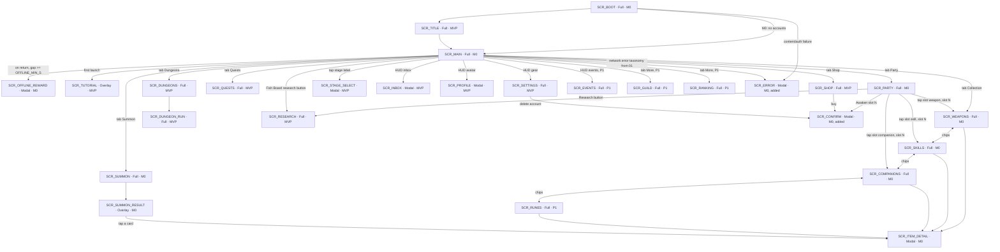

# 07 - Screens and UX

Every screen in 00 section 5.3: what it is for, how it is laid out on a portrait phone, which view-model fields each element binds to, which `Command` each action sends, which `Event`s it reacts to, and its empty, loading, error, locked and first-time states. Then the rules that hold across screens: formatting, palette, touch, haptics, sound, badges, modals, accessibility, localization, performance, the tutorial, the placeholder-art plan, the Unity implementation shape and the Unity project setup, builds and device QA (section 17). The client is presentation only (00 section 4): nothing here computes a game number; every number is read from a view-model that was filled from a sim snapshot or an event.

Tiers covered: M0 (`SCR_BOOT`, `SCR_MAIN`, `SCR_PARTY`, `SCR_WEAPONS`, `SCR_SKILLS`, `SCR_SUMMON`, `SCR_SUMMON_RESULT`, `SCR_OFFLINE_REWARD`, `SCR_ITEM_DETAIL`), MVP (the rest of 5.3 except P1 rows), P1 (`SCR_RUNES`, `SCR_GUILD`, `SCR_RANKING`, `SCR_EVENTS`) in outline.

The player fights with a party of `PARTY_SLOTS` (5) companions; there is no hero in combat, and the squire is only the player's avatar (00 decision 109). Each slot holds one companion, one weapon, one skill, its own Awakening rank and its own MP pool; Training and the Party Level are party-wide. The screens below describe that design; the client is not yet built to it (implementation tracked in issue #309).

Depends on: 00 (screen IDs, commands, events, constants), 01 (`SessionRunner`, snapshot API, error taxonomy), 02 (`GameState` fields the view-models read), 03 (combat snapshot, Training, per-slot Awakening, Research), 04 (banners, collections), 05 (Fish Board), 06 (quests, dungeons, offline, shop, inbox), 09 (localization keys and length budgets).

## 1. Navigation map

Types: **Full** replaces the content area and pushes onto the `ScreenRouter` stack; **Modal** is a card over a dimmed scrim, pushed onto the same stack, at most one visible at a time; **Overlay** draws over `SCR_MAIN` without a scrim and does not block the combat viewport.



Two screens were added here and are now in 00 section 5.3: `SCR_CONFIRM` (generic two-button confirmation with a cost line) and `SCR_ERROR` (blocking or non-blocking error card driven by 01's error taxonomy). Both are M0 because the boot path and the Awakening confirm need them.

Stack rules:

1. `SCR_MAIN` is the stack root and is never popped. Every Full screen is pushed over it; the HUD stays visible on every Full screen; the combat viewport and Fish Board are hidden under Full screens except `SCR_DUNGEON_RUN`, which replaces the combat viewport and keeps the HUD.
2. Tab bar taps replace the top Full screen rather than pushing (stack depth stays 2), so the back button from any tab returns to `SCR_MAIN`.
3. Modals push; a modal over a Full screen dims both. A second modal request while one is open is queued, not stacked (section 10).
4. Overlays (`SCR_SUMMON_RESULT`, `SCR_TUTORIAL`) are drawn in a layer above modals but never hide the HUD wallet chips.
5. Android back button: pops the top modal or overlay if dismissible; else pops the top Full screen; on `SCR_MAIN` with nothing open it shows the `SCR_CONFIRM` "Exit Whisker Hero?" once, then quits on the second press within 2 s. It never pops `SCR_OFFLINE_REWARD` (claim is mandatory, 06 section 7.3) and is ignored during a summon reveal until the reveal finishes or is skipped.

## 2. Portrait layout grammar

Reference resolution 1080 x 1920; `CanvasScaler` Scale With Screen Size, match width (0). Every size below is in reference pixels (rp); 1 rp is about 0.055 mm on a 5.5 inch 1080p phone, so 120 rp is about 9 mm.

```
+----------------------------------------------+  safe area top (status bar, notch)
| HUD bar                               120 rp |  wallet chips, avatar, inbox, settings
+----------------------------------------------+
|                                              |
| Combat viewport                       800 rp |  about 45% of the usable height
|   stage label, enemy, HP bar, timer, DPS     |
|   party: 5 companions in 2 rows, MP, skills  |
+----------------------------------------------+
| Action strip                          100 rp |  Boss button, quick toggles, red-dot shortcuts
+----------------------------------------------+
|                                              |
| Fish Board                            640 rp |  about 35%: tank, 5x4 grid, merge/release buttons
|                                              |
+----------------------------------------------+
| Tab bar                               160 rp |  Party | Collection | Summon | Dungeons | Quests | Shop
+----------------------------------------------+  safe area bottom (gesture bar)
```

Band budget: 120 + 800 + 100 + 640 + 160 = 1,820 rp. The remaining 100 rp of a 1920 rp screen absorbs safe-area insets; on taller phones (19.5:9 and 20:9) the combat viewport grows (`flex-grow: 1`); on 16:9 phones with insets larger than 100 rp the combat viewport shrinks first, then the Fish Board's cell size, never the tab bar or HUD.

| Element | Rule |
|---|---|
| Safe area | `SafeAreaFitter` on the root panel applies `Screen.safeArea` as padding on `Start` and on resolution change. Nothing is drawn outside it except the background. |
| HUD wallet chips | Gold, Diamonds, Fish Coins (MVP adds Rock Candy). Each chip: icon 56 rp, value in 40 rp bold, tappable (gold opens `SCR_PARTY`, diamonds opens `SCR_SHOP`, Fish Coins opens `SCR_RESEARCH`, Rock Candy opens `SCR_PARTY` scrolled to the slot cards). Right side: avatar (opens `SCR_PROFILE`), inbox icon with badge, settings gear. |
| Combat viewport | Full-width camera render texture or a world-space sorting layer; UI elements over it are the stage label (top-left, tappable: `SCR_STAGE_SELECT`), kill counter (top-right), enemy HP bar (under the enemy), boss timer bar (under HP bar, boss only), DPS readout (left, above the party line) and the party line (section 4.3). Reference split of the 800 rp: top row 72, enemy area 248 (sprite, HP bar, timer; the enemy sprite is bottom-anchored and may extend up behind the top row), DPS and damage-number line 40, party formation 440 (two rows, section 4.3). On short screens the enemy area shrinks first (to 200 rp); the party formation never shrinks. Tap anywhere except a skill icon = `TapZap(count)`. |
| Action strip | Left: `[Boss]` button (visible only while walled, 06/03), `[Auto]` placeholder toggle (P1 Auto Merge). Right: shortcut pills with red dots for Quests claimable, Dungeon tickets unused, Inbox items; each opens its screen. |
| Fish Board | Left column 160 rp: Magic Tank gauge (fill, `n / cap`, next-fish countdown), `[Release]` and `[Release max]` buttons, `[Merge all]`. Right: 5 x 4 grid, cell 176 rp with 8 rp gaps (5 x 176 + 4 x 8 = 912 rp wide), fish sprite 140 rp inside. A `[Research]` button (MVP) in the tank column bottom. |
| Tab bar | Six tabs, 180 rp wide each, icon 64 rp over a 28 rp label. Red-dot badge at top-right of the icon. Active tab tinted `accent`. P1 adds a seventh "More" tab opening Guild / Ranking / Events. |
| Full screen content | Pushed over combat viewport + action strip + Fish Board (the 1,540 rp between HUD and tab bar). Has a 96 rp title row with a back chevron (left) and the screen title; content below scrolls. |
| Modal | Width 960 rp, centered; max height 1,400 rp; 32 rp corner radius; scrim `#000000` at 60%. Tap on scrim dismisses when `Dismissible`. |
| Overlay stacking | z-order: background < combat < Fish Board < HUD/tab bar < Full screens < modal scrim + modal < overlays (`SCR_SUMMON_RESULT`, `SCR_TUTORIAL`) < toasts < `SCR_ERROR` when blocking. |
| Touch targets | Minimum 112 x 112 rp (about 8.5 mm) for any tappable; 16 rp minimum gap between adjacent targets; list rows at least 128 rp tall. |

## 3. Binding conventions used by every screen section

- A screen is a uGUI prefab with a `ScreenBase` subclass. `Bind(vm)` resolves references once; `Refresh()` writes only changed values through change-only setters (`NumberLabel`, `IntLabel`, `TextKeyLabel`, `BarFill`, `BadgeDot`); `OnEvent(Event e)` handles the events listed per screen.
- View-models live in `HeroCat.Client.Core` (`Assets/HeroCat.Client/Core/`, section 16), one class per screen named `<Screen>Vm` (`MainVm`, `PartyVm`, ...). They are plain C#, no `UnityEngine`. They are filled from `Simulation.Snapshot()` after any tick that ran and from events as they drain (01).
- A view-model field listed as `bind` is read-only display; `cmd` means the element sends that `Command` through `Commands.Send(cmd)`; a rejection comes back as `ApplyResult.Reject(code, reason)` (01's `RejectCode` category plus a reason from the owning spec's closed list, issue #11) and renders as 01's `Reject` presentation (issue #30): a button shake plus a short toast anchored under the pressed button with the localized reason `reject.<reason_lower>`; the category only picks the toast styling. `err.<code_lower>.title` / `.body` keys are for 01's error taxonomy (`SCR_ERROR`), not for rejections. Codes and reasons stay UPPER_SNAKE as 01 section 7 and the owning specs list them (08's wire codes, issue #30); the client lowercases them when it builds the key (`NOT_ENOUGH_GOLD` -> `reject.not_enough_gold`, `NET_OFFLINE` -> `err.net_offline.title`), because 09's key pattern is lowercase (issue #248).
- States every screen implements unless the section says otherwise: **Loading** (skeleton rows, shimmer, no spinner longer than 2 s before a retry link), **Empty** (illustration key + one-line copy + the primary action that fills it), **Error** (inline card from 01 taxonomy with Retry), **Locked** (greyed content, lock icon, unlock condition text, no interaction), **First-time** (one coach-mark overlay pointing at the primary action, shown once, stored in `ClientPrefs.SeenCoachMarks`).
- `ClientPrefs` (issue #47) is a Runtime store, a local JSON file next to the save, never cloud-synced and never in `GameState`. It holds everything in this spec that does not change a game number: seen coach marks, new-item badges (issue #7), sort/filter and Training-step choices, and the `SCR_SETTINGS` toggles. Losing it on reinstall is acceptable.
- Locked conditions come from the 09 `feature_unlocks` table (issue #45), the same rows the sim's rejections read, so a Locked state and the sim always agree. The table's MVP seed: Research at Awakening rank 1 of any slot (`AWAKEN_RANK >= 1` reads the highest slot rank; 00 decisions 11 and 109), Quests at stage 10, Dungeons at stage 30 (row `DUNGEONS`); Companions (banner and all `PARTY_SLOTS` slots, 04) and Shop are never locked. No party slot is ever locked, at any tier.
- Slot mode (00 decision 109): `SCR_WEAPONS`, `SCR_SKILLS` and `SCR_COMPANIONS` take an optional `TargetSlot` arg (0-4). Pushed from a `SCR_PARTY` slot card they open in slot mode: a 64 rp banner under the title row reads "Equipping slot {n}: {companion}" with an `[x]` that clears the mode, the selected panel's `[Equip]` sends straight into `TargetSlot`, and an accepted equip pops back to `SCR_PARTY`. Opened from the tab bar (no `TargetSlot`), `[Equip]` opens the slot picker: five rows (slot number, occupant companion icon, the slot's current item of this kind), the slot that already holds the item marked "here". `SCR_ITEM_DETAIL` uses the same picker. Slot numbers shown to the player are 1-5; commands carry 0-4.
- Equip rejections (owners 02/04, 00 decision 109) render as `reject.bad_slot`, `reject.unknown_item`, `reject.item_not_owned`, `reject.already_equipped`, `reject.weapon_in_other_slot`, `reject.skill_in_other_slot`, `reject.companion_in_other_slot`. `reject.companion_slot_locked` is removed: no slot is locked. The screens avoid the "in other slot" rejections by design: an owned item in another slot shows "In slot {n}" on its tile and picker row, and its `[Equip]` becomes `[Move here]`, which sends `Unequip<Kind>(otherSlot)` then `Equip<Kind>(slot, id)` (two sim commands, no UI-only command).

## 4. Screens

### 4.1 `SCR_BOOT` (Full, M0)

Purpose: cold-boot progress and the only place a fatal startup error is shown. Runs the 01 cold-boot sequence: content load, config fetch (MVP), auth (MVP), save load, Offline Catch-up compute, then `SCR_TITLE` (MVP) or `SCR_MAIN` (M0).

```
+----------------------------------------------+
|                                              |
|              [ logo placeholder ]            |
|                                              |
|          Whisker Hero                        |
|                                              |
|   |==================          |  64%        |
|   Loading content...                         |
|                                              |
|   v0.1.0 (17)  content 12  build abc123      |
+----------------------------------------------+
```

| Element | Binding |
|---|---|
| Progress bar | `BootVm.Progress01` (steps weighted: content 40, config 10, auth 10, save 20, catch-up 10, warm-up 10) |
| Step label | `BootVm.StepKey` (`boot.step.content`, `boot.step.config`, `boot.step.auth`, `boot.step.save`, `boot.step.catchup`, `boot.step.warmup`) |
| Version caption | `BootVm.ClientVersion`, `ContentVersion`, `BuildHash` |

States: Loading is the whole screen. Error: `SCR_ERROR` blocking, with the 01 taxonomy code, `[Retry]` and, for the recoverable `SAVE_CORRUPT`, `[Restore from cloud]` (MVP) / `[Reset profile]` (two-step confirm) (issue #30). No readable save copy anywhere is not an error: boot continues with a new profile and `SCR_MAIN` shows the one-time save-reset notice (section 4.27; 02 section 8.3, issue #248). Content newer than the client (`CLIENT_TOO_OLD`): `SCR_ERROR` with `[Update]` opening the store page. No interaction otherwise; back button ignored. Events: none from the sim; it reacts to `SessionRunner.BootProgress`.

### 4.2 `SCR_TITLE` (Full, MVP)

Purpose: account pick on first launch and after logout; skipped when a guest or linked session token is valid.

```
+----------------------------------------------+
|              [ key art placeholder ]         |
|                                              |
|   [ Continue as Guest ]                      |
|   [ Sign in with Apple ]        (iOS)        |
|   [ Sign in with Google Play ]  (Android)    |
|                                              |
|   Have a save on another device? Sign in     |
|   with the same account to restore it.       |
|                                              |
|   Terms · Privacy · Age 13+ (region)         |
+----------------------------------------------+
```

| Element | Binding / command |
|---|---|
| Guest button | `cmd` runtime `Auth.Guest()` (01, not a sim command) |
| Platform buttons | `Auth.LinkOrSignIn(provider)`; only the platform's own provider is shown |
| Legal links | open in-app browser; `TitleVm.AgeGateRequired` (08 compliance) shows a birth-year picker modal before any sign-in |

States: Loading during the auth round-trip (buttons disabled, spinner on the pressed one). Error inline under the buttons (`err.<code_lower>.*` for 01's auth codes, e.g. `err.provider_already_linked.title`; issues #30, #248). Conflict: when the cloud save and the local save differ, the 02 conflict modal is shown here before `SCR_MAIN` with both saves' stage, Party Level, server time and a `[Keep this device]` / `[Use cloud]` pair.

### 4.3 `SCR_MAIN` (Full root, M0)

Purpose: the game. Combat on top, Fish Board below, HUD and tab bar framing them. It is never popped and keeps ticking under every other screen except `SCR_OFFLINE_REWARD` (section 4.18).

```
+----------------------------------------------+
| [G] 3.72M  [D] 1,240  [F] 812   (av) [in] [*]|  HUD
+----------------------------------------------+
| Stage 240  Ch.5  v        kills 9/10   WALL  |
|                    (boss)                    |
|                    ~~~~~~                    |
|            HP |==========       | 1.2M       |
|            T  |======           | 17s        |
| DPS 3.72K  +12.3K  +9.8K crit!               |  damage numbers float here
|            (c4)[sk4]     (c5)[sk5]          |  back row: slots 4-5, behind
|            |=== |        |==  |             |  MP bar inside each cell
|    (c1)[sk1]     (c2)[sk2]     (c3)[ -- ]   |  front row: slots 1-3
|    |=== |        |==  |        |====|       |  skill badge, cooldown ring
+----------------------------------------------+
| [ Boss: need ~2.3x ]        (Q*) (Dg*) (In)  |  action strip
+----------------------------------------------+
| Tank    | [1][2][ ][3][ ]                    |
| 7/10    | [ ][1][1][ ][2]                    |
| 0:04    | [ ][ ][ ][ ][ ]                    |
| [Rel.]  | [ ][ ][ ][ ][ ]                    |
| [Rel.max]                                    |
| [Merge all]                       [Research] |
+----------------------------------------------+
| Party | Collection | Summon | Dungeons | Quests | Shop |
+----------------------------------------------+
```

| Element | `MainVm` field (bind) or command | Notes |
|---|---|---|
| Gold chip | `Wallet.Gold` | suffix ladder; pulses on increase from `BOSS`/`OFFLINE` only, not per kill |
| Diamond chip | `Wallet.Diamond` | pulses on any increase |
| Fish Coin chip | `Wallet.FishCoin` | |
| Rock Candy chip (MVP) | `Wallet.RockCandy` | shown once `Progress.HighestCleared >= AWAKEN_STAGES[0]` |
| Avatar | `Profile.AvatarId` | tap: push `SCR_PROFILE` |
| Inbox icon | `Inbox.UnclaimedCount` badge | tap: push `SCR_INBOX` |
| Settings gear | | tap: push `SCR_SETTINGS` |
| Stage label | snapshot `Stage`, `Chapter`, `SelectedStage` (02 `Combat.Selected`; issue #254) | tap: push `SCR_STAGE_SELECT` (MVP; M0 no-op); while farming a side stage it reads "Farming 235 · frontier 240" (issue #35) |
| Kill counter | `Combat.KillsInStage / KILLS_PER_STAGE` | red when `IsWalled` |
| WALL badge | `Combat.IsWalled` | |
| Enemy sprite, HP bar | `Combat.EnemyId`, `EnemyIsBoss`, `EnemyHp`, `EnemyMaxHp` | HP bar text "1.2M / 1.7M" |
| Boss timer bar | `Combat.Fight.BossTicksLeft / BOSS_TIME_TICKS` | boss only; turns `bad` under 5 s |
| Party line | `Party.Slots[i]` x `PARTY_SLOTS` (5): `CompanionId` (battle sprite), `WeaponId` (not drawn: each chibi is drawn holding its own weapon, decision 113), `AwakenRank` (aura), `IsEmpty` | two rows (decision 110): a front row of slots 1-3 (3 x 280 + 2 x 16 = 872 rp, centred) and a back row of slots 4-5 (576 rp, centred, so each back cell sits behind a front gap), cells `UI_PARTY_CELL_W` x `UI_PARTY_CELL_H` (280 x 280 rp) with `UI_PARTY_GAP` (16 rp) gaps; the back row is raised by `UI_PARTY_CELL_H - UI_PARTY_ROW_OVERLAP` (160 rp) and drawn behind the front row, so the formation is 440 rp tall. Each cell carries its slot's MP bar (160 x 16 rp) along its bottom edge and its skill as an 88 rp badge with a 112 rp hit rect at its lower-right corner. Front and back are presentation only; no rule reads them. Pixel-art battle sprites (00 decision 106, section 15.3) idle, play attack frames on that slot's `HitLanded` and cast frames on its `CompanionAbilityUsed`. An empty slot shows a dashed outline and does nothing; a companion with no weapon attacks unarmed (no held sprite) |
| Damage numbers | from `HitLanded(slot, ...)` (one slot's auto-attack, crit flag), `SkillCast(slot, ...)`, `CompanionAbilityUsed(slot, ...)` and `FishMissileHit` events (issue #11) | pooled, section 13; slot numbers rise from that slot's cell, missile numbers from the enemy |
| DPS readout | `Combat.Dps` | updates at most 2 Hz |
| MP bar x5 | `Party.Slots[i].Mp / MpMax` (the slot's own pool, `Combat.Mp[slot]`; `MpMax` is party-wide) | 160 x 16 rp under each cell; set from `CompanionAbilityUsed.mpAfter`, otherwise from the snapshot; a full-pool glint when the ability is ready (`AbilityReadyPct` = 1); hidden for an empty slot |
| Skill icon x5 | `Party.Slots[i].Skill`: `IconId`, `CooldownPct`, `IsEmpty` | 88 rp icon with a 112 rp hit rect, under its slot's MP bar; tap: push `SCR_ITEM_DETAIL`; long-press (P1 manual cast) |
| Tap on viewport | `cmd TapZap(count)` | taps accumulated this frame, at most `TAP_ZAP_MAX_PER_SEC`; extra taps still play the tap VFX but send nothing |
| Boss button | `Combat.IsWalled`, `Combat.BossClearable`, `Combat.NeedDpsRatio` | `cmd AttemptBoss`; label "Boss: need ~2.3x" or "Boss: clearable" (green border) |
| Shortcut pills | `Badges.QuestsClaimable`, `Badges.DungeonTicketsUnused`, `Badges.InboxUnclaimed` | push the respective screen |
| Tank gauge | `Fish.TankCount / Fish.TankCap`, `Fish.NextFishSec` | |
| Release / Release max | `Fish.CanRelease` | `cmd ReleaseFish` / `cmd ReleaseMax` (one sim command, 05 section 6.1; issue #11) |
| Merge all | `Fish.MergeAllCount` (pairs available) | `cmd MergeAll` (one sim command; pair order is 05's `MergeAll` contract) |
| Grid cells | `Fish.Cells[20]`: `Level` (0 empty), `IsSelected`, `IsNew`, `IsDropTarget` | interaction in section 5 |
| Research button (MVP) | `Badges.ResearchAffordable` dot | push `SCR_RESEARCH` |
| Tab bar | `Badges.*` per tab | replace top Full screen; `TabDisabled[]` greys the Shop tab while `shopEnabled` is off and the Dungeons tab while `dungeonsEnabled` is off (01 section 8.12 step 1), and a tap toasts `scr.common.feature_disabled` instead of opening it (a locked tab keeps its lock toast); the Dungeons pill goes through the same tap |
| Maintenance banner | `Maintenance`: `Visible`, `Active`, `Line`, `Message`, `MessageVisible` | under the stage label, over the combat band; fed once per server second from `ConfigRefresher.Banner(now)`. During a window `scr.main.maint_active` ("Maintenance: back in {0}", `Countdown` to `until`) or `scr.main.maint_active_open` when the window has no end; from `MAINT_ANNOUNCE_S` before an announced window (`active: false`, future `until`; 08 section 8.4) `scr.main.maint_scheduled` ("Maintenance starts in {0}"). Config's `messageKey` is a second line, shown only when sent. It never blocks play (issue #299) |

Events `SCR_MAIN` reacts to: `EnemySpawned` (new sprite, HP full), `HitLanded` / `SkillCast` / `CompanionAbilityUsed` / `FishMissileHit` (number), `EnemyKilled` (death VFX, gold burst toward chip), `StageCleared` (stage label pulse), `BossFailed` (WALL badge in, boss button in, toast with need ratio), `BossCleared` (green flash, first-clear diamond toast if `FirstClearGranted`), `LevelUp` (Party Level: all five sprites flash, "Party Lv 32" float), `FishReleased` (cell pop-in), `FishMerged` (merge VFX, missile launch toward enemy), `FishDiscovered` (discovery card overlay 1.5 s with coins), `QuestCompleted` (Quests badge), `DayRolledOver` (toast, badges), `Awakened(slot, rank)` (that slot's aura swaps and a full-width card names the slot and companion over the combat viewport, combat keeps running), `StageCapReached` (toast), `OfflineRewardComputed` (push `SCR_OFFLINE_REWARD`). Login diamonds are auto-granted on the first tick of the day (`CurrencyChanged(DIAMOND, LOGIN)`, issue #20) and toast "+{LOGIN_DIAMONDS} diamonds: daily login" with the `DayRolledOver` toast.

`HitLanded`, `SkillCast` and `CompanionAbilityUsed` are outside the sim's default `CombatEventMask` (03 section 2.1, issue #160); the client opts in by setting `CombatEvents = CombatEventMask.All` (`GameViewModel.cs`); bots and the server leave them off.

States: Loading never (boot covers it). First-time: `SCR_TUTORIAL` overlay. Error: 01's `Offline` banner is drawn as the non-blocking `SCR_ERROR` card in the action strip position (MVP), keeping the combat viewport clear while the sim keeps running offline (issue #30). Mid-session `CLIENT_TOO_OLD` (01 section 8.12 step 3; issue #299): once a landed config gates the client out, `ClientUpdateGateVm` waits for `SCR_MAIN` idle (`GameViewModel.MainIdle`: `SCR_MAIN` on top, no modal open or queued, no overlay, no blocking error, no summon request or reveal running), saves, then shows the blocking `SCR_ERROR` whose only action `[Update]` opens config's `storeUrls[platform]` (`ios` / `android`; the client falls back to its own store link when config names none). Another error never replaces it for more than a frame; a later config that lifts the gate takes it down. Locked elements: Rock Candy chip, stage label tap, the Research button and the Dungeons/Quests tabs before their `feature_unlocks` condition (issue #45) show a lock glyph and a toast naming the condition; the HUD Fish Coin chip still opens `SCR_RESEARCH`, which shows its Locked state. The Shop tab is never locked.

### 4.4 `SCR_PARTY` (Full, M0; 00 decision 109)

Purpose: all gold and Rock Candy sinks on the party: party-wide Training per stat, the Party Level readout, the five slot cards (companion, weapon, skill, Awakening (MVP), MP pool), and the entry to Research (MVP). Replaces `SCR_HERO`.

```
+----------------------------------------------+
| <  Party                       DPS 3.72K     |
| (sqr) Party Lv 32 |=======    | 4.2K / 9.8K  |
| Slot 1 (Tabby)  [wpn Tuna] [sk Fish Rain]    |
|   Awakening I  MP |====  | 120   [ Awaken ]  |  MVP: Awakening
| Slot 2 (Mittens) [wpn --]  [sk Claw]         |
|   Awakening -  MP |==    |  60   Reach 50    |
| Slot 3 ... Slot 5 (same card)                |
| [ Auto-equip all ]                           |
| Training              [x1] [x10] [x100] [Max]|
| ATK      Lv 64  x4.20   cost 3.80K  [ + ]    |
| CRIT_RATE Lv 5  12.5%   cost 70     [ + ]    |
| CRIT_DMG Lv 3   +45%                         |
| ATK_SPD  Lv 8   +16%                         |
| GOLD_GAIN Lv 20 +40%                         |
| EXP_GAIN Lv 6   +12%                         |
|                              [ Research > ]  |  MVP
+----------------------------------------------+
```

| Element | `PartyVm` field or command |
|---|---|
| Avatar | `Profile.AvatarId` (the squire portrait: the player's identity, never a fighter) |
| Party Level, EXP bar | `Party.Level`, `Party.Exp / Party.ExpToNext` (`PARTY_LVL_EXP(l)`); party-wide, auto, never spent |
| DPS | `Combat.Dps` (party DPS) |
| Slot card x5 | `Slots[i]` for i in 0..`PARTY_SLOTS`-1, 176 rp tall: companion portrait 128 rp (`CompanionId`, rarity frame; dashed "Empty" when none), weapon icon 112 rp (`WeaponId`, "Unarmed" when none), skill icon 112 rp (`SkillId`, "No skill" when none), Awakening rank glyph (`AwakenRank`), MP bar (`Mp / MpMax`). Tap the portrait, weapon or skill: push `SCR_COMPANIONS` / `SCR_WEAPONS` / `SCR_SKILLS` with `TargetSlot = i` (slot mode, section 3) |
| Awaken button x5 (MVP) | `Slots[i].Awaken`: `NextStage`, `NextCost`, `CanAfford`, `StageReached`, `AtMax`; `[Awaken]` opens `SCR_CONFIRM` naming the slot, with cost and balance-after, then `cmd Awaken(i)`. Shown on an empty slot too: the rank belongs to the slot and is kept for its next companion |
| Auto-equip all | `AutoEquipWouldChange` dot; sends `cmd AutoEquipBestCompanions`, `AutoEquipBestWeapons`, `AutoEquipBestSkills` in that order (04 rules, all five slots) |
| Bulk step selector | `Training.Step` in `TRAIN_BULK_STEPS` {1, 10, 100, Max}; persisted in `ClientPrefs.TrainStep` (issue #47) |
| Per-stat row x6 | one row per trainable stat (`stats.trainable`, 09; `HP` and `DEF` are not trainable in MVP, 00 decision 10); every stat buffs all five slots: `Training.Rows[stat]`: `Level`, `EffectText` (from 03 per-stat formatter), `Cost` (bulk cost for the selected step), `Count` (levels the step buys; Max computes affordable), `CanAfford`, `AtCap`; `[+]` sends `cmd TrainStat(stat, count)` all-or-nothing |
| Research button (MVP) | `Badges.ResearchAffordable`; push `SCR_RESEARCH` |

Events: `StatTrained(stat, count, cost)` (row flash, "+5%" float), `LevelUp` (Party Level bar), `Awakened(slot, rank)` (that card's rank glyph animates), `ItemEquipped(kind, slot, id)` (that card's icon swaps), `CompanionAbilityUsed(slot, id, mpAfter)` (that card's MP bar), `CurrencyChanged(GOLD | ROCK_CANDY)` (re-evaluate `CanAfford`).

States: a stat at its cap (03) shows "MAX" in place of the cost and a disabled button. Awakening before a slot's stage gate: that slot's button disabled with "Reach stage {AWAKEN_STAGES[rank]}", e.g. "Reach stage 50" for its rank I (`AWAKEN_STAGES[0]`) and "Reach stage 150" for its rank II; each slot reads its own rank, so slots can sit at different gates. At max rank: "Max rank". First-time: coach mark on ATK `[+]`. The `Max` step shows "Buy 37 levels for 3.71M" so the player knows what they are tapping. Locked: none (all five slots open from the start, 00 decision 109).

### 4.5 `SCR_WEAPONS` (Full, M0)

Purpose: the 30-weapon collection, equip into a slot (any weapon on any companion, one slot per weapon; 00 decision 109), level-up readout, and the owned-collection passive total that makes dupes and low rarities matter (00 decision 5).

```
+----------------------------------------------+
| <  Collection   [Weapons] Skills Companions  |  chips switch screens
| Equipping slot 2: Mittens               [x]  |  slot mode only
| Slot 2: [L] Tuna Blade Lv3  ATK +120%        |
| Collection passive: +86% ATK (24/30 owned)   |
| Sort: [Rarity v]  Filter: [All v]  (3 new)   |
| [M?] [L1] [L ] [E*] [E3] [E ]                |  6 per row, 5 rows; digit = slot
| [R ] [R ] [R ] [R ] [R?] [R ]                |
| ...                                          |
| Selected: [E] Sardine Spear  Lv2 (4/6)       |
|  ATK +48%  passive +4.8%     [ Equip ] [ i ] |
+----------------------------------------------+
```

| Element | `WeaponsVm` field or command |
|---|---|
| Chips | push sibling collection screen (replace, same stack depth) |
| Equipped summary | `Equipped` for `TargetSlot` (slot mode), else slot index 0: `Rarity`, `NameKey`, `Level`, `AtkPct`; "Unarmed" when the slot has none |
| Passive total | `PassiveTotalPct`, `OwnedCount / PoolSize` (04 `WEAPON_PASSIVE_PCT`) |
| Sort / filter | `Sort` in {Rarity, Level, Newest, Owned first}, `Filter` in {All, Owned, Rarity r}; persisted in `ClientPrefs` |
| Grid tile x30 | `Tiles[i]`: `Id`, `Rarity`, `IconId`, `Owned`, `Level`, `CopiesToNext`, `IsNew`, `EquippedSlot?` (corner chip with the slot number 1-5); unowned at 30% opacity with "?" |
| Selected panel | `Selected`: stats, `NextLevelCopies` ("4/6"), `AtkPct`, `PassivePct`; `[Equip]` sends `cmd EquipWeapon(TargetSlot, id)` in slot mode, else opens the slot picker (section 3); `[Move here]` when the weapon is in another slot; disabled "Equipped" when already in the target slot, hidden when unowned; `[Unequip]` in slot mode sends `cmd UnequipWeapon(TargetSlot)`; `[i]` pushes `SCR_ITEM_DETAIL` |

Events: `ItemAcquired(kind=WEAPON)` (tile flips from "?" or copies tick up, `IsNew` set; a level change is read from the snapshot, level is derived from copies, 04), `ItemEquipped(WEAPON, slot, id)` (slot chips and equipped summary swap; also fires with `auto: true` after a summon's `AutoEquipBestWeapons`).

States: Empty is impossible: profile creation grants five Common starter weapons `TUTORIAL_WEAPON_IDS`, one equipped in each party slot (00 decision 111; 09 `tut_welcome`, issue #46). New badges clear when the tile is tapped or the screen is left (a `ClientPrefs` update, not a sim command; issues #7, #47). Locked: none.

### 4.6 `SCR_SKILLS` (Full, M0)

Purpose: 40-skill collection and one auto-cast skill per party slot (`PARTY_SLOTS` = 5; 00 decision 109). Each slot casts its own skill, scaled by its own slot's attack; there is no shared cast order.

```
+----------------------------------------------+
| <  Collection   Weapons [Skills] Companions  |
| Equipping slot 4: Biscuit               [x]  |  slot mode only
| Party skills                 [ Auto-equip ]  |
| [1 Tabby:Fish Rain][2:Claw][3:Pounce][4][5]  |
| Sort / Filter row                            |
| 40 tiles, 6 per row; digit = slot            |
| Selected: [E] Fish Rain Lv2  DPS 85% CD 8s   |
|  instant · 1/6 copies · in slot 1 [Equip v]  |
+----------------------------------------------+
```

| Element | `SkillsVm` field or command |
|---|---|
| Slot chip x5 | `Slots[i]`: `CompanionIconId` (the slot's companion, so the player sees who casts it), `SkillId?`, `IconId`, `Rarity`, `Level`, `CooldownSec`; tap with a selection: `cmd EquipSkill(slot, id)` (`[Move here]` rule of section 3 when the skill is in another slot); tap without: `cmd UnequipSkill(slot)`. No drag reorder: slot order no longer matters |
| Auto-equip | `AutoEquipWouldChange` dot; `cmd AutoEquipBestSkills` (04 rule, fills all five slots) |
| Tiles x40 | as weapons (`EquippedSlot?` chip) plus `DpsPct`, `CooldownTicks`, `CastType` (instant / dot / buff) glyph; a buff skill's caption reads "buffs this companion's attacks" |
| Selected panel | `[Equip]`: into `TargetSlot` in slot mode, else the slot picker (section 3); disabled when unowned |

Events: `ItemAcquired(kind=SKILL)`, `ItemEquipped(SKILL, slot, id)`, `SkillCast(slot, id)` (slot chip cooldown ring).

### 4.7 `SCR_COMPANIONS` (Full, M0; 00 decisions 107, 109)

Purpose: 50-companion collection, the five party slots (always open), and each slot's own MP pool.

```
+----------------------------------------------+
| <  Collection   Weapons Skills [Companions]  |
| Equipping slot 3                        [x]  |  slot mode only
| MP max 200   regen 4.0/s per pool (Research+)|
| [1 c1 ===][2 c2 ==][3 -- ][4 c4 =][5 c5 ===] |  slot, companion, MP bar
| Sort / Filter row                            |
| 50 tiles, 6 per row; digit = slot            |
| Selected: [L] Captain Mittens Lv1            |
|  damage · 40 MP · every 6 s · DPS +60%       |
|  own pool covers 80% of casts  [ Equip v ]   |
+----------------------------------------------+
```

| Element | `CompanionsVm` field or command |
|---|---|
| MP line | `MpMax`, `MpRegenPerSec` (03 Research; the same for every pool); `(Research +)` pushes `SCR_RESEARCH` |
| Slot chip x5 | `Slots[i]`: `CompanionId?`, `IconId`, `Mp / MpMax`, `MpSufficiencyPct` (03's `mpSufficiency` for that slot, read from the sim, never computed here; shown `bad` under 100%); tap with a selection: `cmd EquipCompanion(slot, id)` (`[Move here]` rule of section 3); tap without: `cmd UnequipCompanion(slot)` |
| Tiles x50 | plus `EquippedSlot?` chip, `AbilityType` glyph (damage / buff / gold / MP regen), `MpCost`, `IntervalSec` |
| Selected panel | `EffectText`; party-wide abilities (`BUFF_ATK`, `BUFF_GOLD`, `MP_REGEN`) say "whole party" (`MP_REGEN` restores every pool); `[Equip]`: into `TargetSlot` in slot mode, else the slot picker (section 3). Swapping the companion in a slot keeps that slot's weapon, skill and Awakening rank; the picker says so |

Events: `ItemAcquired(kind=COMPANION)`, `ItemEquipped(COMPANION, slot, id)`, `CompanionAbilityUsed(slot, id, mpAfter)` (slot chip MP bar). Locked: none; the Companion banner and all five slots are open from the start, at every tier (04, 00 decision 109, issue #45). Empty is impossible: profile creation equips the five starter companions (`TUTORIAL_COMPANION_IDS`, 09 `tut_welcome`).

### 4.8 `SCR_RUNES` (Full, P1)

Same grid grammar with six slots (`RUNE_SLOTS`) and a slot-type filter. Fourth chip on the collection header, hidden until P1 content ships. `RunesVm` mirrors `WeaponsVm` with `StatMods[]` on the selected panel. Commands `EquipRune(slot, id)`, `UnequipRune(slot)`.

### 4.9 `SCR_RESEARCH` (Full, MVP)

Purpose: the Fish Coin sink (03 node list: MP pool and MP regen (each raises all five slot pools equally), tank capacity, tank refill, fish level cap, gold gain, offline cap extension).

```
+----------------------------------------------+
| <  Research              [F] 812 Fish Coins  |
| Tank capacity   Lv 2  20 -> 25    450 [ Buy ]|
| Tank refill     Lv 1  5.6s -> 5.2s 480 [Buy] |
| Fish level cap  Lv 0  10 -> 11  2,500 [ Buy ]|
| MP pool         Lv 3  ...                    |
| MP regen        Lv 1                         |
| Gold gain       Lv 0                         |
| Offline cap     Lv 0  24h -> 26h  2,000      |
+----------------------------------------------+
```

| Element | `ResearchVm` field or command |
|---|---|
| Row per node | `Rows[node]`: `Level`, `MaxLevel`, `CurrentText`, `NextText`, `Cost`, `CanAfford`, `AtMax`; `[Buy]` sends `cmd Research(nodeId)` |
| Header | `Wallet.FishCoin` |

Events: `ResearchLeveled(nodeId, newLevel, cost)` (row flash, tank gauge on `SCR_MAIN` updates via snapshot), `CurrencyChanged(FISH_COIN)`. Locked before Awakening rank 1 (`feature_unlocks`, 00 decision 11, issue #45; the sim rejects with `RESEARCH_LOCKED`): greyed with "Unlocks when any slot reaches Awakening I". First-time coach mark on Tank capacity.

### 4.10 `SCR_SUMMON` (Full, M0)

Purpose: the diamond sink. One tab per banner; 1x and 10x; rates, pity and banner level always visible (pillar 4).

```
+----------------------------------------------+
| <  Summon      [Weapon] [Skill] [Companion]  |
| Banner Lv 3  |=======     | 143/200 EXP      |
| Pity 23 / 80   soft pity from pull 51        |
| |==========                              |   |
| Featured: 30 weapons · rates [ View rates ]  |
|  [ Summon x1   100 ]   [ Summon x10  1,000 ] |
|  [ Use ticket x1 (3) ]                       |
| 10x: at least one Epic guaranteed            |
+----------------------------------------------+
```

| Element | `SummonVm` field or command |
|---|---|
| Banner tabs | `Banners[b]`: `Unlocked`, `BadgeNewLevel`; all three banners are open from the start (04; issue #45) |
| Banner level | `Level`, `Exp`, `ExpToNext` (04 thresholds) |
| Pity | `Banners[b].Pity`, `PITY_SOFT_START`, `PITY_HARD`; bar with a marker at 50 |
| View rates | opens a rates panel (inline, not a new screen) listing the published table for the current banner level from `RateTable[level]` (04) and the pity ramp rows |
| Summon x1 / x10 | `PullCost`, `CanPull1`, `CanPull10` (diamond balance); `cmd Summon(banner, count: 1 or 10, payment: DIAMOND, requestId)` |
| Use ticket | `TicketCount`; `cmd Summon(banner, 1, payment: TICKET, requestId)`; hidden when 0 |

MVP server path (01): the button shows a spinner on the pressed button for up to 10 s while the request is in flight, which also covers the save upload 01 runs before a pull when there are unsynced local earnings (issue #49); the HUD diamond chip does not change until the server result lands (04 payload); on a timeout (`NET_TIMEOUT`, 01's `Timeout` class; there is no `SUMMON_TIMEOUT` code, issue #30) the client shows the "Retrying..." toast and retries the same `requestId` (01 section 5.2), and once retries are exhausted closes the overlay with the `SUMMON_PENDING_SAVED` toast and a "Pending..." button that resolves the summon by replay (01 section 8.5 step 4; the server replays by `requestId`). M0 local path returns synchronously.

Summon results are not a sim event: the `SummonResultPayload` returned by `ISummonService` (01 section 2.5) is applied through `ApplySummonResult` and then pushes `SCR_SUMMON_RESULT` (issues #11, #13). Events: `ItemAcquired` x N, `BannerLeveledUp` (banner bar fill, toast "Banner level 4: rates improved"), `CurrencyChanged(DIAMOND)`.

States: disabled buttons name the shortfall ("Need 760 more"). Error as above. First-time: the tutorial scripts the first x10 on Weapons.

### 4.11 `SCR_SUMMON_RESULT` (Overlay, M0)

Purpose: the reveal. Driven entirely by the already-applied `SummonResultPayload`; skippable at any time; the HUD stays live above it.

```
+----------------------------------------------+
|                                   [ Skip ]   |
|   [ ? ] [ ? ] [ ? ] [ ? ] [ ? ]              |
|   [ ? ] [ ? ] [ ? ] [ ? ] [ ? ]              |
|                                              |
|  1 Epic · 3 Rare · 6 Common   pity 33/80     |
|  [ Summon x10 again  1,000 ]   [ Close ]     |
+----------------------------------------------+
```

| Element | `SummonResultVm` field or command |
|---|---|
| Cards x1 or x10 | `Cards[i]`: `Rarity`, `IconId`, `NameKey`, `IsNew`, `LevelBefore`, `LevelAfter`, `State` (FaceDown, Flipping, FaceUp) |
| Skip | `cmd` client-side `Reveal.Skip()` |
| Summary | `Counts[rarity]`, `PityAfter` |
| Again | `CanPullAgain`; `cmd Summon(sameBanner, sameCount, DIAMOND, newRequestId)`; disabled during the reveal and while a request is in flight |
| Close | pops the overlay |
| Tap a face-up card | push `SCR_ITEM_DETAIL`, whose `[Equip]` offers the slot picker (section 3) for the card's weapon, skill or companion |

Reveal rules are in section 6. The `SummonResultPayload` of an "again" request replaces the cards in place.

Splash (00 decision 108): when a Legendary or Mythic companion flips face up, its splash illustration `art_splash_<id>` fills the whole screen for 1.5 s (tap to dismiss early, skipped by `Skip`) before the card grid returns. Full screen means over the HUD band and the safe-area insets too, scaled to cover: the art fills the screen and whatever extends past it is cut off, so there are never bars (section 15.2 sets the safe zone). The address is derived from the companion id, not a content column; a missing splash falls back to the card. `SCR_ITEM_DETAIL` shows the splash in place of the portrait for those companions.

### 4.12 `SCR_DUNGEONS` (Full, MVP)

Purpose: the three daily dungeons and the Tower card (P1).

```
+----------------------------------------------+
| <  Dungeons          resets in 6h 12m        |
| +------------------------------------------+ |
| | Fish Coin Dungeon      tickets 2/2       | |
| | Best floor 4   Next: floor 5  Clearable  | |
| | Reward floor 5: 250 Fish Coins           | |
| | [ Challenge floor 5 ]  [ Sweep floor 4 ] | |
| +------------------------------------------+ |
| | Rock Candy Dungeon     tickets 1/2       | |
| | Best floor 4   Next: floor 5             | |
| | Not clearable yet (need ~1.4x DPS)       | |
| | [ Challenge ] (disabled)  [ Sweep floor 4]| |
| +------------------------------------------+ |
| | EXP Dungeon ...                          | |
| +------------------------------------------+ |
| | Tower (coming soon)                      | |  P1
| +------------------------------------------+ |
```

| Element | `DungeonsVm` field or command |
|---|---|
| Reset countdown | `SecondsToRollover` (from `IClock`, 06 section 4) |
| Card x3 | `Cards[d]`: `Tickets`, `TicketsPerDay`, `BestFloor`, `NextFloor`, `NextReward` (currency, amount), `Clearable` (06 `PreviewDungeon`), `NeedDpsRatio`, `Locked` |
| Challenge | `cmd StartDungeon(d, NextFloor)`; pushes `SCR_DUNGEON_RUN`; disabled with reason when `!Clearable` or `Tickets == 0` |
| Sweep | `cmd SweepDungeon(d)`; disabled when `BestFloor == 0` or `Tickets == 0`; shows reward inline |
| Floor picker (long-press Challenge) | modal list of cleared floors to replay for the spectacle; rewards equal the floor's |

Events: `DungeonCleared`, `DungeonFailed`, `DungeonFloorFirstCleared`, `DayRolledOver` (tickets refresh), `CurrencyChanged(TICKET_*)`.

States: Locked before its `feature_unlocks` condition (row `DUNGEONS`, stage 30; issue #45): whole screen greyed, "Unlocks at stage 30". Empty tickets: buttons disabled, "More tickets in the Shop" link to `SCR_SHOP` exchange tab. Error: none (local sim; seed fetch failure in MVP falls back to a retry toast and the button re-enables).

### 4.13 `SCR_DUNGEON_RUN` (Full, MVP)

Purpose: the fixed fight. Replaces the combat viewport region; the HUD stays. The run is ticked in the main loop (`Combat.Mode == Dungeon`, issue #42): main-stage combat waits while it runs and resumes with its kills and boss state intact. The Fish Board is hidden and frozen (issue #40): its passive DPS still applies, the tank keeps refilling, and board commands are rejected (`reject.board_locked`) until the run ends.

```
+----------------------------------------------+
| Fish Coin Dungeon · Floor 5                  |
|                    (floor boss)              |
|            HP |======           | 40%        |
|            T  |=====            | 14s        |
| DPS 3.72K                                    |
|            (c4)          (c5)               |  party formation as SCR_MAIN
|    (c1)          (c2)          (c3)         |
|    |=== |        |==  |        |====|       |
| Reward on clear: 250 Fish Coins              |
|                               [ Skip fight ] |
+----------------------------------------------+
```

| Element | `DungeonRunVm` field |
|---|---|
| Title | `Dungeon`, `Floor` |
| Fight widgets | same bindings as `SCR_MAIN` combat viewport (party line included) from the run's own snapshot |
| Skip fight | runs the remaining ticks headlessly in one frame (no player input can change the outcome, issue #40) and shows the result card |
| Result card | `Outcome` (Cleared / Failed), `RewardText`, `RemainingHpPct`; `[Collect]` pops to `SCR_DUNGEONS`; a clear debits one ticket, a fail costs nothing (00 decision 16, issue #42); on Cleared with another ticket, `[Next floor]` sends `cmd StartDungeon(d, floor + 1)` if `Clearable` |

Events: `DungeonStarted`, `HitLanded`, `SkillCast`, `CompanionAbilityUsed`, `DungeonCleared`, `DungeonFailed`, `DungeonAbandoned`. `HitLanded`, `SkillCast` and `CompanionAbilityUsed` are opt-in events the client masks in (section 4.3). Back button: same as Skip fight.

### 4.14 `SCR_STAGE_SELECT` (Modal, MVP)

Purpose: farm a cleared side stage (an easier stage for `GOLD_GAIN`-tuned kill rates, or to let a weak loadout breathe) without losing the frontier, and challenge the frontier boss from anywhere. Side-stage farming (issue #35, 03): `Combat.Stage` stays the frontier and keeps its `KillsInStage` and walled state; `Combat.Selected` is the farm target; kills there pay that stage's gold and EXP and never advance progress; returning resumes the frontier exactly where it was.

```
+----------------------------------------------+
| Stages                                [ X ]  |
| Highest cleared: 239  Frontier: 240 (walled) |
| Chapter 5  (201-250)   v                     |
|  [231][232][233][234][235][236][237][238]    |
|  [239]  [240 boss] <- frontier  Farming: 235 |
| [ Return to frontier ]  [ Challenge boss ]   |
+----------------------------------------------+
```

| Element | `StageSelectVm` field or command |
|---|---|
| Chapter dropdown | `Chapters[]` (`CHAPTER_WIDTH` groups up to `Progress.HighestCleared`) |
| Stage chips | `Stages[]`: `Number`, `IsBoss`, `IsFrontier`, `IsSelected`, `Cleared`; tap: `cmd SelectStage(n)` for `n <= Progress.HighestCleared` (02's meaning: highest stage of any kind completed, issue #35); tapping the frontier chip equals Return |
| Return to frontier | `cmd SelectStage(null)`; shown while snapshot `SelectedStage != null` |
| Challenge boss | `cmd AttemptBoss` for the frontier boss only (only when walled) |

Rules the modal makes visible: offline gold and EXP use the frontier `Combat.Stage` (06 section 7.1), the Dungeons unlock reads `Progress.HighestCleared` and first-clear diamonds read `Progress.HighestFirstClearBoss`, never the selected stage (06, 03 and 02; issue #35), so a lower stage is never a loophole; the modal says "Rewards for offline time use your highest stage". Events: `StageChanged` (from `SelectStage`), `StageCleared`; the selected stage is read from the snapshot (`SelectedStage`, which mirrors 02 `Combat.Selected`; null = frontier; issue #254), there is no `StageSelected` event (issue #11).

### 4.15 `SCR_QUESTS` (Full, MVP)

```
+----------------------------------------------+
| <  Quests   [Daily *] Weekly  Achievements   |
| Daily progress  8 / 11   [30 claimed] [70 !] |
|  Log in                 1/1    done          |
|  Defeat 300 monsters  300/300  [ Claim ]     |
|  Attempt a boss 3 times  2/3   |======  |    |
|  Summon a weapon         1/1   claimed       |
|  Summon a skill          0/1   [ Go > ]      |
|  ...                                         |
|                        [ Claim all (4) ]     |
+----------------------------------------------+
```

| Element | `QuestsVm` field or command |
|---|---|
| Tabs | `Tab` in {DAILY, WEEKLY, ACHIEVEMENT}; badge per tab = count `COMPLETED` |
| Daily progress bar | `DailyCompletedCount / 11`, bonus chips for `d_bonus_5`, `d_bonus_8` with their state |
| Weekly progress bar | `WeeklyCompletedCount / 7`, bonus chips for `w_bonus_all_skill`, `w_bonus_all_companion` (one ticket each, 06 section 5.3) with their state |
| Row per quest | `Rows[]`: `TitleKey`, `TitleArgs` (target), `Progress`, `Target`, `State`, `RewardIcon`, `RewardAmount`, `GoScreen` (deep link for `IN_PROGRESS` rows) |
| Claim | `cmd ClaimQuest(id)`; Claim all: `cmd ClaimAllQuests(tab)` with a summary toast "+140 diamonds". `d_login` pays nothing (login diamonds are auto-granted on rollover, issue #20): its row shows "done" with no Claim button and only counts toward the bonus rows |
| Achievements tab | one row per ladder showing the lowest unclaimed rung and "3 / 11 rungs" (`Simulation.AchievementRows()`, `ClaimedRungs(ladder)`, 06 section 5.4); a fully claimed ladder drops out |

Events: `QuestCompleted` (row state swap, badge), `QuestClaimed`, `QuestsBulkClaimed` (toast), `DayRolledOver` / `WeekRolledOver` (full refresh; a toast "Missions reset" if the screen is open).

States: Locked before its `feature_unlocks` condition (stage 10, after the first boss; issue #45). Empty daily list cannot occur. Forfeit warning: 60 minutes before rollover, rows with `COMPLETED` state show an amber "expires soon" caption (06 Open question 2).

### 4.16 `SCR_SHOP` (Full, MVP)

```
+----------------------------------------------+
| <  Shop    [Packages] Diamonds  Exchange     |
| Daily free gift: 1 Weapon ticket   [ Claim ] |
| +------------------------------------------+ |
| | Starter Pack  600 diamonds   US$2.99     | |
| | one time · 2x value           [ Buy ]    | |
| +------------------------------------------+ |
| | Monthly Card  1,000 now + 100/day x30    | |
| | US$9.99 · best value          [ Buy ]    | |
| +------------------------------------------+ |
| Diamonds tab: 6 packs, "x2 first purchase"   |
| Exchange tab: 3 ticket offers, 0/2 today     |
+----------------------------------------------+
```

| Element | `ShopVm` field or command |
|---|---|
| Daily gift | `DailyGiftClaimed`; `cmd ClaimDailyGift` |
| Package cards | `Packages[]`: `Sku`, `TitleKey`, `GrantText`, `LocalizedPrice` (from the store SDK), `Available`, `Limit text`, `BestValue`; `[Buy]` opens `SCR_CONFIRM` then `Iap.Purchase(sku)` (01/08 flow) |
| Diamond packs | `Packs[]`: `Total`, `BonusPct`, `FirstPurchaseAvailable`, `LocalizedPrice`, `PerUsd` |
| Exchange | `Offers[]`: `Price`, `Grant`, `UsedToday / Limit`; `cmd ExchangeItem(offerId, qty)` with a qty stepper |

IAP states: pressed button shows a spinner; the store sheet is native; on success a toast "Purchase complete: check your Inbox" and the Inbox badge increments when the server grant lands (08); on `IAP_PENDING` (deferred approval, 01 code) a card explains; a store-side cancel shows nothing; other failures show `SCR_ERROR` with the presentation of their 01 class (e.g. `RECEIPT_INVALID` is `Rejected`: a modal with the specific message; issue #30). Prices are never shown before the store returns them (skeleton rows meanwhile). `shop_view` analytics on open (fields in 06 section 13).

### 4.17 `SCR_INBOX` (Modal, MVP)

```
+----------------------------------------------+
| Inbox (3)                              [ X ] |
|  [D] Monthly Card day 4   100 diamonds       |
|      expires in 29d                 [Claim]  |
|  [M] Maintenance thanks   50 diamonds        |
|      expires in 6d                  [Claim]  |
|  [D] Diamond pack x2      2,400 diamonds     |
|      never expires                  [Claim]  |
|                         [ Claim all (3) ]    |
+----------------------------------------------+
```

| Element | `InboxVm` field or command |
|---|---|
| Rows | `Items[]`: `Id`, `Type` glyph, `TitleKey`, `BodyKey`, `BodyArgs`, `Grants[]`, `ExpiresInSec?`, `AvailableInSec?`, `Claiming` |
| Scheduled portions | package portions are inbox rows with a future `available_at` (08, issue #51); the list shows at most one future portion per package, greyed, "arrives in 14h", with no Claim, and never counts it in the badge |
| Claim / Claim all | `cmd ClaimInbox(id, requestId)` / `cmd ClaimAllInbox(requestId)` (server mutations) |

States: Loading skeleton while `GET /inbox` is in flight (cached list shown immediately if present). Empty: illustration + "Nothing here. Rewards from purchases and events arrive here." Error: inline card with Retry; cached items stay visible but Claim is disabled offline. Rows animate out on claim; the wallet chip pulses.

### 4.18 `SCR_OFFLINE_REWARD` (Modal, M0)

Content is defined in 06 section 7.3. Layout:

```
+----------------------------------------------+
|  Welcome back!                               |
|  Away for 12h 04m                            |
|  Rewards for 12h 04m                         |   "(capped at 26h)" when Capped; the cap shown is the effective one
|   [G] +15.0M gold                            |
|   [E] +11.6M EXP                             |
|   [T] Magic Tank refilled (+10 fish)         |
|  Farmed stage 240 at 344/s                   |
|            [ Claim ]        [ Claim x2 ]     |   x2 is P1, hidden in MVP
+----------------------------------------------+
```

Sketch values: a 12h 04m gap at the day-1 target stage 240 (00 section 6.6), a 3.5 s kill time and no `GOLD_GAIN`/`EXP_GAIN` training, i.e. 43,440 s x `OFFLINE_RATE` 0.5 x (2 x 1.03^240 gold, 5 x 1.025^240 EXP) / 3.5 s (06 section 7.2); the rate is `Gold / CreditedSec`.

`OfflineRewardVm` is the `OfflineReward` record plus formatted strings. Rules (issue #21): ticks do not run while this modal is open, so the numbers shown are exactly what is credited; the cap is the effective cap `OFFLINE_CAP_H` plus the `RES_OFFLINE_CAP` Research extension; a second gap while a reward is pending is summed into the same record, and the "Farmed stage" line shows the latest stage and rate; the tank line is the `CatchUpTank` count over credited ticks, applied at claim. `[Claim]` sends `cmd ClaimOfflineReward`; the modal then plays a gold burst into the HUD chip and pops. Not dismissible by scrim or back button. If `Pending` is null at show time (double-show race) the modal pops silently.

### 4.19 `SCR_ITEM_DETAIL` (Modal, M0)

Purpose: any collectible's full card: stats, level, next-level cost, limit breaks, source.

```
+----------------------------------------------+
| [E] Sardine Spear               Weapon [ X ] |
|        ( big icon )                          |
| Level 2   4 / 6 copies to level 3            |
| Limit breaks 0 / 5                           |
| Equipped ATK +48%  ->  +60% at level 3       |
| Collection passive +4.8%  (4% x 1.2)         |
| Max level 10: 2.8x base (DUPE_LVL_BONUS)     |
| Source: Weapon banner (Epic 9%)              |
| [ Limit break (40 Rock Candy) ]              |
|                     [ Equip ]  [ Compare ]   |
+----------------------------------------------+
```

| Element | `ItemDetailVm` field or command |
|---|---|
| Header | `Kind`, `Rarity`, `NameKey`, `IconId` |
| Level block | `Level`, `Copies`, `CopiesToNext` (`DUPE_LVL_CUM`), `AtMaxLevel` |
| Stat block | kind-specific rows: weapon `AtkPct`, `PassivePct`; skill `DpsPct`, `CooldownSec`, `CastType`; companion `AbilityType`, `MpCost`, `IntervalSec`, `EffectPct`; rune (P1) `StatMods[]` |
| Next-level preview | `NextLevelStatText` |
| Source | `BannerCode`, `BaseRate` for its rarity |
| Equip | `cmd EquipWeapon(slot, id)` / `EquipSkill(slot, id)` / `EquipCompanion(slot, id)`; `[Equip]` opens the slot picker (section 3) for every kind, preselecting `TargetSlot` when opened from a collection screen in slot mode; `[Move here]` when the item is in another slot; a header chip "In slot {n}" when equipped |
| Compare (weapons) | toggles a side-by-side with the weapon in the picked slot (`TargetSlot`, else slot index 0) |
| Limit breaks line (MVP) | `LimitBreaks` / `LIMIT_BREAK_RANKS` ("Limit breaks 2 / 5"); hidden when unowned |
| Limit break (MVP) | `Limit break (N Rock Candy)` with N = `NextLimitBreakCost` (04 sections 5.2 and 11); sends `cmd LimitBreak(id)`; shown when owned; disabled with reason `LIMIT_BREAK_CAPPED` when `NextLimitBreakCost == 0` and `NOT_ENOUGH_ROCK_CANDY` when Rock Candy is short |

States: unowned item shows "Not owned" and no Equip or Limit break. Rune slots (P1) keep their own picker (`RUNE_SLOTS`). Opened from `SCR_SUMMON_RESULT` it shows a "NEW" ribbon when `IsNew`.

### 4.20 `SCR_SETTINGS` (Full, MVP)

```
+----------------------------------------------+
| <  Settings                                  |
| Account   Guest · id 8d1c...   [ Link Apple ]|
|           [ Link Google Play ] [ Log out ]   |
| Notifications  ( ) Tank full  ( ) Dungeon reset ( ) Missions expiring |
| Language       [ English v ]                 |
| Sound ( ) Music ( ) Haptics ( ) Reduced motion ( ) Large text ( ) |
| Battery saver (30 fps) ( )                   |
| Purchases      [ Restore purchases ]         |
| Support        [ Contact ]  [ FAQ ]          |
| Legal          [ Privacy ] [ Terms ] [ Licenses ] |
| Danger         [ Delete account ]            |
| v0.1.0 (17) · content 12 · save v1 · abc123  |
+----------------------------------------------+
```

| Element | `SettingsVm` field or command |
|---|---|
| Account block | `Account.Provider`, `PlayerIdShort`, `Linked[]`; `Auth.Link(provider)`, `Auth.Logout()` (01 logout flow: upload save, clear token, `SCR_TITLE`) |
| Notification toggles | `ClientPrefs.Notify*` (local OS scheduling; MVP: tank full, dungeon reset; P1: missions expiring) |
| Language | `ClientPrefs.Locale` from the shipped locales (09 `meta.ship_locales`; hidden while only `en` ships, issue #57); applies on the next screen push without restart |
| Accessibility toggles | `ClientPrefs.Sound`, `Music`, `Haptics`, `ReducedMotion`, `LargeText` (section 11) |
| Battery saver | `ClientPrefs.TargetFps` 60 / 30 |

Every toggle on this screen lives in `ClientPrefs` (issue #47): local to the device, not cloud-synced, not in `GameState`.
| Restore purchases | `Iap.Restore()`; result toast |
| Delete account | `SCR_CONFIRM` with typed "DELETE" field (08 GDPR flow), then `Account.Delete()` and `SCR_TITLE` |
| Version caption | `ClientVersion`, `ContentVersion`, `SaveSchemaVersion`, `BuildHash`; long-press copies diagnostics |
| Content update row | `UpdateVisible`, `UpdateLine` from `ContentUpdater` (01 section 8.12 step 2): `scr.settings.update_ready` ("Update ready, restarts on next launch") while `UpdateReady` (a verified bundle pending for the next cold boot), `scr.settings.update_app` ("Update the app for new content") while the offered bundle needs a newer client (09 section 10.3 step 3); hidden otherwise and without a `ContentUpdater` (Local mode). Built first, with the rest of the screen in issue #185 (issue #299) |

States: offline shows account actions disabled with "Needs connection". Dev builds add a Debug section (01: grant currency, set stage, clock offset, run N hours, export/import save), compiled out of release.

### 4.21 `SCR_PROFILE` (Modal, MVP)

| Element | `ProfileVm` field or command |
|---|---|
| Name | `DisplayName`; `[Edit]` opens a text field (2 to 12 chars, server-filtered, 08); `Profile.Rename(name)` |
| Avatar | `AvatarId` from a fixed set of 12 squire portraits (the squire is the player's identity only and never fights, 00 decision 109); `Profile.SetAvatar(id)` |
| Stats | `Progress.HighestCleared`, `Party.Level`, highest slot `AwakenRank`, `Stats.Pulls`, `Stats.Merges`, `Collection counts x3`, `CreatedAt`, `PlayDays` |
| Player id | `PlayerId` with copy button (support) |

### 4.22 `SCR_GUILD` (Full, P1)

Outline: guild card (name, level, members 23/30), check-in button (`GUILD_COIN`), guild boss panel (shared HP bar, your damage today, 3 attempts), chat tab (server, 08), member list, guild shop (products priced in `GUILD_COIN`). Reached from the P1 "More" tab. `GuildVm` is server-fed, not sim-fed.

### 4.23 `SCR_RANKING` (Full, P1)

Outline: tabs Stage / Party Level / Guild; top 100 plus your row pinned at the bottom; weekly reset countdown; rewards by rank tier delivered to Inbox. Server-fed from Redis (08).

### 4.24 `SCR_EVENTS` (Full, P1)

Outline: a card per active event with countdown, progress and a `[Go]` deep link; event quest list reuses the `SCR_QUESTS` row prefab; rate-up banner events deep link to `SCR_SUMMON` with the banner preselected. HUD gets an events icon with a badge while any event has claimable rewards.

### 4.25 `SCR_TUTORIAL` (Overlay, MVP)

Purpose: the first three minutes. A spotlight cut-out over one target, a one-line caption, a pointer hand. Steps in section 14. `TutorialVm.Step` (from `GameState.Tutorial.Step`, 02), `TargetElementId`, `CaptionKey`, `CanSkip`. It blocks taps outside the spotlight except on the HUD; the sim keeps ticking except during step 1 (section 14). Reacts to the event each step waits for (section 14 table). Skip rules in section 14.

### 4.26 `SCR_CONFIRM` (Modal, M0, added)

Generic: `TitleKey`, `BodyKey` + args, optional cost line (`CostCurrency`, `CostAmount`, `BalanceAfter`), `ConfirmKey`, `CancelKey`, `Destructive` (red confirm), optional typed-confirmation string. Used by Awakening, IAP, delete account, exit, and any command flagged `RequiresConfirm` in content. Dismissible by scrim and back button (equals Cancel).

### 4.27 `SCR_ERROR` (Modal or inline card, M0, added)

Driven by 01's error taxonomy (issue #30): 01 section 7's code table is the source of codes, classes and retry; 07 only renders them. `Code`, `TitleKey` (`err.<code_lower>.title`), `BodyKey` (`err.<code_lower>.body`; the UPPER_SNAKE code lowercased, issue #248), `Blocking`, `Actions[]` from 01's per-code table: `RETRY`, `UPDATE_APP`, `RESET_PROFILE`, `RESTORE_CLOUD`, `CONTACT_SUPPORT`, `DISMISS`. Presentation by 01 class:

| 01 class | `SCR_ERROR` presentation |
|---|---|
| `Reject` (sim) | never `SCR_ERROR`: button shake + toast under the pressed button (section 3) |
| `Offline` | non-blocking card in the action-strip position (07's placement of 01's "banner"); the sim runs under it; auto-hides on reconnect |
| `Timeout` / `ServerError` | "Retrying..." toast during automatic retries, then the modal with `[Retry]` / `[Later]` |
| `Rejected` (server) | modal with the code's specific message |
| `Conflict` | the 02 conflict modal, not `SCR_ERROR` |
| `Maintenance`, `Fatal`, `CLIENT_TOO_OLD` and boot failures | blocking variant above everything (maintenance with its countdown) |

Never two at once: a new error replaces the visible one and the replaced code is logged.

Save-reset notice (issue #248): when boot replaced an unreadable save with a new profile (02 section 8.3, `BootResult.SaveResetNotice`), `SCR_MAIN` shows one acknowledge-only modal with `notice.save_corrupt_all.title` and `notice.save_corrupt_all.body` (`{supportId}` argument: "your save could not be read; a new game was started; contact support with id X") and `[OK]` / `[Contact support]`. It is not an error class and is shown once (the next boot loads the new save); the tutorial overlay waits until it is closed.

## 5. Fish Board interaction states and feedback

The board on `SCR_MAIN` is the one touch-heavy surface. Behaviour, commands, events and `UI_LONG_PRESS_MS` are 05 section 6's contract; the presentation below (scales, shakes, badges, animation timings) is this spec's, and the UI constants live in this spec's constants list (issue #18). Rules from 05 restated as UI states:

| State | Visual | Transitions |
|---|---|---|
| Idle | fish bob (2 s loop, disabled under Reduced motion); empty cells show a faint pad | touch down on a fish and move beyond `UI_DRAG_START_PX` -> Dragging; tap on a fish -> Selected; tap Release -> release |
| Selected (tap-select) | cell ring in `accent`, equal-level fish on the board pulse once | tap an equal-level fish -> `cmd MergeFish(src, dst)`; tap anywhere else -> Idle; long-press -> Info |
| Dragging | fish lifts (scale 1.15, shadow), follows the finger at 60 Hz; the cell under the finger highlights `ok` if equal level, `bad` if occupied by another level, neutral if empty | release over equal level -> `cmd MergeFish`; release over empty -> `cmd MoveFish(src, dst)` (00 decision 22, cosmetic reposition, no sim randomness); release elsewhere -> snap back 120 ms |
| Info (long-press `UI_LONG_PRESS_MS`) | popover card: level, name, missile % (`FISH_MISSILE_PCT`), board DPS contribution, merges to next level, and a `[Release back to sea (+N coins)]` button | button -> `cmd DiscardFish(cell)` (05); tap outside -> Idle |
| Invalid drop | the target cell shakes 3 x 6 rp over 180 ms, `bad` flash, light haptic | -> Idle |
| Merge | source slides into target 120 ms, target pops to level+1 (scale 1.3 -> 1.0, 200 ms), missile sprite launches toward the enemy, coin chip float `+n` | `FishMerged` event; `FishDiscovered` adds the discovery card for 1.5 s with `FISH_DISCOVERY_COINS[n]` |
| Release | fish drops into a random empty cell from the tank gauge with a 150 ms arc | `FishReleased`; board full -> Release button disabled with "Board full" and the merge-all button pulses once |
| Tank empty | Release buttons disabled, countdown to next fish shown | re-enabled from the snapshot when `Fish.TankCount > 0` (no event; 05's `TankFishReady` is opt-in, issue #18) |
| At level cap | a capped fish shows a crown; dragging it onto an equal capped fish shows "Max level: raise the cap in Research". A fish above a lowered cap (content change) is kept with its board DPS and shows the crown too (05, issue #41) | no command |
| Backgrounded mid-drag | on resume the drag is cancelled and the fish snaps back; nothing was sent | |
| Boss fight | board stays active (merging is how you burst a boss); the merge VFX missile is the visible payoff | |

Merge-all order: lowest level first, left-to-right, top-to-bottom pairs, so the result is deterministic and the player can predict it; this order is 05's `MergeAll` contract. `[Release max]` and `[Merge all]` each send one sim command (`ReleaseMax`, `MergeAll`; issue #11); the view animates from the resulting events in the sim's order, `UI_RELEASE_MAX_ANIM_MS` / `UI_MERGE_ALL_ANIM_MS` apart. Fish rejections use 05's reasons (`TANK_EMPTY`, `BOARD_FULL`, `EMPTY_CELL`, `CELL_OCCUPIED`, `LEVEL_MISMATCH`, `FISH_AT_LEVEL_CAP`, `BAD_CELL` for same or out-of-range cells, `BOARD_LOCKED` during a dungeon run) as `reject.<reason_lower>` toasts.

Haptics: light on pick-up, medium on merge, success pattern on discovery, failure pattern on invalid drop. Sound: pick, drop, merge pitch rising with level (12 steps; levels above 12 clamp to step 12, issue #48), discovery fanfare.

## 6. Summon reveal rules

Applies to `SCR_SUMMON_RESULT`. The sim and HUD already reflect the result when the overlay opens; the reveal is theatre and must never gate state.

1. **Single pull.** One card face down at center. 0.2 s pause, flip 0.3 s (scale X to 0, swap face, scale X back), 0.6 s total. Tap anywhere completes the flip instantly.
2. **10-pull.** 2 x 5 grid face down. Card `i` starts at `0.3 + 0.12 i` s; each flip 0.3 s. L and M cards hold a 0.4 s border glow in their rarity colour before flipping, pushing later cards by 0.4 s. Typical 10-pull: about 2 s; worst case: about 6 s.
3. **Rarity flashes.** On a face-up E: card glow 0.3 s. L: full-screen vignette flash in `rarity-L` 0.4 s plus medium haptic. M: screen shake 2 x 4 rp, vignette in `rarity-M`, 0.6 s, success haptic, dedicated sound. Reduced motion replaces shake and vignette with a static border and keeps the haptic.
4. **Skip.** Visible from the first frame. Sets every card face up with transitions disabled and shows the summary. Also triggered by the back button.
5. **Tap to speed.** Any tap during the sequence completes the current card's flip and halves the remaining stagger (`0.06 i`); a second tap equals Skip.
6. **NEW ribbon** on first-ever copies; "Lv 2 -> 3" chip when a dupe crosses a `DUPE_LVL_CUM` threshold; "+1 copy (4/6)" otherwise.
7. **Summon again.** Enabled only after the reveal completes or is skipped and when `CanPullAgain`. Pressing it keeps the overlay, re-faces the cards down and runs the new request; the summary line shows the previous result until the new one lands. At most one request in flight.
8. **Leaving mid-reveal** (HUD tap to another screen) completes the reveal silently; results are already in the collections.
9. **Banner level up** during a reveal is queued and toasted after the summary.

## 7. Number and time formatting

`BigNumber.Short(double)` in the client's engine-free Core (`HeroCat.Client.Core`, tested in `HeroCat.Runtime.Tests`) is the single implementation (00 item 9); nothing else formats a number for a player, and it moves to a shared assembly only if bots or the server ever need to. Contract:

1. Round to three significant digits first, then choose the suffix (issue #22). A rounded value below 1000 prints as an integer with no suffix (`0`, `2`, `999.4 -> 999`); `999.5` rounds to `1.00K`. Negative values format the magnitude with a leading `-`. NaN or infinity formats `?` and is a bug.
2. Otherwise `k = floor(log1000 v)` by repeated division (never `Math.Log`), mantissa `m = v / 1000^k` to three significant digits (`1.23`, `12.3`, `123`); if rounding carries to 1000, bump `k`.
3. Suffix: `K`, `M`, `B`, `T`, then two lowercase letters: `aa` = 1e15, `ab` = 1e18, ... `az` = 1e90, `ba` = 1e93. `double.MaxValue` is `180dt`.
4. Culture-invariant `.` separator, no grouping, no allocation beyond the returned string.

| Input | Output |
|---|---|
| 999.4 | `999` |
| 999.5 | `1.00K` |
| 12345 | `12.3K` |
| 1.7e5 | `170K` |
| 4.56e7 | `45.6M` |
| 2.9e18 | `2.90ab` |

Integers that are counts (diamonds, tickets, copies, pity) use `IntText` and are shown in full with locale grouping below 1e6 (`1,240`, `999,999`); from 1e6 they use the ladder (00 contract 9: 3 significant digits on the ladder, integer counts below 1e6 in full). Percentages: `+48%`, one decimal below 10% (`+5.0%`), ladder above 1000% (`+1.64K%`). Chances: integer percent, floored, so 99.6% never reads as 100%. Multipliers: `x2.25`, on the ladder above 1000 (`x1.50K`), never scientific notation.

Time: `Duration(s)`: `12h 04m`, `45m 10s`, `12s` (two largest units); `Countdown(s)`: `6h 12m` above an hour, `12:34` below, `0:04` below a minute; boss timer: `17.3 s`.

## 8. Palette, rarity, iconography, type

Rarity colours with a shape so colour-blind players get the same information (section 11):

| Rarity | Hex | Shape glyph (corner badge) | Text on it | Contrast vs `#121212` bg |
|---|---|---|---|---|
| COMMON | `#9E9E9E` | circle | black | 7.4:1 |
| RARE | `#42A5F5` | square | black | 7.0:1 |
| EPIC | `#AB47BC` | diamond | white | 4.9:1 (white text 4.6:1, passes AA for 40 rp+) |
| LEGENDARY | `#FFA726` | star | black | 10.3:1 |
| MYTHIC | `#EF5350` | crown | white | 5.0:1 |

Other colours: background `#121212`, panel `#1E1E1E`, panel raised `#262626`, text `#EEEEEE`, muted `#9E9E9E`, accent `#4DD0E1` (active tab, selection ring), gold `#FFD54F`, diamond `#4DD0E1`, fish coin `#26C6DA`, rock candy `#F06292`, ok `#66BB6A`, bad `#EF5350`, scrim `#000000` 60%. Disabled: 40% opacity, never a colour change alone.

Iconography: 64 rp line icons, 4 rp stroke, single colour, from one atlas (`ui_icons`). Every currency, tab, dungeon and ability type has one icon; an icon never appears without a label on first use of a screen (coach mark or caption).

Type scale (TextMeshPro, one font family, two weights): display 64 rp (summon summary, offline total), title 48 rp, body 36 rp, numbers in HUD and combat 40 rp bold with tabular figures, caption 28 rp, micro 24 rp (badges only). Minimum body on any screen 32 rp; Large text multiplies all by 1.25 and the layout must survive (section 11).

## 9. Haptics and sound maps

| Trigger | Haptic (iOS / Android fallback) | Sound event |
|---|---|---|
| Button tap | selection / light click | `ui_tap` |
| Rejected command toast | light | `ui_deny` |
| Fish pick-up, drop | light | `fish_pick`, `fish_drop` |
| Fish merge | medium | `fish_merge_01..12` by resulting level, clamped at 12 |
| Fish discovery | success | `fish_discover` |
| Enemy killed | none | `hit_kill` (max 4 per second, pooled) |
| Crit | none | `hit_crit` |
| Boss spawn | medium | `boss_enter` |
| Boss cleared | success | `boss_clear` |
| Boss failed | failure | `boss_fail` |
| Stage cleared | none | `stage_up` |
| Level up / Awakened | success / heavy | `level_up`, `awaken` |
| Summon card flip C/R | none | `card_flip` |
| Summon E | light | `card_epic` |
| Summon L / M | medium / heavy | `card_legend`, `card_mythic` |
| Currency gain (quest claim, offline claim, IAP) | light | `coins` |
| Training purchase | none (would be constant) | `upgrade` |
| Toast appears | none | none |

Music: one combat loop per chapter skin, ducked 50% under modals, off during a reveal's last 0.6 s for the sting. All toggles in `SCR_SETTINGS`.

## 10. Design rules

1. **One-tap reach.** From `SCR_MAIN`, every primary sink (Train, Summon, Release/Merge, Dungeons, Quests claim, Shop) is one tap; every secondary (Research, Awakening, equip) is two.
2. **Red-dot policy.** A dot means "a free thing is waiting": claimable quest, unused dungeon ticket, unclaimed inbox item, affordable Research node, new collectible unseen, free daily gift. Never for "you could spend money" or for affordable Training (that would be permanent). Dots clear when the thing is claimed or seen, never on a timer.
3. **Toasts.** One at a time, bottom of the content area above the tab bar, except rejection toasts, which anchor under the pressed button (01 `Reject`, issue #30); 2 s (4 s for L/M acquisitions), identical consecutive toasts collapse with "x3". Toasts never carry actions; anything actionable is a card or a modal.
4. **Modals.** Never two at once; requests queue and show in order after the current one closes. A modal never covers the combat viewport while `EnemyIsBoss` is true: `SCR_OFFLINE_REWARD`, `SCR_INBOX`, `SCR_STAGE_SELECT`, `SCR_PROFILE`, `SCR_ITEM_DETAIL` and `SCR_CONFIRM` wait for the boss fight to end or shift down to the Fish Board region if invoked by the player during a boss. Mandatory modals (`SCR_OFFLINE_REWARD`) are the only non-dismissible ones.
5. **Loading.** Skeletons, not spinners, for lists; a spinner only on the pressed button. Nothing blocks the sim. After 2 s a Retry link appears; after 10 s the 01 error card.
6. **Empty.** One illustration key, one sentence, one action that fills it.
7. **Error.** Code visible in small text for support; copy explains what the player should do, not what failed internally.
8. **Locked.** Shown, greyed, with the unlock condition. Locked things are never hidden, so the player can see what is coming.
9. **Disabled buttons name the reason** in the label ("Need 760 more", "Board full", "Max level"). Nothing is hidden for being unaffordable except the Boss button when there is no boss to attempt.
10. **Every command gets a visible result within 100 ms**: a changed number, a feedback animation or a rejection toast.
11. **No dark patterns.** Countdowns only on real resets and real expiries; no fake scarcity; the close button on `SCR_SHOP` is as large as the buy buttons; first-purchase bonuses are shown as what they are.

## 11. Accessibility

- **Font scaling.** Large text toggle = 1.25x; also honour OS font scale up to 1.3x. Every layout must fit at 1.3x by wrapping or truncating with ellipsis, never by overlapping; the 09 length budgets are computed for 1.3x.
- **Colour-blind safe rarity.** Shape glyph in every rarity badge (section 8), and the rarity word appears on `SCR_ITEM_DETAIL` and in toasts. Ok/bad are never the only signal: ok adds a check glyph, bad adds a cross.
- **Reduced motion.** Disables fish bob, screen shake, vignette flashes, card stagger (all cards flip together), count-up tweens and parallax; keeps fades under 150 ms and haptics.
- **Touch.** Minimum 112 rp targets; no gesture is the only way to do something (drag-merge has tap-select; swipe has buttons).
- **Screen reader.** uGUI has no native support; MVP exposes labels through the Unity Accessibility package where available and otherwise ships without. Open question 3.
- **Audio.** Nothing is conveyed by sound alone.

## 12. Localization

- Every string is a key (`scr.<screen>.<element>`, `err.<code_lower>.title` / `.body`, `reject.<reason_lower>`, `notice.<code_lower>.title` / `.body`, `quest.<id>.name` (the quest rows' `name_key`, 09 section 5.21), `item.<id>.name`; keys are lowercase, issue #248), resolved through `ContentDb.Text(key, args)` (09). No literal strings in prefabs or code; a missing key renders the key itself in dev and the English fallback in release and logs once.
- Pluralisation through ICU MessageFormat in the 09 table (`{n, plural, one {# copy} other {# copies}}`); never concatenate number + noun in code.
- Numbers and dates through the formatters in section 7 with the locale's grouping separator; the suffix ladder letters are not localised (K/M/B/T/aa are shown in all locales; Open question 4 for ja/ko/zh 万/億 ladders).
- RTL readiness: all layouts use horizontal layout groups with `childAlignment` mirrored by a single `RtlFlipper` component; icons that imply direction (back chevron, arrows) are mirrored; text uses TMP's RTL support. No RTL locale ships in MVP, but the flip is tested in CI with a pseudo-RTL locale.
- Length budgets (09 column `maxChars` at 1.3x): HUD chip value 7, tab label 10, button label 18, row title 28, toast 48, modal body 160, quest title 40. The 09 validator fails a translation over budget; pseudo-localization (`[!!! Ţêšţ !!!]`, +40% length) is built nightly and screenshotted per screen.
- Locale list MVP (issue #57): soft launch ships `en` only (`meta.ship_locales = en`; PH/CA/NZ are English-first). `ja` is kept fully translated in the pipeline and CI fixtures use `ship_locales = en,ja`, so pseudo-localization and the length budgets are exercised with a real second locale; content for `zh-Hans` prepared.

## 13. Performance rules

- 30 fps floor on a 2 GB Android 8 device (00 section 3) with the board full, a boss on screen, five companions attacking and casting skills and abilities, and a toast; 60 fps target on 2019 mid-range.
- Damage numbers: pooled 32 TMP labels; above 32 simultaneous, the oldest is recycled; per-tick aggregation merges hits of the same source (one slot's attack, skill or ability, or the missiles) within one tick into one number.
- Particles: at most 3 active systems in the combat viewport and 1 on the board; total live particles under 300; VFX prefabs are pooled per type with a cap of 8 instances.
- One Canvas per band (HUD, combat UI, action strip, Fish Board, tab bar, Full screen, modal, overlay, toasts) so a changing number rebuilds only its band. Per-frame text updates limited to the HP bar text, boss timer and damage numbers; everything else updates on change (change-only setters) at most 10 Hz.
- Zero steady-state managed allocation from `SessionRunner.Update` and `*Vm.Refresh` when no event arrived; under 1 KB per second while farming. No LINQ, closures, boxing or `string.Format` in the update path.
- Atlases: `ui_icons`, `ui_frames` (shared); one sprite atlas per Full screen (`scr_party`, `scr_collection` shared by the three collection screens, `scr_summon`, `scr_dungeons`, `scr_quests`, `scr_shop`); `fish` (`UI_FISH_SPRITE_LEVELS` = 12 levels, tint/frame variants, crown), `weapons_icons`, `skills_icons`, `companions_icons`; combat: one atlas per chapter skin (enemy + background), `party_battle` (50 companion battle sprites, 30 weapon held sprites, 5 awakening auras), VFX atlas. Addressables groups mirror this list (section 16).
- Cold boot to `SCR_MAIN` under 4 s on the floor device (10 budget); `SCR_MAIN` assets are in the always-loaded group; everything else loads on first push with the skeleton state covering the load.
- Memory under 350 MB PSS on the 2 GB device with two Full screens cached; screens not visited for 5 minutes are unloaded (`ScreenRouter` LRU of 3 cached Full screens).

## 14. Tutorial flow (MVP)

Goal: by minute three the player has trained the party, merged, summoned, equipped and seen a boss, without reading. Steps are content rows (09 `tutorial_steps`) so copy and gating are data. Each step waits on events, stored as the row's `expect_event` and `expect_count` (issue #46): `expect_event` is one event name or a `|`-separated list, and an occurrence of any listed event counts (09 section 5.29; issue #246); the spotlight blocks everything else except the HUD. Steps waiting on a screen push or an overlay close observe `ScreenRouter`, not the sim. State is `GameState.Tutorial.Step` in the save (02), advanced by the `SetTutorialStep(step)` command (01) when a step completes; `TUTORIAL_DONE` is the row count of `tutorial_steps`. Ticks keep running during every step except step 1, where the enemy waits for the player's taps (issue #46; 01 Open question 1).

| Step | Spotlight | Caption key | Waits for (`expect_event` x `expect_count`) | Grant |
|---|---|---|---|---|
| 1 | combat viewport | `tut.1.tap` "Tap the monster!" | 3 x `TapZap` accepted | row `tut_welcome` (09, trigger `PROFILE_CREATED`): its grants are applied once at profile creation, guarded by `Tutorial.TutorialDiamondsGranted` (02): `TUTORIAL_DIAMONDS` (1500), the five Common starter companions `TUTORIAL_COMPANION_IDS` equipped in slots 0-4, and the five Common starter weapons `TUTORIAL_WEAPON_IDS` equipped in slots 0-4 (00 decisions 109, 111). The party is on screen and attacking from the first frame |
| 2 | `SCR_MAIN` gold chip after first kills | `tut.2.gold` | `EnemyKilled` x3 | |
| 3 | Party tab | `tut.3.party` "Make your party stronger" | `SCR_PARTY` pushed | |
| 4 | ATK `[+]` | `tut.4.train` "Training powers up all five" | `StatTrained` | |
| 5 | back chevron | `tut.5.back` | `SCR_MAIN` on top | |
| 6 | Release button | `tut.6.release` "Release a fish" | `FishReleased` x2 | |
| 7 | the two level-1 fish | `tut.7.merge` "Drag one onto the other" | `FishMerged` | `FishDiscovered(2)` plays naturally |
| 8 | Summon tab | `tut.8.summon` | `SCR_SUMMON` pushed | `TUTORIAL_DIAMONDS` (1500), the starter party and the starter weapon are already granted at profile creation (09 `tut_welcome`, issue #46) |
| 9 | Summon x10 (Weapon) | `tut.9.pull` "Summon 10 weapons" | `ItemAcquired(kind=WEAPON)` x10 (after `ApplySummonResult`) | the tutorial's 10-pull is a normal server/local roll; no rigged result |
| 10 | Skip on the reveal (if still running after 3 s) | `tut.10.skip` | overlay closed | |
| 11 | Equip on the best weapon the pull gave (`SCR_WEAPONS` auto-pushed in slot mode for slot index 0, where the best weapon goes; every slot is already armed with a starter weapon, 00 decision 111) | `tut.11.equip` "Equip your new weapon" | `ItemEquipped(WEAPON)` | |
| 12 | back to `SCR_MAIN`; stage 10 boss approaching | `tut.12.boss` "A boss! Merge fish to fire missiles" | `BossCleared\|BossFailed` x1 (either completes it) | tutorial ends; `Tutorial.Step = TUTORIAL_DONE` |

Rules: `[Skip tutorial]` is available from step 3 onward (steps 1 and 2 take under 20 s) and completes all grants a skipped step would have made (none are conditional). Skip sends `SetTutorialStep(TUTORIAL_DONE)` and sets `Tutorial.Skipped`. Steps are resumable: `Tutorial.Step` is in the save, so a relaunch resumes at that step with the spotlight re-aimed. Coach marks for MVP screens (Quests, Dungeons, Shop, Research) are separate one-shot overlays shown on first push of each screen (`ClientPrefs.SeenCoachMarks`), not part of this flow. The whole flow is skipped for a restored cloud save with `Tutorial.Step == TUTORIAL_DONE`.

## 15. Placeholder art (M0) and the MVP asset list

### 15.1 M0 placeholders

No artist in M0. Everything is a coloured `Image` with a TMP label, so the slice can be playtested and the layout frozen before art arrives.

| Thing | Placeholder |
|---|---|
| Party slot | five 264 x 264 rp rounded rects in the companion's rarity colour in the two-row formation, label = pool index and slot (`C03 · 2`), the slot's awakening rank as a coloured outline, a small weapon chip (`W07`) when armed; an empty slot is a dashed outline |
| Enemy / boss | 180 / 260 rp square, hue = `(chapter * 23) mod 360` at 60% saturation, label "s37" / "BOSS 40" |
| Weapon / skill / companion icons | 96 rp circle in rarity colour with the rarity glyph and a pool index (`W07`, `S12`, `C03`) |
| Fish | 140 rp circle, hue stepping 30 degrees per level, level number centred |
| Currency icons | letter chips: G, D, F, R, T |
| VFX | a scaling ring sprite tinted per use; damage numbers are the real system |
| Backgrounds | flat `#121212` with a chapter-tinted gradient band behind the combat viewport |
| Font | DejaVu Sans (`Assets/Resources/Fonts/`, license beside it), built into a dynamic TMP font asset at runtime by `UiKit.Font`, because TMP's LiberationSans lacks the placeholder glyphs (rarity shapes, crown, gear, envelope, close). The shipped font and its `latin -> ja -> ko -> zh-Hans` fallback chain (section 15) replace it |

### 15.2 MVP asset list for the artist

Fish art is a fixed set of `UI_FISH_SPRITE_LEVELS` (12) sprites (issue #48). A level `n` above 12 reuses sprite 12 with tint/frame variant `n - 12`; merge sounds clamp at step 12. The 09 validator warns when content can raise the fish level above the sprite count (`FISH_MAX_LVL0` plus the `res_fish_cap` maximum).

| Category | Count | Spec |
|---|---|---|
| Awakening auras | 5, one per rank, pixel art drawn behind a slot's battle sprite (the rank belongs to the slot, 00 decision 109) | fits the 280 x 280 rp party cell |
| Weapon icons | 30 | 128 rp, atlas `weapons_icons` |
| Skill icons | 40 | 128 rp, atlas `skills_icons` |
| Companions | 50 portraits + 50 icons (illustrated), 50 battle chibis with pixel frames idle 4 + attack 6 + cast 6 each drawn holding its own weapon; the equipped weapon is never drawn in battle (00 decision 113). Addresses: icon = the row's `icon`, chibi = the row's `sprite` (`spr_comp_*`, the in-battle sprite as for weapons), portrait = `portrait_<id>` derived from the id like the splash (00 decision 108) | portrait 256 rp, icon 128 rp, chibi about 48 px native (the prototypes are 46-57 px), drawn at 4 rp per pixel to fit the 280 x 280 rp party cell (at most 70 px, 00 decision 110) (display scale confirmed by the art bible, issue #287) |
| Enemies | 8 chapter skins x 3 mob variants = 24 mobs, 8 bosses, each with idle + hurt + death (3 pixel frames each, section 15.3) | mobs 320 rp (40 px native), bosses 480 rp (60 px native) |
| Backgrounds | 8 chapter backgrounds (static + 2 parallax layers) | 1080 x 900 rp |
| Fish | 12 levels (`UI_FISH_SPRITE_LEVELS`) + tint/frame variants for levels above 12 + crown overlay + tank gauge art (issue #48) | 140 rp |
| UI icons | 48 line icons (currencies 5, tabs 7, dungeons 3, ability types 4, quest kinds 3, misc 26) | 64 rp, atlas `ui_icons` |
| UI frames | 9-slice panels x 4, buttons x 3 states x 2 styles, chips, badges, rarity frames x 5 | atlas `ui_frames` |
| Avatars | 12 squire portraits (the player's avatar; the squire has no battle sprite, 00 decision 109) | 256 rp |
| VFX | hit 3, crit 1, kill 2, missile 1 + trail, merge 1, discovery 1, level up 1, awaken 1, summon card flip 1, rarity flashes 3, coin burst 1, boss enter 1 = 17 systems | under 300 live particles total |
| Summon cards | card back x 1, card frames x 5 rarities | 400 x 560 rp |
| Companion splash | 8 illustrations, Legendary and Mythic companions only (00 decision 108), address `art_splash_<companion id>`, no baked-in text; full-screen character art, drawn to cover the screen (section 4.11), so keep the face and the key silhouette inside the centred 810 x 1440 rp safe zone (what survives from about 4:3 to 20:9 screens) | 1080 x 1920 rp |
| Shop art | 3 package illustrations, 6 diamond pile sizes | 400 rp |
| Illustrations | empty states x 4 (inbox, quests claimed, collection filter, dungeons locked), error x 1, offline welcome x 1 | 480 rp |
| Key art / logo | title screen art, app icon, store screenshots template | per store spec |
| Audio | 28 SFX events (section 9), 8 music loops (one per chapter), 1 title loop | OGG, 44.1 kHz mono SFX |

### 15.3 Art pipeline and content rules

Two art styles, after the artist's prototypes in `art/reference/` (00 decisions 104-106, issues #284-#286):

- **Pixel art** for everything that moves in the combat viewport: the five companion battle chibis (each drawn with its own weapon; equipped weapons are not drawn, 00 decision 113), their awakening auras, and enemies. Battle shows the companions; the squire is the player's avatar only and never appears there (00 decisions 104 as amended and 109). Enemies use 8 rp per sprite pixel (a 40 px mob is 320 rp); the party uses 4 rp per sprite pixel in a two-row formation (00 decision 110), so the current 46-69 px chibis fit a 280 rp cell. These are starting sizes; the art bible (issue #287) may revise them.
- **Illustrated art** for everything else: portraits, icons, summon cards, splash art, backgrounds, key art and UI.

Pixel sprites are animated frame by frame. There is no skeletal rig, because rotating parts breaks the pixel grid. Frame counts are in section 15.2. Rendering rules:

| Rule | Value |
|---|---|
| Texture filtering | Point (no filtering) on pixel sprites; no mipmaps |
| Compression | None on pixel atlases (compression artefacts show at 8x); illustrated atlases keep the platform default |
| Scaling | Integer multiples only: a pixel-perfect camera snaps the sprite scale to whole device pixels, so a sprite pixel is never split |
| Movement | Pixel sprites snap to the sprite-pixel grid; tweened UI and VFX may move freely |
| Frame rate | 12 fps for pixel animations |

**AI-assisted frames are allowed.** An AI tool may draft frames or variants, but the artist cleans every frame: the locked palette, the pixel grid, and no drift between frames. Keep the layered source files under `art/source/` as the record of human authorship. Purely AI-generated output can't be registered for copyright in the US. Use only tools whose terms allow commercial use.

**Content rating: mature** (00 decision 105). Character art may be suggestive. The target is the App Store 17+ rating and the IARC questionnaire's mature answers (10 section 7 item 6). Store metadata is the exception: App Store guideline 2.3.8 and Google Play's metadata policy require the icon, screenshots, preview video and listing art to suit all audiences whatever the app's rating, so the store set uses covered variants only (10 section 7 item 11). The age gate and minors are 08 section 10.1's concern (issue #302).

## 16. Unity implementation notes

- **uGUI + TextMeshPro** (00 section 3). One prefab per screen under `Assets/HeroCat.Client/Screens/<ScreenId>/<ScreenId>.prefab` with a `ScreenBase` subclass. M0 has no prefabs: each screen is one code builder (`ScreenView` subclass) creating placeholder art (section 15.1), so it can run before an artist exists; prefabs replace the builders with the MVP art. The Unity-only `Boot/`, `Screens/` and `Editor/ContentPreBuild.cs` are type-checked in `check.sh` against API stubs (`tools/unity_typecheck`), since Unity cannot run in cloud sessions. Sub-prefabs for repeated rows (collection tile, quest row, inbox row, dungeon card, shop card) are nested prefabs instantiated into pooled lists.
- **`ScreenRouter`** (engine-free, `HeroCat.Client.Core`; the view layer implements its `IScreenHost`): a stack of `ScreenEntry { ScreenId, Type, Instance, Args }`. `Push(id, args)`, `Replace(id, args)` (tab bar), `Pop()`, `PopTo(id)`, `ShowModal(id, args)` (queues if a modal is visible), `ShowOverlay(id)`. It owns the Android back-button mapping (section 1) and the LRU cache of three Full screens. Screens are loaded through Addressables by `ScreenId` and released when evicted.
- **Engine-free core** (issue #23): view-models and every piece of client logic that does not need the engine live in `Assets/HeroCat.Client/Core/` (asmdef `HeroCat.Client.Core`, `noEngineReferences: true`, namespace `HeroCat.Client.Core`), which `src/HeroCat.Runtime.Tests` compiles and tests under dotnet without Unity. That is: one vm per screen plus `HudVm`, `BadgesVm`, `ToastQueue`, `RevealSequencer`, and the logic of `ScreenRouter` (stack, modal queue, Android back mapping, LRU), the Fish Board interaction state machine, the Tap Zap throttle, the damage-number pool, badge rules, tutorial step logic and `SafeAreaMath`. MonoBehaviours, prefabs and uGUI code only adapt these to the engine. `GameViewModel` owns them and is the only client type holding a `Simulation` reference besides `SessionRunner`. `Refresh()` runs on frames where a tick ran, an event arrived or a command marked dirty (01); screens update from their vm with change-only setters.
- **Binding approach**: explicit. No reflection binding, no per-frame polling of properties. A screen's `Refresh()` is a flat list of setter calls; `OnEvent` is a `switch` on event type. Reasons: zero allocation is easy to audit, and the bot harness's view-model tests (10) run without Unity.
- **Commands**: `Commands.Send(Command)` -> `Simulation.Apply` on the main thread between frames; result `ApplyResult.Accepted` or `ApplyResult.Reject(code, reason)`; the screen toasts `reject.<reason_lower>` (section 3). Server-backed commands (summon, inbox, shop) go through `HeroCat.Runtime` clients and return a `Task<Result>`; the vm sets `InFlight` flags for spinners.
- **Addressables groups**: `always` (`SCR_MAIN`, HUD, tab bar, fish atlas, `ui_icons`, `ui_frames`, chapter 1 skin, `party_battle`), one group per Full screen prefab + its atlas, `chapters` (one bundle per chapter skin, downloaded ahead when the player enters the previous chapter), `audio_sfx`, `audio_music` (one bundle per loop), `collection_icons` (three icon atlases, loaded on first collection screen).
- **Input**: Input System package; `TapZap` from a full-viewport `IPointerClickHandler` behind the combat UI; Fish Board drag through `IBeginDragHandler` / `IDragHandler` / `IEndDragHandler` on cells; back button via `Keyboard.current.escapeKey`.
- **Safe area**: one `SafeAreaFitter` on the root `RectTransform`; bands are children with fixed heights and the combat band `flexibleHeight = 1`. Details in section 17.2.
- **Localization**: `TextKeyLabel` component holds the key; a locale change re-resolves every live label through an event. A hot-applied content swap (00's four tables: `localization`, `shop_products`, `shop_packages`, `inbox_templates`; issue #54) re-resolves labels the same way and makes `ShopVm` and `InboxVm` re-read their rows. As built (issue #299): the `GameViewModel` calls `ContentUpdater.TryApplyHot` each frame while a hot bundle is ready, at a safe point (no modal, no blocking error, not in a boss), and publishes the swapped `HotContentSet` on `VmContext.HotContent` / `VmContext.HotContentApplied`, which `ShopVm` and `InboxVm` read and subscribe to when they land (#184). Kill switches are read through `VmContext.Flags` at every refresh. Fonts: one TMP font asset with fallback chain `latin -> ja -> ko -> zh-Hans`.
- **Dev tooling**: `Debug` section in `SCR_SETTINGS` compiled under `HEROCAT_CHEATS` (section 17.3); a `UiStateCatalog` scene that instantiates every screen in every state (empty, loading, error, locked, first-time) for screenshot review and pseudo-localization builds.

## 17. Unity project setup, builds and device QA

The engine-level setup of `unity/HeroCatClient`, carried over from the retired client prototype spec and adapted to this design (issue #3). 01 owns `SessionRunner` and the lifecycle mapping; this section adds only what is client-side.

### 17.1 Unity version and project settings

**Unity `6000.6.7f1`**, pinned in `ProjectSettings/ProjectVersion.txt` (00 section 3). Everyone opens the project in exactly this version; the pin is bumped only between playtest rounds, in its own PR. Why Unity 6 and not 2022.3 or 6.0:

- 2022.3 is out of support and 6.0 LTS support ends October 2026; a client that becomes the product should not start on a stream that is ending.
- Google Play's current requirements (target API 35 or newer, 16 KB page size support for apps targeting Android 15 and newer) are met by Unity 6 out of the box; on 2022.3 they depend on late patch releases.
- Build Profiles (17.4) replace per-platform define juggling for the Dev versus Release split.
- C# 9 is the compiler default, matching the sim's `LangVersion 9.0` and netstandard2.1.

UI stack: **uGUI + TextMeshPro** (00 section 3, issue #2). The UI Toolkit screens in the repo are old design and are rewritten as uGUI prefabs, not ported.

Template: **Universal 2D** (URP with the 2D Renderer). Configure the URP asset for the floor device (00 section 3: 2 GB, Android 8):

| URP setting | Value | Why |
|---|---|---|
| Renderer | 2D Renderer; no 2D lights in M0 | flat sprites and UI; lights only if the MVP art asks for them |
| HDR | off | memory and bandwidth on low-end GPUs |
| MSAA | off | sprites and UI do not need it |
| Render Scale | 1.0 | |
| Post-processing | off | rarity flashes and vignettes are sprites (section 6), not post effects |
| Depth Texture, Opaque Texture | off | |
| SRP Batcher | on (default) | |

Other project settings: Color Space Linear, Active Input Handling **Input System Package (New)**, Scripting Backend IL2CPP, API Compatibility Level **.NET Standard 2.1** (the sim's surface is the same in dotnet and Unity), Default Orientation **Portrait** with every other auto-rotation orientation off, incremental GC on.

Packages and assemblies:

- `HeroCat.Sim`, `HeroCat.Runtime` and `HeroCat.Remote` enter Unity as local `file:` packages pointing at `src/` (`Packages/manifest.json`), not copied DLLs, so edits and breakpoints work in both hosts.
- `src/Directory.Build.props` redirects dotnet `obj/` and `bin/` out of the package folders; Unity imports every file in a package folder, so a generated `AssemblyInfo.cs` there would compile twice. Commit the `.meta` files Unity writes into `src/`.
- C# level: C# 9 only in code Unity compiles; no file-scoped types, `required` members or raw string literals.

| asmdef | Location | References | Flags |
|---|---|---|---|
| `HeroCat.Client.Core` | `Assets/HeroCat.Client/Core/` | `HeroCat.Sim`, `HeroCat.Runtime` | `noEngineReferences: true`; also compiled by `src/HeroCat.Runtime.Tests` (section 16) |
| `HeroCat.Client` | `Assets/HeroCat.Client/` | `HeroCat.Client.Core`, `HeroCat.Sim`, `HeroCat.Runtime`, `HeroCat.Remote`, `Unity.InputSystem`, `Unity.TextMeshPro`, Addressables | engine references on; `HEROCAT_CHEATS` is a define in Dev build profiles only (17.4) |
| `HeroCat.Client.Editor` | `Assets/HeroCat.Client/Editor/` | `HeroCat.Client`, `HeroCat.Client.Core` | `includePlatforms: ["Editor"]`; holds `ContentPreBuild` (verifies `content/`, copies it into `StreamingAssets/content` and `Resources/content`, checks the `asset` addresses; 09 sections 3.2 and 10.1, issue #133) and the build-profile menu (17.4) |

Rules: only `Boot/` and `Screens/` hold `MonoBehaviour`s; nothing outside `Boot/GameRoot.cs`, `SessionRunner` and `GameViewModel` holds a `Simulation` reference.

### 17.2 Safe area and screen fit

`SafeAreaFitter` reads `Screen.safeArea` on `Start` and on any frame where the safe area or screen size changed, converts it with `Core/SafeAreaMath` (engine-free, unit-tested) and applies it as anchors on the root `RectTransform`. Every band in section 2 is a child of that root; only the background and the camera clear colour draw into the notch and home-indicator bands. Tablets get the same portrait layout stretched to width (tablet layout is P2).

### 17.3 Frame loop and sim bridge rules

`SessionRunner` (01 section 3) is the only `Update()` that touches the sim. The client adds these rules:

1. **Frame rate and sleep.** At boot: `Application.targetFrameRate = ClientPrefs.TargetFps` (60, or 30 with Battery saver), `QualitySettings.vSyncCount = 0`, `Screen.sleepTimeout = SleepTimeout.NeverSleep` while `SCR_MAIN` is the top Full screen (a modal over it included) and `SleepTimeout.SystemSetting` elsewhere (01 section 3.3; `ScreenRouter.KeepScreenAwake`, applied by `GameRoot` on change). The phone-on-the-desk idle mode depends on it.
2. **Unscaled time only.** The tick accumulator uses `Time.unscaledDeltaTime`; `Time.timeScale` is never changed. `MAX_TICKS_PER_FRAME`, `TICK_BUDGET_MS` and `AUTOSAVE_INTERVAL_SEC` are 01's; the client does not redefine them.
3. **Commands between frames.** Commands come only from UI callbacks on the main thread, which never interleave with `Advance`. `OnEvent` never sends a command; anything a feedback item wants from the sim is queued to the next frame.
4. **Time enters through logged commands.** The client never reads `DateTime.Now`. Server time reaches the sim only as the logged `ApplyServerTime` system command at boot, resume, gap recovery and every `WALL_CLOCK_SYNC_SEC` (60 s) while open; between syncs the sim's tick-driven clock rolls the day (issue #5). Offline catch-up also runs through `Simulation.Apply`, never by writing state (issue #6).
5. **Lifecycle.** `OnApplicationPause(true)`: save synchronously, stop ticking. `OnApplicationPause(false)`: reset the accumulator, resync time, run catch-up; `SCR_OFFLINE_REWARD` follows if the gap reached `OFFLINE_MIN_S`. `Application.lowMemory`: save, then unload non-visible screens. `OnApplicationFocus` is deliberately unused: on Android both focus and pause fire on backgrounding, and on split-screen focus loss an idle game should keep running. Full table in 01 section 3.3.
6. **Dev clock.** Dev builds wrap the clock in `OffsetClock` so the Debug section can move time; the offset is not persisted, so a relaunch after a `+8h` cheat looks like the clock going back, which is the case to test.
7. **Debug compile-out.** The Debug section of `SCR_SETTINGS`, the time-scale control, the clock offset and the perf overlay are compiled only under `UNITY_EDITOR || DEVELOPMENT_BUILD || HEROCAT_CHEATS`. A Release build contains no cheat UI and no code path that changes time scale or moves the clock.

### 17.4 Build profiles and platform settings

Four Build Profiles (`Assets/Settings/BuildProfiles/`): `Android-Dev`, `Android-Release`, `iOS-Dev`, `iOS-Release`. Dev profiles define `HEROCAT_CHEATS` and enable Development Build, Autoconnect Profiler and Script Debugging; Release profiles have none of these. Build Profile assets are generated by Unity, so the repo does not hand-write them: `Editor/BuildProfiles.cs` adds **Tools > HeroCat > Build Profiles > Create Dev + Release From Selected**, which copies a platform profile into `<Platform>-Dev` and `<Platform>-Release`, sets `HEROCAT_CHEATS` on `*-Dev` only and removes it from the Player Settings defines. A pre-build check fails any `*-Release` build marked Development and any non-development build that still defines `HEROCAT_CHEATS`.

Common Player Settings:

| Setting | Value |
|---|---|
| Product name | `Whisker Hero` (working title); company and bundle id `com.<studio>.herocat` are placeholders |
| Version / bundle code | semantic version / increment per build |
| Default orientation | Portrait, auto-rotate off |
| Scripting backend | IL2CPP |
| API compatibility | .NET Standard 2.1 |
| Managed stripping | Low (safe with Newtonsoft); raised later if size matters |
| Incremental GC | on |
| Active Input Handling | Input System Package (New) |
| Color space | Linear |
| Status bar | hidden |

Android:

| Setting | Value | Why |
|---|---|---|
| Minimum API level | 26 (Android 8) | 00 section 3 minimum |
| Target API level | highest installed (35 or newer) | Google Play requirement |
| Target architectures | ARM64; ARMv7 only if the device farm needs it (10) | Play requires 64-bit |
| Graphics APIs | OpenGLES3 in M0; Vulkan evaluated on the device set before MVP | low-end Vulkan drivers are uneven |
| Build type | APK for Dev, AAB for Release | sideload for playtests, Play for release |
| Keystore | debug keystore for Dev; project keystore kept outside the repo for Release | |
| 16 KB page sizes | on (Unity 6 default) | Play requirement for apps targeting Android 15+ |
| Internet permission | off in M0 (no network code); on from MVP (08) | |
| Optimized frame pacing | on | smoother frame pacing on GLES3 |

Build commands for CI: `Unity -batchmode -quit -projectPath unity/HeroCatClient -executeMethod HeroCat.Client.Editor.Builds.AndroidDev -logFile -` (APK, debug keystore) and `...Builds.AndroidRelease` (signed AAB, used by `build-android.yml`, 10 section 6.2). `Editor/Builds.cs` wraps `BuildPipeline.BuildPlayer` with the `Android-Dev` / `Android-Release` profile when it exists, takes the version from `unity/HeroCatClient/version.json` and the versionCode from `-androidVersionCode`.

iOS:

| Setting | Value | Why |
|---|---|---|
| Target minimum iOS | 15.0 | 00 section 3 minimum |
| Architecture | ARM64 | |
| Graphics API | Metal | only option |
| Requires full screen | on | portrait-only, no multitasking layouts |
| Signing | automatic with the team ID; Dev uses a development provisioning profile | |
| Strip engine code | on | |

Xcode: the newest release that supports the installed iOS SDK, building the Unity-generated project with no manual edits. Playtests install directly on registered devices; TestFlight from MVP.

### 17.5 Device QA checklist (lifecycle, clock, save, touch)

The checks only a real phone catches. Run with an `Android-Dev` build on the floor device (2 GB, Android 8) and an iPhone on iOS 15, then repeat items 1, 3, 9 and 18 with the Release profiles. Record pass/fail and the build number.

Install and layout

1. Fresh install, cold start: first `SCR_MAIN` frame within 4 s (section 13).
2. Rotate the device: layout stays portrait.
3. Notch, Dynamic Island and gesture bar never cover the HUD wallet chips, the Fish Board or the tab bar.
4. Every tab, modal and overlay opens and closes; Android back follows section 1 stack rules.

Touch

5. Tap Zap at full speed: taps beyond `TAP_ZAP_MAX_PER_SEC` play the VFX and send nothing.
6. Fish Board: drag-merge, tap-select merge, drop on empty cell, invalid drop, long-press info with discard; a drag never starts below `UI_DRAG_START_PX` and long-press fires at `UI_LONG_PRESS_MS`.
7. Background the app mid-drag: on resume the fish is back in its cell and nothing was sent.
8. Every tappable is at least `UI_MIN_TOUCH` on the floor device; no mis-taps between adjacent tab bar items.

Lifecycle, clock and save

9. Background for 2 minutes, resume: `SCR_OFFLINE_REWARD` shows about 2 m; combat stays paused behind it and the claimed amounts equal the modal's.
10. Background for less than `OFFLINE_MIN_S`, resume: no modal; the Magic Tank still advanced.
11. Swipe-kill mid-boss, relaunch: stage, wallet, collections, board, tank, pity and the boss timer are restored (02).
12. Debug clock `+8 h` then `+1 day`: the first is capped at the effective offline cap; the second also rolls the day (login diamonds granted once; MVP: quests reset, dungeon tickets refilled).
13. Move the device clock back one hour in system settings and return: no crash, no currency change (08 decides any further policy).
14. Day boundary while open: the rollover happens within `WALL_CLOCK_SYNC_SEC` of midnight without a relaunch.
15. Low memory (Android developer options, background process limit): the save is written and the app relaunches to the same state.
16. Debug Export, Reset profile, Import: the profile returns with the same id and pity counters.

Performance

17. Perf overlay on `SCR_MAIN`, full board, boss on screen: at or above 30 fps on the floor device, 60 fps on 2019 mid-range; 30 minutes on the desk without thermal throttling.

Release build

18. No Debug section in `SCR_SETTINGS`; time scale and clock offset cannot be changed; the perf overlay cannot be enabled.

## Open questions

1. **Tab bar membership.** Six tabs (Party, Collection, Summon, Dungeons, Quests, Shop) with Research and Settings off the bar. Owner: UX. Default: keep six; P1 adds "More" for Guild / Ranking / Events.
2. **Modal deferral during bosses.** Rule 4 in section 10 delays player-invoked modals during a 30 s boss. Owner: UX. Default: shift the modal down over the Fish Board region instead of delaying, except `SCR_OFFLINE_REWARD`, which is never shown mid-boss (boot and resume happen before the first tick anyway).
3. **Screen reader support.** uGUI has no built-in accessibility tree. Owner: client lead. Default: ship MVP without, add Unity Accessibility package labels in P1.
4. **CJK number ladders.** ja/ko/zh players expect 万/億 grouping. Owner: localization. Default: K/M/B everywhere in MVP; revisit with soft-launch feedback.

## Acceptance criteria

How each criterion runs (issue #23): **[core]** criteria test logic in `HeroCat.Client.Core` and run in `src/HeroCat.Runtime.Tests` under dotnet, so `./check.sh` covers them today; **[unity]** criteria need prefabs, rects, the renderer or the profiler and wait for the Unity CI job in 10; **[manual]** criteria are checklists or device-farm runs.

1. [manual] Every ID in 00 section 5.3 has a prefab, a `<Screen>Vm`, and a `UiStateCatalog` entry for each state in section 3 (checklist).
2. [manual] From `SCR_MAIN`, each of Train, Summon, Release, Merge, Dungeons, Quests claim and Shop is reachable in one tap; Research, Awakening and equip in two (checklist, measured on the prefab graph).
3. [core] `ScreenRouter` never shows two modals at once: a test requests three modals in one frame and asserts they appear sequentially.
4. [core + unity] The combat viewport is never covered by a non-mandatory modal while `EnemyIsBoss`: a core test sets a boss stage, requests `SCR_ITEM_DETAIL` and asserts the router defers or shifts it; a Unity test asserts the modal rect does not intersect the viewport rect.
5. [core] Android back on `SCR_MAIN` with nothing open shows `SCR_CONFIRM` once and quits only on a second press within 2 s; back on `SCR_OFFLINE_REWARD` is ignored; back during a reveal skips it.
6. [unity] All touch targets at least 112 x 112 rp: an EditMode test walks every prefab's `Selectable` rects.
7. [core] `BigNumber.Short` test vectors in section 7 pass, plus suffix boundaries K through `ab` and a monotonicity sweep.
8. [manual] Rarity badges render the shape glyph; with colours replaced by grey in the `UiStateCatalog` the five rarities remain distinguishable (screenshot checklist).
9. [unity] At OS font scale 1.3x and Large text on, no label overlaps another and none is clipped without ellipsis, on every catalog state (automated overlap test on rects plus screenshot review).
10. [core + unity] Reduced motion disables fish bob, shake, vignette and card stagger: a core test asserts the 10-pull reveal completes within 0.7 s; a Unity test asserts the animator components are disabled.
11. [unity] Pseudo-localized build (+40% length) passes the overlap test; every string in prefabs resolves through `TextKeyLabel` (EditMode test finds no `TMP_Text` with literal text outside the catalog's debug labels).
12. [core] Steady state farming on `SCR_MAIN` for 600 frames with the event mask set to none allocates 0 bytes in `SessionRunner.Update` and `GameViewModel.Refresh`; under 1 KB per second with events on.
13. [core + unity] Damage number pool never exceeds 32 live labels (core test of the pool); particle count never exceeds 300 (Unity profiler assertion in a 60 s PlayMode soak with a full board and a boss).
14. [manual] Cold boot to first `SCR_MAIN` frame under 4 s on the floor device; `SCR_SHOP` first push shows skeleton rows within one frame and prices within 2 s on Wi-Fi (device-farm checklist, 10).
15. [core] 10-pull reveal: card `i` starts at `0.3 + 0.12 i` s with +0.4 s per preceding L/M card; Skip faces every card up in the same frame; Summon again is disabled until the sequencer reports complete (EditMode `RevealSequencer` test).
16. [core] Fish Board: dragging onto an equal-level fish sends exactly one `MergeFish`; dropping onto a different level sends nothing and plays the invalid-drop shake; dropping onto an empty cell sends one `MoveFish`; `[Merge all]` and `[Release max]` each send exactly one `MergeAll` / `ReleaseMax` command (vm unit test with a scripted board).
17. [core] Tutorial: a fresh profile completes steps 1 to 12 with the scripted inputs in under 3 minutes of sim time; killing the app at step 7 and relaunching resumes at step 7; Skip at step 3 sets `Tutorial.Step = TUTORIAL_DONE` and `Tutorial.Skipped`, and leaves `Wallet.Diamond` = 1,500, the five starter companions in slots 0-4 and the starter weapon owned and in slot 0.
18. [core] Red dots: with one `COMPLETED` quest, one unused dungeon ticket and one inbox item the Quests, Dungeons and Inbox badges show counts 1/1/1; claiming each clears its dot immediately; no dot appears for an affordable Training level.
19. [unity] Every disabled primary button in the catalog has a non-empty reason label (EditMode test over `ReasonLabel` components).
20. [core] Every screen's `Refresh()` writes a label only when its value changed (counting fake labels, one test per vm).
21. [core] No tick runs while `SCR_OFFLINE_REWARD` is open, and the amounts credited by `ClaimOfflineReward` equal the ones the modal showed (issue #21).
22. [manual] The section 17.5 device QA checklist passes on both platforms for every playtest build.
23. [core] `PartyVm` on a fresh profile shows five slot cards bound to `Party.Slots[0..4]` with the five starter companions and the starter weapon in slot 0; tapping slot 3's weapon pushes `SCR_WEAPONS` with `TargetSlot = 2`, and `[Equip]` there sends exactly one `EquipWeapon(2, id)` and pops back; `[Awaken]` on a slot confirms and sends `Awaken(slot)` for that slot only (vm and router unit test).
24. [core] Slot picker and `[Move here]`: an owned weapon, skill or companion equipped in slot a shows "In slot a+1" on its tile; moving it to slot b sends exactly `Unequip<Kind>(a)` then `Equip<Kind>(b, id)`, and no screen shows a lock state on any party slot (vm unit test per collection screen).
25. [core] `SCR_MAIN`'s party line vm: a `HitLanded(slot, ...)` raises its damage number from that slot's cell, `CompanionAbilityUsed(slot, id, mpAfter)` sets only that slot's MP bar to `mpAfter`, and an empty slot reports `IsEmpty` with no MP bar (vm unit test).
26. [unity] The party formation fits: the three-cell front row and the two-cell back row (`UI_PARTY_CELL_W`, `UI_PARTY_GAP`, `UI_PARTY_ROW_OVERLAP`) lie inside the safe area at 1080 rp width on a 16:9 phone with 100 rp insets, do not overlap the enemy HP bar, and keep their size when the combat band shrinks (EditMode rect test).

## Constants introduced

| Name | Value | Kind | Tuning / check |
|---|---|---|---|
| `UI_REF_WIDTH`, `UI_REF_HEIGHT` | 1080, 1920 rp | I (sibling) | |
| `UI_BAND_HUD`, `UI_BAND_COMBAT`, `UI_BAND_ACTION`, `UI_BAND_BOARD`, `UI_BAND_TABS` | 120, 800, 100, 640, 160 rp | S | Fit on 16:9 with 100 rp insets; combat band is the flexible one |
| `UI_MIN_TOUCH` | 112 rp | S | Acceptance 6 |
| `UI_TOAST_SEC`, `UI_TOAST_RARE_SEC` | 2.0, 4.0 | S | |
| `UI_REVEAL_FLIP_SEC`, `UI_REVEAL_STAGGER_SEC`, `UI_REVEAL_LPLUS_HOLD_SEC` | 0.3, 0.12, 0.4 | S | Acceptance 15 |
| `UI_LONG_PRESS_MS`, `UI_DRAG_START_PX` | 350, 8 rp | S | Behaviour values owned by 05 section 6 (issue #18) |
| `UI_RELEASE_MAX_ANIM_MS`, `UI_MERGE_ALL_ANIM_MS` | 60, 80 | S | Referenced by 05 section 6 |
| `UI_DAMAGE_LABEL_POOL`, `UI_MAX_PARTICLES` | 32, 300 | S | Acceptance 13 |
| `UI_SCREEN_CACHE` | 3 Full screens | S | Memory budget in section 13 |
| `UI_PARTY_CELL_W`, `UI_PARTY_CELL_H`, `UI_PARTY_GAP`, `UI_PARTY_ROW_OVERLAP` | 280, 280, 16, 120 rp | S | Two-row party formation on `SCR_MAIN` and `SCR_DUNGEON_RUN`: front row 872 rp wide, formation 440 rp tall; never shrinks; acceptance 26 (decision 110) |
| `UI_FISH_SPRITE_LEVELS` | 12 | S | Fish sprite and merge-sound count; levels above use tint variants; 09 warns when content exceeds it (issue #48) |
| `UI_BACK_EXIT_WINDOW_SEC` | 2 | S | |
| `UI_QUEST_EXPIRY_WARN_SEC` | 3600 | S | 06 Open question 2 |
| Rarity palette, shape glyphs | section 8 | S | Contrast table |
| Commands and events | 00 section 5.1 names, plus owner-spec names 00 adds (issue #11): `UnequipWeapon`, `UnequipSkill`, `UnequipCompanion`, `AutoEquipBestWeapons`, `AutoEquipBestSkills`, `AutoEquipBestCompanions` (04; every equip command and `Awaken` take a slot, and `HitLanded`, `SkillCast`, `CompanionAbilityUsed`, `ItemEquipped`, `Awakened` carry it, 00 decision 109), `ClaimAllInbox`, `QuestClaimed`, `QuestsBulkClaimed`, `WeekRolledOver`, `DungeonFloorFirstCleared`, `OfflineRewardComputed` (01/06), `BannerLeveledUp` (01/04), `EnemySpawned`, `BossCleared`, `StageCapReached`, `StatTrained` (03/01); P1 `EquipRune`, `UnequipRune` | | 07 follows the sim owners; no UI-only commands or events |
