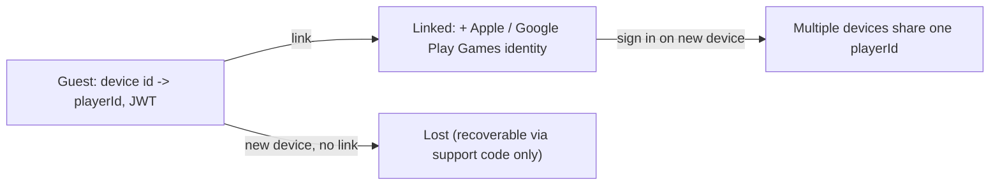
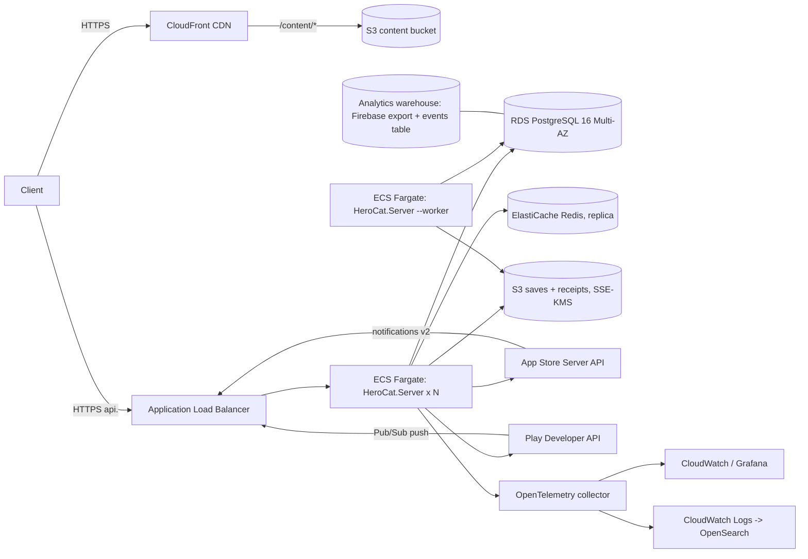

## 08 - Backend and Live Ops

Specifies `HeroCat.Server`: every service and endpoint the client calls, the auth model, the server-authoritative summon algorithm and its audit trail, receipt validation for both stores, remote config and content versioning, anti-cheat plausibility checks and the action matrix, live-ops tooling, infrastructure and cost, and compliance. Everything here sits behind the seven interfaces of 00 section 8.11 (`IClock`, `ISummonService`, `ISaveStore`, `IInboxService`, `IReceiptValidator`, `IConfigService`, `IDungeonSeedService`; issue #25) with local implementations, so M0 ships with no server at all; the server is additive from MVP.

Tiers covered: MVP (everything not marked otherwise), P1 (Guild, Leaderboard, Coupon, Rewarded Ads, Events schedule), with M0 notes where the local implementation differs.

Depends on: 00 (sections 3, 4, 6.3, 8), 01 (flows, `ApiClient`, error taxonomy), 02 (save metadata, conflict rules, relational schema, clock), 04 (banner level reshaping, item pools), 06 (currency rules, shop products, first-purchase double).

## 1. Service inventory

One ASP.NET Core 8 deployable (`HeroCat.Server`), organised as feature folders; "service" below is a code boundary, not a separate process. Splitting into processes is a P2 question that nothing here forecloses because services share no in-memory state. Every table and column this spec reads or writes is defined in 02 section 12, which owns the server schema (issue #53).

| Service | Owns | Tables (02 section 12) | Tier | M0 local implementation |
|---|---|---|---|---|
| Auth | guest creation, JWT issue/refresh, platform linking, logout, recovery, device registration, server time | `accounts`, `account_links`, `devices`, `refresh_tokens` | MVP | none needed; `PlayerId = Guid.Empty`, `ServerClock(api: null)` |
| Profile | display name, avatar, age gate, account delete/export | `accounts` | MVP | `profile.json` cache only |
| Save | upload/download, metadata, history, plausibility hook, crediting client-earned currency (issue #49) | `saves`, `save_history`, `diamond_ledger`, `ticket_ledger`, S3 | MVP | `LocalSaveStore` |
| Summon | pull, pity state, rate table, history | `banner_pity`, `summon_log`, `diamond_ledger`, `ticket_ledger`, `granted_items`, `idempotency` | MVP | `LocalSummonService` (same algorithm, 04 section 3.2, `summon_*` streams) |
| Inbox | list, claim, claim-all, expiry | `inbox_items`, `diamond_ledger`, `ticket_ledger`, `granted_items` | MVP | `LocalInboxService` (empty) |
| IAP / Receipt | catalog, validate, restore, store webhooks, refunds | `purchases`, `inbox_items`, `diamond_ledger` | MVP | `DisabledReceiptValidator`; `FakeReceiptValidator` in debug builds |
| Config / Content | remote config, kill switches, content manifest pointer, min versions, maintenance | `config_versions` | MVP | `LocalConfigService` (bundled content, all flags on) |
| Dungeon seed | seed issue, result correlation | `dungeon_seeds` | MVP | `LocalDungeonSeedService : IDungeonSeedService` (one draw from `dungeon`; issue #25) |
| Mail / Admin | mail blasts, compensation, moderation actions, config publishing, support lookups | `mail_blasts`, `moderation_actions`, `config_versions` | MVP (internal) | n/a |
| Guild | create/join/chat/boss | `guilds`, `guild_members`, `guild_chat` | P1 | n/a |
| Leaderboard | weekly boards from save summaries | Redis ZSETs | P1 | n/a |
| Coupon | redeem codes | `coupons`, `coupon_redemptions` (P1 tables) | P1 | n/a |
| Ads | rewarded-ad server-side verification callbacks | `ad_rewards` (P1) | P1 | n/a |

### 1.1 Conventions shared by every endpoint

- Base URL `https://api.{env}.whiskerhero.example/v1`. TLS 1.2+, HSTS. JSON bodies, `Content-Type: application/json; charset=utf-8`; the save blob is `application/octet-stream`.
- Headers from the client (01 section 5.1): `Authorization: Bearer <jwt>`, `X-Request-Id`, `X-Client-Version`, `X-Content-Version`, `X-Device-Id`, `Accept-Language`.
- Every response carries `X-Server-Time` (unix seconds) and `X-Request-Id` echoed (a request without a usable id, up to 64 chars of `[A-Za-z0-9-]`, gets a server-made 32-hex id, which the error body's `requestId` also carries).
- Error body, every 4xx/5xx:

```json
{ "code": "INSUFFICIENT_FUNDS", "message": "Not enough diamonds.", "requestId": "c1f0...", "retryAfterSec": null, "details": { "need": 1000, "have": 640 } }
```

`code` is from a closed list per endpoint below plus the global set: `UNAUTHENTICATED` (401), `TOKEN_EXPIRED` (401), `FORBIDDEN` (403), `ACCOUNT_BANNED` (403, section 7.4), `NOT_FOUND` (404 for an unmatched route, 405 for a wrong method), `CLIENT_TOO_OLD` (426), `CONTENT_TOO_OLD` (409), `RATE_LIMITED` (429), `MAINTENANCE` (503), `VALIDATION` (400), `IDEMPOTENCY_IN_FLIGHT` (409), `INTERNAL` (500). All five body fields are always present (`retryAfterSec` and `details` are `null` when unused); `message` is English diagnostics, the client localizes by `code`. Any unhandled exception is `500 INTERNAL` with no exception text, and an error status that leaves a handler without a body gets the body of its status's global code (issue #193).

The codes and statuses in this spec are the canonical wire contract. Several statuses carry codes of different classes (409 is retryable `IDEMPOTENCY_IN_FLIGHT`, re-quote `PAYMENT_MISMATCH`, must-download `SAVE_ROLLED_BACK` or success-equivalent `INBOX_ALREADY_CLAIMED`; 503 is `MAINTENANCE` or the non-retryable `SUMMON_DISABLED`), so the client classifies by `(status, code)` through 01 section 5.2's table, and an unknown code falls back to that table's status rule (issue #30).

- **Idempotency** (00 section 8.13): every mutating endpoint requires `X-Request-Id` (32 hex chars). The handler does `INSERT ... ON CONFLICT DO NOTHING` into `idempotency` with status `in_flight` first; if the row existed with a final status, the stored response is replayed with header `X-Idempotent-Replay: true`; if it existed as `in_flight`, `409 IDEMPOTENCY_IN_FLIGHT` with `retryAfterSec: 1`. Rows live `IDEMPOTENCY_TTL_H = 24`. A `requestId` seen under a different `playerId` is rejected `403` and flagged `DUPLICATE_REQUEST_ID` (section 7). As built (issue #194): every endpoint whose line below says "idempotent" declares `[Idempotent]`, and one middleware after the gates (so a gate's refusal is never stored) does the above for all of them; a missing or malformed id is `400 VALIDATION` (`details.header`), the cross-player refusal is `403 FORBIDDEN` with `details.reason = DUPLICATE_REQUEST_ID`, and the same id from the same player for a different method, route or body is `400 VALIDATION` with `details.reason = REQUEST_ID_REUSED` (not `409`, which the client would retry forever). Every response below 500 is stored and replayed byte-identically with its status, `Content-Type`, `ETag`, `Location` and `X-Save-Meta`, error bodies included (a `402 INSUFFICIENT_FUNDS` replays as itself); a 5xx, an unhandled exception or a handler's own `409 IDEMPOTENCY_IN_FLIGHT` (the summon lock) deletes the `in_flight` row so the retry runs fresh. A row older than `IDEMPOTENCY_TTL_H` counts as absent before the hourly worker purge removes it (00 decision 28). A handler that writes in a transaction can store the final row in that same transaction (section 4.3) instead of after it returns. `/auth/guest`, which has no player yet, keys its rows by a UUID derived from `X-Device-Id` (02 section 12).
- **Rate limits** are per `playerId` (per IP for unauthenticated routes), sliding window in Redis (`rl:{route}:{playerId}`, `rl:{route}:ip:{ip}`; 02 section 12), reported with `RATE_LIMITED`, `retryAfterSec` and `Retry-After` (whole seconds until the request fits every window). Values below are per minute unless stated. Each endpoint declares its limits on the action (`[RateLimit(limit, windowSeconds)]`); a request must fit all of an endpoint's windows, and only accepted requests count. If Redis is unreachable the limits fail open (logged), as does the maintenance check (issue #193).
- **Version gates**: `X-Client-Version < config.minClientVersion` -> `426 CLIENT_TOO_OLD` (`details.minClientVersion`) on every route except `/config`, `/time`, `/auth/*`. `X-Content-Version < minContentVersion[clientVersion]` -> `409 CONTENT_TOO_OLD` (`details.minContentVersion`) on `/summon/pull`, `/dungeon/seed`, `/save` PUT (the sim-sensitive routes). Client versions compare by semver precedence (build metadata ignored); a client version missing from `minContentVersionByClient` takes the floor of the highest listed version below it, and none if there is none. A missing or unparseable `X-Client-Version` on a gated route, or `X-Content-Version` on a sim-sensitive one, is `400 VALIDATION` (`details.header`).
- **Maintenance**: when `maint` is set in Redis, every route except `/config` and `/time` returns `503 MAINTENANCE` with `details: { messageKey, until }` and, while `until` is ahead, `retryAfterSec` until then.
- **Scope and order.** These gates cover the client routes under `/v1`; `/health`, the OpenAPI document and the internal admin API (`/v1/admin/*`, section 8.5) take no client headers and are never version-gated or blocked by maintenance (the admin API is how maintenance is lifted). A matched route passes maintenance, client version, auth, content version and rate limits in that order; an unmatched route is `404 NOT_FOUND` regardless.
- Auth column below: `none`, `jwt` (any valid access token), `jwt+device` (token's `deviceId` claim must match `X-Device-Id`), `admin` (internal network + SSO). A missing or invalid token is `401 UNAUTHENTICATED`, an expired one `401 TOKEN_EXPIRED`; a `jwt+device` device mismatch (or no `X-Device-Id`) is `403 FORBIDDEN` with `details.reason = DEVICE_MISMATCH`; a banned account on a `jwt` or `jwt+device` route is `403 ACCOUNT_BANNED` with `details.appealUrl`. A `none` route reads a valid token if one is sent (`/config`'s rollout bucket) and ignores an invalid one. An endpoint that declares no policy is `jwt` (fail closed). The OpenAPI document generated from the controllers records each operation's policy as `x-herocat-auth`, its limits as `x-herocat-rate-limits` (`5/60s`) and whether it is idempotent by `X-Request-Id` as `x-herocat-idempotent`, which the contract test (acceptance 23) compares with the endpoint lines below.

## 2. Auth

### 2.1 Model



- **Tokens.** Access JWT: RS256, `exp` 1 h, claims `sub` (playerId), `dev` (deviceId), `age` (age gate), `iat`, `jti`. Refresh token: 256-bit random, stored hashed in `refresh_tokens`, 60 days, **rotated on every use** (the old one is revoked; reuse of a revoked refresh token revokes the whole family and returns `TOKEN_REUSED`, which forces re-login and is logged as a possible theft).
- **Guest.** `POST /auth/guest` with a device id creates an account and a device row. The device key for HMAC (02 section 10) is registered in the same call. A guest can play, buy, and cloud-save; the only thing a guest cannot do is recover the account on another device without linking.
- **Linking.** Sign in with Apple: the client sends the identity token (JWT) from `ASAuthorizationAppleIDCredential`; the server verifies signature against Apple's JWKS, `aud` = our bundle id, `nonce`, and takes `sub`. Google Play Games Services v2: the client sends the server auth code; the server exchanges it for tokens and calls `games.players.get('me')` for `playerId`. The provider id is stored as `sha256(providerUserId || pepper)`.
- **Multiple devices.** Allowed concurrently. Each has its own `deviceId`, key and refresh token family. Saves reconcile by 02 section 9.3. Summons are serialised per player by the Redis lock, so two devices pulling at once get `409 IDEMPOTENCY_IN_FLIGHT` / a replayed result, never a double roll.
- **Recovery.** `SCR_SETTINGS` shows a 12-character support code (`base32(hmac(playerId, serverKey))[:12]`). A player who lost a guest account can give support the code plus a recent purchase receipt; support links a new device via the admin API. No self-service recovery for unlinked guests, by design.
- **Age gate** is set once at first launch (`PATCH /profile {ageGate}`) from a neutral age screen (section 10.1). It is in the JWT so every handler can branch without a lookup.

### 2.2 Endpoints

**`POST /auth/guest`** -- auth `none` -- idempotent by `X-Request-Id` -- rate limit 5/min per IP, 20/day per IP.

```json
// request
{ "deviceId": "0f9e8d7c-...", "deviceKey": "<base64 32 bytes>", "model": "Pixel 7", "os": "Android 14", "clientVersion": "1.4.2+318", "region": "US" }
// 201
{ "playerId": "6b1f2c40-...", "accessToken": "eyJ...", "refreshToken": "r1.…", "accessExpiresAt": 1793670800, "profile": { ...Profile (02 section 4)... }, "serverTime": 1793667200 }
```

Errors: `DEVICE_ALREADY_BOUND` (409; this device already has a guest account; response includes `playerId` so the client refreshes instead), `VALIDATION`.

**`POST /auth/refresh`** -- auth `none` (refresh token in body) -- not idempotent (rotation) -- 30/min.

```json
{ "refreshToken": "r1.…", "deviceId": "0f9e8d7c-..." }
// 200
{ "accessToken": "eyJ...", "refreshToken": "r2.…", "accessExpiresAt": 1793674400, "serverTime": 1793670800 }
```

Errors: `TOKEN_EXPIRED` (401), `TOKEN_REVOKED` (401), `TOKEN_REUSED` (401, family revoked), `DEVICE_MISMATCH` (403).

**`POST /auth/link`** -- auth `jwt+device` -- idempotent -- 10/min.

```json
{ "provider": "apple", "identityToken": "eyJ...", "nonce": "…", "authorizationCode": "…" }
{ "provider": "google_play", "serverAuthCode": "4/0A…" }
// 200
{ "profile": { ... }, "linked": [ { "provider": "apple", "linkedAt": 1793670800 } ] }
```

Errors: `PROVIDER_TOKEN_INVALID` (400), `PROVIDER_ALREADY_LINKED` (409; this platform identity belongs to another `playerId`; `details.otherSummary` carries that account's save summary so the client can run the 01 section 8.13 step 4 choice), `ACCOUNT_ALREADY_HAS_PROVIDER` (409).

**`POST /auth/link-login`** -- auth `none` -- not idempotent -- 10/min per IP. Same body as `/auth/link`. Returns the same shape as `/auth/guest` for the account that owns that platform identity, and registers the calling device (`deviceId`, `deviceKey`) under it. Error `NO_ACCOUNT_FOR_PROVIDER` (404) -> client offers "create new" (guest + link in one go).

**`POST /auth/merge`** -- auth `jwt+device` -- idempotent -- 2/hour. Resolves `PROVIDER_ALREADY_LINKED`: `{ "provider", "identityToken"|"serverAuthCode", "keep": "this"|"other" }`. `keep: "other"` re-issues tokens for the other account and archives this guest (status `merged_away`, save blob retained 30 days). `keep: "this"` moves the platform link to this account and archives the other. Both write `moderation_actions` with `action = account_merge`.

**`POST /auth/logout`** -- auth `jwt` -- idempotent -- 10/min. `{ "refreshToken": "…" }` -> `204`. Revokes that family only.

**`POST /devices`** -- auth `jwt` -- idempotent -- 5/min. Registers or rotates a device key: `{ "deviceId", "deviceKey", "model", "os", "clientVersion", "pushToken"? }` -> `204`. Key rotation is only accepted from a request whose save HMAC verified under the old key or within 24 h of `/auth/guest` for that device.

**`GET /time`** -- auth `none` -- 60/min per IP. `{ "serverTime": 1793670800 }`. Also every response's `X-Server-Time`.

### 2.3 Profile and account

**`GET /profile`** -- `jwt` -- 60/min -> `Profile` (02 section 4).

**`PATCH /profile`** -- `jwt` -- idempotent -- 10/min. `{ "displayName"?, "avatarId"?, "ageGate"? }`. Display names: 2-16 chars after NFC normalisation, no control characters, filtered against a blocklist (`DISPLAY_NAME_BLOCKED` 400), unique not required. `ageGate` can be set only when currently `0` (`AGE_GATE_LOCKED` 409); changing it afterwards is a support action.

**`POST /account/delete`** -- `jwt+device` -- idempotent -- 1/hour. `{}` -> `{ "graceUntil": 1794880000 }`. 02 section 13.2.

**`POST /account/delete/cancel`** -- `jwt` -- idempotent. `{}` -> `204`; `DELETE_NOT_PENDING` 409; `GRACE_EXPIRED` 410.

**`POST /account/export`** -- `jwt` -- idempotent -- 1 per 7 days (`EXPORT_RATE_LIMITED` 429 with `retryAfterSec`). `{}` -> `{ "status": "queued", "estimatedMinutes": 10 }`; the link appears in `GET /account/export` -> `{ "status": "ready", "url": "https://…", "expiresAt": … }`.

## 3. Save, Inbox, Dungeon seed, Config endpoints

### 3.1 Save

**`GET /save/meta`** -- `jwt` -- 60/min -> the metadata object of 02 section 9.1 plus `etag`, or `404 NO_SAVE`.

**`GET /save`** -- `jwt` -- 10/min -> `200` with `ETag` header, metadata in `X-Save-Meta` (JSON), body = the raw save file (header + JSON body) as `application/octet-stream`. Served by redirect to a 5-minute presigned S3 URL when `sizeBytes > 64 KiB`, inline otherwise.

**`PUT /save`** -- `jwt+device` -- idempotent -- 6/min, 400/day (a 2 h session at one upload per minute is 120).

The save routes, headers and statuses in this section are the canonical cloud-save wire contract; 02 section 9 follows them (issue #34).

Request: headers `If-Match: <etag>` (or `*` for first upload), `X-Save-Meta: <json>` (02 section 9.1), `Content-Type: application/octet-stream`, body = the save file (max `SAVE_BLOB_MAX_BYTES`).

```json
// 200
{ "etag": "W/\"1875-0f9e\"", "saveSeq": 1875, "serverTime": 1793670900, "flags": [], "diamondReconcile": null }
// 200 with reconciliation (section 7.4)
{ "etag": "...", "saveSeq": 1875, "serverTime": ..., "flags": ["DIAMOND_LEDGER_MISMATCH"], "diamondReconcile": { "clientBalance": 9999, "serverBalance": 1240, "applied": true } }
// 409
{ "code": "SAVE_CONFLICT", "details": { "serverMeta": { ...02 section 9.1... } } }
```

Server steps, in order: (1) parse header, verify `len`/CRC (`SAVE_MALFORMED` 400); (2) verify HMAC against `devices.hmac_key_enc` for `X-Device-Id` (record `hmac_valid`; not a rejection); (3) `If-Match` vs `saves.etag` (`SAVE_CONFLICT` 409 unless `*` and no row); (4) `saveSeq` must exceed the stored one for the same `deviceId` (`SEQ_REGRESSION` flag, accepted but flagged; a lower seq from the *same* device is rejected `SAVE_STALE` 409 because the device itself knows better); (5) `lastSavedServerTime <= now + CLOCK_MAX_SKEW_ACCEPT_S` (`CLOCK_AHEAD` flag); (5a) credit client-earned currency (issue #49, below); (6) plausibility checks (section 7) asynchronously *except* `DIAMOND_LEDGER_MISMATCH`, which runs inline because its reconciliation is in the response; (7) write blob to S3 `saves/{playerId}/{saveSeq}.sav`, upsert `saves`, insert `save_history`, trim to `SAVE_HISTORY_KEEP`; (8) P1: update leaderboard ZSETs from `summary`.

**Crediting client-earned currency** (step 5a, issue #49). Diamonds and summon tickets earned in the client sim (login, quests, first clears, achievements, tutorial, daily gift, weekly grants) and diamonds spent client-side (`SHOP_EXCHANGE`) reach the server ledgers only through this step. The save carries cumulative per-reason counters (02 `Stats`): `Stats.ClientDiamondsEarned[reason]`, `Stats.ClientDiamondsSpent[reason]` and `Stats.ClientTicketsEarned[ticket][reason]`, counting only client-originated reasons (server-originated reasons such as `IAP`, `MAIL`, `ADMIN`, `REFUND` and `SUMMON` are written by the server and excluded). For each `(currency, reason)` the server takes `delta = counter - sum(ledger rows with ref_type = save_reconcile for that reason)` and writes one ledger row per non-zero delta (`diamond_ledger` or `ticket_ledger`, that reason, `ref_type = save_reconcile`, `ref_id = saveSeq`), in the same transaction as step 7. Earned diamond credits for one upload are clamped to `clientSideAllowance` (section 7.2); a clamped excess is not credited and raises `DIAMOND_LEDGER_MISMATCH`. Summon ticket credits are clamped the same way, per ticket, to `maxTicketsPerDay(ticket) * daysSinceLastUpload`, where `maxTicketsPerDay` is derived from that ticket's client-side sources in content (06 section 1.1 rule 6) and `daysSinceLastUpload` counts the day keys from the last upload's to this one's, inclusive (so at least 1); an excess is not credited. Dungeon tickets stay client-side and are not credited. A pull can spend only what has been credited, so the client uploads before a summon when it holds unsynced earnings (01 summon flow).

**`GET /save/history`** -- `jwt` -- 10/min -> `[{ "saveSeq", "deviceId", "uploadedAt", "summary" }]` (last 10). Restoring one is a support action (`POST /admin/save/restore`), not self-service, because a self-service rollback is a free re-roll of anything client-side.

### 3.2 Inbox

**`GET /inbox`** -- `jwt` -- 30/min.

```json
// 200
{ "items": [
    { "inboxItemId": "ibx_01HZ…", "kind": "iap", "titleKey": "inbox.iap.title", "bodyKey": "inbox.iap.body", "params": { "sku": "diamonds_3" },
      "grants": [ { "kind": "currency", "id": "DIAMOND", "amount": 2400 } ], "createdAt": 1793670000, "expiresAt": null },
    { "inboxItemId": "ibx_01HZ…", "kind": "compensation", "titleKey": "inbox.comp.title", "bodyKey": "inbox.comp.2026_11_03", "params": {},
      "grants": [ { "kind": "currency", "id": "DIAMOND", "amount": 300 }, { "kind": "currency", "id": "TICKET_SUMMON_WEAPON", "amount": 5 } ],
      "createdAt": 1793600000, "expiresAt": 1796200000 } ],
  "serverTime": 1793670900 }
```

Unclaimed items only; expired items are excluded and purged nightly. Rows whose `available_at` is in the future (scheduled package portions, section 5.2; issue #51) are hidden, except the earliest future portion of each package, which is returned with `availableAt` set so the client can show the next delivery (07 shows at most one); claiming it early returns `INBOX_NOT_AVAILABLE` 409. Inbox items never contain diamonds that were not first written to `diamond_ledger` with `ref_type = inbox_item` at claim time (not at creation), so an unclaimed item is not a balance.

**`POST /inbox/claim`** -- `jwt` -- idempotent -- 30/min. `{ "inboxItemId" }` ->

```json
{ "inboxItemId": "…", "grants": [ ... ], "balances": { "DIAMOND": 3640 }, "reason": "IAP", "serverTime": … }
```

Writes `diamond_ledger` (`+amount`, reason `IAP`/`MAIL`/`ADMIN`, `ref_type = inbox_item`) and, for summon ticket grants, `ticket_ledger` with the same reason and ref (issue #49), sets `claimed_at`, in one transaction. Errors: `INBOX_NOT_FOUND` 404, `INBOX_NOT_AVAILABLE` 409 (`available_at` in the future), `INBOX_ALREADY_CLAIMED` 409 (response still carries the original `grants` so the client can reconcile `Inbox.ClaimedIds`), `INBOX_EXPIRED` 410. Item grants (`kind: item`) are returned for the client to apply through `ApplyInboxGrant`; the server also appends them to a per-player `granted_items` ledger used by `ITEM_WITHOUT_PULL` (section 7).

**`POST /inbox/claim-all`** -- `jwt` -- idempotent -- 10/min. `{}` -> `{ "claimed": [ ...per-item results... ], "balances": {...} }`. Claims up to 50 items oldest-first; a partial failure (an item expiring between list and claim) is skipped and reported, not an error.

### 3.3 Dungeon seed

**`POST /dungeon/seed`** -- `jwt` -- idempotent -- 20/min, 60/day.

```json
{ "kind": "FISH_COIN", "floor": 7, "clientContentVersion": "2026.11.03" }
// 200
{ "grantId": "a4d1…", "seed": "9f86d081884c7d65", "expiresAt": 1793671500, "serverTime": 1793670900 }
```

Checks: `floor` in `[1, maxFloor(kind)]` (`VALIDATION`); the player's last uploaded save has `BestFloor[kind] >= floor - 1` (`DUNGEON_LOCKED` 403; the client's state may be ahead of the last upload, so a mismatch by one floor is tolerated: `floor <= BestFloor + 2`); outstanding unexpired seeds for the same `(kind, dayKey)` count against a daily cap of `DUNGEON_SEEDS_PER_DAY = 10` per kind (`DUNGEON_SEED_CAP` 429). Seed = 64 random bits from the server CSPRNG, stored in `dungeon_seeds` with `expires_at = now + DUNGEON_SEED_TTL_S`. The result is filled from the next save upload: the save keeps a short `Dungeons.RecentRuns[{GrantId, Kind, Floor, Cleared}]` list (02), and section 7.3 matches it, `Stats.DungeonClears` and `BestFloor` to issued grants. The server only correlates; it does not replay dungeon runs in MVP (issue #52).

### 3.4 Config

**`GET /config`** -- `none` (optionally `jwt`, which enables the rollout bucket) -- 30/min per IP. The rollout bucket is computed server-side only (issue #31): without a valid JWT the response carries the non-rollout default content, and the client re-fetches config once after auth at boot (01 section 8.1). Section 6 gives the body. Served with `Cache-Control: max-age=60`; the client caches for `CONFIG_CACHE_MAX_AGE_S` (01).

Content bundles are **not** served by the API; `config.content.url` points to the CDN (`https://cdn.whiskerhero.example/content/{version}/manifest.json`), immutable per version, `Cache-Control: public, max-age=31536000`.

## 4. Summon service (server-authoritative, MVP)

### 4.1 Rate table and pity rules (00 section 6.3, restated as data)

The rate table for a banner at level `L` comes from `banner_levels` (09). The algorithm never changes the Legendary and Mythic probabilities across banner levels, so the published odds for the two rarities players care about are constant; levels redistribute weight from C to R/E (04 defines the schedule). The table at level 1 is the 00 base: C .60 / R .28 / E .09 / L .025 / M .005.

```csharp
public sealed record RateTable(double C, double R, double E, double L, double M)   // sums to 1 within 1e-9 (09 validator)
{
    public double LPlus => L + M;                                 // 0.03 at every level
    public double MShare => M / (L + M);                          // M_SHARE_OF_LPLUS = 1/6 at every level
}
```

Pity is defined once (issue #24): `pity` = pulls on this banner since the last L+ result, **before** this pull, held server-side in `banner_pity` (the client's `Banners[b].Pity` mirrors it). The pull's index is `n = pity + 1`, and its L+ probability is 04's `PityRate(n)` (04 section 3.1):

```
pLPlus(n) = n <= PITY_SOFT_START            ? table.LPlus                                   // pulls 1..50: 0.03
          : n >= PITY_HARD                   ? 1.0                                           // pull 80: forced
          : min(1.0, table.LPlus + PITY_SOFT_STEP * (n - PITY_SOFT_START))                  // pull 51..79: 0.03 + 0.0325*(n-50)
```

Worked: `n = 51 -> 0.0625`, `n = 60 -> 0.355`, `n = 70 -> 0.68`, `n = 79 -> 0.9725`, `n = 80 -> 1.0`. The formula reaches 1.0 at `n = 80` on its own (`0.03 + 0.0325*30 = 1.005`), so `PITY_HARD` is a guarantee consistent with the curve, not an override of it. So a pull made at `pity = 79` is pull 80 and its L+ probability is exactly 1.0.

Below L+, 04 section 3.2 picks C/R/E with `u2` over the level's C/R/E weights renormalised by `(1 - table.LPlus)`.

### 4.2 The pull algorithm (owned by 04)

The algorithm is 04 section 3.2 (`Pull`, `Pull10`, `PityRate`, `SampleCRE` in `HeroCat.Sim.Summons`), shared by the server, `LocalSummonService` and `tools/gacha_model.py`; this spec does not restate it (issue #24). Only the source of the uniforms differs: the server draws from a CSPRNG, the local service from the `summon_<banner>` stream, the model from `random`. What the server handler and audit rely on:

- Three uniforms per pull, always consumed, even when unused, in a fixed order: `u1` is the L+ check against `PityRate(n)`; `u2` picks M vs L inside L+, or C/R/E renormalised, or is unused on a forced E; `u3` picks the item inside the rarity's pool. Stream counters stay `3 * TotalPulls` (02 section 3.4) and a 10-pull consumes exactly 30 uniforms.
- Banner EXP is added before each pull's draw and that pull uses the resulting level's rate table (04 section 4), so a 10-pull that crosses a level threshold changes table mid-batch.
- 10-pull guarantee: if slots 1-9 produced nothing >= EPIC, slot 10 still runs the normal L+ check first and becomes EPIC only if that check fails. It is never a reroll over E/L/M, so the L+ distribution is identical on every slot and the published odds need no forced-slot caveat. Pity advances through a forced E and resets on L/M.

Test vectors: one directory `Fixtures/Summon/` (issue #14). `Fixtures/Summon/vectors.json` is generated by `tools/gacha_model.py --vectors` (the independent oracle): a superset of 04's named vectors (04 section 3.4) plus at least 500 row vectors `(level, pity, u1, u2, u3, forceEplus) -> (rarity, poolIndex, pityAfter, guarantee)` and 20 batch rows. `HeroCat.Sim.Tests` and `HeroCat.Server.Tests` only read it; server and client must reproduce every row. Beside it, the C# stream-sequence fixture (seed -> 1,000 pulls through the `summon_<banner>` stream) is a determinism golden that the Python model's SplitMix64 must also reproduce.

### 4.3 Handler

**`POST /summon/pull`** -- `jwt+device` -- idempotent -- 20/min, and at most one in flight per player.

```json
// request
{ "banner": "WEAPON", "count": 10, "payment": "DIAMOND", "clientContentVersion": "2026.11.03" }
// 200
{ "requestId": "c1f0…", "banner": "WEAPON", "count": 10,
  "pulls": [ { "itemId": "wpn_017", "rarity": "R", "isNew": false, "levelBefore": 1, "levelAfter": 1, "copiesAfter": 2, "overflowRockCandy": 0, "guaranteeApplied": false }, "...9 more" ],
  "pityBefore": 23, "pityAfter": 33, "bannerLevelBefore": 4, "bannerLevelAfter": 4, "bannerExpAfter": 422,
  "debits": [ { "currency": "DIAMOND", "amount": -1000 } ],
  "balances": { "DIAMOND": 240, "TICKET_SUMMON_WEAPON": 3 },
  "rateTableHash": "3f9a…", "serverTime": 1793670900 }
```

```
Handle(player, req):
  acquire Redis lock summon:lock:{player} (TTL 10 s, wait up to 1 s) else 409 IDEMPOTENCY_IN_FLIGHT
  idempotency lookup by (player, X-Request-Id): replay if final
  validate: banner open per schedule (BANNER_CLOSED 409); count in {1,10} (VALIDATION); payment in {DIAMOND, TICKET}
  content = ContentDb for req.clientContentVersion (CONTENT_TOO_OLD 409 if below min)
  tx:
    pity = select ... from banner_pity for update (insert default if absent)
    cost  = payment == DIAMOND ? PULL_COST[banner] * count : count tickets
    if payment == DIAMOND: balance = sum(diamond_ledger) ; if balance < cost: 402 INSUFFICIENT_FUNDS {need, have}
    else: tickets = sum(ticket_ledger) for the banner's ticket (credited at PUT /save step 5a and inbox claim; issue #49); if tickets < count: 402 INSUFFICIENT_FUNDS
    if payment == DIAMOND and tickets >= count: 409 PAYMENT_MISMATCH {expected: "TICKET"}   // 06 rule: tickets first; client out of date
    st  = BannerState { Pity = pity.pity, TotalPulls = pity.total_pulls, Exp = pity.exp }      // cumulative exp; level derived
    col = CollectionState from the player's item ledger (granted_items + summon_log aggregates)
    results = count == 10 ? Pull10(content.Banner(banner), st, col, csprng)                                  // 04 section 3.2; banner level and
                          : [Pull(content.Banner(banner), st, col, csprng, forceEplus: false)]               // rate table evaluated per pull
    insert count rows into summon_log (one per pull, with that pull's u1/u2/u3, pity_before/after, banner level, guarantee, rate_table_hash of that pull's table)
    insert diamond_ledger (-cost, SUMMON, ref summon, request_id) or ticket_ledger (-count, SUMMON, ref summon, request_id)
    update banner_pity: pity = st.Pity, exp = st.Exp, level = levelFor(exp) (04 section 4 thresholds), total_pulls = st.TotalPulls
    isNew/levelBefore/levelAfter/copiesAfter/overflowRockCandy come from the Pull results; append items to the ledger
    insert idempotency(final, response)
  release lock; return response
```

As built (issue #194), the idempotency middleware runs before the handler, so the lookup precedes the lock; the outcome is the same (one id in flight is `409`, a final one replays, and a second request id waits for the lock). The lock records `redis_lock_wait_seconds` (tags `lock`, `outcome` = `acquired` / `timeout` / `unavailable`) and fails open when Redis is unreachable (section 9.1). Latency target p99 under 150 ms. The response is the `SummonResultPayload` of 01 section 2.5, with per-pull `copiesAfter` and `overflowRockCandy` (issue #13); the client applies it with `ApplySummonResult`, the only summon mutator in both modes, replacing `DIAMOND` with `balances.DIAMOND` (server wins). Replacing is safe because the client uploads its save before the pull whenever it holds unsynced client-earned diamonds or tickets (issue #49).

Errors: `INSUFFICIENT_FUNDS` 402, `PAYMENT_MISMATCH` 409, `BANNER_CLOSED` 409, `CONTENT_TOO_OLD` 409, `IDEMPOTENCY_IN_FLIGHT` 409, `SUMMON_DISABLED` 503 (kill switch).

### 4.4 Audit log

One `summon_log` row per pull, never per batch, so a regulator or support agent can reproduce any pull: given `rate_table_hash` (which identifies the exact published table), `pity_before`, `guarantee` (whether slot 10 ran with `forceEplus`) and the pull's three uniforms, 04's `Pull` yields the logged rarity and item. The row records `guarantee` so forced 10-pull slots are visible. Retention 7 years (02 section 13). `GET /summon/history?banner=WEAPON&limit=100` -- `jwt` -- 10/min -> the player's own rows (item, rarity, pity, time; not the uniforms).

### 4.5 Published rates

**`GET /summon/rates?banner=WEAPON&level=4`** -- `none` -- 60/min per IP -- `Cache-Control: max-age=3600`.

```json
{ "banner": "WEAPON", "level": 4, "contentVersion": "2026.11.03", "rateTableHash": "3f9a…",
  "rates": { "C": 0.540, "R": 0.316, "E": 0.114, "L": 0.025, "M": 0.005 },
  "pity": { "softStart": 50, "softStepPerPull": 0.0325, "hard": 80, "lplusAtSoftStart": 0.03 },
  "tenPullGuarantee": "EPIC_OR_BETTER",
  "effective": { "lplusPerPullAveraged": 0.0366, "expectedPullsToLplus": 27.3, "p99PullsToLplus": 62 },
  "items": [ { "itemId": "wpn_001", "rarity": "C", "weight": 1 }, "..." ] }
```

`rates` is 04 section 4's level-4 row. `effective` numbers are computed by `tools/gacha_model.py` at export time and stored in `banner_levels` so the server serves exactly what the model printed. `SCR_SUMMON` renders this endpoint's body (07); the same JSON is exported to the store listing's odds page (section 10.3).

**`GET /summon/state`** -- `jwt` -- 30/min -> `{ "banners": { "WEAPON": { "pity": 23, "level": 4, "bannerExp": 412, "totalPulls": 412 }, ... } }`. `bannerExp` is cumulative and `level` is derived from it (04 section 4; returned for display only). The client calls it at boot to overwrite the `Banners[b]` mirrors (`Pity`, `TotalPulls`, `Exp`).

### 4.6 M0 note

`LocalSummonService` (Runtime) checks the wallet, then runs 04's `Pull`/`Pull10` on cloned banner and collection state with uniforms from the `summon_<banner>` stream, and returns a `SummonResultPayload` that also carries that stream's counter after the pull. It never writes `GameState` and writes no log: `ApplySummonResult` debits the wallet, sets the stream counter and applies the pulls, in Local and Remote mode alike (issues #6, #13). The bot harness uses the same class. Because the function is shared, the bot's realised rates predict live rates exactly, and the server's test suite asserts the vectors file against the same assembly.

## 5. IAP and receipt validation

### 5.1 Catalog

**`GET /shop/catalog`** -- `jwt` -- 30/min -> the `shop_products` and `shop_packages` rows (09) filtered by region, age gate and kill switches, with per-player state (`firstPurchaseDoubleAvailable`, a per-SKU map over diamond packs such as `{ "diamonds_3": true }`; `dailyFreeClaimed`; package purchase counts). Prices shown in the client come from the store SDK, not from this endpoint; the endpoint carries `appleProductId`, `googleProductId` and the grant.

### 5.2 Validate

**`POST /iap/validate`** -- `jwt+device` -- idempotent by `X-Request-Id` **and** by `(platform, transactionId)` -- 10/min.

```json
// request (Apple)
{ "platform": "apple", "sku": "diamonds_3", "transactionId": "2000000123456789", "signedTransaction": "eyJ…", "appAccountToken": "6b1f2c40-…" }
// request (Google)
{ "platform": "google_play", "sku": "diamonds_3", "purchaseToken": "opaque…", "orderId": "GPA.1234-…", "obfuscatedAccountId": "sha256(playerId)" }
// 200
{ "status": "GRANTED", "inboxItemId": "ibx_01HZ…", "grants": [ { "kind": "currency", "id": "DIAMOND", "amount": 2400 } ], "firstPurchaseDoubled": true, "serverTime": … }
// 200 replay
{ "status": "ALREADY_GRANTED", "inboxItemId": "ibx_01HZ…", "grants": [ ... ] }
```

**Apple (StoreKit 2 / App Store Server API).** The client sends the JWS `signedTransaction` from `Transaction.jwsRepresentation`. Server: verify the JWS chain against Apple's root CA (bundled, pinned by fingerprint), check `bundleId`, `environment` matches the server env (`Sandbox` accepted only on dev/stage), `productId == sku`, `appAccountToken == playerId` (set by the client at purchase so a receipt cannot be replayed onto another account; mismatch -> `RECEIPT_ACCOUNT_MISMATCH` 403 and a flag). Then confirm server-to-server with `GET /inApps/v1/transactions/{transactionId}` (App Store Server API, JWT-signed with our key) so a forged JWS with a stolen intermediate cannot pass; 5xx from Apple -> retry 3x then `STORE_UNAVAILABLE` 503 (the client keeps its pending receipt). `revocationDate` present -> `RECEIPT_REVOKED` 410.

**Google (Play Developer API + RTDN).** Server calls `purchases.products.get(packageName, sku, purchaseToken)` with a service account; requires `purchaseState == 0` (purchased), `consumptionState == 0`, `obfuscatedExternalAccountId == sha256(playerId)` (mismatch -> `RECEIPT_ACCOUNT_MISMATCH`), `orderId` matches. Then the server itself calls `purchases.products.acknowledge` after the grant (client-side acknowledge is also allowed; whichever first). Diamonds are consumables, so the client consumes after the 200 (01 section 8.9 step 4).

**Grant** (one transaction): `firstPurchase` = the SKU is a diamond pack and no `purchases` row with `status` in (`granted`, `refunded`, `chargeback`) exists for this player and SKU (per SKU, derived, no column; a refund does not re-arm it; packages are never doubled; issue #50); insert `purchases(status = granted)`; insert `inbox_items(kind = iap, grants = product.grant * (firstPurchase ? 2 : 1))` for a diamond pack, or for a package one `inbox_items` row per scheduled portion, all created now, each with its `available_at` (the first portion `now`; issue #51); insert `idempotency`. Diamonds are **not** written to `diamond_ledger` here; that happens at `/inbox/claim`, so an unclaimed purchase is visible in the inbox and not spendable. Raw receipt payload to S3 `receipts/{playerId}/{purchaseId}.json` (7-year retention).

Errors: `RECEIPT_INVALID` 400 (signature/fields), `RECEIPT_ACCOUNT_MISMATCH` 403, `RECEIPT_REVOKED` 410, `SKU_UNKNOWN` 400, `SKU_NOT_AVAILABLE` 409 (region/age/kill switch), `STORE_UNAVAILABLE` 503.

### 5.3 Restore

**`POST /iap/restore`** -- `jwt+device` -- idempotent -- 2/min. `{ "platform", "receipts": [ ...up to 50 of the validate shapes... ] }` -> per-item results. Each runs the validate path; duplicates return `ALREADY_GRANTED`. For Apple the client sends `Transaction.currentEntitlements` plus unfinished transactions; for Google, `queryPurchasesAsync`. Non-consumable packages (P1 remove-ads) restore here too.

### 5.4 Refunds, chargebacks, voided purchases

Webhooks, both `auth none` with signature verification, idempotent on the store's notification id:

- **`POST /webhooks/apple`**: App Store Server Notifications V2 (`signedPayload` JWS, verified like a transaction). Handle `REFUND`, `REVOKE`, `CONSUMPTION_REQUEST` (answer with our consumption data: `POST /inApps/v1/transactions/consumption/{transactionId}` with `consumptionStatus` derived from whether the inbox item was claimed and the diamonds spent), `TEST`.
- **`POST /webhooks/google`**: Pub/Sub push with the RTDN `oneTimeProductNotification` (`ONE_TIME_PRODUCT_CANCELED`) and a nightly poll of `purchases.voidedpurchases.list` as a backstop.

On refund of purchase `P`:

```
tx:
  purchases.status = refunded; refunded_at = now
  unclaimed inbox items of P (incl. future package portions): expires_at = now (vanish)   // nothing to claw back (issue #51)
  N = diamonds in the claimed inbox items of P
  if N > 0:
    insert diamond_ledger(-N, REFUND, ref purchase P)
    balance = sum(ledger)
    if balance < 0: insert diamond_ledger(+(-balance), ADMIN, ref "refund_debt_clamp"); accounts.refund_debt += -balance
  insert inbox_items(kind = refund, grants = [], titleKey inbox.refund.title, params {sku, diamonds: N})   // informational, shown once
  moderation: refunds_90d = count(purchases of this player with refunded_at >= now - 90 days)   // derived, no column (02)
  if refunds_90d >= REFUND_ABUSE_COUNT (3): soft_flag; if >= 5: ban review queue
```

The client learns on the next `PUT /save` response (`diamondReconcile`) or `GET /inbox`; 01 section 8.9 step 8 shows the one-time notice. A player whose items from a refunded pull remain keeps them (clawing back items is a support decision), which is why refund abuse escalates to the action matrix rather than being silently absorbed.

### 5.5 M0 note

`DisabledReceiptValidator` throws `Unsupported`; the shop is not in M0. `FakeReceiptValidator` (debug builds) returns `GRANTED` from the local catalog so `SCR_SHOP` can be exercised.

## 6. Remote config and content versioning

### 6.1 Config body

**`GET /config`** returns the active `config_versions.payload` for the environment, with the rollout bucket applied when a JWT is present (without one, `content` is the non-rollout default and `inBucket` is omitted; issue #31):

```json
{
  "configVersion": 318,
  "serverTime": 1793670900,
  "minClientVersion": "1.4.0",
  "latestClientVersion": "1.4.2",
  "storeUrls": { "ios": "https://apps.apple.com/…", "android": "https://play.google.com/…" },
  "content": {
    "version": "2026.11.10",
    "url": "https://cdn.whiskerhero.example/content/2026.11.10/manifest.json",
    "sha256": "ab12…",
    "sizeBytes": 1843200,
    "minClientVersion": "1.4.1",
    "rolloutPct": 25,
    "inBucket": true,
    "hotApplyTables": ["localization", "shop_products", "shop_packages", "inbox_templates"]
  },
  "minContentVersionByClient": { "1.4.0": "2026.10.20", "1.4.1": "2026.11.03", "1.4.2": "2026.11.03" },
  "killSwitches": { "shopEnabled": true, "summonEnabled": { "WEAPON": true, "SKILL": true, "COMPANION": true, "RUNE": false }, "dungeonsEnabled": true, "cloudSaveEnabled": true, "adsEnabled": false, "guildEnabled": false, "leaderboardEnabled": false },
  "maintenance": { "active": false, "messageKey": null, "until": null },
  "banners": [ { "banner": "WEAPON", "openFrom": 0, "openUntil": null }, { "banner": "COMPANION", "openFrom": 1793000000, "openUntil": null } ],
  "events": [],
  "limits": { "summonPerMinute": 20, "saveUploadsPerDay": 400 },
  "features": { "stageSelect": true, "tutorialV2": false }
}
```

- `inBucket = hash(playerId || content.version) % 100 < rolloutPct`, computed by the server only (the client never hashes; issue #31). Stable per version; raising `rolloutPct` adds players, never removes them.
- Content bundles apply only at next cold boot unless the manifest's `hot_apply` bool is set (01 section 8.12, 09); the exporter computes it from the four-table allowlist of 00 contract 3, which is the single source. `hotApplyTables` only echoes that exporter constant for diagnostics; the client does not read it to decide (issue #54).
- `minContentVersionByClient` lets the server refuse sim-sensitive requests from a client running stale content (`CONTENT_TOO_OLD`) without blocking the client entirely.
- Kill switches are read by view-models at every config refresh; none touches `GameState`.

### 6.2 Publishing

Config and content are published through the admin API (`POST /admin/config` with the payload, `created_by` from SSO), stored as a new `config_versions` row, activated with `POST /admin/config/{id}/activate`. Activation is a single row flip, so rollback is `activate` on the previous id (section 8.5 runbook in 10). Content bundles are uploaded to the CDN bucket by the exporter pipeline (09) under their version path before the config that references them is activated; the server verifies the manifest's `sha256` at activation (`CONTENT_HASH_MISMATCH` 400) so a config can never point at a bundle that is not there.

Version rules: client semver + build; content `YYYY.MM.DD[.n]`; save schema integer; API `v1` in the path, additive changes only within `v1`, a breaking change is `v2` beside it (10 compatibility matrix).

## 7. Anti-cheat

### 7.1 Principles

The client sim is authoritative for everything except summons, diamonds from money, and time (00 section 4). Anti-cheat therefore does not try to prevent client-side editing; it bounds what editing can gain, detects it from uploads, and reserves hard action for cases that touch other players or money. Nothing here blocks gameplay in real time; checks run after upload.

### 7.2 Plausibility checks on `PUT /save`

Each check yields `(flag, severity, evidence)`; severity `info | suspicious | certain`. Named in 02 section 10.2; bounds here.

| Flag | Rule | Severity |
|---|---|---|
| `HMAC_INVALID` | Envelope fails against the device key. | `suspicious` (a restored OS backup from another device also fails; two in a row from the same device is `certain`) |
| `SEQ_REGRESSION` | `saveSeq` below the stored value for another device of the same player. | `info` (normal with two devices) |
| `CLOCK_AHEAD` | `lastSavedServerTime > now + CLOCK_MAX_SKEW_ACCEPT_S`. | `suspicious` |
| `STAGE_VS_TIME` | `HighestCleared > botStage(daysSinceCreated) * STAGE_BOUND_MULT`, `STAGE_BOUND_MULT = 1.5`. `HighestCleared` is 02's highest stage completed, boss or not (issue #35). `botStage(day)` is the `stage` of the `plausibility_stage_bound (day, stage)` content table (09), the p95 over seeds 1-20 of the whale bot for 60 days, written by `HeroCat.Bots stage-bound` (10), shipped in the bundle and regenerated with any sim-affecting content change (issue #60); past the table's last day the check does not run. | `suspicious`; `certain` above `3x` |
| `DPS_VS_STAGE` | Re-derive the rated DPS with `Query.RatedDps` (03 section 7.1) from the uploaded state: skills, companions and fish missiles (05's closed form) are in it, transient buffs and tap zap are not (issues #10, #15). If `DPS * BOSS_TIME_TICKS / TICK_HZ < BossHp(HighestFirstClearBoss) * DPS_BOUND_MARGIN` (the highest boss killed, 02; issue #35) with `DPS_BOUND_MARGIN = 0.5` (allowing for tap zap, buffs and crit variance the rated value leaves out), the player could not have cleared it. | `certain` |
| `GOLD_DELTA_BOUND` | `Stats.GoldEarned - prev.GoldEarned > maxGoldRate(HighestCleared, DPS) * elapsedSec * GOLD_BOUND_MULT`, `GOLD_BOUND_MULT = 2` (covers `GOLD_GAIN` training and boss multipliers). | `suspicious`; `certain` above `10x` |
| `DIAMOND_LEDGER_MISMATCH` | Step 5a's earned-diamond credit for this upload exceeds `clientSideAllowance = DIAMONDS_PER_DAY_F2P * daysSinceLastUpload + TUTORIAL_DIAMONDS (once) + firstClearDiamondsPossible(HighestFirstClearBoss)`, or, after step 5a, `Wallet.Diamond > serverLedgerBalance` (issue #49). Client-side diamond sources (quests, login, first clears) are bounded per day; anything above is impossible. | `certain` |
| `ITEM_WITHOUT_PULL` | Any collection `Copies` exceeds `summon_log` count + `granted_items` for that id. | `certain` |
| `PITY_MISMATCH` | Client pity differs from `banner_pity`. | `info` |
| `DUPLICATE_REQUEST_ID` | `X-Request-Id` previously used by another player. | `certain` |
| `OFFLINE_WINDOW_OVERLAP` | `Offline.LifetimeOfflineSecCredited` grew by more than the wall-clock gap between the last two uploads plus the effective cap `(OFFLINE_CAP_H + 2 * level(RES_OFFLINE_CAP)) * 3600` (issue #21). | `suspicious` |
| `STREAM_COUNTER_MISMATCH` | 02 P15 invariants fail on the uploaded body, one per consumed draw, e.g. `loot.Counter == Stats.BossKills`, `crit.Counter == Stats.HeroHits`, `summon_<b>.Counter == 3 * TotalPulls` (issue #8; the client's own validator should have fixed them; failing means the client is modified). | `certain` |
| `TAINTED` | `DebugTainted` true on a release client version. | `certain` |
| `REPLAY_DIVERGENCE` | Spot check (section 7.3): re-simulating the command log from the previous upload does not reproduce the uploaded state hash. | `certain` |
| `RESEARCH_WITHOUT_COINS` | `sum(research cost paid) > Stats.FishCoinEarned`. Same pattern for Rock Candy vs awakening cost. | `certain` |

### 7.3 Re-simulation spot check

The server references `HeroCat.Sim`, so it can replay. Sampling: 1% of uploads at random plus 100% of uploads carrying any `suspicious` flag. The server requests the command log (`GET` is impossible server-side; the next `PUT /save` response carries `"requestCmdLog": true` and the client includes `saves/cmdlog.jsonl` in its next upload as a second part). Replay: load previous blob, apply `Advance` and the logged commands in log order. Runtime-originated changes are logged system commands (`ApplyServerTime` at sync points, `ComputeOfflineCatchup`, `ApplySummonResult` with its recorded payload; issues #5, #6), and `ApplySummonResult` itself performs the debit and, in Local mode, sets the summon stream counter, so the replay needs no service and no special records. Compare the resulting SHA-256 `StateHash` to the uploaded one (issue #28). Divergence -> `REPLAY_DIVERGENCE`. Cost: one replay of a 2 h session is ~72,000 ticks, under 2 s on one core; at 1% sampling and 100k DAU that is ~2,000 replays a day, negligible.

Dungeon correlation (issue #52): each upload's `Dungeons.RecentRuns` entries fill `dungeon_seeds.result` for their `grantId`; an entry whose `grantId` was not issued to this player for that `(kind, floor)` is `DUNGEON_WITHOUT_SEED`. For every `dungeon_seeds` row with `result null` older than its TTL, compare `BestFloor[kind]` and `Stats.DungeonClears` between the two uploads bracketing the issue time; a `BestFloor` increase with no issued seed for that floor is also `DUNGEON_WITHOUT_SEED` (`certain`). Dungeon rewards are soft currencies already bounded by `GOLD_DELTA_BOUND` and `RESEARCH_WITHOUT_COINS`, so there is no replay check in MVP; replaying sampled runs from a power snapshot in `RecentRuns` is a P1 follow-up if soft-launch data shows dungeon reward abuse.

### 7.4 Action matrix

| Trigger | Action | Player-visible effect | Record |
|---|---|---|---|
| Any `info` | `log` | none | `saves.flags` |
| First `suspicious` | `log` | none | `moderation_actions(log)` |
| 3 `suspicious` in 7 days, or 1 `certain` of `STAGE_VS_TIME`/`GOLD_DELTA_BOUND`/`OFFLINE_WINDOW_OVERLAP` | `soft_flag` | Excluded from leaderboards (P1) and from tuning datasets; inbox notice "Unusual activity detected on your account" with appeal link | `moderation_actions(soft_flag)` |
| `certain` `DIAMOND_LEDGER_MISMATCH` | `reconcile` | `Wallet.Diamond` is overwritten by the ledger on the next load (`diamondReconcile` in the `PUT` response, applied by the client as `Wallet.Apply(delta, ADMIN)`); no other penalty the first time | `diamond_ledger(ADMIN, "reconcile")` |
| `certain` `ITEM_WITHOUT_PULL`, `DPS_VS_STAGE`, `REPLAY_DIVERGENCE`, `STREAM_COUNTER_MISMATCH`, `RESEARCH_WITHOUT_COINS`, `DUNGEON_WITHOUT_SEED` | `rollback` | Save of record reverts to the last unflagged `save_history` entry; client gets `409 SAVE_ROLLED_BACK` on next upload and must download; inbox notice with appeal link | `moderation_actions(rollback)` |
| 2 rollbacks in 30 days, or `DUPLICATE_REQUEST_ID`, or `TAINTED` on a release build, or refund abuse >= 5 | `ban` | `accounts.status = banned`; all routes return `403 ACCOUNT_BANNED` with appeal url; purchases remain refundable through the store | `moderation_actions(ban)` |

Every decision in this matrix also emits the analytics event `plausibility_flag` (`flags[]`, `action`) from the server so the warehouse mirrors it (index: 02 section 14.4).

Never automatic: deleting an account, clawing back items, charging money. A ban is reviewed by a human within 72 h (queue in the admin UI); an unreviewed ban auto-downgrades to `soft_flag` after 72 h.

### 7.5 Appeal path

`SCR_SETTINGS` -> "Appeal" opens a web form (support site) prefilled with the support code. Support sees in the admin UI: the flags with evidence, the `save_history` diff, the replay result, purchase history. Outcomes: `appeal_granted` (restore the rolled-back save from history, or unban), `appeal_denied`. Response SLA 5 business days, stated on the form. All actions and outcomes in `moderation_actions`.

## 8. Live ops

### 8.1 Event scheduling data (P1 events, MVP banner schedule)

Schedules are config, not code. `config.banners[]` and `config.events[]` are arrays of windows evaluated against `serverTime`:

```json
{ "id": "evt_2026_12_catmas", "kind": "RATE_UP", "titleKey": "event.catmas.title",
  "startAt": 1796400000, "endAt": 1797004800, "showFrom": 1796313600,
  "params": { "banner": "WEAPON", "featuredItemId": "wpn_029", "featuredWeightMult": 3.0, "rateTableOverrideId": "bl_catmas" },
  "regions": null, "minStage": 50 }
```

Kinds (P1): `RATE_UP` (featured item weight inside its rarity; L/M totals unchanged), `LOGIN_CALENDAR` (grants by day index), `DOUBLE_DUNGEON` (reward multiplier by kind), `SEASON_PASS`. `showFrom < startAt` lets the client show a teaser. The server enforces windows on `/summon/pull` (`BANNER_CLOSED`); the client only displays. Event-specific rate tables are `banner_levels` rows with an `eventId` (09) and are published through `/summon/rates?event=…` with their own `rateTableHash`.

### 8.2 Mail blasts

`POST /admin/mail` with a `mail_blasts` row: audience, grants, keys, `sendAt`, `expiresAt`. A worker materialises `inbox_items` for the audience in batches of 1,000 at `sendAt` (`sent_count` tracks progress; idempotent by `(mail_blast_id, player_id)` unique index). Audiences: all, region list, player id list (CSV upload), `minStage`/`maxStage`, `createdBefore`, `hasPurchased`. Preview mode returns the audience count without sending. Grants are capped per blast by a two-person rule: a blast granting more than `MAIL_GRANT_APPROVAL_DIAMONDS = 1000` per player, or to more than 10,000 players, needs a second admin's `approve` before the worker runs.

### 8.3 Compensation flow

1. Incident declared (10 runbooks) with an incident id.
2. Affected audience computed by query (e.g. players with a `PUT /save` 5xx between `t0` and `t1`, or players who pulled on a misconfigured banner).
3. Compensation is a mail blast referencing the incident id in `source_ref`, `expiresAt` 30 days, body key written per incident (localised before send).
4. For summon misconfiguration specifically: pulls made under the wrong table are listed from `summon_log` by `rate_table_hash`; compensation is a refund of the diamonds (`REFUND` ledger rows via inbox) and the items are kept.
5. Post-incident, the blast's `sent_count` and claim rate are reported in the postmortem.

### 8.4 Maintenance mode

`POST /admin/maintenance { "active": true, "messageKey": "maint.db_upgrade", "until": 1793680000 }` sets the Redis `maint` key. Effects: every route except `/config` and `/time` returns `503 MAINTENANCE`; the client shows the block screen with a countdown and polls `/config` every `MAINT_POLL_S`. Players already in-game keep playing offline (client-authoritative sim) and their uploads queue; summons and shop are blocked. Scheduled maintenance is announced via `config.maintenance.until` set in advance with `active: false`, which the client shows as a banner 1 h before.

### 8.5 Admin API and UI

Internal only (`admin` auth: VPN + SSO, every call logged with actor). Routes: `/admin/players/{id}` (profile, flags, save summary, purchases, ledger, summon history), `/admin/players/{id}/save/restore {saveSeq}`, `/admin/players/{id}/grant {grants, reasonKey}` (writes an inbox item, two-person rule above 1,000 diamonds), `/admin/players/{id}/moderate {action, reason}`, `/admin/players/{id}/link-device` (recovery), `/admin/config`, `/admin/config/{id}/activate`, `/admin/mail`, `/admin/maintenance`, `/admin/coupons` (P1). The UI is a thin internal web app over these routes; it is not a product and ships as a static SPA behind the same SSO.

## 9. Infrastructure

### 9.1 Topology



- One container image, two roles by command-line flag: `api` (no flag; stateless, horizontally scaled on CPU + request latency) and `--worker` (mail blasts, plausibility replays, purges, refund polls; one instance, leader lock in Redis; serves no HTTP). A third flag, `--migrate`, runs the migration runner below and exits. Both roles share Npgsql, Redis and the S3 client behind interfaces (`IDbConnectionFactory`, `IRedisConnection`, `IBlobStore`, the last with an in-memory implementation for tests and local runs and MinIO through the S3 client's service URL), so unit tests need no containers (issue #192).
- `GET /health` (outside `/v1`, no auth) is the load balancer's liveness probe and the version 10 section 6.3 reads: `{ "status": "ok", "version": "2026.11.03", "role": "api", "sim": { "version", "saveSchemaVersion", "newStateHash" } }`, where `sim` comes from the referenced `HeroCat.Sim` (`newStateHash` is the `StateHash` of a new `GameState`, a fingerprint of the encoding the re-simulator shares with the client). It reads no database or Redis, so a dependency outage does not drain the target group; dependency readiness comes with 9.4's observability.
- PostgreSQL via Npgsql with connection pooling (RDS Proxy at 100k DAU). Migrations are plain versioned SQL files (`server/db/migrations/NNNN_<name>.sql`, 02 section 12's DDL verbatim; no EF Core migrations, EF Core at most for queries) applied by a small runner (`HeroCat.Server --migrate`, from the same image; it records each file and its SHA-256 in `schema_migrations` under a Postgres advisory lock and refuses an applied file that changed or disappeared) in the deploy pipeline before the new image receives traffic and in CI against an empty PostgreSQL 16 (issue #33) (expand/contract pattern: never drop a column in the same release that stops writing it).
- S3 buckets per environment: `herocat-saves-{env}` (versioning on, SSE-KMS, lifecycle: non-current versions expire after 7 days), `herocat-receipts-{env}` (object lock, 7 years), `herocat-content-{env}` (public read via CloudFront OAC only).
- Redis is a cache and a lock service only; losing it loses rate-limit counters and in-flight summon locks (the idempotency table in Postgres still prevents double rolls).

### 9.2 Environments

| Env | Purpose | Data | Store side |
|---|---|---|---|
| `dev` | Every merge to `main` deploys here. Shared by the team. | Synthetic; reset weekly | Apple Sandbox, Google license testers |
| `stage` | Release candidates; closed beta; load tests. Mirrors prod sizing at 1/4. | Anonymised copy of prod schema, no prod data | Apple Sandbox, Google internal testing track |
| `prod` | Players. | Real | Production |

Each env is a separate AWS account (billing isolation and blast radius). Config and content are promoted `dev -> stage -> prod` by activating the same `config_versions` payload; content bundle versions are identical bytes across envs (hash checked).

### 9.3 Secrets

AWS Secrets Manager, read at container start into memory, rotated by schedule: database credentials (RDS-managed rotation, 30 days), JWT signing key (RSA, two active keys for rotation, `kid` in the JWT header, 90 days), Apple App Store Server API private key (`.p8`, manual rotation, yearly), Google service account JSON (yearly), provider pepper for `account_links` hashing (never rotated; rotating would orphan links), device HMAC keys (in Postgres, column-encrypted with a KMS data key), Redis auth token. No secret in an environment variable, image layer, or log. The client has no secrets at all (store validation is server-side).

### 9.4 Logging and metrics

Structured JSON logs via `Microsoft.Extensions.Logging` + OpenTelemetry: `ts, level, route, status, latencyMs, playerIdHash, deviceId, requestId, code, traceId`. Never logged: tokens, receipts, HMAC keys, display names, IP beyond `/24`. Retention 30 days hot. Traces sampled 10% (100% for 5xx).

Metrics (Prometheus naming), by route where applicable:

| Metric | Type |
|---|---|
| `http_requests_total{route,status}` | counter |
| `http_request_duration_seconds{route}` | histogram |
| `summon_pulls_total{banner,rarity}` | counter (realised rates dashboard) |
| `summon_lplus_rate_5m{banner}` | gauge (derived) |
| `iap_validate_total{platform,status}` | counter |
| `iap_webhook_total{platform,type}` | counter |
| `save_upload_bytes` | histogram |
| `save_flags_total{flag,severity}` | counter |
| `moderation_actions_total{action}` | counter |
| `idempotency_replays_total{route}` | counter |
| `db_pool_in_use`, `db_query_duration_seconds{name}` | gauge, histogram |
| `redis_lock_wait_seconds` | histogram |
| `worker_job_duration_seconds{job}`, `worker_job_failures_total{job}` | histogram, counter |
| `config_active_version`, `content_active_version_info` | gauge |

### 9.5 Alarm list

10 section 10 owns the production alarm and runbook catalog, with its thresholds, owners and severities; this section keeps no table of its own (issue #59). It covers the alarms on the metrics of section 9.4 (API 5xx and latency, summon odds, IAP validation and grant lag, refund spike, save conflicts and rejections, plausibility flood and rollbacks, DB, Redis, worker, config, certificate and key expiry, cost, client crash-free and `save_corrupt`). Runbook ids are 08's stable `RB-*` ids (`RB-API-5XX`, `RB-LATENCY`, `RB-SUMMON-RATES`, `RB-CLIENT-BALANCE`, `RB-IAP`, `RB-REFUND`, `RB-SAVE-CONFLICT`, `RB-SAVE-CORRUPT`, `RB-ANTICHEAT`, `RB-DB`, `RB-REDIS`, `RB-WORKER`, `RB-CONFIG`, `RB-SECRETS`, `RB-COST`, `RB-CLIENT-CRASH`). Summon odds drift uses a sample-size-scaled rule, a Wilson interval per banner level and rarity (10), not a fixed band.

### 9.6 Cost estimate

Assumptions: 2 sessions/day/DAU; per session 1 `/config`, 1 `/auth/refresh`, 1 `/save/meta`, 1 `/summon/state`, 1 `/inbox`, ~12 `PUT /save` (2 h active per day across 2 sessions at one coalesced upload per 60 s is 120/day; most players are far below the 2 h assumption, so 24/day average), 3 summon batches/day, 1 dungeon seed. Roughly 40 API calls/DAU/day, 60% of them save uploads of ~30 KB. Prices are US-East list prices as understood in late 2026 and need re-checking before budgeting; treat as order of magnitude.

| Item | 10k DAU | 100k DAU |
|---|---|---|
| Requests/day | ~400k (avg 5 rps, peak ~25 rps) | ~4M (avg 46 rps, peak ~250 rps) |
| ECS Fargate API (0.5 vCPU / 1 GB tasks) | 2 tasks, ~$60 | 8 tasks, ~$240 |
| ECS Fargate worker | 1 task, ~$30 | 1 task (1 vCPU / 2 GB), ~$60 |
| RDS PostgreSQL Multi-AZ | db.t4g.medium, 100 GB gp3, ~$130 | db.r6g.large + RDS Proxy, 500 GB, ~$520 |
| ElastiCache Redis (primary + replica) | cache.t4g.small x2, ~$50 | cache.m6g.large x2, ~$300 |
| S3 saves (PUT requests dominate: 240k/day -> 7.2M/mo at $0.005/1k; storage 10k x 10 x 30 KB = 3 GB) | ~$40 | ~$380 (72M PUTs) |
| S3 receipts, content; CloudFront (bundle 2 MB, ~1 download/DAU/week) | ~$10 | ~$60 |
| ALB | ~$25 | ~$60 |
| NAT gateway (store API egress) | ~$40 | ~$90 |
| CloudWatch logs + metrics (10% trace sampling) | ~$40 | ~$250 |
| Secrets Manager, KMS, Route53, WAF | ~$30 | ~$60 |
| Firebase Analytics | free | free (BigQuery export ~$50) |
| **Total / month** | **~$455** | **~$2,070** |
| Per DAU per month | ~$0.046 | ~$0.021 |

Levers if cost matters: raise `CLOUD_UPLOAD_MIN_SEC` to 300 (cuts S3 PUTs and API load by ~4x; the price is up to 5 min of lost progress on a device loss, not a save loss, since the local save is unaffected); drop replica Redis at 10k; Graviton for Fargate (-20%).

## 10. Compliance

### 10.1 COPPA and age gate

A neutral age screen at first launch (`SCR_TITLE`, before any account call): "When were you born?" month/year picker with no default and no hint of a threshold. Under 13 (or the regional digital-consent age: 16 in several EU states, 14 in Korea; table in `compliance_ages` content) sets `ageGate = 1`:

| Area | `ageGate = 1` behaviour |
|---|---|
| Account linking | Allowed (Apple/Google handle parental consent on their side); no email collection. |
| Analytics | Firebase in `analytics_storage = denied` mode; backend economy events still recorded (needed for the service) with `ageGate` in the envelope; no advertising id. |
| Ads (P1) | Rewarded ads disabled. |
| Chat (P1) | Guild chat read-only. |
| Display name | Auto-generated only, not editable. |
| Push notifications (P1) | Off. |
| IAP | Allowed; the stores enforce parental controls. |

The age gate value is never shown after it is set and cannot be changed by the player (`AGE_GATE_LOCKED`); support can change it with proof.

### 10.2 GDPR / CCPA

- Lawful basis: contract (saves, purchases, summons), legitimate interest (anti-cheat, analytics on hashed ids), consent (Firebase advertising features, off by default in the EU/UK/CA). Consent is recorded in `accounts` (`consent_analytics_at`, P1 column) and sent to the Firebase SDK before initialisation.
- Export and delete: 02 section 13. Hard delete re-points a purchaser's `purchases`, `summon_log` and `diamond_ledger` rows to a tombstone `accounts` row (`player_id` = a UUID from the first 16 bytes of `sha256(player_id || pepper)`, `status = deleted`, PII blanked) before the real account row is deleted; those tables reference `accounts` with `on delete restrict`, so a job bug fails instead of destroying financial records. A non-purchaser's `summon_log` is deleted (issue #32). `SCR_SETTINGS` -> Privacy -> "Download my data" / "Delete my account". Delete completes within `GDPR_DELETE_GRACE_DAYS + 1`, well inside the 30-day requirement. CCPA "Do not sell" is moot (nothing is sold) but the toggle exists and sets the Firebase ads flag off.
- Processors list in the privacy policy: AWS (hosting, US-East with EU replica P1), Google (Firebase Analytics, Play), Apple (App Store), the crash reporter.
- Data minimisation: no email, no phone, no precise location; IP truncated to /24 in logs; `providerUserId` hashed with a pepper.

### 10.3 Loot-box odds disclosure

Summons are paid random rewards. Rules by jurisdiction, with what we do:

| Jurisdiction | Requirement | Implementation |
|---|---|---|
| Apple App Store (Guideline 3.1.1) | Disclose odds of receiving each type of item before purchase. | `SCR_SUMMON` "Rates" tab shows `/summon/rates` for the current banner level; the pull button is never reachable without the tab being one tap away. Pity and the 10-pull guarantee are stated in plain words. |
| Google Play (Developer Policy, Loot boxes) | Disclose odds prior to purchase. Age rating questionnaire (IARC) answered "yes" to paid random items. | Same screen. The IARC answer is in the store checklist (10). |
| Japan (JOGA / CESA guidelines; Act against Unjustifiable Premiums) | **Complete gacha (kompu gacha) prohibited**: a reward conditioned on collecting a specific set of random items. Publish rates; show expected cost to obtain a specific item; recommended monthly spend guidance for minors. | The weapon collection passive (`WEAPON_PASSIVE_PCT`) pays per owned item, never for completing a set; achievements reward *count* of collected items, never a named set (06 must keep this), and every `OWN_*` achievement `target` is strictly below the current pool size of its kind, so no rung means owning the whole pool (09 validator; issue #44). Rates page shows "expected pulls to Legendary+" from `effective`. Display `PITY_HARD` cost in diamonds and local currency. |
| China (2017 MIIT rules, 2024 draft) | Publish names, odds and count of random items; no pay-to-reroll; minors' spend and time limits; real-name verification. | Not a launch market (00 section 11 soft launch markets exclude it). `/summon/rates` already provides the data; real-name and minor limits would be P2 if China is ever targeted. |
| Belgium (Gaming Commission, 2018) | Paid loot boxes are gambling and require a licence. | Region `BE` (from store account country): diamond-paid summons disabled (`summonEnabled` kill switch by region in config; the server enforces via `BANNER_CLOSED` with `details.reason = REGION_RESTRICTED`); ticket summons from quests remain (not paid). Diamond packs remain purchasable for shop and research P1 sinks; if that is judged too close, the simpler option is to not list in Belgium. Decision at soft launch (open question 5). |
| Netherlands | 2022 court ruling reversed the 2020 fine; currently permitted with disclosure. | Treated as default EU. |
| South Korea (Game Industry Promotion Act amendment, 2024) | Odds disclosure in-game, on the store page, and in ads; pity systems must be disclosed; per-item odds. | Rates page per item (the `items[]` list with weights), pity text, and the store listing's odds page generated from the same JSON. |
| UK / EU generally | Disclosure plus age rating (PEGI "In-Game Purchases (Includes Random Items)"). | PEGI/IARC answers in the store checklist. |

Technical commitments that make the above checkable: every pull is logged with the `rate_table_hash` it used (4.4); the published rates endpoint serves the exact table in content with the same hash; a nightly job computes realised rarity frequencies per banner level over the trailing 30 days and alarms if any rarity's published rate falls outside the Wilson interval of its realised frequency at that level's sample size (10 section 10; `RB-SUMMON-RATES`; issue #59).

### 10.4 Privacy-policy data inventory

| Data | Purpose | Storage | Retention | Shared with |
|---|---|---|---|---|
| `playerId`, `deviceId`, device model/OS | Account, cloud save, anti-cheat | Postgres | Account lifetime + grace | none |
| Platform identity (hashed) | Login | Postgres | Account lifetime | Apple/Google (they issue it) |
| Device HMAC key | Save integrity | Postgres (encrypted) | Device lifetime | none |
| Save blobs | Cloud save | S3 | Current + last 10 | none |
| Purchase records, receipts | Grant, refunds, tax | Postgres, S3 | 7 years (under the tombstone id after account delete) | Apple/Google (verification) |
| Summon log | Audit, odds compliance | Postgres | 7 years (purchasers, under the tombstone id); deleted with the account for non-purchasers | none |
| Inbox items | Grants | Postgres | Until claimed/expired + 90 days | none |
| Moderation actions | Anti-cheat, appeals | Postgres | Account lifetime | none |
| Analytics events (hashed id) | Balancing, product analytics | Firebase, warehouse | 25 months raw | Google (Firebase) |
| Crash reports | Stability | Crash reporter | 90 days | the crash reporter vendor |
| Server logs (IP /24, request ids) | Operations, security | CloudWatch | 30 days | none |
| Age gate value | Compliance | Postgres, JWT | Account lifetime | none |
| Display name, avatar | Profile, guild, leaderboard (P1) | Postgres | Account lifetime | other players (P1) |

## 11. P1 service outlines

Shapes fixed now so MVP code leaves room; no detailed design.

- **Guild**: `POST /guild`, `POST /guild/{id}/join`, `POST /guild/{id}/leave`, `GET /guild/{id}`, `GET /guild/{id}/chat?since=`, `POST /guild/{id}/chat` (rate 10/min, profanity filter, `ageGate = 1` read-only), guild boss as a shared HP pool decremented by server-validated dungeon-style runs (seed per attempt from `/dungeon/seed` with `kind = GUILD_BOSS`). `GUILD_COIN` in `diamond_ledger`-style `guild_coin_ledger`.
- **Leaderboard**: no submit endpoint; boards are derived from `saves.summary` on upload (3.1 step 8) so the only input is the plausibility-checked save. `GET /leaderboard/{board}?around=me&limit=50`. Soft-flagged players are excluded; a rollback removes the entry. Weekly reset at `WeekKey` change; top-100 rewards by mail blast.
- **Coupon**: `POST /coupon/redeem { code }` -> inbox item. Codes in `coupons(code, grants, max_redemptions, per_player_limit, expires_at)`; `coupon_redemptions(code, player_id)` unique. Rate 5/min, 20/day; brute-force protection by per-IP limit and 12-char codes.
- **Rewarded Ads**: server-side verification callbacks from the ad network (SSV) -> `ad_rewards(player_id, network_tx_id unique, reward)` -> inbox or direct grant through `/inbox/claim`. Daily cap in config. `ageGate = 1` disabled.
- **Push notifications**: `devices.push_token`; worker sends "Offline rewards are capped" at `OFFLINE_CAP_H` and event starts; opt-in in `SCR_SETTINGS`.

## 12. M0 note

M0 has no server. Every service above is reached through an interface in `HeroCat.Runtime.Services` with a local implementation (01 section 1.2): `ServerClock(api: null)`, `LocalSummonService` (section 4.6), `LocalSaveStore`, `LocalInboxService` (empty list, `claim` -> `INBOX_NOT_FOUND`), `DisabledReceiptValidator`, `LocalConfigService` (bundled manifest, all switches on, no maintenance), `LocalDungeonSeedService` (implements `IDungeonSeedService`, the seventh seam, issue #25). The bot harness uses the same set with `FakeClock`. Nothing in the client branches on "local or remote"; the composition root picks. When the server arrives, the only client change is `BackendMode.Remote` and the base URL.

## Open questions

1. **Summon tickets server-side.** Resolved: summon tickets are the server `ticket_ledger` from MVP; client-earned tickets and diamonds are credited on `PUT /save` (section 3.1 step 5a) and the client uploads before a pull with unsynced earnings; dungeon tickets stay client-side (issue #49).
2. **`DPS_BOUND_MARGIN = 0.5`.** Tap zap, transient buffs and crit variance are not in the rated DPS the server re-derives (fish missiles are, through 05's closed form; issue #15). 0.5 may be too loose or too tight. Owner: 03 (provides `Query.RatedDps` and a "max burst multiplier" bound). Default: 0.5 until 10's bot harness reports the realised ratio of effective to formula DPS.
3. **Refund item clawback.** Section 5.4 keeps items from a refunded pull. Owner: product. Default: keep items, escalate repeat refunds.
4. **Diamond reconciliation on first mismatch** silently overwrites the client balance. Should the client show a notice? Owner: 07. Default: show a one-line toast with the delta the first time, nothing afterwards.
5. **Belgium**: disable paid summons or do not list. Owner: product/legal at soft launch. Default: do not list in Belgium for soft launch; decide for global launch.
6. **Age-of-consent table** (`compliance_ages`) and whether to apply the regional age rather than 13 everywhere. Owner: legal. Default: 13 everywhere except where the region's digital-consent age is higher.
7. **Sampling rate of re-simulation** (1%). Owner: ops after measuring worker cost. Default: 1% + all suspicious.
8. **Per-region day rollover** (00 decision 8 names it as a P1 question). Server-side implication: `WeekKey`/`DayKey` would need a per-account timezone; leaderboards and daily resets would then differ by region. Owner: 06/08 at P1. Default: stay on 00:00 UTC.
9. **Guest cloud save before any server contact** (01 open question 7): the first `/auth/guest` call must adopt a save that already has `DeviceId` set and `PlayerId = Guid.Empty`; the server assigns `playerId`, the client rewrites the save root and uploads with `If-Match: *`. RNG seeds derive from the immutable `GameState.RngRoot`, not from `PlayerId`, so adopting the save re-seeds nothing and the server can re-simulate across the change (issue #9). Default: supported as described.

## Acceptance criteria

1. 04's pull algorithm reproduces every row of `Fixtures/Summon/vectors.json` (generated by `tools/gacha_model.py --vectors`) in `HeroCat.Sim.Tests` and `HeroCat.Server.Tests`, and the Python model reproduces the C# stream-sequence golden in `Fixtures/Summon/` (10 CI gate; issue #14).
2. One million simulated pulls at level 1 through 04's `Pull`/`Pull10` with pity realise L+ within 0.1 pp of 04's consolidated 3.657% and never exceed 80 pulls between L+ results; the per-pull L+ probability at `pity = 79` (pulls since the last L+ before this pull, so `n = 80`) is exactly 1.0 (issue #24).
3. 10-pull batches: in 100,000 simulated batches with slots 1-9 forced below EPIC, slot 10 is EPIC or better 100% of the time, its L+ frequency equals the unforced per-pull L+ rate at the same pity (the guarantee never raises L+), and the stream/CSPRNG consumption is exactly 30 uniforms per batch.
4. `/summon/pull` replay: a request that times out after commit and is retried with the same `X-Request-Id` produces one `diamond_ledger` row, `count` `summon_log` rows, and a byte-identical response with `X-Idempotent-Replay: true`.
5. Two concurrent `/summon/pull` requests for the same player with different request ids produce one `200` and one `409 IDEMPOTENCY_IN_FLIGHT` (or two sequential `200`s), never two rolls against the same `pity_before`.
6. `/summon/pull` with `payment = DIAMOND` while the player holds enough tickets returns `409 PAYMENT_MISMATCH` and charges nothing.
7. Every `summon_log` row can be reproduced: 04's `Pull` with `tableFor(rate_table_hash)`, `pity_before`, `guarantee` and the row's `u1, u2, u3` yields the logged rarity and item (test over 10,000 random rows in stage).
8. `/summon/rates` returns a table whose rarities sum to 1 within 1e-9 and whose `L` and `M` equal the level-1 values at every level.
9. Apple: a valid sandbox JWS grants once; the same `transactionId` again returns `ALREADY_GRANTED` with the same `inboxItemId`; a JWS with a mismatched `appAccountToken` returns `RECEIPT_ACCOUNT_MISMATCH` and writes a `moderation_actions(log)` row.
10. Google: a `purchaseState = 1` (canceled) token returns `RECEIPT_INVALID`; a valid token is acknowledged within the handler; the RTDN `ONE_TIME_PRODUCT_CANCELED` path writes the `REFUND` ledger row and clamps a negative balance to 0 with the `refund_debt` recorded.
11. `/inbox/claim` twice returns `409 INBOX_ALREADY_CLAIMED` carrying the original grants and writes exactly one ledger row.
12. `PUT /save` with a stale `If-Match` returns `409 SAVE_CONFLICT` with `serverMeta`; with a lower `saveSeq` from the same device returns `409 SAVE_STALE`; with an invalid HMAC returns `200` with `HMAC_INVALID` in `flags`.
13. Plausibility: a fixture save with `HighestCleared = 2000` at day 1 is flagged `STAGE_VS_TIME certain`; a fixture whose DPS cannot clear its highest boss within `BOSS_TIME_TICKS / DPS_BOUND_MARGIN` is flagged `DPS_VS_STAGE`; a fixture with `Wallet.Diamond = 99999` and an empty ledger returns `diamondReconcile.applied = true` and the next `GET /save/meta` summary shows the ledger balance; a fixture with an empty ledger, `Stats.ClientDiamondsEarned[TUTORIAL] = 1500` and 50 quest diamonds within the allowance writes `save_reconcile` credits totalling 1,550, raises no flag, and re-uploading the same counters credits nothing (issue #49).
14. Re-simulation of a 2 h bot session's command log from its previous upload reproduces the uploaded state hash; mutating one `TrainStat` in the log produces `REPLAY_DIVERGENCE`.
15. Action matrix: three `suspicious` flags within 7 days on a test account produce one `soft_flag` and an inbox notice; a `certain` `ITEM_WITHOUT_PULL` produces a `rollback` whose next `PUT` returns `409 SAVE_ROLLED_BACK` and whose `GET /save` serves the previous history entry.
16. `GET /config` without a JWT omits `inBucket` and returns the non-rollout default content; with a JWT, 1,000 synthetic players at `rolloutPct = 25` land in the bucket between 20% and 30% of the time, and the same player is in the same bucket on repeated calls.
17. Kill switch `summonEnabled.WEAPON = false` makes `/summon/pull` return `503 SUMMON_DISABLED` within 60 s of activation.
18. Maintenance mode returns `503 MAINTENANCE` on `/summon/pull` and `200` on `/config` and `/time`.
19. Refresh-token reuse: using a rotated-out refresh token returns `401 TOKEN_REUSED` and revokes the whole family (the current token also stops working).
20. GDPR: after the grace period the nightly job leaves no row referencing a deleted non-purchaser's `playerId` in any table; for a purchaser, exactly `purchases`, `summon_log` and `diamond_ledger` rows remain, re-pointed to the tombstone `accounts` row (`status = deleted`), and no row references the old id (issue #32).
21. Load (10): `/summon/pull` at 500 rps and `PUT /save` at 200 rps on stage sizing hold p99 under 300 ms and 500 ms respectively for 10 minutes with zero 5xx.
22. The realised-rate nightly job on 30 days of stage data reports every rarity's published rate inside the Wilson interval of its realised frequency (issue #59); a deliberately mis-set `banner_levels` row in stage triggers `RB-SUMMON-RATES` within one job run.
23. Every error `code` named in this spec has a localization key (09 validator), and every endpoint has an OpenAPI entry generated from the controllers that matches the request/response JSON shown here (contract test).
24. A Local-mode client build makes zero network calls during a 20-minute PlayMode session (network interceptor assertion), proving the M0 note.
25. IAP: the first granted purchase of `diamonds_3` is doubled and a second is not, while the first purchase of another diamond pack is still doubled; a package is never doubled and creates one `inbox_items` row per scheduled portion at purchase, `GET /inbox` shows only the delivered portions plus the next one, and a refund expires every unclaimed portion (issues #50, #51).

## Constants introduced

Engineering/operational constants, code- or config-resident (`HeroCat.Server` `appsettings` or `config_versions.payload.limits`), not `ContentDb`. In `appsettings.json` they sit under `HeroCat:Limits`, keyed by the names below (a two-level value such as `STAGE_BOUND_MULT` is an object, `{ "Suspicious": 1.5, "Certain": 3 }`; the age default is `AGE_OF_DIGITAL_CONSENT_DEFAULT`), and a `HeroCat.Server.Tests` test fails when the file and this table disagree (issue #192). `I` = same role in the sibling project; `S` = new. The tuning tool does not validate these; 10's load, contract and fault tests and the alarm thresholds are the check.

| Name | Value | Tag | Section |
|---|---|---|---|
| `IDEMPOTENCY_TTL_H` | 24 | I (00 section 8.13; sibling used 48) | 1.1 |
| `ACCESS_TOKEN_TTL_S` | 3600 | S | 2.1 |
| `REFRESH_TOKEN_TTL_DAYS` | 60 | S | 2.1 |
| `SUMMON_LOCK_TTL_S` | 10 | S | 4.3 |
| `DUNGEON_SEEDS_PER_DAY` | 10 per kind | S | 3.3 |
| `DUNGEON_SEED_TTL_S` | 600 | S (declared in 01) | 3.3 |
| `REFUND_ABUSE_COUNT` | 3 soft flag / 5 ban review, per 90 days | S | 5.4 |
| `MAIL_GRANT_APPROVAL_DIAMONDS` | 1000 | S | 8.2 |
| `STAGE_BOUND_MULT` | 1.5 suspicious / 3 certain | S | 7.2 |
| `DPS_BOUND_MARGIN` | 0.5 | S | 7.2 |
| `GOLD_BOUND_MULT` | 2 suspicious / 10 certain | S | 7.2 |
| `RESIM_SAMPLE_PCT` | 1 | S | 7.3 |
| `BAN_REVIEW_SLA_H` | 72 | S | 7.4 |
| `CLOCK_MAX_SKEW_ACCEPT_S` | 120 | S (declared in 02) | 3.1 |
| `SAVE_BLOB_MAX_BYTES` | 262144 | S (declared in 02) | 3.1 |
| `SAVE_HISTORY_KEEP` | 10 | S (declared in 02) | 3.1 |
| Rate limits | per endpoint, sections 2-5 | S | |
| Alarm thresholds | 10 section 10 (issue #59) | S | |
| Age of digital consent default | 13 | S | 10.1 |

Used from 00 by name: base rates, `PITY_SOFT_START`, `PITY_SOFT_STEP`, `PITY_HARD`, `M_SHARE_OF_LPLUS`, `BANNER_EXP_PER_PULL`, `PULL_COST[*]`, `DIAMONDS_PER_DAY_F2P`, `TUTORIAL_DIAMONDS`, `LOGIN_DIAMONDS`, `OFFLINE_CAP_H`, `RES_OFFLINE_CAP`, `BOSS_TIME_TICKS`, `TICK_HZ`, `DAY_SECONDS`, `WEAPON_PASSIVE_PCT`. From 01: `CONFIG_CACHE_MAX_AGE_S`, `MAINT_POLL_S`, `CLOUD_UPLOAD_MIN_SEC`. From 02: `GDPR_DELETE_GRACE_DAYS`, `RETENTION_INACTIVE_DAYS`.
