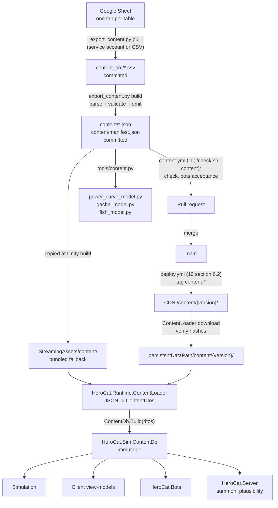

## 09 - Content Data Pipeline

This spec is the implementation of 00 section 8 item 3 ("content is data"): how every number in 00 section 6, every collectible, quest, dungeon floor, shop row and user-visible string travels from a Google Sheet through `tools/export_content.py` into `content/*.json`, is validated, is handed to `HeroCat.Sim` as an immutable `ContentDb`, is shipped inside the app and later over the CDN, and is read by the Python tuning tools. Constants are referred to by their 00 names; their values appear only in the example rows and files. Where this spec and 00 disagree on a name or value, 00 wins.

Tiers covered: **M0** (sheet, exporter, validator, bundled content, `ContentDb`, English strings), **MVP** (CDN delivery with hash verification and min-content-version gate, `hotApply` for sim-neutral tables, `en` plus one locale, pseudo-localization), **P1** (`runes` consumers, `content_migrations`, per-locale asset overrides).

Depends on: 00 (sections 5, 6, 8), 01 (`ContentLoader`, boot flow 8.1, content hot update 8.12), 02 (`GameState.ContentVersion` and `ContentHash`, the load validator that reconciles saves against content), 03 (stats, Research, curve evaluation), 04 (collectible columns, banner levels), 05 (fish levels, tank), 06 (quests, dungeons, shop, inbox), 07 (locales, length budgets, ICU plurals), 08 (`GET /config`, CDN layout), 10 (CI gate).

## 1. Principles

1. **One source of truth.** One Google Sheet workbook, one tab per table. CSV, JSON, `ContentDb` and the Python models are derived. Nobody edits `content/*.json` by hand; CI rejects a commit whose JSON does not match what the exporter produces from the committed CSVs.
2. **No balance literal in code.** `HeroCat.Sim` receives a `ContentDb` and reads typed properties and rows. Acceptance criterion 1 is a grep: the only numeric literals in `HeroCat.Sim` are 0, 1, -1, 2 (bit ops), array indices and the `ATTACK_PROGRESS_UNIT` fixed-point scale that 03 declares.
3. **Fail at export time, never in a tick.** The exporter rejects bad content with coded errors (section 8). `ContentDb.Build` re-runs the subset of rules that protect the sim (ids resolve, rates sum, curves monotonic, counts match) so a stale or hand-edited bundle fails at boot with a readable list, not inside `Simulation.Advance`.
4. **Deterministic bytes.** Same CSV input produces byte-identical JSON and the same `content_hash`. The save (02: `ContentVersion`, `ContentHash`) and every bot report (10) record `content_version` and `content_hash`, so a regression can be tied to the exact data it ran on.
5. **Sim stays JSON-free.** JSON parsing lives in `HeroCat.Runtime` (`ContentLoader`). It fills plain DTO classes and hands them to `ContentDb.Build(ContentDtos)` in `HeroCat.Sim`. No `Newtonsoft`, no reflection, no file IO in Sim (00 section 8 item 1).
6. **Immutable after build.** Every `*Def` is a sealed class with get-only properties; collections are read-only wrappers over arrays. A content update builds a new `ContentDb`; the live one is never mutated, and the swap happens only where 01 section 8.12 allows.

## 2. Pipeline overview



Both the CSVs and the JSON are committed. CSVs are the reviewable diff (one tab, one file); JSON is what ships and what CI rebuilds to prove the CSVs and the JSON agree.

## 3. Workbook layout and authoring conventions

### 3.1 Tabs and files

| Rule | Detail |
|---|---|
| Tab name = table name = file name | `skills` tab -> `content_src/skills.csv` -> `content/skills.json`. Lowercase `snake_case`. |
| Row 1 is the header | Column names are `snake_case` and must match section 5 exactly; column order in the sheet is free, JSON key order is the schema order. |
| `#` columns are notes | Any header beginning with `#` (`#notes`, `#owner`, `#todo`) is ignored by the exporter. Designers write freely there. |
| Blank rows skipped | A row with every cell empty is skipped. A row with some cells empty is data and is validated. |
| Decimal separator `.` | The workbook locale is en-US. `1,07` is error `E010`. |
| Trim | Cell text is trimmed. Internal whitespace is preserved (strings only). |
| Row order | Preserved into JSON. Meaningful only where a `sort_order`, `level`, `rank`, `floor` or `order` column says so. |
| One `meta` tab | Key/value tab read by the exporter for `content_version`, `min_client_version`, `source_revision` (section 5.33). Not a `ContentDb` table. |

Tabs are protected so only the design owner edits structure (adding or renaming a column); anyone on the team may edit values. The exporter, not the sheet, is the gate.

### 3.2 Column types

| Type | CSV form | JSON form | Rules |
|---|---|---|---|
| `int` | `50` | number | Integer literal only, `[-2^31, 2^31-1]`. `50.0` is `E010`. |
| `long` | `86400` | number | `[-2^53, 2^53]` so it round-trips through a JSON double. |
| `double` | `1.07`, `0.0325`, `10` | number | IEEE double; emitted with Python `repr` (shortest round-trip). `10` is emitted `10.0`. |
| `bool` | `true` / `false` | boolean | Lowercase only. |
| `string` | any text | string | Never player-visible; use `key` for that. |
| `id` | `skill_e_03` | string | `^[a-z][a-z0-9_]{0,63}$`. Primary key; stable forever once shipped. |
| `ref(<table>)` | `dungeon_fish` | string | Must equal an `id` (or the key column) in the named table (`E022`). |
| `enum(<Name>)` | `EPIC` | string | One of section 3.3, case-sensitive (`E021`). |
| `key` | `skill.e_03.name` | string | Localization key, `^[a-z0-9_]+(\.[a-z0-9_]+)+$`; must exist in `localization` (`E072`). |
| `color` | `#9B59B6` | string | `#RRGGBB` uppercase. |
| `intlist` | `1\|10\|100` | array of number | Pipe-separated ints, at least one. |
| `grantlist` | `DIAMOND:1000;TICKET_SUMMON_WEAPON:10` | array of `{currency, amount}` | `;`-separated `enum(Currency):long` pairs, amount `>= 1`, no duplicate currency. Also accepts item grants `WEAPON:weapon_c_01:1` -> `{kind, id, amount}`. |
| `asset` | `icon_skill_e_03` | string | Addressables address; `^[a-z][a-z0-9_]{0,63}$`. Existence is checked by the Unity build step, not the exporter. |

Nullable columns are marked `?` (`duration_ticks?`). A nullable column accepts an empty cell and emits JSON `null`; any other empty cell is `E011`.

### 3.3 Enums

Enums are defined once in C# (`HeroCat.Sim.Content.Enums`) and mirrored in `tools/export_content.py` (`ENUMS`). Adding a value is a code change in both places plus a content export; removing one is a breaking content change (section 6.3). Order is load-bearing where noted.

| Enum | Values | Order matters |
|---|---|---|
| `Rarity` | `COMMON`, `RARE`, `EPIC`, `LEGENDARY`, `MYTHIC` | yes: `E+`, `L+` comparisons and rate renormalisation (04) |
| `Stat` | `ATK`, `HP`, `DEF`, `CRIT_RATE`, `CRIT_DMG`, `ATK_SPD`, `GOLD_GAIN`, `EXP_GAIN` | yes: Training levels are stored by this index (02) |
| `Banner` | `WEAPON`, `SKILL`, `COMPANION`, `RUNE` | yes: pity counters stored by index (02) |
| `Currency` | `GOLD`, `DIAMOND`, `FISH_COIN`, `ROCK_CANDY`, `HERO_EXP`, `TICKET_FISH_COIN`, `TICKET_ROCK_CANDY`, `TICKET_EXP`, `TICKET_SUMMON_WEAPON`, `TICKET_SUMMON_SKILL`, `TICKET_SUMMON_COMPANION`, `GUILD_COIN`, `TICKET_SUMMON_RUNE` | yes: Wallet array index (02). `TICKET_SUMMON_RUNE` is appended last so earlier indices never move; unused until P1 (issue #26) |
| `Dungeon` | `FISH_COIN`, `ROCK_CANDY`, `EXP` | yes |
| `CastType` | `INSTANT`, `DOT`, `BUFF` | no |
| `AbilityType` | `DAMAGE`, `BUFF_ATK`, `BUFF_GOLD`, `MP_REGEN` | no |
| `ResearchEffect` | `RESEARCH_PCT`, `GOLD_MULT`, `MP_POOL`, `MP_REGEN`, `TANK_CAP`, `TANK_REFILL`, `FISH_CAP`, `OFFLINE_CAP` | no |
| `QuestKind` | `DAILY`, `WEEKLY`, `ACHIEVEMENT` | no |
| `QuestGoal` | 06 section 5.1 list: `LOGIN`, `LOGIN_DAYS`, `KILL_ENEMIES`, `ATTEMPT_BOSS`, `CLEAR_STAGES`, `SUMMON`, `RELEASE_FISH`, `MERGE_FISH`, `CLEAR_DUNGEON`, `DAILIES_COMPLETED`, `WEEKLIES_COMPLETED`, `REACH_STAGE`, `REACH_HERO_LEVEL`, `OWN_WEAPONS`, `OWN_SKILLS`, `OWN_COMPANIONS`, `LIFETIME_MERGES`, `FISH_LEVEL`, `AWAKEN_RANK`, `LIFETIME_SUMMONS`, `WATCH_AD` (P1) | no |
| `Element` | `NONE`, `FIRE`, `WATER`, `LEAF`, `LIGHT`, `DARK` | no (cosmetic in MVP) |
| `PackageLimit` | `ONCE`, `DAILY`, `WEEKLY`, `MONTHLY` | no |
| `InboxKind` | `IAP`, `MAIL`, `COMPENSATION`, `COUPON`, `SYSTEM` | no |
| `TutorialTrigger` | `PROFILE_CREATED`, `STAGE_REACHED`, `FIRST_BOSS_FAILED`, `SCREEN_OPENED`, `PREVIOUS_DONE` | no |
| `FeatureCondition` | `ALWAYS`, `STAGE_HIGHEST`, `AWAKEN_RANK` | no (section 5.34, issue #45) |
| `ConstantType` | `int`, `long`, `double`, `bool`, `intlist` | no |
| `Tier` | `M0`, `MVP`, `P1`, `P2` | yes: a client built for tier T loads rows with `tier <= T` and hides the rest (section 9.5) |
| `Locale` | `en`, `ja`, `ko`, `zh-Hans` | no; the MVP ship list is 07's. The exporter maps the enum value to the `snake_case` CSV column by a fixed rule (`zh-Hans` <-> `zh_hans`); file names use the enum form (`localization.zh-Hans.json`) (issue #57) |

### 3.4 Ids and keys

- Ids never change and are never reused after shipping in a `content_version`; saves reference them (02). To retire a row, set `enabled = false` where the table has it, or set `tier` to `P2`; never delete. Pool tables (`weapons`, `skills`, `companions`, `runes`) are the exception: they have no `enabled` column, and raising a row's `tier` past a shippable tier removes it from that tier's pool, so it is allowed only when the row is last in its `(banner, rarity)` pool for every shippable tier it leaves (rule B4). A pool row that is not last cannot be retired yet (TODO(#253): a retire mechanism that keeps indices).
- Collectible ids follow `weapon_<r>_<nn>`, `skill_<r>_<nn>`, `comp_<r>_<nn>`, `rune_<r>_<nn>` with `<r>` in `c r e l m` and `<nn>` two digits (`skill_e_03`). The exporter enforces only the `id` regex and uniqueness; the pattern is a convention 04 relies on for readability.
- Pool index (04, 08): within one `(banner, rarity)` the pool list is the ids of the rows a client loads (`tier <= buildTier`, section 5.32) sorted by ordinal string comparison; `Pool(banner, rarity)[poolIndex]` is what the server's audit row stores. Inserting an id that sorts before an existing one, or retiring one (by tier) that sorts before another, shifts indices and is a breaking change (section 6.3 rule B4).
- Localization keys follow `<table singular>.<id without table prefix>.<field>` (`skill.e_03.name`, `quest.d_merge.name`, `research.res_atk.desc`) and `ui.<screen>.<element>` for screen text (`ui.scr_main.offline_claim`). Section 13.

## 4. Where every 00 section 6 entry lives

The exporter checks `constants` against this list (`E040` missing, `E042` unknown). Names introduced here because 00 states them only inside a formula are marked *(named here)* and listed in Constants introduced.

| 00 entry | Lives in | Type |
|---|---|---|
| `TICK_HZ` | `constants` | int |
| `BASE_ATK`, `BASE_HP` | `constants` | double |
| `ATTACK_INTERVAL_TICKS` | `constants` | int |
| `HP0`, `HP_G` | `curves[enemy_hp].base`, `.growth` | double |
| `KILLS_PER_STAGE` | `constants` | int |
| `SPAWN_DELAY_TICKS` | `constants` | int |
| `BOSS_EVERY`, `BOSS_HP_MULT`, `BOSS_TIME_TICKS`, `BOSS_GOLD_MULT` | `constants` | int, double, int, double |
| `CHAPTER_WIDTH` | `constants` | int |
| `STAGE_CAP` | `constants` | int |
| `TAP_ZAP_DMG_PCT`, `TAP_ZAP_MAX_PER_SEC` | `constants` | double, int |
| `GOLD0`, `GOLD_G` | `curves[gold_per_kill]` | double |
| `EXP0`, `EXP_G` | `curves[exp_per_kill]` | double |
| `TRAIN_PER_LVL[stat]` | `stats.per_lvl` | double |
| `TRAIN_COST0`, `TRAIN_COST_G` | `training_curves.cost0`, `.cost_g` per stat | double |
| `TRAIN_BULK_STEPS` | `constants` (`1\|10\|100`; the Max button is a UI affordance, not data) | intlist |
| `DIAMONDS_PER_DAY_F2P` | `constants` (read by bots and the validator only; it is a target) | int |
| `PULL_COST[banner]` | `banners.pull_cost_diamonds` | int |
| `DAY_SECONDS` | `constants` | int |
| `OFFLINE_RATE`, `OFFLINE_CAP_H`, `OFFLINE_MIN_S` | `constants` | double, double, int |
| `TUTORIAL_DIAMONDS` | `tutorial_steps[tut_welcome].grants` | grantlist |
| `LOGIN_DIAMONDS` | `constants` (auto-granted by `EnsureDay` with reason `LOGIN`; `d_login` pays nothing, issue #20) | int |
| Base rates C..M | `banner_levels` rows with `level = 1`, per banner | double x5 |
| `PITY_SOFT_START`, `PITY_SOFT_STEP`, `PITY_HARD`, `M_SHARE_OF_LPLUS` | `banners` | int, double, int, double |
| 10-pull guarantee | `banners.guarantee_batch_size`, `.guarantee_min_rarity` | int, enum |
| `BANNER_EXP_PER_PULL` | `banners.exp_per_pull` | int |
| `SKILL_SLOTS`, `COMPANION_SLOTS`, `RUNE_SLOTS` | `constants` | int |
| `DUPE_LVL_CUM` | `dupe_levels.cum_copies` | int per row |
| `DUPE_LVL_BONUS` | `constants` | double |
| `LIMIT_BREAK_RANKS` | `constants` (issue #37) | int |
| `LIMIT_BREAK_COST[r]`, `DUPE_OVERFLOW_ROCK_CANDY[r]` (04) | `rarities.limit_break_cost`, `.dupe_overflow_rock_candy` (issue #37) | long |
| Pool sizes 30 / 40 / 50 | derived: row counts of `weapons`, `skills`, `companions`; pinned by `E034` against `banners.pool_size` | - |
| `WEAPON_PASSIVE_PCT[r]` | `rarities.weapon_passive_pct`; per-row override in `weapons.passive_pct` | double |
| `FISH_BOARD_W`, `FISH_BOARD_H` | `constants` | int |
| `TANK_CAP0`, `TANK_REFILL_S0` | `tank.cap0`, `.refill_s0` | int, double |
| `FISH_MAX_LVL0` | `constants` | int |
| `FISH_DISCOVERY_COINS[n]` | `fish_levels.discovery_coins` (rows generated by the sheet formula `10 * 2^(n-1)`) | long |
| `FISH_MERGE_COINS_PCT` | `constants` | double |
| `FISH_MISSILE_PCT[n]` | `fish_levels.missile_pct` (sheet formula `5 * 1.5^(n-1)`) | double |
| `FISH_BOARD_DPS_PCT` factor 0.77 | `constants.FISH_BOARD_DPS_FACTOR` *(named here)* | double |
| `AWAKEN_STAGES`, `AWAKEN_COST_ROCK_CANDY`, `AWAKEN_MULT` | `awakening.stage_gate`, `.rock_candy_cost`, `.mult` | int, long, double |
| `HERO_LVL_EXP(l) = 100 * 1.08^l` | `hero_levels.exp0`, `.exp_g` | double |
| `HERO_LVL_MULT` | `hero_levels.mult_per_level` | double |
| Section 6.6 day/stage targets | `progress_targets` | int, int |
| Feature unlock gates (Research, Companions, Quests, Dungeons, Shop) | `feature_unlocks` (issue #45) | enum, int |
| Awakening cadence target (03, 06) | `awakening_targets.max_days_after_gate` (issue #43) | int |
| 08's `STAGE_VS_TIME` whale curve | `plausibility_stage_bound` (generated, issue #60) | int, int |
| 06 section 2 reference-day parameters | `constants.REF_DAILIES_DONE`, `.REF_NEW_BOSSES` *(named here, issue #55)* | int |
| 01's `CLOCK_BACKWARDS_TOLERANCE_S` (backwards-clock jitter, issue #246) | `constants.CLOCK_BACKWARDS_TOLERANCE_S` | int |

Constants other specs declare and this spec hosts (their owners' Constants introduced sections are the source): 03's `ATTACK_PROGRESS_UNIT`, `CRIT_DMG_BASE`, `MP_POOL0`, `MP_REGEN0`, `BOSS_ROCK_CANDY_P`, `TRAIN_CAP[*]` (in `stats.cap`), `RES_*` (in `research`); 05's `FISH_DISCARD_COINS_PCT` (05 section 16; a `constants` row); 04's `WEAPON_ATK_PCT[r]`, `SKILL_DPS_PCT[r]`, `COMPANION_DPS_PCT[r]`, `LIMIT_BREAK_COST[r]`, `DUPE_OVERFLOW_ROCK_CANDY[r]` (in `rarities`), `BANNER_LVL_EXP` (in `banner_levels.exp_required`), `TUTORIAL_WEAPON_ID` (in `tutorial_steps`); 06's `FIRST_CLEAR_DIAMONDS`, `DUNGEON_*`, `INBOX_EXPIRY_DAYS`, shop rows; 01's `CLOCK_BACKWARDS_TOLERANCE_S` (the sim reads it, issue #246). Quest diamond amounts live only in the quest rows' `reward_amount` (no `QUEST_*` reward constants, issues #55 and #244). `REQUIRED_CONSTANTS` in the exporter is the union; acceptance criterion 4 pins the C# `Constants` class to it.

## 5. Table schemas

Every table is required unless marked optional. "Key" is the column the exporter enforces unique. Column order below is the JSON key order. Every constraint reports as the error code in section 8; where no code is named the rule is `E043` (range) with the column's rule text.

### 5.1 `constants`

| Column | Type | Constraint |
|---|---|---|
| `key` | string | Key. `^[A-Z][A-Z0-9_]*$`. Must be exactly `REQUIRED_CONSTANTS` (`E040`, `E042`). |
| `type` | enum(ConstantType) | Must equal the required type (`E041`). |
| `value` | per `type` | Parsed per `type` (`E010`). |
| `kind` | string | `I` or `S` from 00. Informational; the exporter prints the `S` list so the tuning tools know what to validate. |

Required keys (M0 + MVP), with 00 kind:

```
TICK_HZ int I                 BASE_ATK double I            BASE_HP double S
ATTACK_INTERVAL_TICKS int I   KILLS_PER_STAGE int I        SPAWN_DELAY_TICKS int I
BOSS_EVERY int I              BOSS_HP_MULT double I        BOSS_TIME_TICKS int S
BOSS_GOLD_MULT double I       CHAPTER_WIDTH int S          STAGE_CAP int I
TAP_ZAP_DMG_PCT double S      TAP_ZAP_MAX_PER_SEC int S    TRAIN_BULK_STEPS intlist I
DIAMONDS_PER_DAY_F2P int S    DAY_SECONDS int I            OFFLINE_RATE double I
OFFLINE_CAP_H double S        OFFLINE_MIN_S int S          SKILL_SLOTS int I
COMPANION_SLOTS int S         RUNE_SLOTS int S             DUPE_LVL_BONUS double I
FISH_BOARD_W int S            FISH_BOARD_H int S           FISH_MAX_LVL0 int S
FISH_MERGE_COINS_PCT double S FISH_BOARD_DPS_FACTOR double S
ATTACK_PROGRESS_UNIT int I    CRIT_DMG_BASE double S       MP_POOL0 double S
MP_REGEN0 double S            BOSS_ROCK_CANDY_P double S   FIRST_CLEAR_DIAMONDS int I
INBOX_EXPIRY_DAYS int S       DAILY_GIFT_WEAPON_TICKETS int S  LOGIN_DIAMONDS int I
LIMIT_BREAK_RANKS int S       REF_DAILIES_DONE int S       REF_NEW_BOSSES int S
FISH_DISCARD_COINS_PCT double S CLOCK_BACKWARDS_TOLERANCE_S int S
```

`REF_DAILIES_DONE` (8) and `REF_NEW_BOSSES` (4) are 06 section 2's reference-day assumptions (paying daily missions completed, new boss stages first-cleared); only `E039` and the bots read them (issue #55). There are no `QUEST_DAILY_DIAMONDS`, `QUEST_DAILY_BONUS_5`, `QUEST_DAILY_BONUS_8` or `QUEST_WEEKLY_DIAMONDS` constants: the quest rows are the single source (issues #55, #244).

Range rules: every `*_TICKS`, `TICK_HZ`, `KILLS_PER_STAGE`, `BOSS_EVERY`, `CHAPTER_WIDTH`, `STAGE_CAP`, `TAP_ZAP_MAX_PER_SEC`, `DAY_SECONDS`, `OFFLINE_MIN_S`, `*_SLOTS`, `FISH_BOARD_*`, `FISH_MAX_LVL0`, `ATTACK_PROGRESS_UNIT`, `LIMIT_BREAK_RANKS` are `> 0`; `SPAWN_DELAY_TICKS`, `REF_DAILIES_DONE`, `REF_NEW_BOSSES`, `CLOCK_BACKWARDS_TOLERANCE_S` are `>= 0`; `BASE_ATK`, `BASE_HP`, `BOSS_HP_MULT`, `BOSS_GOLD_MULT`, `OFFLINE_CAP_H`, `DUPE_LVL_BONUS`, `MP_POOL0`, `MP_REGEN0` are `> 0`; `TAP_ZAP_DMG_PCT`, `OFFLINE_RATE`, `FISH_MERGE_COINS_PCT`, `FISH_BOARD_DPS_FACTOR`, `FISH_DISCARD_COINS_PCT`, `BOSS_ROCK_CANDY_P` are `in [0, 1]`; `CRIT_DMG_BASE >= 1`; `TRAIN_BULK_STEPS` strictly increasing with first element 1; `FISH_BOARD_W * FISH_BOARD_H <= 64` (02 stores the board as a fixed array).

Example row: `{"key": "BOSS_TIME_TICKS", "type": "int", "value": 300, "kind": "S"}`. What the tuning tool checks for the `S` rows is stated by the owning spec (03 section 8.6, 05's `fish_model.py`, 06 section 2); this spec only guarantees the value reaches them unchanged.

### 5.2 `curves`

Geometric curves `base * growth^x` over an unbounded domain. Two parameters per curve rather than a per-stage table because stage 9000 (`STAGE_CAP`) must evaluate and because 06 section 7 relies on the closed form for offline catch-up. Code evaluates `growth^x` by repeated multiplication into a cached table (section 9.2); never `Math.Pow`.

| Column | Type | Constraint |
|---|---|---|
| `id` | id | Key. Required ids: `enemy_hp`, `gold_per_kill`, `exp_per_kill` (`E044`). |
| `base` | double | `> 0`. |
| `growth` | double | `> 1` (`E043`). |
| `x_offset` | int | Evaluation index is `x + x_offset`. `0` for the three required curves. Exists so a future curve indexed from 1 can share the type. |

Example: `{"id": "enemy_hp", "base": 20.0, "growth": 1.04, "x_offset": 0}` (`HP0`, `HP_G`, 00 section 6.1); the bots (10) are the test.

### 5.3 `stats` (8 rows)

| Column | Type | Constraint |
|---|---|---|
| `id` | enum(Stat) | Key. All eight values present, in enum order (`E044`, `E060`). |
| `trainable` | bool | 03 section 4: `HP` and `DEF` are `false` in MVP. |
| `per_lvl` | double? | `TRAIN_PER_LVL[stat]`. Required when `trainable`, empty otherwise (`E054`). `> 0`. |
| `cap` | int? | `TRAIN_CAP[stat]` in levels; empty = uncapped. `>= 1`. |
| `base` | double? | The level-0 value for stats that have one: `CRIT_DMG` -> `CRIT_DMG_BASE` 1.5, `ATK` -> `BASE_ATK`, `HP` -> `BASE_HP`. Empty for the rest. |
| `tier` | enum(Tier) | |
| `name_key`, `desc_key` | key | |
| `icon` | asset | |

Every row is `tier = M0`, `HP` and `DEF` included: Training levels and `ContentDb.Stats` are indexed by the enum, so no row of this table may be tier-filtered away. 03's P1 tag on `HP`/`DEF` is about their trainability, which is `trainable = false`.

Example: `{"id": "CRIT_RATE", "trainable": true, "per_lvl": 0.0025, "cap": 300, "base": null, "tier": "M0", "name_key": "stat.crit_rate.name", "desc_key": "stat.crit_rate.desc", "icon": "icon_stat_crit_rate"}`.

### 5.4 `training_curves` (one row per trainable stat)

| Column | Type | Constraint |
|---|---|---|
| `stat` | ref(stats) | Key. Exactly the stats with `trainable = true` (`E055`). |
| `cost0` | double | `TRAIN_COST0`. `> 0`. |
| `cost_g` | double | `TRAIN_COST_G`. `> 1`. |

MVP rows all carry `50` / `1.07` (00 section 6.2: same curve per stat). Per-stat rows exist so a later tune can make `GOLD_GAIN` dearer without a schema change. Bulk cost for `m` levels from `n` is `cost0 * cost_g^n * (cost_g^m - 1) / (cost_g - 1)`, which `ContentDb.TrainCost(stat, n, m)` computes from the cached table (03 section 5.1).

### 5.5 `chapters`

| Column | Type | Constraint |
|---|---|---|
| `id` | id | Key. |
| `index` | int | Exactly `1..N` in row order (`E060`). |
| `from_stage` | int | Must equal `(index - 1) * CHAPTER_WIDTH + 1` (`E056`). Stored so the table reads like the game. |
| `name_key` | key | |
| `background` | asset | |
| `music` | asset | |
| `tier` | enum(Tier) | |

MVP ships 12 chapters (stage 600), which covers the 00 section 6.6 day-30 target with margin. Stages past the last chapter reuse its row (`ContentDb.ChapterFor(stage)` clamps) so the sim never fails on `STAGE_CAP`.

### 5.6 `enemies` and 5.7 `bosses` (cosmetic)

Enemy HP and gold are curves and `BOSS_*` constants (00 section 6.1); these tables only pick skins, so the sim ignores them and the view-model reads them.

`enemies`:

| Column | Type | Constraint |
|---|---|---|
| `id` | id | Key. |
| `chapter` | ref(chapters) | Every chapter has at least one enemy (`E057`). |
| `weight` | double | `> 0`. Spawn-skin weight within the chapter. The pick uses a hash of `(stage, killIndex)` and consumes no RNG stream (`combat` is reserved with `Counter == 0` in MVP, issue #8). |
| `sprite` | asset | |
| `anim_set` | asset | |
| `name_key` | key | |

`bosses`:

| Column | Type | Constraint |
|---|---|---|
| `id` | id | Key. |
| `chapter` | ref(chapters) | Exactly one boss per chapter (`E057`). |
| `sprite`, `anim_set` | asset | |
| `name_key` | key | |
| `intro_vfx` | asset? | |

Example enemy: `{"id": "en_01_sock_gremlin", "chapter": "ch_01", "weight": 1.0, "sprite": "spr_en_sock_gremlin", "anim_set": "anim_en_small", "name_key": "enemy.01_sock_gremlin.name"}`.

### 5.8 `rarities` (5 rows)

Per-rarity facts shared by every collectible kind. 04 section 6.1, 7.1 and 8.1 defaults live here; a collectible row may override within the tolerance in `E035`.

| Column | Type | Constraint |
|---|---|---|
| `id` | enum(Rarity) | Key. All five, in order (`E044`, `E060`). |
| `code` | string | `C`, `R`, `E`, `L`, `M`. |
| `color` | color | 07 palette. |
| `shape_icon` | asset | Colour-blind-safe glyph (07). |
| `weapon_atk_pct` | double | `WEAPON_ATK_PCT[r]`; non-decreasing in rarity (`E048`). |
| `weapon_passive_pct` | double | `WEAPON_PASSIVE_PCT[r]`; non-decreasing. |
| `skill_dps_pct` | double | `SKILL_DPS_PCT[r]`; non-decreasing. |
| `companion_dps_pct` | double | `COMPANION_DPS_PCT[r]`; non-decreasing. |
| `rune_stat_pct` | double | P1 default; present, non-decreasing. |
| `limit_break_cost` | long | `LIMIT_BREAK_COST[r]`: Rock Candy for limit-break rank `k` is `limit_break_cost * k` (04 section 5.2); `>= 1`, non-decreasing (`E048`) (issue #37). |
| `dupe_overflow_rock_candy` | long | `DUPE_OVERFLOW_ROCK_CANDY[r]`: Rock Candy granted per copy past the last `dupe_levels` threshold (04 section 5.3); `>= 0`, non-decreasing (issue #37). |
| `override_tolerance` | double | Fraction a collectible row may deviate from the default (`0.10`). |
| `name_key` | key | |

Example: `{"id": "EPIC", "code": "E", "color": "#9B59B6", "shape_icon": "icon_rarity_diamond", "weapon_atk_pct": 120.0, "weapon_passive_pct": 4.0, "skill_dps_pct": 40.0, "companion_dps_pct": 64.0, "rune_stat_pct": 8.0, "limit_break_cost": 40, "dupe_overflow_rock_candy": 5, "override_tolerance": 0.1, "name_key": "rarity.epic.name"}`.

### 5.9 `weapons` (30 rows)

| Column | Type | Constraint |
|---|---|---|
| `id` | id | Key. |
| `rarity` | enum(Rarity) | Count per rarity must match `banners[WEAPON].pool_c..pool_m` (`E034`): 10 / 8 / 6 / 4 / 2. |
| `atk_pct` | double | Within `override_tolerance` of `rarities.weapon_atk_pct` (`E035`). |
| `passive_pct` | double | Within tolerance of `rarities.weapon_passive_pct` (`E035`). |
| `element` | enum(Element) | Cosmetic in MVP. |
| `tier` | enum(Tier) | |
| `name_key`, `desc_key` | key | |
| `icon` | asset | |
| `sprite` | asset | Held by the hero. |

Example: `{"id": "weapon_e_02", "rarity": "EPIC", "atk_pct": 125.0, "passive_pct": 4.0, "element": "FIRE", "tier": "M0", "name_key": "weapon.e_02.name", "desc_key": "weapon.e_02.desc", "icon": "icon_weapon_e_02", "sprite": "spr_weapon_e_02"}`.

### 5.10 `skills` (40 rows)

| Column | Type | Constraint |
|---|---|---|
| `id` | id | Key. |
| `rarity` | enum(Rarity) | Counts 14 / 11 / 8 / 5 / 2 pinned by `banners[SKILL]` (`E034`). |
| `dps_pct` | double | Within tolerance of `rarities.skill_dps_pct` (`E035`). |
| `cast_type` | enum(CastType) | |
| `cooldown_ticks` | int | `[30, 300]` (04 section 7.1). |
| `duration_ticks` | int? | Required for `DOT` and `BUFF`, empty for `INSTANT` (`E054`); `1 <= duration <= cooldown` (`E058`). |
| `buff_pct` | double? | Required for `BUFF`, empty otherwise (`E054`); `> 0`. |
| `tier` | enum(Tier) | |
| `name_key`, `desc_key` | key | |
| `icon`, `vfx` | asset | |

Warning `W010` if more than two `BUFF` skills share a rarity (04: buffs do not stack). Derived at build, not stored: `DamagePctPerCast`, `DamagePctPerTick` (04 section 7.1 formulas).

Example: `{"id": "skill_e_03", "rarity": "EPIC", "dps_pct": 40.0, "cast_type": "INSTANT", "cooldown_ticks": 100, "duration_ticks": null, "buff_pct": null, "tier": "M0", "name_key": "skill.e_03.name", "desc_key": "skill.e_03.desc", "icon": "icon_skill_e_03", "vfx": "vfx_skill_e_03"}`.

### 5.11 `companions` (50 rows)

| Column | Type | Constraint |
|---|---|---|
| `id` | id | Key. |
| `rarity` | enum(Rarity) | Counts 18 / 14 / 10 / 6 / 2 (`E034`). |
| `ability_type` | enum(AbilityType) | At least one `MP_REGEN` companion per rarity `<= RARE` so auto-equip's reserve rule (04 section 8.2) always has a candidate (`W011`). |
| `dps_pct` | double | Within tolerance of `rarities.companion_dps_pct` (`E035`). |
| `mp_cost` | int | `>= 1`. |
| `cooldown_ticks` | int | `[20, 600]`. |
| `duration_ticks` | int? | Required for `BUFF_*`, empty otherwise (`E054`); `<= cooldown_ticks` (`E058`). |
| `tier` | enum(Tier) | `MVP` for all 50 (companions are MVP). |
| `name_key`, `desc_key` | key | |
| `icon`, `sprite`, `vfx` | asset | |

Derived at build: `Magnitude` by `ability_type` (04 section 8.1). Example: `{"id": "comp_r_05", "rarity": "RARE", "ability_type": "MP_REGEN", "dps_pct": 32.0, "mp_cost": 10, "cooldown_ticks": 100, "duration_ticks": null, "tier": "MVP", "name_key": "companion.r_05.name", "desc_key": "companion.r_05.desc", "icon": "icon_comp_r_05", "sprite": "spr_comp_r_05", "vfx": "vfx_comp_r_05"}`.

### 5.12 `runes` (P1, optional tab in MVP)

| Column | Type | Constraint |
|---|---|---|
| `id` | id | Key. |
| `rarity` | enum(Rarity) | |
| `stat` | ref(stats) | A rune adds `stat_pct` percent to this stat; 04's `ATK_PCT` maps to `ATK` (issue #26). |
| `stat_pct` | double | Within tolerance of `rarities.rune_stat_pct`. |
| `slot_mask` | int | Bitmask of allowed slots `0..RUNE_SLOTS-1`; `> 0`. |
| `tier` | enum(Tier) | `P1`. |
| `name_key`, `desc_key` | key | |
| `icon` | asset | |

When the tab is absent the exporter emits an empty `runes.json` and `banners[RUNE].enabled` must be `false` (`E036`).

### 5.13 `banners` (4 rows)

| Column | Type | Constraint |
|---|---|---|
| `id` | enum(Banner) | Key. All four present, in enum order (`E044`, `E060`). |
| `enabled` | bool | `RUNE` is `false` until P1. |
| `tier` | enum(Tier) | |
| `pull_cost_diamonds` | int | `PULL_COST[banner]`; `> 0`. |
| `ticket_currency` | enum(Currency) | One of the `TICKET_SUMMON_*` values (`E059`); `RUNE` carries `TICKET_SUMMON_RUNE` (issue #26). |
| `pool_c`, `pool_r`, `pool_e`, `pool_l`, `pool_m` | int x5 | Expected rows per rarity in the pool table; sum is the 00 pool size; pinned to actual counts by `E034`. Folded into `pool_size` in JSON. |
| `pity_soft_start` | int | `PITY_SOFT_START`; `>= 1`. |
| `pity_soft_step` | double | `PITY_SOFT_STEP`; `> 0`. |
| `pity_hard` | int | `PITY_HARD`; `> pity_soft_start` (`E051`). |
| `m_share_of_lplus` | double | `[0, 1]`. |
| `guarantee_batch_size` | int | `>= 2`. |
| `guarantee_min_rarity` | enum(Rarity) | Combined level-1 rate of that rarity and above `> 0` (`E052`). |
| `exp_per_pull` | int | `BANNER_EXP_PER_PULL`; `>= 0`. |
| `sort_order` | int | Unique (`E046`). Tab order on `SCR_SUMMON`. |
| `name_key` | key | |
| `icon`, `banner_art` | asset | |

Derived at build: `BaseLplus = rates[L] + rates[M]` at level 1; `PityRate(n)`; `Pool(rarity)` lists; `MaxLevel = count of banner_levels rows`.

Example: `{"id": "WEAPON", "enabled": true, "tier": "M0", "pull_cost_diamonds": 100, "ticket_currency": "TICKET_SUMMON_WEAPON", "pool_size": {"COMMON": 10, "RARE": 8, "EPIC": 6, "LEGENDARY": 4, "MYTHIC": 2}, "pity_soft_start": 50, "pity_soft_step": 0.0325, "pity_hard": 80, "m_share_of_lplus": 0.16666666666666666, "guarantee_batch_size": 10, "guarantee_min_rarity": "EPIC", "exp_per_pull": 1, "sort_order": 0, "name_key": "banner.weapon.name", "icon": "icon_banner_weapon", "banner_art": "art_banner_weapon"}`.

### 5.14 `banner_levels` (10 rows per enabled banner)

The rate table per level, 04 section 4. Rows are generated in the sheet from the three shift constants 04 names; the exporter validates the result and does not know the shift rule, so a designer can hand-edit a level if 04's rule ever changes.

| Column | Type | Constraint |
|---|---|---|
| `banner` | ref(banners) | Composite key with `level` (`E020`). |
| `level` | int | Exactly `1..N` contiguous per banner (`E060`); same `N` for every enabled banner (`W012`). |
| `exp_required` | int | Cumulative pulls. Level 1 row must be `0`; strictly increasing (`E031`). |
| `rate_c`, `rate_r`, `rate_e`, `rate_l`, `rate_m` | double x5 | Each `[0, 1]`; sum to 1 within 1e-9 (`E030`). Folded into `rates` keyed by `Rarity`. |

Cross-row rules: `rate_l` and `rate_m` identical across all levels of a banner within 1e-12 (`E037`: published odds never change with level, 04 principle 1); `rate_c` non-increasing and `rate_r`, `rate_e` non-decreasing in level (`E048`).

`exp_required` (`BANNER_LVL_EXP`) is retuned from the per-banner pull cadence the tool computes from 06's income and 03's bot policy, so that weapon banner level 4 lands in days 20-35; the threshold values in this section are placeholders pending that tool run (04, issue #38).

Example row: `{"banner": "WEAPON", "level": 4, "exp_required": 300, "rates": {"COMMON": 0.54, "RARE": 0.316, "EPIC": 0.114, "LEGENDARY": 0.025, "MYTHIC": 0.005}}`.

### 5.15 `dupe_levels` (10 rows)

| Column | Type | Constraint |
|---|---|---|
| `level` | int | Key. Exactly `1..N` (`E060`). |
| `cum_copies` | int | `DUPE_LVL_CUM`. Level 1 must be `1` (`E061`); strictly increasing (`E031`). |

`DUPE_LVL_BONUS` is in `constants`; `ContentDb.LevelMult(level) = 1 + DUPE_LVL_BONUS * (level - 1)`. Limit breaks (04 section 5.2) read `constants.LIMIT_BREAK_RANKS` and `rarities.limit_break_cost`; copies past the last row convert at `rarities.dupe_overflow_rock_candy` (04 section 5.3) (issue #37).

### 5.16 `awakening` (5 rows)

| Column | Type | Constraint |
|---|---|---|
| `rank` | int | Key. Exactly `1..N` (`E060`). |
| `stage_gate` | int | `AWAKEN_STAGES[rank]`; strictly increasing (`E032`). |
| `rock_candy_cost` | long | `AWAKEN_COST_ROCK_CANDY[rank]`; strictly increasing. |
| `mult` | double | `AWAKEN_MULT`; `> 1`. Every MVP row carries `1.5`. |
| `companion_slots_after` | int | Total companion slots unlocked after this rank; non-decreasing; `<= COMPANION_SLOTS` (`E048`). |
| `rune_slots_after` | int | Same for runes; `<= RUNE_SLOTS`. |
| `tier` | enum(Tier) | |
| `name_key` | key | Rank title shown on `SCR_HERO`. |
| `icon` | asset | |

Example: `{"rank": 2, "stage_gate": 150, "rock_candy_cost": 300, "mult": 1.5, "companion_slots_after": 3, "rune_slots_after": 0, "tier": "MVP", "name_key": "awakening.rank_2.name", "icon": "icon_awaken_2"}`.

### 5.17 `hero_levels` (1 row)

A one-row rule table rather than a per-level table: hero level is unbounded and 03 evaluates the threshold curve from two parameters.

| Column | Type | Constraint |
|---|---|---|
| `id` | id | Key. Exactly one row, `default` (`E045`). |
| `exp0` | double | `HERO_LVL_EXP` base, `100`; `> 0`. |
| `exp_g` | double | `1.08`; `> 1`. |
| `atk_pct_per_level` | double? | Retired linear term `HERO_LVL_ATK_PCT`; empty (00 decision 9). |
| `mult_per_level` | double? | Compounding `HERO_LVL_MULT` (`1.02`, 00 section 6.5, decision 9); populated. Exactly one of the two columns set (`E054`). |
| `level_cap` | int | `>= 1`. Guard like `STAGE_CAP`; `9999`. |

`ContentDb.HeroLvlExp` is a `CurveDef` built from `exp0`/`exp_g`.

### 5.18 `research` (8 rows in MVP)

| Column | Type | Constraint |
|---|---|---|
| `id` | id | Key. 03's node ids lowercased: `res_atk`, `res_gold_gain`, `res_mp_pool`, `res_mp_regen`, `res_tank_cap`, `res_tank_refill`, `res_fish_cap`, `res_offline_cap`. |
| `effect` | enum(ResearchEffect) | One row per effect in MVP (`E046` on `effect`). |
| `effect_per_level` | double | 03 section 6 column "Effect per level"; `> 0` (the refill node stores the positive decrement and the sim subtracts). |
| `effect_floor` | double? | Lower bound for decrementing effects (`res_tank_refill`: `2.0`). Required when `effect = TANK_REFILL` (`E054`). |
| `max_level` | int | `>= 1`. |
| `cost0` | double | `RES_COST0`; `> 0`. |
| `cost_g` | double | `RES_COST_G`; `> 1`. |
| `unlock_awaken_rank` | int | Per-node extra gate on top of `feature_unlocks[RESEARCH]` (the screen gate); `>= 0`; `1` for every MVP node (03: locked before rank 1). Must be `>= feature_unlocks[RESEARCH].threshold` (`E063`): a node never opens before the Research screen. |
| `layout_row`, `layout_col` | int | Unique pair (`E046`); drawn by `SCR_RESEARCH`. |
| `tier` | enum(Tier) | |
| `name_key`, `desc_key` | key | |
| `icon` | asset | |

Cross-table: `fish_levels` must have at least `FISH_MAX_LVL0 + research[FISH_CAP].effect_per_level * max_level` rows (`E038`), so the cap can never point past the table.

Example: `{"id": "res_fish_cap", "effect": "FISH_CAP", "effect_per_level": 1.0, "effect_floor": null, "max_level": 10, "cost0": 2500.0, "cost_g": 2.0, "unlock_awaken_rank": 1, "layout_row": 2, "layout_col": 3, "tier": "MVP", "name_key": "research.res_fish_cap.name", "desc_key": "research.res_fish_cap.desc", "icon": "icon_res_fish_cap"}`.

### 5.19 `fish_levels` (20 rows)

| Column | Type | Constraint |
|---|---|---|
| `level` | int | Key. Exactly `1..N` (`E060`); `N >= FISH_MAX_LVL0 + max research cap` (`E038`). |
| `discovery_coins` | long | `FISH_DISCOVERY_COINS[n]`; strictly increasing (`E031`). Sheet formula `10 * 2^(n-1)`. |
| `missile_pct` | double | `FISH_MISSILE_PCT[n]`; strictly increasing. Sheet formula `5 * 1.5^(n-1)`. |
| `sprite` | asset | MVP art covers `UI_FISH_SPRITE_LEVELS` (12, 07) distinct fish sprites plus a crown overlay; higher levels reuse a lower level's sprite with a `tint` (issue #48). |
| `tint` | color? | Empty when the row has its own sprite; set when `sprite` repeats a lower row's value (`W013`). |
| `name_key` | key | "Guppy", "Koi"... |

Warning `W013`: a reachable fish level (`<= FISH_MAX_LVL0 + research[FISH_CAP].effect_per_level * max_level`) above `UI_FISH_SPRITE_LEVELS` (07), or one that reuses a lower level's `sprite`, has no `tint`, i.e. content can exceed the art set (issue #48). With the current rows, levels 13-20 need tints.

Derived at build: `MergeCoins = discovery_coins * FISH_MERGE_COINS_PCT` as an unrounded `double` (no rounding, no minimum; the UI floors the display, issue #16), `BoardDpsPct = FISH_BOARD_DPS_FACTOR * missile_pct`. Example: `{"level": 5, "discovery_coins": 160, "missile_pct": 25.3125, "sprite": "spr_fish_05", "tint": null, "name_key": "fish.05.name"}`.

### 5.20 `tank` (1 row)

| Column | Type | Constraint |
|---|---|---|
| `id` | id | Key. One row `default` (`E045`). |
| `cap0` | int | `TANK_CAP0`; `>= 1`. |
| `refill_s0` | double | `TANK_REFILL_S0`; `> 0`. Converted to ticks at build: `RefillTicks0 = round(refill_s0 * TICK_HZ)`; must be an integer number of ticks (`E043`). |
| `release_level` | int | Base level of a released fish; `1` in MVP. The save holds the player's upgrade level (`Fish.TankReleaseLevel`, 02), not this value (issue #7). |
| `refill_floor_s` | double | Hard floor Research cannot pass; must equal `research[TANK_REFILL].effect_floor` (`E056`). |

### 5.21 `quests_daily` and 5.22 `quests_weekly`

Same schema, two tabs, because 06 resets them on different keys and `SCR_QUESTS` shows them on different tabs.

| Column | Type | Constraint |
|---|---|---|
| `id` | id | Key. 06's `d_*` / `w_*` ids. |
| `goal` | enum(QuestGoal) | |
| `filter` | string? | Required for `SUMMON` (a `Banner` value) and `CLEAR_DUNGEON` (a `Dungeon` value); must parse as that enum (`E021`); empty otherwise (`E054`). |
| `target` | long | `>= 1`. |
| `reward_currency` | enum(Currency) | |
| `reward_amount` | long | `>= 1`; `0` allowed only for goal `LOGIN` (`d_login` is a counting row that pays nothing, issue #20). |
| `sort_order` | int | Unique (`E046`). |
| `tier` | enum(Tier) | `d_watch_ad` is `P1`. |
| `name_key` | key | |
| `icon` | asset | |

The quest rows are the only home of quest reward amounts, bonus payouts included (`d_bonus_5`, `d_bonus_8` are `DAILIES_COMPLETED` rows; issues #55, #244). Rule `E064`: `quests_daily` has at least one `DAILIES_COMPLETED` row with `tier <= MVP`, and every such row's `target` is at most the number of daily rows (`missing or unreachable daily bonus rows`).

Sum rule (`E039`, on `quests_daily` and `quests_weekly`), recomputing 06 section 2's reference day from the rows (issues #20, #55): over rows with `reward_currency = DIAMOND` and `tier <= MVP`, the sum of `LOGIN_DIAMONDS`; `REF_DAILIES_DONE` times the mean `reward_amount` of the paying daily missions (`reward_amount > 0`, goal not `DAILIES_COMPLETED`); `reward_amount` of every `DAILIES_COMPLETED` row whose `target <= REF_DAILIES_DONE`; the `quests_weekly` sum divided by 7; and `FIRST_CLEAR_DIAMONDS * REF_NEW_BOSSES`, must land within 10% of `DIAMONDS_PER_DAY_F2P`. Achievements and the tutorial grant are excluded. This rule only catches a sheet edit that silently breaks the budget.

Example: `{"id": "d_merge", "goal": "MERGE_FISH", "filter": null, "target": 15, "reward_currency": "DIAMOND", "reward_amount": 20, "sort_order": 8, "tier": "MVP", "name_key": "quest.d_merge.name", "icon": "icon_quest_merge"}`.

### 5.23 `achievements`

| Column | Type | Constraint |
|---|---|---|
| `id` | id | Key. `ach_<ladder>_<rung>` (`ach_stage_03`). |
| `ladder` | id | Groups rungs; 06 section 5.4 ladders. |
| `rung` | int | Exactly `1..N` within a ladder (`E060`). |
| `goal` | enum(QuestGoal) | Same for every rung of a ladder (`E056`). |
| `target` | long | Strictly increasing within a ladder (`E031`). For goals `OWN_WEAPONS`, `OWN_SKILLS`, `OWN_COMPANIONS`, strictly less than the row count of `weapons`, `skills`, `companions` with `tier <= MVP` (`E065`): a count-owned reward never equals completing the pool (00 pillar 4, issue #44). |
| `reward_currency` | enum(Currency) | |
| `reward_amount` | long | `>= 1`. |
| `tier` | enum(Tier) | |
| `name_key` | key | |

Example: `{"id": "ach_merges_04", "ladder": "merges", "rung": 4, "goal": "LIFETIME_MERGES", "target": 1000, "reward_currency": "DIAMOND", "reward_amount": 80, "tier": "MVP", "name_key": "achievement.merges_04.name"}`.

### 5.24 `dungeons` (3 rows + Tower P1)

| Column | Type | Constraint |
|---|---|---|
| `id` | id | Key. `dungeon_fish`, `dungeon_candy`, `dungeon_exp`, `tower` (P1). |
| `kind` | enum(Dungeon)? | Required for the three MVP rows; empty for `tower` (`E054`). Unique. |
| `ticket_currency` | enum(Currency)? | `TICKET_*` of the kind (`E059`); empty for `tower`. |
| `tickets_per_day` | int | `DUNGEON_TICKETS_PER_DAY`; `>= 0`. |
| `floor_stage_step` | int | `DUNGEON_FLOOR_STAGE_STEP`; floor `f` fights at stage-equivalent `f * floor_stage_step`; `>= 1`. |
| `floors` | int | `DUNGEON_FLOORS_MVP`; must equal the `dungeon_floors` row count for this dungeon (`E034`). |
| `sweep_allowed` | bool | |
| `tier` | enum(Tier) | |
| `name_key`, `desc_key` | key | |
| `icon`, `background` | asset | |

### 5.25 `dungeon_floors` (40 rows per dungeon)

| Column | Type | Constraint |
|---|---|---|
| `dungeon` | ref(dungeons) | Composite key with `floor`. |
| `floor` | int | Exactly `1..floors` per dungeon (`E060`). |
| `reward_currency` | enum(Currency) | |
| `reward_amount` | long? | Fixed reward (`FISH_COIN_FLOOR`, `ROCK_CANDY_FLOOR`); non-decreasing in floor (`E048`). |
| `reward_kills_equiv` | int? | For `HERO_EXP`: reward = `reward_kills_equiv * ExpPerKill(floor * floor_stage_step)` evaluated from `curves[exp_per_kill]` at build. Exactly one of `reward_amount` / `reward_kills_equiv` set (`E054`). |
| `boss` | ref(bosses)? | Skin for the floor fight; empty = chapter boss of the stage-equivalent. |
| `first_clear_bonus` | grantlist? | One-time extra on first clear. |

Example: `{"dungeon": "dungeon_exp", "floor": 12, "reward_currency": "HERO_EXP", "reward_amount": null, "reward_kills_equiv": 300, "boss": null, "first_clear_bonus": null}`.

### 5.26 `shop_products` (6 rows)

| Column | Type | Constraint |
|---|---|---|
| `sku` | id | Key. 06's `dia_1..dia_6`. |
| `apple_product_id` | string | Reverse-DNS id configured in App Store Connect; unique (`E046`). |
| `google_product_id` | string | Play Console id; unique. |
| `usd_tier` | int | Apple tier number the price maps to; `>= 1`. |
| `usd` | double | Reference price; strictly increasing in `sort_order` (`E031`). |
| `grant_currency` | enum(Currency) | Must be `DIAMOND` (00 decision 7; `E059`). |
| `base_amount` | long | `>= 1`. |
| `bonus_pct` | double | `[0, 1]`; non-decreasing in `sort_order`. |
| `first_purchase_mult` | double | `2.0`. |
| `sort_order` | int | Unique. |
| `enabled` | bool | |
| `tier` | enum(Tier) | |
| `name_key` | key | |
| `icon` | asset | |

Derived at build: `TotalAmount = base_amount + floor(base_amount * bonus_pct)`. This table is `hotApply`-eligible (section 10.4) because the sim never reads it; so are `shop_packages` and `inbox_templates` (issue #54).

### 5.27 `shop_packages`

| Column | Type | Constraint |
|---|---|---|
| `id` | id | Key. `pkg_starter`, `pkg_weekly`, `pkg_monthly`. |
| `apple_product_id`, `google_product_id` | string | Unique across `shop_products` and `shop_packages` (`E046`). |
| `usd_tier` | int | |
| `usd` | double | |
| `grants` | grantlist | At least one entry. |
| `limit` | enum(PackageLimit) | |
| `limit_count` | int | Purchases allowed per `limit` window; `>= 1`. |
| `daily_drip` | grantlist? | For `pkg_monthly`: granted via Inbox each day key for `drip_days`. |
| `drip_days` | int? | Required with `daily_drip` (`E054`). |
| `enabled` | bool | |
| `tier` | enum(Tier) | |
| `name_key`, `desc_key` | key | |
| `icon` | asset | |

### 5.28 `inbox_templates`

| Column | Type | Constraint |
|---|---|---|
| `id` | id | Key. `inbox_iap_grant`, `inbox_compensation`, `inbox_coupon`, `inbox_welcome_back`, ... |
| `kind` | enum(InboxKind) | |
| `title_key`, `body_key` | key | Body may use `{amount}`, `{sku}`, `{reason}` ICU arguments. |
| `grants` | grantlist? | Fixed grants; empty when the server fills them (IAP). |
| `expiry_days` | int | `INBOX_EXPIRY_DAYS` default; `>= 1`. |
| `icon` | asset | |
| `tier` | enum(Tier) | |

### 5.29 `tutorial_steps`

| Column | Type | Constraint |
|---|---|---|
| `id` | id | Key. Permanent. The save stores the step index `Tutorial.Step` (02, advanced by 01's `SetTutorialStep`), not ids, so rows are only ever appended (B5) and `TUTORIAL_DONE` is the row count (issue #46). |
| `order` | int | Exactly `1..N` (`E060`). |
| `trigger` | enum(TutorialTrigger) | |
| `trigger_value` | string? | Stage for `STAGE_REACHED`, screen id for `SCREEN_OPENED`; empty otherwise (`E054`). |
| `screen` | string | `SCR_*` id from 00 section 5.3 (`E021` against the screen list the exporter holds). |
| `highlight` | string? | Element id in the screen prefab (07). |
| `text_key` | key | |
| `expect_event` | string? | Sim event name (00 section 5.1 event vocabulary, e.g. `FishMerged`, `EnemyKilled`) the overlay waits for, or a `\|`-separated list of them (`BossCleared\|BossFailed`), where an occurrence of any listed event counts; every name must be in the vocabulary (`E021` against the exporter's `SIM_EVENT_NAMES`); empty = tap to continue (issues #46, #246). |
| `expect_count` | int? | How many `expect_event` occurrences (of any listed event, summed) complete the step; required with `expect_event`, empty otherwise (`E054`); `>= 1`. |
| `grants` | grantlist? | `tut_welcome` carries `DIAMOND:1500` (`TUTORIAL_DIAMONDS`) and the starter weapon `WEAPON:weapon_c_01:1` (`TUTORIAL_WEAPON_ID`), so collection screens are never empty (issue #46). |
| `skippable` | bool | |
| `tier` | enum(Tier) | |

Rule `E062`: exactly one step has `trigger = PROFILE_CREATED` and it is `order = 1`. That step is `tier = M0` even though the tutorial overlay is MVP: M0 applies its grant at profile creation (06 section 1.2), so an M0 build must not filter it out.

### 5.30 `localization`

| Column | Type | Constraint |
|---|---|---|
| `key` | key | Key. |
| `en` | string | Required, non-empty. |
| `ja`, `ko`, `zh_hans` | string? | Empty = fall back to `en` at runtime and warning `W020`; `E073` for a locale listed in `meta.ship_locales`. Column `zh_hans` is locale `zh-Hans` (section 3.3). `ja` is kept fully translated even though MVP ships `en` only, so the pipeline always exercises a real second locale (issue #57). |
| `max_chars` | int | Length budget at 1.3x font scale (07 section 11); every locale's rendered length `<= max_chars` (`E074`). `0` = unbudgeted (long body text). |
| `plural` | bool | `true` when the text uses ICU `{n, plural, ...}`; the exporter parses the ICU message and requires `one` and `other` branches for `en` (`E075`). |
| `#context` | note | Where it appears; for translators. Exported to the translator CSV, not to JSON. |

Emitted per locale as `content/localization.<locale>.json` (section 6.1). Every `key`-typed cell in every other table must exist here (`E072`); every row here must be referenced by a table cell or by the client's `ui.*` key list the exporter is given with `--ui-keys` (`W021` unused key).

### 5.31 `progress_targets`

00 section 6.6 as data so the acceptance targets are versioned with the content they judge (10 reads them through `ContentDb`).

| Column | Type | Constraint |
|---|---|---|
| `day` | int | Key. Strictly increasing (`E032`). |
| `stage` | int | `>= 1`; non-decreasing (`E048`). |
| `tolerance` | double | `0.20` (00 section 6.6: +/-20%). |

### 5.32 Tier filtering

Every table with a `tier` column is filtered at build: `ContentDb.Build(dtos, Tier buildTier)` keeps rows with `tier <= buildTier` and drops the rest, then re-runs the count rules against what is left. An M0 build therefore sees 2 banners, no companions, no quests, and `E034` is evaluated against `pool_size` only for enabled banners whose `tier <= buildTier`. The exporter validates the full MVP set; the per-tier re-validation happens in `Build`.

### 5.33 `meta`

| Key | Type | Meaning |
|---|---|---|
| `content_version` | string | `YYYY.MM.DD` or `YYYY.MM.DD.N` (section 6.3). Required. |
| `min_client_version` | string | Semver of the oldest client that can load this content (`1.2.0`). Required. |
| `source_revision` | string | Sheet revision or date plus initials; bumped by the author on every export so two different sheets never produce the same manifest. Required. |
| `ship_locales` | string | Comma list of locales that must be complete. Shipped MVP meta: `en` (soft launch PH/CA/NZ is English-only); CI fixtures use `en,ja` (acceptance 14) (issue #57). |
| `notes` | string | Free text, lands in the manifest for the release ticket. |

### 5.34 `feature_unlocks`

One gate per feature, read both by sim rejections (`RESEARCH_LOCKED`, `DUNGEON_LOCKED`, `QUESTS_LOCKED`, ...) and by the client's Locked states, so they cannot disagree (issue #45). `ContentDb.IsUnlocked(feature, state)` is the single evaluator.

| Column | Type | Constraint |
|---|---|---|
| `feature` | string | Key, UPPER_SNAKE feature id matching `^[A-Z][A-Z0-9_]*$` (`E071`; the `id` type's lowercase pattern cannot hold it) (the form 06's `QUESTS_LOCKED` / `DUNGEON_LOCKED` checks name). MVP rows: `RESEARCH`, `COMPANIONS`, `QUESTS`, `DUNGEONS`, `SHOP`. |
| `condition` | enum(FeatureCondition) | `STAGE_HIGHEST`: `Progress.HighestCleared >= threshold`; `AWAKEN_RANK`: `Hero.AwakenRank >= threshold`; `ALWAYS`: never locked. |
| `threshold` | int? | Required for `STAGE_HIGHEST` and `AWAKEN_RANK` (`>= 1`), empty for `ALWAYS` (`E054`). |
| `screen` | string | `SCR_*` id the gate locks (`E021` against `SCREEN_IDS`). |
| `locked_text_key` | key? | "Unlocks at ..." text; empty for `ALWAYS`. |
| `tier` | enum(Tier) | |

MVP seed: `RESEARCH` `AWAKEN_RANK` 1 (00 decision 11), `COMPANIONS` `ALWAYS` (04: slot 1 open from the start), `QUESTS` `STAGE_HIGHEST` 10, `DUNGEONS` `STAGE_HIGHEST` 30 (all three dungeons; it replaces the former `DUNGEON_UNLOCK_STAGE` constant and `dungeons.unlock_stage` column), `SHOP` `ALWAYS` (the Shop is never locked). Rule `E063`: `feature_unlocks[SHOP].condition = ALWAYS`; every `research.unlock_awaken_rank >= feature_unlocks[RESEARCH].threshold`.

### 5.35 `awakening_targets`

The Awakening cadence target as data, read by `power_curve_model.py` (03) and the bot acceptance sweep (06 AC 18, 10) instead of per-spec day numbers (issue #43).

| Column | Type | Constraint |
|---|---|---|
| `rank` | int | Key. Exactly the `awakening` ranks `1..N` (`E060`, `E034` against `awakening`). |
| `max_days_after_gate` | int | `>= 0`. Rank `k` must be affordable (Rock Candy) within this many days of the day the bot first reaches `awakening[k].stage_gate`. MVP: `2` for every rank. |

### 5.36 `plausibility_stage_bound` (generated)

The whale stage curve 08's `STAGE_VS_TIME` check multiplies by `STAGE_BOUND_MULT` (issue #60). Not authored in the Sheet: `HeroCat.Bots stage-bound --update` (whale bot, seeds 1-20, 60 days) writes `content_src/plausibility_stage_bound.csv` (p95 `HighestCleared` over seeds per day; 10 owns the verb and the CI drift check), and `pull` never touches it. It is regenerated in the same PR as any sim-affecting content change (section 12 rule 3); no sim or bot code reads it, so one regeneration converges.

| Column | Type | Constraint |
|---|---|---|
| `day` | int | Key. Exactly `1..60` (`E060`). Past the last row 08 does not run the check. |
| `stage` | int | `>= 1`; non-decreasing (`E048`). |

## 6. JSON layout, manifest and versioning

### 6.1 One file per table

`content/` holds `manifest.json`, one `<table>.json` per table, and `localization.<locale>.json` per locale. Per-table files keep diffs readable, let the CDN serve only changed tables, and make loader errors name a file.

```json
{
  "table": "dupe_levels",
  "rows": [
    { "level": 1, "cum_copies": 1 },
    { "level": 2, "cum_copies": 3 }
  ]
}
```

Formatting, so identical input is identical bytes: UTF-8 without BOM, 2-space indent, `\n` endings, trailing newline, keys in schema order, rows in CSV order, ints as integer literals, doubles via Python `repr`, `null` for empty nullable cells, folded columns emitted as objects keyed in enum order. Folds in use: `banners.pool_size`, `banner_levels.rates`.

Localization file shape: `{"table": "localization", "locale": "ja", "rows": [{"key": "skill.e_03.name", "text": "..."}]}`. Keys with an empty cell for that locale are omitted from the file; the client falls back to `en`.

### 6.2 `manifest.json`

```json
{
  "schema_version": 1,
  "content_version": "2026.11.03",
  "min_client_version": "1.0.0",
  "source_revision": "sheet rev 118 kj",
  "hot_apply": false,
  "tables": {
    "achievements":    { "file": "achievements.json",    "rows": 58,  "sha256": "9f1c..." },
    "awakening":       { "file": "awakening.json",       "rows": 5,   "sha256": "0b77..." },
    "banner_levels":   { "file": "banner_levels.json",   "rows": 30,  "sha256": "c2a0..." },
    "banners":         { "file": "banners.json",         "rows": 4,   "sha256": "5d1e..." },
    "constants":       { "file": "constants.json",       "rows": 44,  "sha256": "a8e3..." }
  },
  "localization": {
    "en": { "file": "localization.en.json", "rows": 1412, "sha256": "..." },
    "ja": { "file": "localization.ja.json", "rows": 1402, "sha256": "..." }
  },
  "content_hash": "sha256 over every table and localization sha256 concatenated in the key order above",
  "s_constants": ["BASE_HP", "BOSS_TIME_TICKS", "CHAPTER_WIDTH", "..."],
  "notes": "meta.notes, for the release ticket"
}
```

- `schema_version` is the version of this document's table layout; the loader refuses an unknown value (`E901`). It changes only when exporter and `ContentDb.Build` change together.
- No timestamp anywhere. `source_revision` is the human provenance.
- `content_hash` is what the save (02), the analytics envelope (02 section 14.1), the bot reports (10) and `GET /config` (08) carry.
- `hot_apply` is computed by the exporter: `true` only when the diff against `--previous` touches nothing but the hot-apply allowlist `localization.*`, `shop_products`, `shop_packages`, `inbox_templates` (00 contract 3, 01 section 8.12; issue #54). This bool is the single source; 08's `hotApplyTables` in `GET /config` echoes the exporter's allowlist constant.

### 6.3 `content_version` ordering and compatibility

`content_version` is `YYYY.MM.DD` with an optional `.N` (`N >= 1`) for a second publish on the same day. Ordering is numeric per component with a missing `N` read as 0; `ContentVersion.Compare(a, b)` lives in `HeroCat.Sim.Content` and is what 08's `minContentVersion[clientVersion]` gate and 01's "is the CDN manifest newer" check use. The format carries no major/minor semantics; breaking changes are expressed through `min_client_version` and the reconcile rules below.

Change classes the exporter detects against `--previous`:

| Class | Example | Required action | Check |
|---|---|---|---|
| B1 value change | a rate, a cost, a string | new `content_version` | `E091` if bytes differ and the version is unchanged |
| B2 additive | new row, new nullable column, new enum value, new table | new `content_version` | `E091` |
| B3 removed id in a keyed table | deleting `skill_c_07` | forbidden; set `enabled=false` / `tier=P2` instead | `E090` |
| B4 pool index shift | inserting `skill_c_00` before `skill_c_01`; setting `skill_c_01` to `tier=P2` while `skill_c_02` ships | forbidden on a shipped banner; new ids must sort after every shipped one, and a pool row is retired by tier only when it is last in its pool | `E090` (detected as an index change in the tier-filtered pool list of each shippable tier, `M0` and `MVP`) |
| B5 fewer rows in `dupe_levels`, `awakening`, `banner_levels`, `fish_levels`, `stats`, `tutorial_steps`; a reordered `tutorial_steps` | | forbidden (new tutorial steps are appended, issue #46) | `E090` |
| B6 schema change needing new client code | new required column, removed enum value | bump `min_client_version` and `schema_version` together with the client release | `E092` if the schema changed and `min_client_version` did not increase |
| B7 version went backwards | | | `E093` |

Save compatibility (02 owns it, issue #56): the save stores `ContentVersion` and `ContentHash` (02 `GameState`). Reconciling a save against content is the content-dependent part of 02's load validator (rules P10-P14), one pass with one test list; there is no separate `ContentReconcile` pass here. What this spec guarantees that pass: ids are never deleted (section 3.4) and the B5 tables never shrink, so the drop path is rare; saved fish levels are clamped only to the `fish_levels` row count (`FISH_MAX_LVL_HARD`), never to a lowered reachable cap, while `Fish.TankCount` is still clamped to `TankCap` (05, issue #41). Nothing is refunded in MVP. `content_migrations` (old id -> new id) is P1.

## 7. The exporter: `tools/export_content.py`

Python 3.9+, stdlib only for `build`, `check`, `diff` and `translator-csv`; `pull --service-account` needs `google-api-python-client` and is optional (the CSV path needs nothing). One file, about 600 lines, structured as:

- `SCHEMA`: dict `table -> TableSchema(columns, key, folds, required, tiered)`; columns carry `(type, nullable)`. The single machine-readable form of section 5; `tools/content.py` (section 11) imports it.
- `ENUMS`, `REQUIRED_CONSTANTS`, `SCREEN_IDS`: mirrors of 3.3, 5.1 and 00 section 5.3.
- `read_table(path, schema)`: CSV parsing, per-cell type checks, unknown/missing columns, `#` skipping, key uniqueness.
- `validate(tables, ui_keys) -> list[Error]`: every rule in section 8, one small function per rule appended to a rule list.
- `emit(tables, meta, out_dir)`: deterministic JSON per 6.1, then the manifest.
- `version_rules(current, previous)`: 6.3.
- `pull(sheet_id, mode)`: fetch tabs to `content_src/`.

### 7.1 Command line

```
python3 tools/export_content.py pull  --sheet <id> [--service-account creds.json | --csv-export] [--src content_src]
python3 tools/export_content.py build [--src content_src] [--out content] [--previous content] [--ui-keys unity/HeroCatClient/Assets/HeroCat.Client/ui_keys.txt] [--strict-warnings]
python3 tools/export_content.py check [--src content_src] [--out content] [--dto-out src/HeroCat.Sim/Content/Dto/ContentDtos.g.cs]
python3 tools/export_content.py gen-dtos [--dto-out ...]                       # C# DTOs of section 9.1 from SCHEMA
python3 tools/export_content.py diff  --a content --b <dir>          # human-readable row diff for a PR description
python3 tools/export_content.py translator-csv --out /tmp/strings_ja.csv --locale ja [--missing-only]
python3 tools/export_content.py import-translations --csv strings_ja.csv --locale ja   # writes back into content_src/localization.csv
python3 tools/export_content.py pseudo --locale xx --out content_pseudo              # pseudo-localized build (section 13)
```

| Verb | Does | Exit codes |
|---|---|---|
| `pull` | `--service-account`: Sheets API v4 `spreadsheets.values.batchGet` for every tab, written as CSV. `--csv-export`: the `gviz/tq?tqx=out:csv&sheet=<tab>` URL per tab, which works for link-readable sheets without OAuth. Either way the result is the committed `content_src/`. | 0, 2 (network/auth) |
| `build` | Parse, validate, emit. Lists every error, not the first. Prints `content_version`, `content_hash`, row count per table, pool sizes per rarity, the `S` constant list, and `hot_apply`. | 0, 1 (validation), 2 (usage/IO) |
| `check` | Build to memory; exit 1 if the result differs byte-for-byte from `--out`, or the generated DTO file differs from `--dto-out`. CI's stale-JSON guard. Writes nothing. | 0, 1 |
| `gen-dtos` | Writes the `HeroCat.Sim.Content.Dto` classes (section 9.1) from `SCHEMA`; `build` does it too. Field names are the PascalCase of the columns, so the Runtime loader maps them back with Newtonsoft's snake-case naming. | 0 |
| `diff` | Row-level added/removed/changed per table between two content dirs. Pasted into the PR. | 0 |
| `translator-csv` | `key, en, <locale>, max_chars, context` for a translator; `--missing-only` filters to empty cells. | 0 |
| `import-translations` | Merges a returned CSV into the `localization` CSV; refuses rows whose `en` no longer matches (`E076`, the source changed under the translator). | 0, 1 |
| `pseudo` | Builds a content set where every string is pseudo-localized (section 13.3). | 0 |

Errors go to stderr one per line in the section 8.1 format. Warnings go to stderr prefixed `CONTENT W...` and do not fail the build unless `--strict-warnings` (CI passes it).

### 7.2 Why Python and not C#

The exporter and the three Python tuning tools share `SCHEMA`, so one language on the authoring side means one schema definition. It runs on a designer's laptop with no SDK and in CI with no Unity licence. The cost is that validation exists twice (here and in `ContentDb.Build`); section 8 fixes codes and messages so both emit identical text and acceptance criterion 7 pins them to one fixture set.

## 8. Validator checklist and error codes

### 8.1 Format

```
CONTENT <code> <location>: <message>
```

`<location>` is `<table>`, `<table>[<key>]` or `<table>[<key>].<column>`; when the row has no parseable key it is `row <n>` with `n` the 1-based data row (header excluded, blank rows counted, so it matches the sheet). Doubles print with `repr`. `ContentDb.Build` throws one `ContentBuildException` carrying the full list in the same text.

### 8.2 Structural (`E0xx`)

| Code | Condition | Message |
|---|---|---|
| `E001` | Required table missing | `missing required table '{table}'` |
| `E002` | Required column absent | `missing required column '{column}'` |
| `E003` | Unknown column (not `#`) | `unknown column '{column}' (remove it or add it to SCHEMA)` |
| `E010` | Cell does not parse as its type | `expected {type}, got '{raw}'` |
| `E011` | Empty non-nullable cell | `required cell is empty` |
| `E020` | Duplicate key | `duplicate key '{value}' (first seen at row {first_row})` |
| `E021` | Enum value not allowed | `'{value}' is not a valid {enum} (allowed: {values})` |
| `E022` | Reference unresolved | `'{value}' does not exist in {target_table}` |
| `E070` | Bad colour | `'{value}' is not a #RRGGBB color` |
| `E071` | Bad id/key/asset format | `'{value}' does not match {pattern}` |
| `E072` | Localization key missing | `key '{key}' has no row in localization` |
| `E073` | Ship locale incomplete | `key '{key}' has no {locale} text and {locale} is in ship_locales` |
| `E074` | Over length budget | `{locale} text is {len} chars, budget {max_chars}` |
| `E075` | ICU plural malformed | `plural message must have 'one' and 'other' branches: {detail}` |
| `E076` | Translation source drift | `en text changed since this translation was exported ('{old}' -> '{new}')` |

### 8.3 Constants (`E04x`)

| Code | Message |
|---|---|
| `E040` | `missing required constant '{key}'` |
| `E041` | `declared type '{declared}' does not match required type '{required}'` |
| `E042` | `unknown constant '{key}' (add it to REQUIRED_CONSTANTS and ContentDb.Constants first)` |
| `E043` | `value {value} out of range ({rule})` |

### 8.4 Table rules (`E03x`, `E05x`, `E06x`)

| Code | Tables | Message |
|---|---|---|
| `E030` | banner_levels | `rates sum to {sum} (abs error {abs_error}), expected 1 within 1e-9` |
| `E031` | banner_levels, dupe_levels, fish_levels, achievements, shop_products | `{column} must be strictly increasing; {row} has {value} <= previous {prev}` |
| `E032` | awakening, progress_targets | `{column} must be strictly increasing; ...` |
| `E034` | banners vs pool tables, dungeons vs dungeon_floors, awakening_targets vs awakening | `{table} has {actual} rows of {rarity or dungeon}, expected {expected} from {source}` |
| `E035` | weapons, skills, companions, runes | `{column} {value} deviates {pct}% from rarities default {default} (tolerance {tol}%)` |
| `E036` | banners, runes | `banner RUNE is enabled but runes has no rows` |
| `E037` | banner_levels | `rate_{l or m} must not change with level; level {level} has {value}, level 1 has {base}` |
| `E038` | fish_levels vs research | `fish_levels has {n} rows but FISH_MAX_LVL0 + research cap needs {needed}` |
| `E039` | quests_daily, quests_weekly | `reference-day diamond sum {sum} is outside 10% of DIAMONDS_PER_DAY_F2P {target}` |
| `E044` | enum-keyed tables | `missing row for {enum} value '{value}'` |
| `E045` | hero_levels, tank | `exactly one row required, found {n}` |
| `E046` | sort_order / unique columns | `duplicate {column} {value} (also at {other_row})` |
| `E048` | rarities, awakening, dungeon_floors, banner_levels, progress_targets, plausibility_stage_bound | `{column} must be non-decreasing in {order}; {row} has {value} < previous {prev}` |
| `E051` | banners | `pity_hard ({hard}) must be greater than pity_soft_start ({soft})` |
| `E052` | banners | `guarantee_min_rarity '{r}' has zero combined level-1 rate` |
| `E054` | conditional columns | `{column} must be {set or empty} when {cond_column} = {cond_value}` |
| `E055` | training_curves | `rows must be exactly the trainable stats; missing {missing}, extra {extra}` |
| `E056` | chapters, tank, achievements | `{column} must equal {expected} ({reason}), got {value}` |
| `E057` | enemies, bosses | `chapter '{chapter}' has {n} {enemies or bosses}, expected {rule}` |
| `E058` | skills, companions | `duration_ticks {d} must be in 1..cooldown_ticks {c}` |
| `E059` | banners, dungeons, shop_products | `{column} '{value}' is not an allowed currency here ({rule})` |
| `E060` | index columns | `{column} must be exactly 1..{n} in row order, got {values}` |
| `E061` | dupe_levels | `cum_copies for level 1 must be 1, got {value}` |
| `E062` | tutorial_steps | `exactly one PROFILE_CREATED step at order 1 required` |
| `E063` | feature_unlocks vs research | `{table}[{id}] unlocks at {value}, before feature '{feature}' ({threshold})` / `feature 'SHOP' must be ALWAYS` |
| `E064` | quests_daily | `missing or unreachable daily bonus rows ({detail})` |
| `E065` | achievements | `{goal} target {target} must be below the pool size {pool} (pillar 4)` |

### 8.5 Versioning and manifest (`E09x`, `E9xx`)

| Code | Where | Message |
|---|---|---|
| `E090` | exporter | B3/B5: `{table}: '{id}' existed in previous build {prev_version} and is missing or reordered; retire rows with enabled=false or tier=P2 instead`. B4: `{table}: '{id}' in Pool({banner}, {rarity}) of previous build {prev_version} moved ({tier} pool index {old} -> {new}[; ...]); add ids that sort after every shipped one, and retire a pool row by tier only when it is last in its pool` |
| `E091` | exporter | `content differs from previous build but content_version is still {version}` |
| `E092` | exporter | `schema changed (new required column / removed enum value) but min_client_version {v} did not increase` |
| `E093` | exporter | `content_version {version} is lower than previous {prev}` |
| `E094` | exporter | `content_version '{value}' must be YYYY.MM.DD or YYYY.MM.DD.N` |
| `E900` | loader | `{file}: sha256 {actual} does not match manifest {expected}` |
| `E901` | loader | `manifest schema_version {value} not supported (supports {supported})` |
| `E902` | loader | `{file} listed in manifest but missing` / `{file} present but not listed` |
| `E903` | loader | `content requires client >= {min}, this client is {actual}` |

### 8.6 Warnings

`W010` more than two `BUFF` skills in one rarity; `W011` a rarity `<= RARE` with no `MP_REGEN` companion; `W012` banners with different `banner_levels` counts; `W013` a reachable fish level reuses a lower sprite with no `tint` (issue #48); `W031` `FISH_MAX_LVL0` or the `res_fish_cap` max decreased against `--previous` (05, issue #41); `W020` missing non-ship-locale text; `W021` unused localization key; `W030` an `S` constant changed without a note in `meta.notes`.

Loader scope: `ContentDb.Build` implements every `E0xx`, `E03x`-`E06x` rule that touches sim-read data, and `E9xx`. It does not implement `E07x` localization rules (strings are client-only) or `E09x` (no previous build). `check` in CI plus the hash check at load are what make a hand edit of `content/` visible. In code: the rules live in `ContentDb.Rules.cs`, mirror the exporter's `RULES` in order, and sort by table like it. Also left to the exporter: the warnings, `E039` (a budget check for the designer, not a sim guard) and the rules over tables the sim never reads (`enemies`/`bosses` `E057`, the shop tables, `inbox_templates`). The quest, achievement and dungeon rules join `Build` when those tables are built into `ContentDb` (issues #170, #171, #173).

### 8.7 How the rules read where the tables above leave it open

Decided while implementing issues #122, #123 and #128; each is a default the design owner may veto.

- **Order.** `validate` sorts its errors by table in `SCHEMA` order (acceptance 7). Within one table the rule order holds. `E020` comes first because the reader finds it before any rule runs.
- **Tables not authored yet.** A rule whose table is optional and absent is skipped. That covers `E034` for a banner whose pool table is missing (`companions`, issue #161), `E039`/`E064` without `quests_daily`, `E065` without `achievements`, `E057` without `enemies`/`bosses`, and the research halves of `E038`, `E056` and `E063`.
- **Bounds that name no code** report as `E043` with the rule text. That includes `awakening.companion_slots_after <= COMPANION_SLOTS` and banner level 1's `exp_required = 0`. `E048` is kept for the ordering rules.
- **`E055` and `E022`.** When a `training_curves` row names a stat that does not exist, `E022` reports it and `E055` stays silent.
- **`E059` on banners**: `ticket_currency` must be exactly `TICKET_SUMMON_<id>`.
- **`E064`**: "the number of daily rows" counts every `quests_daily` row with `tier <= MVP`, the bonus rows included.
- **`E074` length**: the longest rendering, where a plural or select counts its longest branch and `#` or an argument counts as one character.
- **`W020`**: a non-ship locale with no text at all warns once (`ja has no text; all N keys fall back to en`), not once per key.
- **`W021`**: rows whose keys start `err.`, `reject.` or `notice.` are exempt, because section 13.1 checks them elsewhere. Client UI rows (`ui.*`, `scr.*`, `boot.*`, the prefixes the client Core view-models use) are judged only when `--ui-keys` is given.
- **`W030`**: a "note" means the constant's key appears somewhere in `meta.notes`.
- **Version rules.** B3 (`E090`) applies to every table keyed by an `id`, enum or `ref`, plus the B5 tables. B4 compares, for each shippable tier (`M0`, `MVP`), the pools a client built for that tier derives: banners with `enabled = true` and `tier <= T`, pool rows with `tier <= T`, exactly as `ContentDb.Build` filters them (section 5.32, issue #250). It reports the first id per `(banner, rarity)` that is still in the pool at a different index, once, listing every tier where it moved. An id that left the pool is not itself an error (B3 covers deletion); an id after it that moves is. B6 (`E092`) is detected two ways: a non-nullable column the previous rows lack, or an enum value the previous rows use that no longer exists. `E091` compares data files only. A `source_revision` or `notes` change on its own rewrites only the manifest.
- **`hot_apply` without a diff.** A build identical to `--previous` keeps the previous `hot_apply`. `check` without `--previous` keeps the committed manifest's value rather than recomputing it. `./check.sh` runs `build --previous` against the merge base's `content/`.
- **Fixtures** (acceptance 6). Each `tests/content_fixtures/<name>/` describes its defect in a `fixture.json` as edits on `good_minimal/`, not as a full copy. `good_minimal` is a small valid set with `ship_locales = en,ja`. `warn_*` fixtures pin warnings under `--strict-warnings`. Fixtures marked `"csharp": true` are built with the exporter's fixture-only `--emit-invalid`, so their defect reaches `ContentDb.Build` (`ContentDbFixtureTests`). `tools/content_fixtures.py` documents the format.

## 9. `ContentDb` in `HeroCat.Sim`

Namespace `HeroCat.Sim.Content`. No `UnityEngine`, no JSON, no IO, no reflection, no `Math.Pow`. Every public type is `sealed`, every property get-only, every collection an `IReadOnlyList<T>` or `IReadOnlyDictionary<K,V>` over a private array or dictionary. `ContentDb` is constructed once per process by `HeroCat.Runtime.ContentLoader` (client), `HeroCat.Bots` (one shared instance across all seeds) and `HeroCat.Server` (one per loaded `content_version`).

### 9.1 DTOs and `Build`

The DTOs are plain mutable classes with public fields in `HeroCat.Sim.Content.Dto`, one per table row, mirroring section 5 column for column (`double?` for nullable doubles, `string` for enums and refs, `GrantDto[]` for grantlists, `object` for `constants.value`, which the loader hands over as a `long`, `double`, `bool` or `long[]`, never a JSON type). They are generated from the exporter's `SCHEMA` into `src/HeroCat.Sim/Content/Dto/ContentDtos.g.cs` and `check` fails on drift, so the Python and C# shapes cannot diverge. They exist so Sim can accept data without knowing JSON; Runtime fills them with Newtonsoft and Sim never sees a `JObject`.

```csharp
namespace HeroCat.Sim.Content.Dto
{
    public sealed class ContentDtos
    {
        public ManifestDto Manifest;
        public ConstantRowDto[] Constants;   public CurveRowDto[] Curves;         public StatRowDto[] Stats;
        public TrainingCurveRowDto[] TrainingCurves;   public ChapterRowDto[] Chapters;
        public EnemyRowDto[] Enemies;        public BossRowDto[] Bosses;          public RarityRowDto[] Rarities;
        public WeaponRowDto[] Weapons;       public SkillRowDto[] Skills;         public CompanionRowDto[] Companions;
        public RuneRowDto[] Runes;           public BannerRowDto[] Banners;       public BannerLevelRowDto[] BannerLevels;
        public DupeLevelRowDto[] DupeLevels; public AwakeningRowDto[] Awakening;  public HeroLevelsRowDto[] HeroLevels;
        public ResearchRowDto[] Research;    public FishLevelRowDto[] FishLevels; public TankRowDto[] Tank;
        public QuestRowDto[] QuestsDaily;    public QuestRowDto[] QuestsWeekly;   public AchievementRowDto[] Achievements;
        public DungeonRowDto[] Dungeons;     public DungeonFloorRowDto[] DungeonFloors;
        public ShopProductRowDto[] ShopProducts; public ShopPackageRowDto[] ShopPackages;
        public InboxTemplateRowDto[] InboxTemplates; public TutorialStepRowDto[] TutorialSteps;
        public ProgressTargetRowDto[] ProgressTargets; public FeatureUnlockRowDto[] FeatureUnlocks;
        public AwakeningTargetRowDto[] AwakeningTargets; public PlausibilityStageBoundRowDto[] PlausibilityStageBound;
        // Localization is NOT here: strings never enter Sim (section 13).
    }

    public sealed class SkillRowDto
    {
        public string Id; public string Rarity; public double DpsPct; public string CastType;
        public int CooldownTicks; public int? DurationTicks; public double? BuffPct; public string Tier;
        public string NameKey, DescKey, Icon, Vfx;
    }
}

namespace HeroCat.Sim.Content
{
    public sealed class ContentBuildException : Exception
    {
        public IReadOnlyList<ContentError> Errors { get; }
    }
    public readonly struct ContentError
    {
        public string Code { get; } public string Location { get; } public string Message { get; }
        public override string ToString() => $"CONTENT {Code} {Location}: {Message}";
    }

    public sealed partial class ContentDb
    {
        /// Validates (section 8 loader scope), filters by tier, builds derived data, returns an immutable db.
        public static ContentDb Build(Dto.ContentDtos dtos, Tier buildTier);
        public string Version { get; }          // manifest.content_version
        public string ContentHash { get; }      // manifest.content_hash
        public string MinClientVersion { get; }
        public Tier BuildTier { get; }
    }
}
```

`Build` order: parse enums (`E021`), check keys (`E020`), resolve refs (`E022`), range rules, cross-table rules, tier filter, re-run counts, then construct every `*Def` and derived table. A `ContentDb` that exists is valid; sim code never re-checks.

### 9.2 Constants and curves

```csharp
public sealed class Constants
{
    public int    TickHz { get; }                 // TICK_HZ
    public double BaseAtk { get; }                // BASE_ATK
    public double BaseHp { get; }                 // BASE_HP
    public int    AttackIntervalTicks { get; }    // ATTACK_INTERVAL_TICKS
    public int    KillsPerStage { get; }          // KILLS_PER_STAGE
    public int    SpawnDelayTicks { get; }        // SPAWN_DELAY_TICKS
    public int    BossEvery { get; }              // BOSS_EVERY
    public double BossHpMult { get; }             // BOSS_HP_MULT
    public int    BossTimeTicks { get; }          // BOSS_TIME_TICKS
    public double BossGoldMult { get; }           // BOSS_GOLD_MULT
    public int    ChapterWidth { get; }           // CHAPTER_WIDTH
    public int    StageCap { get; }               // STAGE_CAP
    public double TapZapDmgPct { get; }           // TAP_ZAP_DMG_PCT
    public int    TapZapMaxPerSec { get; }        // TAP_ZAP_MAX_PER_SEC
    public IReadOnlyList<int> TrainBulkSteps { get; } // TRAIN_BULK_STEPS
    public int    DiamondsPerDayF2p { get; }      // DIAMONDS_PER_DAY_F2P
    public int    DaySeconds { get; }             // DAY_SECONDS
    public double OfflineRate { get; }            // OFFLINE_RATE
    public double OfflineCapH { get; }            // OFFLINE_CAP_H
    public int    OfflineMinS { get; }            // OFFLINE_MIN_S
    public int    SkillSlots { get; }             // SKILL_SLOTS
    public int    CompanionSlots { get; }         // COMPANION_SLOTS
    public int    RuneSlots { get; }              // RUNE_SLOTS
    public double DupeLvlBonus { get; }           // DUPE_LVL_BONUS
    public int    FishBoardW { get; }             // FISH_BOARD_W
    public int    FishBoardH { get; }             // FISH_BOARD_H
    public int    FishMaxLvl0 { get; }            // FISH_MAX_LVL0
    public double FishMergeCoinsPct { get; }      // FISH_MERGE_COINS_PCT
    public double FishBoardDpsFactor { get; }     // FISH_BOARD_DPS_FACTOR
    public int    AttackProgressUnit { get; }     // ATTACK_PROGRESS_UNIT (03)
    public double CritDmgBase { get; }            // CRIT_DMG_BASE (03)
    public double MpPool0 { get; }                // MP_POOL0 (03)
    public double MpRegen0 { get; }               // MP_REGEN0 (03)
    public double BossRockCandyP { get; }         // BOSS_ROCK_CANDY_P (03)
    public int    FirstClearDiamonds { get; }     // FIRST_CLEAR_DIAMONDS (06)
    public int    InboxExpiryDays { get; }        // INBOX_EXPIRY_DAYS (06)
    public int    DailyGiftWeaponTickets { get; } // DAILY_GIFT_WEAPON_TICKETS (06)
    public int    LoginDiamonds { get; }          // LOGIN_DIAMONDS (06)
    public int    LimitBreakRanks { get; }        // LIMIT_BREAK_RANKS (00, 04)
    public int    RefDailiesDone { get; }         // REF_DAILIES_DONE (06 reference day; validator and bots only)
    public int    RefNewBosses { get; }           // REF_NEW_BOSSES (06 reference day; validator and bots only)
    public double FishDiscardCoinsPct { get; }    // FISH_DISCARD_COINS_PCT (05)
    public int    ClockBackwardsToleranceS { get; } // CLOCK_BACKWARDS_TOLERANCE_S (01 section 3.2)

    public bool IsBossStage(int s) => s % BossEvery == 0;
    public int  ChapterOf(int s)   => (s - 1) / ChapterWidth + 1;
}

/// base * growth^(x + offset), growth^k by repeated multiplication into a table precomputed at Build.
/// This is the GeometricTable 03 refers to. No Math.Pow: 00 section 3 requires bit-identical
/// results on x64, ARM64 and IL2CPP, and Pow is not guaranteed to be.
public sealed class CurveDef
{
    public string Id { get; }  public double Base { get; }  public double Growth { get; }  public int XOffset { get; }
    private readonly double[] _pow;    // _pow[k] = Growth^k, k < max(STAGE_CAP + BOSS_EVERY, hero_levels.level_cap) + 1

    public double Power(int k)         // past the table: continue the same multiplication chain from its last entry
    {
        if (k < 0) throw new ArgumentOutOfRangeException(nameof(k));
        if (k < _pow.Length) return _pow[k];
        double v = _pow[_pow.Length - 1];
        for (int i = _pow.Length; i <= k; i++) v *= Growth;
        return v;
    }
    public double Eval(int x) => Base * Power(x + XOffset);
    /// Sum of Base * Growth^(x..x+m-1) by the closed form over the powers; used for bulk Training cost.
    public double EvalSum(int x, int m) => m <= 0 ? 0 : Base * (Power(x + XOffset + m) - Power(x + XOffset)) / (Growth - 1.0);
    /// Largest m >= 0 with EvalSum(x, m) <= budget: doubling, then bisection over EvalSum. No logarithm.
    public int MaxAffordable(int x, double budget) { ... }
}
```

The power table is filled once in `Build` and never mutated, so a `ContentDb` is immutable after `Build` (principle 6) and safe to share across parallel bot seeds and threads with no pre-warming (10 section 3.8, `sweep --parallel`). An index past the table yields the same bits a longer table would, because it continues the same left-to-right multiplication. This replaces an earlier lazily grown cache, which was not thread-safe (issue #125).

### 9.3 Row types (abbreviated)

```csharp
public enum Rarity { COMMON, RARE, EPIC, LEGENDARY, MYTHIC }
public enum Stat { ATK, HP, DEF, CRIT_RATE, CRIT_DMG, ATK_SPD, GOLD_GAIN, EXP_GAIN }
public enum Banner { WEAPON, SKILL, COMPANION, RUNE }
public enum Tier { M0, MVP, P1, P2 }
// Currency, Dungeon, CastType, AbilityType, ResearchEffect, QuestKind, QuestGoal, Element, PackageLimit, InboxKind, TutorialTrigger, FeatureCondition likewise.

public sealed class StatDef       { Stat Id; bool Trainable; double? PerLvl; int? Cap; double? Base; Tier Tier; string NameKey, DescKey, Icon; }
public sealed class TrainingCurveDef { Stat Stat; CurveDef Cost; }
public sealed class ChapterDef    { string Id; int Index; int FromStage; string NameKey, Background, Music; Tier Tier; }
public sealed class RarityDef     { Rarity Id; string Code, Color, ShapeIcon; double WeaponAtkPct, WeaponPassivePct, SkillDpsPct, CompanionDpsPct, RuneStatPct, OverrideTolerance; long LimitBreakCost, DupeOverflowRockCandy; string NameKey; }
public sealed class WeaponDef     { string Id; Rarity Rarity; double AtkPct, PassivePct; Element Element; Tier Tier; string NameKey, DescKey, Icon, Sprite; }
public sealed class SkillDef      { string Id; Rarity Rarity; double DpsPct; CastType CastType; int CooldownTicks; int? DurationTicks; double? BuffPct;
                                    double DamagePctPerCast; double DamagePctPerTick;   /* derived, 04 section 7.1 */ Tier Tier; string NameKey, DescKey, Icon, Vfx; }
public sealed class CompanionDef  { string Id; Rarity Rarity; AbilityType Ability; double DpsPct; int MpCost, CooldownTicks; int? DurationTicks; double Magnitude; /* derived */ Tier Tier; ... }
public sealed class RuneDef       { string Id; Rarity Rarity; Stat Stat; double StatPct; int SlotMask; Tier Tier; ... }
public sealed class BannerDef
{
    public Banner Id { get; } public bool Enabled { get; } public Tier Tier { get; }
    public int PullCostDiamonds { get; } public Currency TicketCurrency { get; }
    public IReadOnlyDictionary<Rarity, int> PoolSize { get; }
    public int PitySoftStart { get; } public double PitySoftStep { get; } public int PityHard { get; }
    public double MShareOfLplus { get; } public int GuaranteeBatchSize { get; } public Rarity GuaranteeMinRarity { get; }
    public int ExpPerPull { get; } public int SortOrder { get; } public string NameKey, Icon, BannerArt;
    public IReadOnlyList<BannerLevelDef> Levels { get; }                 // [0] is level 1
    public double BaseLplus { get; }                                      // Levels[0].Rates[L] + [M]
    public IReadOnlyDictionary<Rarity, IReadOnlyList<string>> Pool { get; } // ids, ordinal-sorted (section 3.4)
    public double PityRate(int n) => n >= PityHard ? 1.0 : Math.Min(1.0, BaseLplus + PitySoftStep * Math.Max(0, n - PitySoftStart));
    public int LevelFor(int exp);                                         // count of Levels with ExpRequired <= exp, min 1
}
public sealed class BannerLevelDef { int Level; int ExpRequired; IReadOnlyDictionary<Rarity, double> Rates; }
public sealed class AwakeningDef  { int Rank; int StageGate; long RockCandyCost; double Mult; int CompanionSlotsAfter, RuneSlotsAfter; Tier Tier; string NameKey, Icon; }
public sealed class HeroLevelsDef { CurveDef Exp; double? AtkPctPerLevel; double? MultPerLevel; int LevelCap; }
public sealed class ResearchDef   { string Id; ResearchEffect Effect; double EffectPerLevel; double? EffectFloor; int MaxLevel; CurveDef Cost; int UnlockAwakenRank; int LayoutRow, LayoutCol; Tier Tier; ... }
public sealed class FishLevelDef  { int Level; long DiscoveryCoins; double MissilePct; double MergeCoins; double BoardDpsPct; /* derived */ string Sprite, Tint, NameKey; }
public sealed class TankDef       { int Cap0; double RefillS0; int RefillTicks0; int ReleaseLevel; double RefillFloorS; }
public sealed class QuestDef      { string Id; QuestKind Kind; QuestGoal Goal; string Filter; long Target; Currency RewardCurrency; long RewardAmount; int SortOrder; Tier Tier; string NameKey, Icon; }
public sealed class AchievementDef{ string Id, Ladder; int Rung; QuestGoal Goal; long Target; Currency RewardCurrency; long RewardAmount; Tier Tier; string NameKey; }
public sealed class DungeonDef    { string Id; Dungeon? Kind; Currency? TicketCurrency; int TicketsPerDay, UnlockStage, FloorStageStep, Floors; bool SweepAllowed; Tier Tier; IReadOnlyList<DungeonFloorDef> FloorDefs; ... }
public sealed class DungeonFloorDef { int Floor; int StageEquiv; Currency RewardCurrency; double RewardAmount; /* resolved at build for HERO_EXP */ string Boss; IReadOnlyList<Grant> FirstClearBonus; }
public sealed class ShopProductDef{ string Sku, AppleProductId, GoogleProductId; int UsdTier; double Usd; long BaseAmount; double BonusPct; long TotalAmount; double FirstPurchaseMult; int SortOrder; bool Enabled; Tier Tier; ... }
public sealed class ShopPackageDef{ ... IReadOnlyList<Grant> Grants; PackageLimit Limit; int LimitCount; IReadOnlyList<Grant> DailyDrip; int? DripDays; ... }
public sealed class InboxTemplateDef { string Id; InboxKind Kind; string TitleKey, BodyKey; IReadOnlyList<Grant> Grants; int ExpiryDays; string Icon; Tier Tier; }
public sealed class TutorialStepDef  { string Id; int Order; TutorialTrigger Trigger; string TriggerValue, Screen, Highlight, TextKey, ExpectEvent; int? ExpectCount; IReadOnlyList<Grant> Grants; bool Skippable; Tier Tier; }
public sealed class ProgressTargetDef{ int Day; int Stage; double Tolerance; }
public sealed class FeatureUnlockDef { string Feature; FeatureCondition Condition; int? Threshold; string Screen, LockedTextKey; Tier Tier; }
public sealed class AwakeningTargetDef { int Rank; int MaxDaysAfterGate; }
public sealed class PlausibilityStageBoundDef { int Day; int Stage; }
public readonly struct Grant      { Currency? Currency; string ItemKind; string ItemId; long Amount; }
```

### 9.4 Accessors

```csharp
public sealed partial class ContentDb
{
    public Constants Constants { get; }
    public IReadOnlyDictionary<string, CurveDef> Curves { get; }
    public CurveDef EnemyHp { get; }  public CurveDef GoldPerKill { get; }  public CurveDef ExpPerKill { get; }   // the three required curves

    public IReadOnlyList<StatDef> Stats { get; }                                  // index == (int)Stat
    public IReadOnlyDictionary<Stat, TrainingCurveDef> TrainingCurves { get; }
    public double TrainCost(Stat s, int fromLevel, int count) => TrainingCurves[s].Cost.EvalSum(fromLevel, count);

    public IReadOnlyList<ChapterDef> Chapters { get; }                            // by Index
    public ChapterDef ChapterFor(int stage);                                      // clamps to last
    public IReadOnlyList<EnemyDef> EnemiesIn(string chapterId);  public BossDef BossOf(string chapterId);

    public IReadOnlyDictionary<Rarity, RarityDef> Rarities { get; }
    public IReadOnlyDictionary<string, WeaponDef> Weapons { get; }
    public IReadOnlyDictionary<string, SkillDef> Skills { get; }
    public IReadOnlyDictionary<string, CompanionDef> Companions { get; }
    public IReadOnlyDictionary<string, RuneDef> Runes { get; }
    public IReadOnlyDictionary<Banner, BannerDef> Banners { get; }
    public IReadOnlyList<string> Pool(Banner b, Rarity r) => Banners[b].Pool[r];  // what 08's audit row indexes

    public IReadOnlyList<int> DupeLevels { get; }                                 // [0] is level 1 cum copies
    public int DupeLevel(int copies);                                             // count of thresholds <= copies, 0 if none
    public double LevelMult(int level) => 1.0 + Constants.DupeLvlBonus * (level - 1);

    public IReadOnlyList<AwakeningDef> Awakening { get; }                         // by Rank
    public HeroLevelsDef HeroLevels { get; }
    public IReadOnlyDictionary<string, ResearchDef> Research { get; }
    public ResearchDef ResearchFor(ResearchEffect e);
    public IReadOnlyList<FishLevelDef> FishLevels { get; }                        // [0] is level 1
    public TankDef Tank { get; }

    public IReadOnlyList<QuestDef> QuestsDaily { get; }  public IReadOnlyList<QuestDef> QuestsWeekly { get; }   // by SortOrder
    public IReadOnlyDictionary<string, IReadOnlyList<AchievementDef>> AchievementLadders { get; }           // by Rung
    public IReadOnlyDictionary<string, DungeonDef> Dungeons { get; }
    public DungeonDef DungeonOf(Dungeon kind);

    public IReadOnlyList<ShopProductDef> ShopProducts { get; }  public IReadOnlyList<ShopPackageDef> ShopPackages { get; }
    public IReadOnlyDictionary<string, InboxTemplateDef> InboxTemplates { get; }
    public IReadOnlyList<TutorialStepDef> TutorialSteps { get; }                  // by Order
    public IReadOnlyList<ProgressTargetDef> ProgressTargets { get; }              // by Day
    public IReadOnlyDictionary<string, FeatureUnlockDef> FeatureUnlocks { get; }
    public bool IsUnlocked(string feature, GameState s);                          // the one gate evaluator (section 5.34)
    public IReadOnlyList<AwakeningTargetDef> AwakeningTargets { get; }            // by Rank; tools and bots only
    public int? PlausibleStage(int day);                                          // plausibility_stage_bound; null past the last day (08 skips the check); 08 only
}
```

Sim code takes `ContentDb` through its constructor (`new Simulation(db, state, clock, sink)`) and never through a static. The view-models (07) read the same instance for names, icons and costs. Strings are not here: the client resolves `NameKey` through `HeroCat.Runtime.Localizer` (section 13.4).

### 9.5 Performance

`Build` on the full MVP set targets under 30 ms on a 2 GB Android device and allocates once (arrays sized from row counts). Lookups are dictionary or array index; nothing is searched linearly on the tick path. `CurveDef` power tables are precomputed in `Build` to `STAGE_CAP + BOSS_EVERY` (or the hero level cap, whichever is larger), so a tick never grows anything (a predictable tick budget, 01 section 3.2).

## 10. Versioning and delivery

### 10.1 Bundled fallback

Every client build copies `content/` into `StreamingAssets/content/` at build time (`build-android.yml` / `build-ios.yml` in 10 run `export_content.py check` first, so a stale bundle cannot ship). The bundled set is the floor: a client always boots, offline, with the content it was built with. The Unity pre-build step (`Editor/ContentPreBuild`, issue #133) verifies the manifest and every table's sha256 before copying, and also writes the same files into `Resources/content/` as TextAssets: Android's StreamingAssets lives inside the APK and is not a folder, so the Android player reads the Resources copy (iOS and desktop players read StreamingAssets). It then runs the `asset` address check of section 3.2 (a warning for the M0 tier, whose screens draw code-built placeholders; a build failure for any other tier).

### 10.2 CDN layout

`https://cdn.whiskerhero.example/content/{content_version}/manifest.json` and `.../{content_version}/<file>` for every file the manifest lists. Immutable per version, `Cache-Control: public, max-age=31536000`. A version is published whole or not at all (section 12 step 6); `manifest.json` is uploaded last so a client that sees a manifest can fetch every file it names.

### 10.3 Client update flow (MVP)

01 section 8.12 owns the sequence; the rules it applies are these:

1. `GET /config` (08) returns `content.version`, `content.url`, `content.sha256` (of `manifest.json`), `content.minClientVersion`. The rollout bucket is applied server-side from the caller's JWT; a request without one gets the non-rollout default, and the client re-fetches config once after auth at boot (issue #31). The client computes no bucket.
2. If `ContentVersion.Compare(config.version, loaded.Version) <= 0`, stop.
3. If `config.minClientVersion > clientVersion`, stop and set `SCR_SETTINGS` note "update the app for new content"; the server will still accept this client's current content until `minContentVersion[clientVersion]` moves (08).
4. Download `manifest.json`; verify its sha256 against `config.content.sha256` (`E900`); verify `schema_version` (`E901`). Download every listed file; verify each sha256 (`E900`). All to `persistentDataPath/content/<version>.tmp/`.
5. Parse into `ContentDtos` and run `ContentDb.Build` on the thread pool. A `ContentBuildException` deletes the temp dir and logs `content_update_failed` with the first error; the client keeps running.
6. Rename `<version>.tmp` to `<version>` (atomic on both platforms). Mark ready.
7. Apply: if `manifest.hot_apply` is `true`, swap `Localizer` strings, `ShopProducts`, `ShopPackages` and `InboxTemplates` at a safe point (no modal open, not in a boss); the live `ContentDb` instance stays the same object for the sim. Otherwise the new version loads at the next cold boot (01: "Update ready, restarts on next launch").
8. Cold boot prefers the newest verified cached version whose `min_client_version <= clientVersion`; falls back to the bundle. Older cached versions beyond the two newest are deleted.

Server-side gate: `config.content.minContentVersion` is a map `clientVersion range -> content_version`; routes that re-simulate (`/summon/pull`, `/dungeon/seed`, `PUT /save`) return `409 CONTENT_TOO_OLD` when `X-Content-Version` is below the entry for the caller's client (08 section 2). The server keeps a `ContentDb` per content version it is willing to accept (the current one and the previous two).

### 10.4 What may change without a client release

| Table group | Hot-apply | Needs cold boot | Needs client release |
|---|---|---|---|
| `localization.*`, `shop_products`, `shop_packages`, `inbox_templates` | yes | | |
| Every other table (sim-read) | | yes | |
| New enum value, new required column, `schema_version` bump | | | yes (`min_client_version`) |

## 11. Python tools read the same JSON

`tools/content.py` (stdlib only): `load(content_dir="content") -> Content`, which verifies `manifest.json` hashes first (same `E900` text as the loader), then exposes `constants` (dict key -> value), `curves` (dict id -> `(base, growth, x_offset)`), and every other table as a list of row dicts straight from `rows`. It imports `SCHEMA` from `export_content.py` for column names and folds.

- `tools/power_curve_model.py` (03 section 8.6) builds its parameter block from `content.load()`: `HP0, HP_G = curves["enemy_hp"][:2]`, `STAT_PER_LVL = {r["id"]: r["per_lvl"] for r in stats if r["trainable"]}`, Research nodes from `research`, awakening from `awakening`, pity and pool sizes from `banners`, rate tables from `banner_levels`, `DUPE_LVL_CUM` from `dupe_levels`, progress targets from `progress_targets`, the Awakening cadence check from `awakening_targets` (issue #43). Its `pow` calls are fine: the model is an estimator, not the sim.
- `tools/gacha_model.py` (04 section 14): banner row and `banner_levels` rows replace its module constants; `--banner WEAPON --level 4` selects the rate table; `GUARANTEE_N = guarantee_batch_size`.
- `tools/fish_model.py` (05): `fish_levels`, `tank`, `research[TANK_*|FISH_CAP]`, `FISH_BOARD_*`, `FISH_MERGE_COINS_PCT`, `FISH_BOARD_DPS_FACTOR`.

All three gain `--content <dir>` (default `content`). Acceptance criterion 10: with the shipped content the tools print the same tables they printed from their module constants before the change, so the switch is a pure refactor.

## 12. Content change workflow

```mermaid
sequenceDiagram
    participant D as Designer
    participant S as Sheet
    participant X as export_content.py
    participant G as GitHub PR
    participant CI as content.yml (10)
    participant R as Reviewer
    participant CDN as CDN (stage, prod)
    D->>S: edit values, bump meta.content_version + source_revision
    D->>X: pull, build --previous content
    X-->>D: errors / content_hash / hot_apply / S-constant list
    D->>G: PR: content_src/*.csv + content/*.json + diff output in description
    G->>CI: ./check.sh --content: check (stale JSON), build --strict-warnings, Sim+Runtime tests, bots acceptance (10 section 3.6)
    CI-->>G: acceptance table, layer shares, golden diff
    R->>G: review day-30 median, longest wall, rates; approve
    G->>CDN: merge -> deploy.yml publishes to stage; QA on stage build
    CDN->>CDN: promote to prod with rolloutPct 5 -> 25 -> 100 via config (08)
```

Rules:

1. A PR that changes `content_src/` must change `content/` identically (CI `check`) and must bump `content_version` (`E091`).
2. A PR that changes any `S` constant carries the tuning tool's before/after table in its description (`W030` reminds). The bot acceptance gate (10) is the real check; a content PR cannot merge while it fails.
3. Golden bot files (10) and the generated `plausibility_stage_bound` table (section 5.36) change in the same PR as the content that moved them; a golden change without a content or sim change is rejected.
4. `hot_apply` content (strings, shop products and packages, inbox templates) may be published any weekday; sim-affecting content publishes Tuesday to Thursday mornings in the main market's time zone, never inside the last hour before day rollover (06), so the catch-up a returning player sees was computed and applied under one content version.
5. Staged rollout is a config change (`rolloutPct`), not a re-publish; rollback is pointing `config.content.version` back to the previous version, which every client still has cached or bundled (10 runbook "bad content push").
6. Publish is atomic: files first, `manifest.json` last; `deploy.yml` verifies every CDN file's sha256 after upload before flipping config.

## 13. Localization pipeline

### 13.1 Extraction

Keys are declared where they are used: table rows carry `name_key`/`desc_key`, and the Unity client declares its `ui.*` keys in `unity/HeroCatClient/Assets/HeroCat.Client/ui_keys.txt` (one per line, generated by an editor script that scans `TextKeyLabel` components, 07 section 12). `export_content.py build --ui-keys <file>` checks both directions: every key referenced exists (`E072`), every row is referenced (`W021`). Keys are never built by string concatenation at runtime; the exceptions are the per-locale suffix ladder which 07 keeps in code, and 01's error, reject and notice keys, which the client builds from a wire code or reason by lowercasing it (`err.<code_lower>.title` / `.body`, `reject.<reason_lower>`, `notice.<code_lower>.title` / `.body`; issue #248). Their rows are checked by 01 AC 14's test against `ErrorClassifier.Table` and the sim's reason lists, not by `--ui-keys`.

### 13.2 Translator round trip

`translator-csv --locale ja --missing-only` writes `key, en, ja, max_chars, context`. The translator fills `ja`. `import-translations` merges, refusing rows whose `en` drifted (`E076`) and rows over budget (`E074`). ICU plural messages are checked for the branches the target locale needs (CLDR: `ja`, `ko`, `zh-Hans` need only `other`; `en` needs `one` and `other`).

### 13.3 Pseudo-localization

`export_content.py pseudo --locale xx` emits `localization.xx.json` where every `en` string is transformed: accented substitutions (`a -> å`, `e -> ê`), `[!!! ... !!!]` brackets, and padding to 140% length (07). `nightly-bots.yml` (10) builds the client with `xx` active and captures one screenshot per screen; a clipped or overlapping label is a visual regression the artist reviews. `xx` is never shipped.

### 13.4 Runtime

`HeroCat.Runtime.Localizer` loads `localization.en.json` plus the active locale's file (if present) into two dictionaries. `Text(key)` returns active, then `en`, then the key itself in square brackets (`[skill.e_03.name]`): ugly, visible, greppable. `Format(key, args)` runs the ICU MessageFormat subset the client ships (plural, select, number). Locale changes re-resolve every live `TextKeyLabel` through an event (07). Strings never enter `HeroCat.Sim`.

### 13.5 Per-locale screenshots and store listings

The store listing text (10's release checklist) is not game content; it lives in the store consoles. What the content pipeline provides is the per-locale screenshot set from the pseudo and real-locale nightly builds, named `<locale>/<SCR_ID>.png`, which the release manager picks from.

## 14. Example files

`content/banner_levels.json`, first rows (values from 04 section 4):

```json
{
  "table": "banner_levels",
  "rows": [
    { "banner": "WEAPON", "level": 1, "exp_required": 0,  "rates": { "COMMON": 0.6,  "RARE": 0.28,  "EPIC": 0.09,  "LEGENDARY": 0.025, "MYTHIC": 0.005 } },
    { "banner": "WEAPON", "level": 2, "exp_required": 50, "rates": { "COMMON": 0.58, "RARE": 0.292, "EPIC": 0.098, "LEGENDARY": 0.025, "MYTHIC": 0.005 } }
  ]
}
```

`content/constants.json`, excerpt:

```json
{
  "table": "constants",
  "rows": [
    { "key": "TICK_HZ", "type": "int", "value": 10, "kind": "I" },
    { "key": "BOSS_TIME_TICKS", "type": "int", "value": 300, "kind": "S" },
    { "key": "TRAIN_BULK_STEPS", "type": "intlist", "value": [1, 10, 100], "kind": "I" },
    { "key": "OFFLINE_CAP_H", "type": "double", "value": 24.0, "kind": "S" },
    { "key": "FISH_BOARD_DPS_FACTOR", "type": "double", "value": 0.77, "kind": "S" }
  ]
}
```

`content/research.json`, one row:

```json
{ "id": "res_tank_refill", "effect": "TANK_REFILL", "effect_per_level": 0.4, "effect_floor": 2.0, "max_level": 10,
  "cost0": 300.0, "cost_g": 1.6, "unlock_awaken_rank": 1, "layout_row": 1, "layout_col": 2, "tier": "MVP",
  "name_key": "research.res_tank_refill.name", "desc_key": "research.res_tank_refill.desc", "icon": "icon_res_tank_refill" }
```

Worked check for `res_tank_refill`: refill at Research level `k` is `max(2.0, 6.0 - 0.4 k)` seconds; level 10 gives `2.0` exactly, the floor, so `effect_floor` and `max_level` agree and `W` is not raised. At `TICK_HZ` 10 every level is a whole number of ticks (60, 56, ... 20), which `TankDef.RefillTicks(level)` requires; a `refill_s0` of `6.05` would fail `E043` on `tank.refill_s0`.

## Open questions

1. **Who owns the sheet.** Default: design owns values and row additions; engineering owns structure (columns, enums) through `SCHEMA` and the C# DTOs. Owner guess: design lead.
2. **Service-account vs CSV pull.** The service account needs a Google Cloud project and a non-stdlib dependency; the CSV export URL needs the sheet to be link-readable, which exposes live tuning data to anyone with the link. Default: service account, credentials in CI secrets only; designers use the manual File > Download path locally. Owner guess: engineering.
3. **Limit-break constants.** Resolved: `constants.LIMIT_BREAK_RANKS` (00's name) in `REQUIRED_CONSTANTS`, per-rarity `rarities.limit_break_cost` and `rarities.dupe_overflow_rock_candy` (issue #37).
4. **`hero_levels` linear vs compounding.** Resolved: compounding `HERO_LVL_MULT` 1.02 (00 decision 9); `mult_per_level` is populated and `atk_pct_per_level` empty; the exporter still rejects both set or both empty.
5. **`E039` daily diamond sum tolerance.** Resolved: 10%, recomputed from the quest rows plus `REF_DAILIES_DONE` and `REF_NEW_BOSSES` (issue #55).
6. **Enemy skin draw on the `combat` stream.** Resolved: skin picks use a hash of `(stage, killIndex)` and consume no stream, since `combat` is reserved with `Counter == 0` in MVP (issue #8). Section 5.6 says so.
7. **Rollout bucket.** Resolved: bucketed server-side by `GET /config` from the JWT; no client hash (issue #31, section 10.3).

## Acceptance criteria

1. **No balance literals.** A CI grep over `src/HeroCat.Sim/**/*.cs` for numeric literals, excluding `0`, `1`, `-1`, `2` (bit ops), array indices, `ATTACK_PROGRESS_UNIT` references and lines marked `// literal-ok: <reason>`, finds nothing.
2. **Shipped content builds.** `ContentDb.Build(load("content"), Tier.MVP)` succeeds; `Version` and `ContentHash` equal the manifest; `Build(..., Tier.M0)` also succeeds and has exactly 2 enabled banners and 0 companions.
3. **Deterministic export.** `export_content.py build` twice from the same `content_src/` produces byte-identical `content/`; `check` exits 0 on the committed tree.
4. **Constants pinned.** The set of `REQUIRED_CONSTANTS` keys in the exporter equals the set of `constants.json` keys equals the set of `Constants` properties (snake-cased), and every property is non-default after build.
5. **Every 00 section 6 row is reachable.** For each row of the section 4 table, a unit test reads the named location from `ContentDb` and compares to the 00 value (`[Category("Golden")]`; updated in the same PR as 00).
6. **Every rule has a fixture.** For every `E0xx`-`E09x` code in section 8 there is a `tests/content_fixtures/bad_<code>_<name>/` directory with one defect (described as edits on `good_minimal/`, section 8.7) and an `expected.txt`; the Python test (`tools/test_export_content.py`) and the C# `ContentDbFixtureTests` both produce exactly that first line for the codes in their scope. `E076` waits for `import-translations`.
7. **All errors reported.** A fixture with three independent defects yields three errors in table order from both validators.
8. **Hash tamper.** Flipping one byte in `skills.json` makes the loader fail with `E900` naming the file; adding an unlisted `pets.json` fails with `E902`.
9. **Curve eval is bit-exact.** `CurveDef("enemy_hp", 20, 1.07).Eval(s)` for `s` in `{0, 1, 10, 100, 550, 9000}` produces identical `BitConverter.DoubleToInt64Bits` on x64 Linux, Apple ARM64 and an IL2CPP Android build (10's golden-file test carries this).
10. **Python tools unchanged by the switch.** `power_curve_model.py`, `gacha_model.py` and `fish_model.py` run with `--content content` print byte-identical tables to their pre-switch output for the same constants.
11. **Pool index stability.** Appending `skill_c_15` to a fixture leaves `Pool(SKILL, COMMON)[0..13]` unchanged; inserting `skill_c_00` fails `E090` against the previous build.
12. **Banner-level invariants.** For each enabled banner and each level, rates sum to 1 within 1e-9, `rate_l` and `rate_m` equal level 1 within 1e-12, and `BannerDef.LevelFor` returns 1, 1, 2, 9, 10, 10 for exp 0, 49, 50, 2999, 3000, 10000 (04 test 16).
13. **Tier filter.** An M0 build with a `companions` row of tier `MVP` exposes `Companions.Count == 0` and `Banners[COMPANION].Enabled == false`.
14. **Localization completeness.** With `ship_locales = en,ja`, a key missing `ja` fails `E073`; a `ja` string over `max_chars` fails `E074`; a `ui.*` key not in `--ui-keys` and not referenced by a row warns `W021`, and `--strict-warnings` turns it into exit 1.
15. **Hot-apply classification.** A build whose only diff against `--previous` is in `localization.ja.json`, `shop_products`, `shop_packages` or `inbox_templates` sets `hot_apply: true`; adding one changed `skills` row flips it to `false`. A Sim test proves no `HeroCat.Sim` code path reads `ShopProducts`, `ShopPackages` or `InboxTemplates` (issue #54).
16. **Update flow.** `ContentLoader` given a manifest whose `min_client_version` is above the client's logs `E903`, keeps the bundled content, and the sim's `ContentDb` instance identity is unchanged (01 acceptance 11).
17. **Build time.** `ContentDb.Build` of the shipped MVP set completes in under 30 ms warm on the CI runner and under 100 ms on the slowest reference device (10).
18. **Culture invariance.** `Build` under `CultureInfo.CurrentCulture = de-DE` yields `EnemyHp.Growth == 1.04`.
19. **Reconcile.** Covered by 02's load-validator tests (P10-P14, issue #56): a save that references `weapon_e_99` (not in content) loses that entry and keeps everything else; a level-12 fish under content with a lower reachable cap stays level 12 (issue #41).
20. **Exporter parity on messages.** For every fixture in criterion 6, the Python and C# messages are string-equal, including the `repr` of doubles.
21. **New-table rules.** Fixtures prove `E063` (Research node below the Research gate; `SHOP` not `ALWAYS`), `E064` (no `DAILIES_COMPLETED` row), `E065` (`OWN_WEAPONS` target equal to the weapon row count), and that the shipped `E039` sum equals 06 section 2's 400 within 10%.

## Constants introduced

| Name | Value | Kind | Section | Tuning tool check |
|---|---|---|---|---|
| `FISH_BOARD_DPS_FACTOR` | 0.77 | S (named here; 00 states it inline in `FISH_BOARD_DPS_PCT`) | 4, 5.1 | `fish_model.py` (05): idle board DPS share stays within the 5%-40% layer band at days 1/7/30 |
| `CONTENT_SCHEMA_VERSION` | 1 | I (engineering) | 6.2 | none |
| `CONTENT_CACHE_KEEP` | 2 | S (engineering) | 10.3 step 8 | none; 10's storage budget |
| `CONTENT_BUILD_MS_MAX` | 30 (CI), 100 (device) | S (engineering) | 9.5 | 10 perf test |
| `PSEUDO_LOC_PAD_PCT` | 0.40 | I (07) | 13.3 | none |
| `REF_DAILIES_DONE` | 8 | S (named here; 06 section 2 reference day, issue #55) | 5.1, 5.21 | `E039` |
| `REF_NEW_BOSSES` | 4 | S (named here; 06 section 2 reference day, issues #55, #244) | 5.1, 5.21 | `E039` |
| `CLOCK_BACKWARDS_TOLERANCE_S` | 5 | S (01 section 3.2; issue #246) | 4, 5.1 | none; a re-anchor behind the virtual clock by at most this emits no `ClockWentBackwards` |
| `awakening_targets.max_days_after_gate` | 2 per rank | S (03, 06; issue #43) | 5.35 | `power_curve_model.py`, bot sweep |
| `content_version` format | `YYYY.MM.DD[.N]` | - | 6.3 | matches 02 and 08 examples (`2026.11.03`) |
| Table set | 34 tables (adds `feature_unlocks`, `awakening_targets`, generated `plausibility_stage_bound`) + `localization.<locale>` + `meta` | - | 5 | - |
| Enums added for content | `Element`, `PackageLimit`, `InboxKind`, `TutorialTrigger`, `FeatureCondition`, `ConstantType`, `Tier` as data | - | 3.3 | - |
| Hosted from siblings (not mine; lift to 00) | 03: `ATTACK_PROGRESS_UNIT`, `CRIT_DMG_BASE`, `MP_POOL0`, `MP_REGEN0`, `BOSS_ROCK_CANDY_P`, `TRAIN_CAP[*]`, `RES_*`; 04: `WEAPON_ATK_PCT[r]`, `SKILL_DPS_PCT[r]`, `COMPANION_DPS_PCT[r]`, `BANNER_LVL_EXP`, `TUTORIAL_WEAPON_ID`, `LIMIT_BREAK_COST[r]`, `DUPE_OVERFLOW_ROCK_CANDY[r]`; 00: `LIMIT_BREAK_RANKS`; 06: `FIRST_CLEAR_DIAMONDS`, `DUNGEON_*`, `INBOX_EXPIRY_DAYS`, `DAILY_GIFT_WEAPON_TICKETS` | per owner | 4, 5.1 | per owner |

Used from 00 by name: every row of section 6.1 to 6.6.
